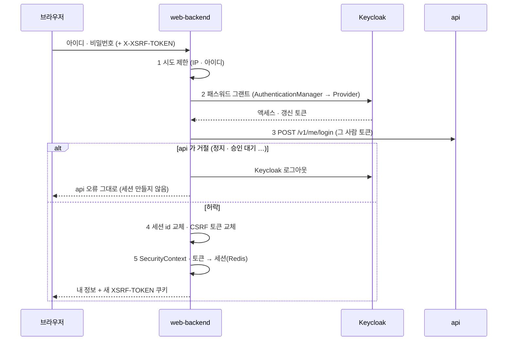

# moai-works 보안 · 인증 구조

| 항목 | 내용 |
|---|---|
| 무엇 | **지금 코드가 실제로 하는 일**: 인증(누구인가) · 인가(무엇을 할 수 있는가) · 세션 · 토큰 · MCP 키 · 비밀값 · 감사. 앞으로 만들 것은 "계획"이라고 따로 적는다 |
| 언제 읽나 | 로그인 · 세션 · 토큰 · 권한 · 접근 어노테이션 · MCP 키 · Keycloak 설정 · 비밀값 · HTTP 헤더를 바꾸거나, 새 REST 엔드포인트 · MCP 도구를 만들 때 |
| 설계 목표 | [워크스페이스·계정·권한](docs/design/03-workspace-identity.md)(세 층의 권한 · Keycloak 정본 · 기본 역할 넷) · [프로젝트 설계](docs/design/04-project.md)(프로젝트 층 · 독자 판정 · 프로젝트 역할) · [MCP 설계](docs/design/06-mcp.md)(MCP 키 · 워크스페이스 엔드포인트 · 판정 · 안전장치). 모두 moai-wiki 와 같은 구조이고, 위키 자리가 프로젝트 · 페이지 자리가 일감이다 |
| 기준일 | 2026-11-22 — 코드가 바뀌면 이 문서도 같은 작업에서 고친다 |

---

## 1. 원칙

1. **판정은 api 한 곳에서 한다.** web-backend(BFF) · 화면 · 바깥 AI Agent 는 권한을 판정하지 않는다. api 는 BFF 가 무엇을 확인했든 다시 판정한다(BFF 를 믿지 않는다).
2. **기본 거부.** REST 핸들러마다 접근 어노테이션이 정확히 하나 있어야 하고, 없으면 api 가 기동하지 않는다.
3. **신원의 정본은 Keycloak, 판정은 DB 사본으로 요청마다 한다.** 계정 정지 · 역할 변경은 토큰이 살아 있어도 다음 요청부터 바로 반영된다.
4. **토큰은 브라우저에 없다.** 브라우저는 HttpOnly 세션 쿠키만 가진다. 토큰은 web-backend 의 서버 세션(Redis)에만 있다.
5. **사용자 동작에는 그 사용자의 토큰을 싣는다.** 서비스 토큰으로 대신 부르지 않는다. 그래야 api 가 누가 했는지 알고 감사에 남긴다.
6. **사람과 AI Agent 는 같은 판정을 지난다.** MCP 도구는 REST 와 같은 서비스 · 같은 권한 판정을 부른다. 모델이 넘긴 인자(워크스페이스 · 프로젝트)도 키 주인의 권한으로 다시 판정한다. api 안에는 LLM 이 없다.
7. **비밀은 원문으로 두지 않는다.** 비밀번호는 Keycloak 에만, 인증 코드는 HMAC, 초대 토큰 · MCP 키는 SHA-256 만 저장한다. 비밀값은 git 제외 `.env` 에만 둔다.
8. **존재를 숨긴다.** 멤버가 아니면 404, 남의 MCP 키는 404, 인증 코드 재발송은 계정이 있든 없든 같은 응답. 프로젝트를 만들면 독자가 아닌 사람에게 그 프로젝트도 404 다(계획, §6.7).

## 2. 한눈에

```
                    세션 쿠키(HttpOnly) + XSRF-TOKEN                 사용자 JWT (Bearer)
  브라우저 ───────────────────────────────▶ web-backend (BFF) ──────────────────────────▶ moai-works-api
  (web-frontend)     /api/**                 │  Spring Security                          │  JWT 직접 검증(JWKS)
                                             │  Spring Session(Redis)                    │  접근 어노테이션 판정
                                             │ 패스워드 그랜트 · 갱신 · 로그아웃           │ 관리 API(서비스 계정)
                                             ▼                                           ▼
                                  Keycloak (MOAI-Keycloak, 렐름 moai-works) ◀──── 계정 · 조직 · 그룹 쓰기

  바깥 AI Agent (Claude Code 등) ──── MCP 키 (Bearer) ────▶ web-backend /mcp/** ─중계─▶ api /mcp/issue · /mcp/project   (§8.3)
                                                          (계획: 워크스페이스 엔드포인트, §8.3 — 키는 입구에 묶지 않는다)
```

| 호출자 | 들어가는 곳 | 자격 | 확인하는 곳 |
|---|---|---|---|
| 사람(브라우저) | web-backend `/api/**` | 세션 쿠키 `__Host-MOAI_WORKS_SESSION` + CSRF 헤더 | web-backend(로그인 여부) → api(권한) |
| web-backend | api `/moai-works-api/v1/**` | 그 사람의 Keycloak 액세스 토큰 | api `restChain` + `AccessInterceptor` |
| 바깥 AI Agent (MCP 클라이언트) | web-backend `/mcp/**` → api `/mcp/issue`(일감) · `/mcp/project`(프로젝트 관리) | MCP 키(하나로 두 입구 모두) | api `mcpChain`(`McpKeyAuthenticationFilter`) |
| 바깥 자동화 (나중 후보) | api `/moai-works-api/v1/**` | Keycloak 서비스 계정 JWT | api `@ServiceApi(clients=…)` — 지금은 등록한 클라이언트가 없다(§8.1) |
| api | Keycloak 관리 API | api 클라이언트의 서비스 계정 토큰 | Keycloak |

### 2.1 전송 구간 — 모든 서비스는 HTTPS

우리 서비스가 여는 포트는 모두 HTTPS 다(포트 · 인증서 만들기는 [DEVELOPE.md §5.2](DEVELOPE.md#52-포트--https)).

| 구간 | 전송 | 서버 인증서를 믿는 방법 |
|---|---|---|
| 브라우저 → web-backend(11002) · vite 개발 서버(11003) | HTTPS | 브라우저의 신뢰 목록. 로컬은 mkcert 인증 기관을 사람이 넣는다(`mkcert -install`) |
| web-backend → api(11001) | HTTPS | JVM 기본 인증 기관 + `MOAI_WORKS_TLS_CA`(`OutboundHttp`) |
| 시드 스크립트(`infra/dev-seed`) → api | HTTPS | 공인 인증 기관 + 로컬 인증 기관(`MOAI_WORKS_TLS_CA`, 기본 `infra/tls/certs/ca.pem`) |
| 바깥 AI Agent → web-backend `/mcp/**`(또는 api `/mcp/**` 직접) | HTTPS | 그 클라이언트의 신뢰 목록. 로컬에서 붙여 볼 때는 클라이언트가 mkcert 인증 기관을 믿게 한다(`infra/tls/certs/ca-bundle.pem`) |
| api · web-backend → Keycloak · PostgreSQL · Redis · MinIO | 로컬은 평문(다른 프로젝트와 같이 쓰는 컨테이너) | 운영에서는 TLS(§11) |

- **인증서 확인을 끄는 설정을 두지 않는다.** 믿을 인증 기관을 원래 목록에 더하기만 한다(`verify=False` · `trustAll` · `secure: false` 금지).
- 평문 HTTP 로 부르면 400 이다. 포트를 HTTP 와 같이 쓰지 않는다.
- 서버 열쇠(`infra/tls/certs/localhost-key.pem`)와 로컬 인증 기관의 열쇠(mkcert 폴더)는 git 에 넣지 않는다. 로컬 인증 기관을 신뢰 목록에 넣으면 그 열쇠로 만든 인증서를 이 PC 가 모두 믿으므로, 그 열쇠 파일을 밖으로 내보내지 않는다.
- TLS 를 앞단 프록시가 끝내는 배치에서만 `MOAI_WORKS_TLS_ENABLED=false` 로 끈다. 그때는 §11 의 프록시 항목을 함께 정한다.

## 3. Keycloak

Keycloak 26.8.2 은 다른 프로젝트와 같이 쓰는 컨테이너 `MOAI-Keycloak`(http://localhost:8180)이다. 컨테이너를 띄우는 정의는 moai-wiki 저장소의 `infra/keycloak/compose.yaml` 에 있고, moai-works 는 자기 렐름만 다룬다.

### 3.1 렐름 설정

렐름 `moai-works`. `infra/keycloak/init-realm.sh` 가 `realm-moai-works.json` 으로 처음 만들고(이미 있으면 정의에 새로 더한 항목만 부분 가져오기 — 있는 것은 건너뛴다), 끝에 `ensure-realm.py` 를 불러 아래 값을 맞춘다(멱등).

| 설정 | 값 | 이유 |
|---|---|---|
| `organizationsEnabled` | true | 워크스페이스 = 조직 |
| `registrationAllowed` | false | 가입은 자체 화면 → api 가 관리 API 로 만든다 |
| `resetPasswordAllowed` | false | Keycloak 화면을 쓰지 않는다. 비밀번호 찾기는 아직 없다 |
| `loginWithEmailAllowed` · `duplicateEmailsAllowed` | true · false | 이메일로 로그인, 이메일은 하나에 한 계정 |
| `passwordPolicy` | `length(8)` | 비밀번호 검사는 Keycloak 이 한다. api 는 오류를 `PASSWORD_POLICY` 로 바꿔 준다 |
| `bruteForceProtected` · `failureFactor` · `maxFailureWaitSeconds` · `permanentLockout` | true · 10 · 900 · false | 10번 틀리면 잠시 잠금(최대 15분). 잠기면 BFF 가 423 `ACCOUNT_LOCKED` |
| `revokeRefreshToken` | false | 여러 web-backend 가 같은 세션을 동시에 갱신해도 둘 다 유효해야 한다(§4.4) |
| 사용자 프로필 | firstName · lastName 필수 해제 | 없으면 패스워드 그랜트가 "Account is not fully set up" 으로 막힌다 |

토큰 수명은 렐름 기본값을 쓴다(따로 정하지 않았다). 처음 시스템 관리자 계정도 `ensure-realm.py` 가 없을 때만 만든다(비밀번호는 `infra/keycloak/.env` 에만).

### 3.2 클라이언트 — 이름 = 모듈 이름

모두 confidential(비밀값 있음), `fullScopeAllowed=false`, standard flow · implicit flow 끔.

| 클라이언트 | 켠 흐름 | 토큰 audience | 쓰임 |
|---|---|---|---|
| `moai-works-api` | 서비스 계정 | `moai-works-api` | api 가 받는 모든 토큰의 audience. 서비스 계정에 `realm-management` 역할(`manage-users` · `manage-realm` · `view-users` · `view-realm` · `query-users` · `query-groups` · `view-clients` · `query-clients`)과 `kc-admin-api` scope — 계정 · 조직 · 그룹 쓰기. **권한 코드가 이 클라이언트의 클라이언트 역할**이다(지금 16개, WBS 2.1 에서 25개로) |
| `moai-works-web-backend` | 패스워드 그랜트(direct access grants)만 | `moai-works-api` · `moai-works-web-backend` | 사람 로그인 · 갱신 · 로그아웃. 서비스 계정 없음 |

- 워커 모듈이 없으므로 다른 클라이언트는 없다. 바깥 자동화용 서비스 계정 클라이언트는 나중 후보다(§8.1).
- Keycloak 26.8 은 introspection 을 부르는 클라이언트가 토큰 `aud` 에 있어야 한다. 그래서 web-backend 는 자기 자신도 audience 에 넣는다(`audience moai-works-web-backend` 매퍼).
- 부분 가져오기(partial import)로 클라이언트만 더하면 서비스 계정 사용자가 생기지 않는다. 렐름 JSON 의 `users` 에 `service-account-<클라이언트>` 를 적어 둔다.
- 클라이언트 비밀값은 `init-realm.sh` 가 Keycloak 에서 읽어 `infra/keycloak/.env` 에 쓴다. 각 모듈의 `.env` 는 거기서 값을 옮긴다.

### 3.3 역할의 세 층

| 층 | Keycloak 에서 | api 에서 | 예 |
|---|---|---|---|
| 플랫폼 | 렐름 역할 | `PlatformRole` · `@PlatformApi(role=…)` | `system-admin`(가입 정책 · 계정 승인 · 정지 · 팀 워크스페이스 허용 수 — **시스템만 관리한다**: 워크스페이스가 없고 만들거나 들어갈 수 없다(`@UserApi` 입구는 시스템 관리자를 기본으로 막는다(403 `SYSTEM_ADMIN_NOT_ALLOWED`, 내 정보 · 로그인 기록 · 이름 바꾸기만 `@UserApi(systemAdmin = true)`), 워크스페이스 · 프로젝트 입구는 멤버로 보지 않는다(404 `WORKSPACE_NOT_FOUND`), 팀 워크스페이스 허용 수를 주면 409 `SYSTEM_ADMIN_ACCOUNT`, MCP 키 발급 403), 그래서 워크스페이스 내용도 못 본다. 로그인하면 시스템 관리 화면으로 간다) · `security-officer`(역할만 있고 쓰는 API 는 아직 없다) |
| 워크스페이스 | 조직 = 워크스페이스, 조직 그룹 `/roles/<key>` = 역할, 그룹에 매핑한 `moai-works-api` 클라이언트 역할 = 권한 코드 | `role_permission` 표(사본) · `@WorkspaceApi(권한)` | 기본 역할(지금 코드 3개 `owner` · `admin` · `member` — moai-wiki 와 같은 4개로 `curator` 를 되살리는 중, §6.4) + 사용자 정의 역할 |
| 프로젝트 **(계획)** | 조직 그룹 `/projects/<프로젝트 id>/<역할 키>` = 프로젝트 역할. 역할이 고정이라 그룹에 클라이언트 역할을 매핑하지 않는다(코드는 api 의 `ProjectRole` 이 갖는다) | `project_role_binding`(사본) · `@ProjectApi(권한)` | `project-admin` ⊃ `project-curator` ⊃ `project-editor` ⊃ `project-reader` — §6.7 · [프로젝트 설계](docs/design/04-project.md) |

- 권한 코드 카탈로그는 `infra/keycloak/permission-catalog.json`(Keycloak 쪽)과 api 의 `Permission` enum 두 곳에 있다. `PermissionCatalogSync` 가 기동 때 DB 카탈로그를 enum 에 맞추고(빠진 코드는 `retired`), Keycloak 에 없는 코드가 있으면 오류 로그를 남긴다(기동은 계속). 코드를 더하면 둘 다 고친다.
- 토큰(`scope=organization`)에는 조직 별칭만 들어 있고 그룹 · 역할은 없다(26.8 실측). 그래서 워크스페이스 권한은 토큰이 아니라 DB 사본으로 판정한다. 프로젝트 층도 같은 방식으로 판정한다(계획).

## 4. 사람 로그인 — web-backend (BFF)

Spring Boot 4.2.0 · Spring Security 7.2.0 · Spring Session 4.2.0(Redis). 코드: `src/moai-works-web-backend/src/main/java/com/moai/works/web/`.

### 4.1 로그인 순서 (`POST /api/auth/sign-in`)



1. **시도 제한** — `SignInRateLimiter`: IP 분당 20번, 아이디 15분에 10번(`moai-works-web.sign-in.*`). 넘으면 429 `RATE_LIMITED`.
2. **인증** — `AuthenticationManager`(`ProviderManager`) → `KeycloakPasswordAuthenticationProvider` 가 패스워드 그랜트를 부른다. 액세스 토큰의 `sub` · `preferred_username` 으로 `KeycloakAuthentication`(principal `SessionUser(id, username)`, 권한 없음)를 만든다. 받은 토큰은 이 객체의 transient 필드에만 잠깐 둔다(세션 직렬화에 섞이지 않는다).
   - Keycloak 오류 → `INVALID_CREDENTIALS`(401) · `ACCOUNT_NOT_ACTIVE`(403, 사용자 꺼짐) · `ACCOUNT_SETUP_REQUIRED`(403) · `ACCOUNT_LOCKED`(423) · `IDENTITY_PROVIDER_ERROR`(502, 응답이 이상함) · `IDENTITY_PROVIDER_UNAVAILABLE`(503, 연결 안 됨).
3. **api 확인** — `POST /v1/me/login`. 로그인할 수 있는 계정인지는 api 가 정한다(DB 상태). 거절하면 Keycloak 세션을 바로 끝내고 세션을 만들지 않는다. 허락하면 api 가 로그인을 기록하고 개인 워크스페이스를 보장한다.
4. **세션 고정 방지** — `CompositeSessionAuthenticationStrategy` = `ChangeSessionIdAuthenticationStrategy` + `CsrfAuthenticationStrategy`. 로그인 전 세션 id 와 CSRF 토큰을 버린다.
5. **저장** — `SecurityContext` 를 `DelegatingSecurityContextRepository`(요청 속성 + `HttpSession`)에 저장, 토큰(`TokenSet`)은 세션 속성 `SessionTokens.tokens` 에 둔다. 응답에 바뀐 CSRF 쿠키를 싣는다.
6. **실패한 로그인 · 익명 요청은 세션을 만들지 않는다**(요청 캐시 끔). Redis 에 빈 세션이 쌓이지 않는다.

### 4.2 세션

| 항목 | 값 |
|---|---|
| 저장소 | Spring Session Redis — 키 `moai-works:web-backend:session:sessions:<세션 id>`. 여러 web-backend 가 같은 세션을 본다 |
| 수명 | 8시간(`server.servlet.session.timeout`) — Redis 키 TTL 도 같다 |
| 저장 방식 | `flush-mode: on-save` · `save-mode: on-set-attribute` · JDK 직렬화 |
| 들어 있는 것 | `SPRING_SECURITY_CONTEXT`(principal = id · username 뿐) · 토큰 묶음. **비밀번호는 없다** |
| 쿠키 | `__Host-MOAI_WORKS_SESSION` — **Secure** · HttpOnly · SameSite=Lax · Path=/ · Domain 없음. 값은 세션 id 의 base64. `__Host-` 접두사라 브라우저가 이 조건이 아니면 받지 않는다 → 평문 HTTP 나 다른 호스트가 세션 쿠키를 덮어쓸 수 없다. 로컬도 같다. TLS 를 끈 배치에서만 `MOAI_WORKS_SESSION_COOKIE` · `MOAI_WORKS_SESSION_SECURE` 로 바꾼다 |
| Redis 설정 | `spring.data.redis.*` ← `MOAI_WORKS_REDIS_HOST/PORT/PASSWORD/DATABASE`. 로컬은 같이 쓰는 `MOAI-Redis` 이고 키는 `moai-works:` 아래에만 둔다. Boot 4 의 세션 설정 이름은 `spring.session.data.redis.*`(옛 `spring.session.redis.*` 는 읽히지 않는다) |

### 4.3 CSRF

- `csrf.spa()` + 공유 `CookieCsrfTokenRepository.withHttpOnlyFalse()` — 쿠키 `XSRF-TOKEN`(화면이 읽을 수 있어야 하므로 HttpOnly 아님, SameSite=Lax) → 요청 헤더 `X-XSRF-TOKEN`.
- `CsrfCookieFilter` 가 토큰을 미리 꺼내 쿠키가 항상 나가게 한다. 로그인 · 로그아웃 때 토큰을 바꾼다.
- 상태를 바꾸는 요청(POST · PUT · PATCH · DELETE)은 로그인 · 가입 · 로그아웃을 포함해 모두 CSRF 를 확인한다. 실패하면 403 `CSRF_INVALID`.
- 화면과 BFF 가 같은 출처라 CORS 를 열지 않는다.

### 4.4 토큰 갱신

- 요청마다 `SessionTokens.validAccessToken` 이 만료 30초 전이면 갱신 토큰으로 새로 받는다.
- 세션 잠금은 없다. 여러 요청(다른 인스턴스 포함)이 동시에 갱신해도 렐름 `revokeRefreshToken=false` 라 둘 다 유효하다. 마지막에 저장한 토큰이 남는다.
- 갱신이 안 되면(갱신 토큰 만료 · Keycloak 세션 종료) 그 자리에서 로그아웃시키고 401.

### 4.5 로그아웃

| 언제 | 무엇이 |
|---|---|
| 사람이 로그아웃 (`POST /api/auth/sign-out`, CSRF 필요) | Spring Security 로그아웃 — `SessionTokens.endKeycloakSession`(Keycloak 로그아웃 → 갱신 토큰 무효) → `SecurityContextLogoutHandler`(세션 무효 · 문맥 지움) → 새 CSRF 토큰 + 204. 로그인 안 한 상태로 불러도 204 |
| 토큰 갱신 실패 · 세션의 토큰 없음 | `SessionTokens.signOutLocally` — 같은 처리 후 401 `UNAUTHENTICATED` |
| api 가 401 · 403 을 돌려줌 (`GET /api/auth/session`) | 토큰이 거절됐거나 계정이 더는 활성이 아니다 → `signOutLocally` |
| 세션 만료(8시간) · Redis 키 삭제 | 다음 요청이 401 → 화면이 로그인으로 보낸다(§9) |

### 4.6 인가 규칙 (web-backend)

web-backend 는 **로그인했는지만** 본다. 무엇을 할 수 있는지는 api 가 정한다.

| 경로 | 규칙 |
|---|---|
| `POST /api/auth/sign-in` · `/api/v1/signup` · `/api/v1/signup/**` | 누구나 |
| `POST /api/auth/sign-out` | 로그아웃 필터가 처리 |
| 그 밖 `/api/**` | 로그인 필요 — 아니면 401 `UNAUTHENTICATED` |
| `/actuator/health/**` · `/actuator/info` | 누구나 |
| 그 밖 `/actuator/**` | 모두 거부 |
| 나머지 | 화면 정적 파일(파일이 없는 화면 주소는 `index.html`, 단 `/api/**` · `/actuator/**` 는 404) |

- 거부 응답은 problem+json: CSRF 실패 403 `CSRF_INVALID`, 그 밖 403 `FORBIDDEN`. form login · HTTP Basic 은 끈다.

### 4.7 api 로 전달 (`/api/v1/**` → `/moai-works-api/v1/**`)

`ApiRelay` — 경로 표 없이 1:1 로 넘긴다.

- **토큰** — 가입(`/api/v1/signup/**`)만 토큰 없이, 나머지는 세션에 있는 그 사람의 액세스 토큰을 `Authorization: Bearer` 로 싣는다. 토큰이 없으면 로그아웃시키고 401.
- **요청 헤더는 허용 목록만** — `Accept` · `Accept-Language` · `Content-Type` · `If-Match` · `If-None-Match` · `Range` · `X-Correlation-Id` · `User-Agent`(2026-11-22 더함 — api 가 감사에 브라우저 정보로 남긴다. 판정에는 쓰지 않는다). 브라우저의 `Cookie` · `Authorization` · `X-Forwarded-*` · 신원 헤더는 버린다.
- **`X-Forwarded-For` 는 BFF 가 정한다**(브라우저 값 무시, 지금은 `request.getRemoteAddr()`). api 는 감사 기록과 공개 경로 속도 제한에만 쓰고 권한 판정에는 쓰지 않는다. **api 는 믿는 중계(`moai-works.security.trusted-proxies`, 기본 루프백)에서 온 요청의 `X-Forwarded-For` 만 쓰고**(맨 오른쪽 값), 직접 붙은 요청은 접속 주소를 쓴다 — 클라이언트가 헤더로 IP 를 꾸미지 못한다(`ClientIp`, 2026-11-22).
- **응답 헤더도 허용 목록만** — `Content-Type` · `Content-Disposition` · `Cache-Control` · `ETag` · `Last-Modified` · `Retry-After` · `X-Correlation-Id`. 응답 본문에 토큰이 없다.
- **파일 올리기(multipart)는 풀지 않는다** — `spring.servlet.multipart.enabled: false`. BFF 는 본문을 담아 두지 않고 그대로 흘려보내고, 크기 상한 · 파일 이름 · 권한은 api 가 본다. CSRF 는 헤더(`X-XSRF-TOKEN`)로 확인하므로 본문을 읽지 않는다. 지금은 올리는 화면이 없고, 첨부(계획)부터 쓴다.
- api 에 닿지 못하면 502 `API_UNAVAILABLE`.

### 4.8 응답 보안 헤더

| 헤더 | 값 |
|---|---|
| `Content-Security-Policy` | `default-src 'self'; script-src 'self'; style-src 'self' 'unsafe-inline'; img-src 'self' data: blob:; font-src 'self' data:; connect-src 'self'; object-src 'none'; base-uri 'self'; form-action 'self'; frame-ancestors 'none'` — 인라인 스타일만 MUI 때문에 허용 |
| `X-Frame-Options` | `DENY` |
| `Referrer-Policy` | `strict-origin-when-cross-origin` — 초대 링크의 토큰이 다른 사이트로 새지 않게 |
| `Strict-Transport-Security` | HTTPS 요청이고 호스트가 이 PC(`localhost` · `*.localhost` · 루프백 주소)가 **아닐 때만** 보낸다(1년 · 하위 도메인 포함, `HstsRule` — api 도 같다). HSTS 는 포트가 아니라 호스트 이름에 걸려서, `localhost` 에 걸리면 이 PC 의 다른 HTTP 서비스가 브라우저에서 열리지 않는다 |
| `XSRF-TOKEN` 쿠키 | Secure(HTTPS 요청이면 자동). 화면이 읽어야 해서 HttpOnly 는 아니다(§4.3) |
| 그 밖 | Spring Security 기본(`X-Content-Type-Options: nosniff`, 캐시 금지 등) |

## 5. api 의 인증 — 누구인가

Spring Boot 4.2.0 · Spring Security 7.2.0(OAuth2 리소스 서버). 코드: `src/moai-works-api/src/main/java/com/moai/works/api/security/`. 필터 체인 둘(`SecurityConfiguration`), 모두 세션 없음(stateless).

### 5.1 REST — Keycloak JWT 직접 검증 (`restChain`, `/moai-works-api/**`)

- `NimbusJwtDecoder` 가 렐름 JWKS 로 **서명**을 확인하고, **만료 · 발급자(`iss`) · audience(`aud` 에 `moai-works-api`)** 를 본다(`SecurityConfiguration.tokenValidator`). 요청마다 Keycloak 에 묻지 않는다(introspection 은 쓰지 않는다).
- 발급자는 Keycloak `KC_HOSTNAME` 과 같은 주소여야 한다 — 로컬은 `http://localhost:8180/realms/moai-works`(`127.0.0.1` 이 아니라).
- 토큰 → `KeycloakPrincipal(subject, username, clientId(azp), 렐름 역할, email, name, serviceAccount)`. `preferred_username` 이 `service-account-` 로 시작하면 서비스 계정이다. 계정은 `sub` 로 잇는다(username 은 바뀔 수 있다).
- 공개: `/actuator/health/**` · `/error` · `/moai-works-api/v1/signup/**`. 나머지는 유효한 토큰이 있어야 한다(401 `UNAUTHORIZED`).
- CSRF 끔 — 쿠키를 쓰지 않는 Bearer 전용 API 다. CSRF 는 BFF 가 막는다.
- 기본 사용자(`UserDetailsServiceAutoConfiguration`)는 만들지 않는다.

### 5.2 MCP — MCP 키 (`mcpChain`, `/mcp/**`)

| 항목 | 값 |
|---|---|
| 입구 | 기능별 고정 입구 둘(2026-11-23 사용자 결정 — [ADR-028](docs/design/00-key-decisions.md#adr-028)): 일감 `/mcp/issue`(`moai-works.mcp.issue-endpoint`, `McpEndpoint.ISSUE`, 도구 15개) · 프로젝트 관리 `/mcp/project`(`moai-works.mcp.project-endpoint`, `McpEndpoint.PROJECT`, `list_projects` · 일감 템플릿 관리 셋 — 고치기는 `workspace.settings.manage` · `project.manage`). Streamable HTTP. 도구마다 REST 핸들러와 같은 권한 코드를 다시 본다([MCP 설계 §8 도구](docs/design/06-mcp.md#mc-tools)). 그 밖의 `/mcp/**`(첨부 티켓 `/mcp/files/**` 빼고)는 키를 보기 전에 404 `MCP_ENDPOINT_NOT_FOUND`. 바깥 클라이언트의 연결 주소는 web-backend `https://<web-backend>/mcp/issue` · `…/mcp/project`(§8.3 중계) |
| 모양 | `mai-wks-` + 32바이트 난수(base64url 43자, `McpKeyTokenCodec`) — 앞부분 `mai-wks-` 는 moai-works 의 MCP 키라는 표시(2026-11-22 사용자 결정). 서명 비밀값 없음 |
| 저장 | 원문의 SHA-256 만(`mcp_api_key.key_hash`). 원문은 발급 응답에 한 번만 나온다. 화면 표시는 앞 12자 |
| 묶음 | **키 하나 = 워크스페이스 하나 · 주인 계정 하나**(2026-11-22, V5). 주인 = 발급한 사람이고 그 사람의 권한 안에서만 닿는다. 사람 계정만 받는다 — 서비스 계정 403 `USER_ONLY`, 시스템 관리자 계정은 워크스페이스가 없어 404 · `/me/mcp-keys` 403. **키는 입구에 묶이지 않는다**(2026-11-23 사용자: "키는 권한만 있으면 어떤 mcp 엔드포인트든 연결 가능해야 해" — V11 이 `endpoint` 열을 지움) — 같은 키로 어느 입구에든 붙고, 할 수 있는 일은 도구마다 주인의 지금 권한으로 판정한다. `McpKeyPrincipal.endpoint` 는 호출이 들어온 입구를 적을 뿐이다 |
| 기간 | 기본 90일, 최대 365일(`moai-works.mcp.key-default-days` · `key-max-days`) |
| 종류 | 없다 — 모든 키는 주인 계정의 권한 안에서만 일한다(2026-11-22 사용자 결정, §8.3). V5 에서 종류 열을 없앴다 |
| 검사 | **모든 HTTP 요청마다, 캐시 없이** — (경로가 입구인가 — 아니면 404) → 모양 → 해시로 행 찾기 → 기간 → 워크스페이스 활성 → 주인 계정 활성 · 그 워크스페이스의 활성 멤버(시스템 관리자 아님). MCP 세션을 열었다고 다음 요청을 건너뛰지 않는다. 만료가 다음 요청에 바로 반영된다 |
| 실패 | 404 `MCP_ENDPOINT_NOT_FOUND`(입구가 아닌 경로) / 401 `MCP_KEY_REQUIRED` · `MCP_KEY_INVALID` · `MCP_KEY_EXPIRED` / 403 `MCP_WORKSPACE_INACTIVE` · `MCP_PRINCIPAL_INACTIVE`. `MCP_KEY_ENDPOINT_DENIED` 는 2026-11-23 없앴다 |
| 문맥 | 통과하면 `McpKeyPrincipal` 을 요청 속성에 두고, `McpCallContext.extract` 가 MCP 전송 문맥으로 도구까지 옮긴다. 범위는 모델이 넘긴 인자가 아니라 이 문맥으로 정한다. 마지막 사용 시각은 1분 간격으로만 쓴다 |
| 발급 · 관리 API | `POST /v1/workspaces/{ws}/mcp-keys` `{name, days}` — `@WorkspaceApi(mcp.key.issue.personal)`, 원문은 응답에 한 번. `GET /v1/workspaces/{ws}/mcp-keys?status=&owner=` — `@WorkspaceApi(workspace.read)`, `mcp.key.manage`(소유자 · 관리자)면 워크스페이스의 모든 키(만료된 것까지 발급 이력, 발급 IP · User-Agent 포함), 아니면 내 키만. `POST …/{id}/expire` `{note}` — 내 키 ∨ `mcp.key.manage`, 아니면 403 `PERMISSION_REQUIRED`, 이미 만료면 409. `GET /v1/me/mcp-keys` — `@UserApi`, 모든 워크스페이스의 내 키(개인 설정 화면) |
| 지우지 않는다 | 지우는 API 가 없고, DB 트리거가 지우기 · 발급 정보(이름 · 해시 · 주인 · 워크스페이스 · 발급 IP …) 변경 · 기간 늘리기 · 이미 만료시킨 키 다시 쓰기를 막는다. 만료시키기 = `expires_at` 을 지금으로 + 누가(`expired_by`) · 왜(`MANUAL` · `MEMBER_LEFT` · `ENDPOINT_DELETED`) · 메모. 주인이 워크스페이스를 떠나거나 내보내지면 그 워크스페이스의 키를 `MEMBER_LEFT` 로 만료시킨다 |
| 감사 | `mcp.key.issue` · `mcp.key.expire` 를 IP · User-Agent · 키 앞부분 · 주인과 함께. 감사 화면은 사람(`person` — 그 사람이 한 일 · 대상인 일 · 그 사람 키에 일어난 일) · 행동 묶음(`action=mcp.key`) · 대상 종류 · 기간으로 거른다(`audit.read`) |

## 6. api 의 인가 — 무엇을 할 수 있는가

### 6.1 접근 어노테이션 (엔드포인트마다 정확히 하나)

| 어노테이션 | 누가 | 실패 |
|---|---|---|
| `@PublicApi` | 누구나 — `/v1/signup/**` 안에서만 | — |
| `@AuthenticatedApi` | 유효한 토큰(사람 · 서비스) | 401 |
| `@UserApi` | 활성 사람 계정 | 403 `USER_ONLY`(서비스 계정) · `ACCOUNT_NOT_ACTIVE` |
| `@ServiceApi(clients=…)` | 지정한 클라이언트의 서비스 계정(`azp` 일치). 어노테이션은 있지만 지금 쓰는 엔드포인트는 없다 | 403 `SERVICE_ONLY` |
| `@PlatformApi(role=…)` | 그 렐름 역할을 가진 활성 사람 계정 | 403 `PLATFORM_ROLE_REQUIRED` |
| `@WorkspaceApi(권한)` | 경로 `{workspace}` 의 활성 멤버 + 그 권한 | 비멤버 **404** `WORKSPACE_NOT_FOUND`(존재를 숨김) · 권한 없음 **403** `PERMISSION_REQUIRED` |
| `@ProjectApi(권한)` **(계획)** | 경로 `{workspace}` · `{project}` 의 프로젝트 독자 + 그 권한(워크스페이스 역할 ∪ 프로젝트 역할). 일감 경로(`…/projects/{project}/issues/{number}`)도 이것 하나로 판정한다 | 독자가 아님 · 없는 프로젝트 · 보관된 프로젝트(관리 권한 없음) **404** `PROJECT_NOT_FOUND`(셋을 구별할 수 없다) · 권한 없음 **403** `PERMISSION_REQUIRED` · 없는 일감 **404** `ISSUE_NOT_FOUND` — §6.7 |

- **판정은 `AccessInterceptor` 한 곳.** 결과(`CurrentUser` · `WorkspaceContext`)는 요청 속성에 두고 컨트롤러는 인자로 받는다(`AccessArgumentResolver`). 컨트롤러 · 서비스에서 권한을 다시 계산하지 않는다 — 권한 상승 방지처럼 "대상"에 따라 달라지는 규칙만 서비스가 더 본다(§6.5).
- **기동 검사 `AccessContractVerifier`** — `/moai-works-api/**` 핸들러마다 어노테이션이 0개 · 2개 이상이거나, `@PublicApi` 가 `/v1/signup` 밖이거나, `@WorkspaceApi` 경로에 `{workspace}` 가 없으면 **기동하지 않는다.** 혹시 지나쳐도 인터셉터가 403 `ACCESS_RULE_MISSING`. `@ProjectApi` 를 만들면 같은 검사(경로에 `{workspace}` · `{project}`)를 더한다(계획).
- 메서드에 붙은 것이 클래스에 붙은 것보다 먼저다.

### 6.2 계정 상태

```
PENDING_VERIFICATION ─▶ PENDING_APPROVAL ─▶ ACTIVE ⇄ SUSPENDED
          │                    │              │          │
          └──────▶ ACTIVE      └─▶ REJECTED   └──────────┴─▶ DELETED
```

- `ACTIVE` 가 아니면 Keycloak 사용자도 `enabled=false` 다(로그인 자체가 막힌다).
- `AccountService.requireActiveUser` 가 **요청마다 DB 상태**를 본다 — 정지는 토큰이 살아 있어도 다음 요청부터 403.
- 같은 자리에서 토큰의 렐름 역할로 플랫폼 역할 사본을 맞춘다.
- Keycloak 에서 직접 만든 계정(시스템 관리자 · 설치 스크립트)은 처음 api 를 부를 때 사본을 만든다(`origin=KEYCLOAK`, 감사 `account.link`). 이메일이 없으면 403 `ACCOUNT_EMAIL_REQUIRED`.
- 시스템 관리자는 자기 계정을 정지할 수 없다(`SELF_SUSPEND`).
- 시스템 관리자 계정은 워크스페이스 영역과 나뉜다(2026-11-22 사용자 결정, [ADR-023](docs/design/00-key-decisions.md#adr-023)): 개인 워크스페이스가 생기지 않고, 팀 워크스페이스를 만들 수 없고(허용 수를 받아도), 가입 신청 · 초대 수락도 403 `SYSTEM_ADMIN_NOT_ALLOWED`. 계획: 팀 워크스페이스 사용 중지 · 다시 사용, 사용 중지한 뒤에만 삭제.

### 6.3 워크스페이스 권한

```
권한(사람, 워크스페이스) = ⋃ 그 사람의 역할들의 권한 코드
  (멤버가 아니거나 · 멤버십이 정지됐거나 · 워크스페이스가 활성이 아니면 ∅ → 404)
```

- `WorkspaceAccessService` 가 DB 사본(`workspace_member` · `member_role` · `role_permission`)으로 요청마다 한 번 계산한다(인덱스 조회 3번). 캐시가 필요해지면 (사람, 워크스페이스, 권한 버전) 키로 둔다.
- 화면에 주는 `myPermissions` 도 이 값이다. 화면은 이것으로 숨기기만 한다.
- 시스템 관리자도 멤버가 아니면 404 다(플랫폼 역할은 워크스페이스 내용을 열지 않는다).
- 프로젝트 안의 권한은 이 위에 한 층 더 얹는다(계획, §6.7).

### 6.4 기본 역할 (고치거나 지울 수 없다)

| 역할 | 권한 |
|---|---|
| `owner` 소유자 | 모든 권한 코드. 항상 1명 이상 |
| `admin` 관리자 | 소유자 전용(`workspace.ownership.transfer` · `workspace.delete`)을 뺀 전부 |
| `curator` 큐레이터 **(되살리는 중 — WBS 2.1)** | `workspace.read` · `member.read` · `issue.read` · `issue.create` · `issue.edit` · `issue.comment` · `issue.manager.assign` · `mcp.key.issue.personal`. 모든 프로젝트에서 일감을 만들고 고친다(일감 삭제 · 프로젝트 관리는 못 한다) |
| `member` 멤버 | 지금 코드: `workspace.read` · `member.read` · `mcp.key.issue.personal`. 새 코드와 함께 `issue.read` · `issue.comment` 를 더한다(읽고 댓글). 그 프로젝트에서 일감을 만들려면 프로젝트 역할(편집자 이상)을 받는다(계획) |

지금 카탈로그의 권한 코드는 16개다(`Permission`): `workspace.read` · `workspace.settings.manage` · `workspace.ownership.transfer`(소유자 전용) · `workspace.delete`(소유자 전용) · `member.read` · `member.invite` · `member.request.review` · `member.remove` · `member.role.assign` · `role.manage` · `mcp.endpoint.manage` · `mcp.key.issue.personal` · `mcp.key.issue.service` · `mcp.key.manage` · `audit.read` · `usage.read`. `mcp.key.issue.service` 는 쓰지 않는다 — 서비스 키를 없앴다(2026-11-22). MCP 단계에서 moai-wiki 와 함께 카탈로그에서 뺀다. WBS 2.1 에서 프로젝트 · 일감 코드 9개를 더해 25개로 맞춘다(moai-wiki 의 위키 · 페이지 코드 자리): `project.create` · `project.manage` · `project.delete` · `issue.read` · `issue.create` · `issue.edit` · `issue.comment` · `issue.manager.assign` · `issue.delete`([워크스페이스·계정·권한 설계](docs/design/03-workspace-identity.md)).

사용자 정의 역할은 키 `custom-<고유 id>`, `role.manage` 권한으로 만든다. 전체 카탈로그와 설명은 [워크스페이스·계정·권한 설계](docs/design/03-workspace-identity.md).

**카탈로그가 바뀌면**(코드 추가 · 이름 바꾸기 · 기본 역할의 권한 변경) api 가 기동할 때 `PermissionCatalogMigrator` 가 이미 있는 워크스페이스의 역할을 맞춘다: 기본 역할은 새 정의대로, 사용자 정의 역할은 없어진 코드를 뺀다. Keycloak 조직 그룹의 매핑을 먼저 고치고 사본을 고친다. 카탈로그 지문을 `platform_setting`(`permission.catalog.applied`)에 두고 달라졌을 때만 돈다. Keycloak 에 새 코드가 없으면(설치 스크립트를 안 돌림) 하지 않고 오류를 남긴다.

### 6.5 권한 상승 방지

| 규칙 | 어디서 | 오류 |
|---|---|---|
| 자기에게 없는 권한이 든 역할은 주거나 뺄 수 없다 | `MembershipService` | 403 `ESCALATION_DENIED` |
| 소유자 역할은 소유자(`workspace.ownership.transfer` 보유)만 주고 뺀다 | `MembershipService` | 403 `OWNER_ONLY` |
| 소유자인 멤버는 소유자만 바꿀 수 있다 | `MembershipService` | 403 `OWNER_PROTECTED` |
| 마지막 소유자는 소유자 역할을 빼거나, 나가거나, 내보낼 수 없다 | `MembershipService` | 409 `LAST_OWNER` |
| 역할에는 내가 가진 권한만 넣고 뺄 수 있다 | `RoleService` | 403 `ESCALATION_DENIED` |
| 소유자 전용 권한은 사용자 정의 역할에 넣을 수 없다 | `RoleService` | 400 `OWNER_ONLY_PERMISSION` |
| 기본 역할은 바꾸거나 지울 수 없다 | `RoleService` | 403 `BUILTIN_ROLE` |
| 쓰는 멤버가 있거나 기본 역할로 지정된 역할은 지울 수 없다 | `RoleService` | 409 `ROLE_IN_USE` · `ROLE_IS_DEFAULT` |
| 자기 자신은 내보내기 대신 "나가기", 개인 워크스페이스는 나갈 수 없다 | `MembershipService` | 400 `USE_LEAVE` · `PERSONAL_WORKSPACE` |
| 초대 · 가입 신청 승인도 내가 줄 수 없는 역할로는 못 한다 | `InvitationService` · `JoinRequestService` → `MembershipService.requireCanGrant` | 403 `ESCALATION_DENIED` · `OWNER_ONLY` |

화면(`features/workspace/role-rules.ts`)이 같은 규칙으로 못 하는 항목을 꺼 두고 이유를 보이지만, 판정은 위 서비스가 한다. 프로젝트 역할을 주고 뺄 때도 같은 원칙(가진 것 안에서만 — 자기 권한 밖의 프로젝트 역할은 못 준다)을 쓴다(계획).

### 6.6 Keycloak 에 쓰는 순서

계정 · 멤버십 · 역할의 정본은 Keycloak 이다. api 는 **Keycloak 에 먼저 쓰고** → 단계마다 `keycloak_operation` 에 남긴 뒤(`KeycloakOperationLog`, 멱등 키, 별도 트랜잭션 `REQUIRES_NEW`) → DB 사본을 고친다.

- 같은 멱등 키가 이미 끝났으면 Keycloak 을 다시 부르지 않는다. 실패하면 `FAILED` 로 남기고, 다음 시도가 이어서 한다.
- 워크스페이스 만들기는 `WorkspaceProvisioner` 사가 — 끊기면 `PROVISIONING` 상태로 남고 다음 요청(로그인 포함)이 이어서 끝낸다.
- 기록의 payload 에 비밀값을 넣지 않는다.
- 가입 때 DB 저장이 실패하면 만든 Keycloak 사용자를 지운다(보상).
- api 의 관리 API 토큰(client_credentials)은 만료 전까지 메모리에 두고 401 이면 한 번 새로 받는다.
- 프로젝트 역할(조직 그룹 `/projects/…`)도 같은 순서로 쓴다(계획). 그룹은 처음 역할을 줄 때 만들고, 그룹에 클라이언트 역할은 매핑하지 않는다.

### 6.7 프로젝트 권한 (계획)

프로젝트를 만들 때 들어갈 판정이다. 지금 코드에는 프로젝트 · 일감이 없다. moai-wiki 의 위키 판정(`WikiAccessService`)과 같은 식이고, 정본은 [프로젝트 설계](docs/design/04-project.md) · [일감 설계](docs/design/05-issue.md)다. 여기에는 보안에 닿는 줄기만 적는다.

```
독자인가(사람, 프로젝트)   = 워크스페이스 활성 멤버
                          ∧ (공개 범위 = WORKSPACE ∨ 역할 key owner · admin ∨ 그 프로젝트의 프로젝트 역할을 가짐)
프로젝트 권한(사람, 프로젝트) = 워크스페이스 역할의 권한 ∪ 그 프로젝트의 프로젝트 역할의 권한
보이는가(사람, 프로젝트)   = 독자인가 ∧ (상태 ACTIVE ∨ project.manage ∨ project.delete)
작업 허용(사람, 프로젝트, 코드) = 보이는가 ∧ 코드 ∈ 프로젝트 권한
```

- **권한 경계는 프로젝트다.** 공개 범위 `WORKSPACE`(워크스페이스 활성 멤버 전원이 독자) · `RESTRICTED`(프로젝트 역할을 받은 멤버 + 소유자 · 관리자만). 보이지 않으면 목록에도 없고, 직접 열어도 없는 프로젝트와 같은 404 `PROJECT_NOT_FOUND` 다. 보이는데 코드가 없으면 403 `PERMISSION_REQUIRED`.
- 판정은 api 한 곳(`@ProjectApi` — 일감 경로도 포함), 매 요청 DB 사본으로 한다(토큰의 역할로 판정하지 않는다). 역할을 주고 빼면 다음 요청부터 반영된다.
- 프로젝트 역할 4개(고정): `project-reader`(일감 보기 · 댓글) ⊂ `project-editor`(+ 만들기 · 고치기) ⊂ `project-curator`(+ 관리자 바꾸기) ⊂ `project-admin`(+ 일감 지우기 · 그 프로젝트의 설정과 역할 관리 — `project.manage`). 한 사람이 여럿 가지면 합친다. 정본은 Keycloak 조직 그룹, api DB 는 사본(`project_role_binding`).
- 역할을 주고 빼는 사람은 그 프로젝트에 `project.manage` 가 있는 사람(워크스페이스 소유자 · 관리자, 또는 그 프로젝트의 `project-admin`)이다. 자기 권한 밖의 역할은 못 준다(§6.5).
- **일감** — 관리자 · 담당자는 그 프로젝트의 독자인 활성 멤버만 정할 수 있다. 관리자를 바꾸려면 `issue.edit` 에 더해 `issue.manager.assign` 이 있어야 한다. 상위 · 연결 일감은 같은 프로젝트 안만이라 다른 프로젝트의 일감이 섞여 보이지 않는다. 동시 수정은 `rowVersion` 으로 막는다(409 `CONCURRENT_UPDATE`). 없는 일감은 404 `ISSUE_NOT_FOUND`.
- 프로젝트 삭제는 보관한 것만, `?confirm=<key>` 를 받아 소프트 삭제한다. 일감 지우기도 소프트 삭제이고 감사에 남는다.

## 7. 가입 · 인증 코드 · 초대

### 7.1 가입 정책 (시스템 관리자만, `/v1/admin/settings/signup`)

| 항목 | 뜻 |
|---|---|
| `enabled` | 가입을 받는가. 아니면 403 `SIGNUP_DISABLED` |
| `allowedEmailDomains` | 비어 있으면 모두, 있으면 그 도메인만(403 `EMAIL_DOMAIN_NOT_ALLOWED`) |
| `requireEmailVerification` | 인증 코드를 거쳐야 활성 |
| `requireAdminApproval` | 시스템 관리자 승인을 거쳐야 활성 |
| `rateLimitPerIpHour` | 가입 요청 IP 당 시간당 횟수(기본 10) |
| `teamWorkspaceGrantDefault` | 시스템 관리자가 계정에 팀 워크스페이스 만들기를 허용할 때 기본으로 넣는 수(기본 2) |

**팀 워크스페이스 만들기는 계정마다 허용한다.** 가입한 계정은 만들 수 없고(403 `TEAM_WORKSPACE_NOT_ALLOWED`), 시스템 관리자가 `PUT /v1/admin/accounts/{id}/team-workspace-limit` 으로 그 계정이 만들 수 있는 수(0 ~ 100)를 정한다. 넘으면 403 `TEAM_WORKSPACE_LIMIT`. 자기 한도를 스스로 올릴 수 없다(`@PlatformApi(system-admin)`). 바꾼 기록은 감사에 `account.team_workspace_limit` 으로 남는다. 만들 때 계정을 잠그고 세어, 같은 계정의 동시 요청이 한도를 넘기지 못한다.

가입 흐름: 정책 확인 → Keycloak 사용자 생성(활성이 아니면 `enabled=false`) → 계정 사본 → (인증 코드 · 승인) → 활성 → 개인 워크스페이스. 이메일은 소문자로 맞춘다.

### 7.2 이메일 인증 코드

- 6자리 난수(`SecureRandom`). 저장은 `HMAC-SHA256(MOAI_WORKS_CODE_SECRET, "<user id>:<code>")` 만. 비밀값은 32자 이상이어야 api 가 기동한다.
- 10분, 5번까지. 새 코드를 보내면 이전 코드는 무효. 비교는 상수 시간(`MessageDigest.isEqual`).
- 틀리거나 만료되면 언제나 같은 400 `INVALID_CODE`. 재발송은 계정이 있든 없든 같은 응답.
- 메일은 아직 로그 모드(`MOAI_WORKS_MAIL_MODE=log`) — SMTP 미정.

### 7.3 초대 링크

- 토큰 32바이트 난수(base64url), 저장은 SHA-256 만. 링크 `<web>/invitations/<토큰>` 은 **만든 응답에 한 번만** 나온다(다시 볼 수 없다 — 잃으면 취소하고 다시 보낸다). 기한 7일.
- 받는 이메일과 로그인한 계정의 이메일이 다르면 수락 · 거절 403 `INVITATION_EMAIL_MISMATCH`. 처리됐거나 기한이 지났으면 409 `INVITATION_CLOSED`.
- 초대할 때도 권한 상승 방지가 적용된다 — 내가 줄 수 없는 역할로는 초대할 수 없다.
- 화면은 토큰을 주소에만 두고 저장하지 않는다. `Referrer-Policy` 로 다른 사이트에 새지 않는다(§4.8).

### 7.4 공개 경로 속도 제한 (api `SignupRateLimiter`)

IP(`X-Forwarded-For` 첫 값) 당 한 시간 미끄럼 창: 가입 = 정책 값, 인증 코드 확인 30번, 재발송 10번. 넘으면 429 `RATE_LIMITED`. 인스턴스 메모리에 둔다.

## 8. 서비스 간 인증 · 바깥 연결

워커 모듈이 없으므로 api 를 부르는 우리 서비스는 web-backend 하나다. 나머지는 바깥에서 붙는 것이다.

### 8.1 바깥 자동화의 REST 호출 (나중 후보)

- 화면이 쓰는 `/moai-works-api/v1/**` 가 곧 공개 REST API 다. 사람이 아닌 바깥 자동화(CI · 스크립트)는 Keycloak 서비스 계정 클라이언트를 따로 받아 client_credentials 토큰으로 부른다. 클라이언트 이름 규칙과 렐름 JSON 의 `users` 항목은 §3.2 와 같다.
- api 는 그런 입구를 `@ServiceApi(clients=…)` 로 받는다 — 서비스 계정이고 `azp` 가 목록에 있어야 한다. 사람용 입구(`@UserApi` 이상)는 서비스 계정에게 403 `USER_ONLY` 다(테스트 있음).
- 지금은 등록한 서비스 클라이언트도, `@ServiceApi` 를 쓰는 엔드포인트도 없다. 바깥 자동화 · REST API 키는 첫 출시 범위 밖의 나중 후보다([개요 §3.2](docs/01-overview.md#32-나중-후보)) — 첫 출시의 바깥 연결은 MCP(§8.3)다.

### 8.2 MinIO 최소 권한 (`infra/minio/init-minio.sh`)

| 버킷 (버전 보관 켬) | 사용자 `moai-works-api` |
|---|---|
| `moai-works-attachments` (첨부 — 일감, 나중 후보) | 쓰기 · 읽기 · 목록 · **삭제** |

- 객체를 쓰고 지우는 것은 api 뿐이다. 다른 모듈은 저장소 열쇠를 갖지 않는다.
- 객체 키는 api 가 정하고 워크스페이스 id 를 맨 앞에 둔다(첨부 기능에서 정한다). 키에 사람이 정한 이름을 넣지 않는다. 내려받기는 api 를 거치며(권한 판정) 늘 `Content-Disposition: attachment` · `Cache-Control: private, no-store` 로 준다 — 올린 HTML · SVG 가 우리 출처에서 열려 실행되지 않게. 파일 하나 상한은 `MOAI_WORKS_MAX_FILE_MB`(기본 200, 넘으면 413 `FILE_TOO_LARGE` — 이 처리와 `storage/ObjectStore` 는 이미 있다).
- MinIO 는 같이 쓰는 `MOAI-MinIO` 이고 `moai-works-*` 만 다룬다. 스크립트는 열쇠를 `infra/minio/.env` 에 쓰고 api 폴더 `.env` 에 옮긴다. 첨부 기능을 만들 때 돌리면 된다 — 열쇠가 없어도 api 는 뜨고, 저장소를 처음 쓸 때 503 `STORAGE_NOT_CONFIGURED`.

### 8.3 AI Agent 의 MCP 연결

**지금** — 바깥 AI Agent 는 기능별 고정 입구 둘 — 일감 `/mcp/issue`(도구 15개) · 프로젝트 관리 `/mcp/project`(`list_projects` · 일감 템플릿 관리 셋) — 에 MCP 키(`Authorization: Bearer mai-wks-…`) 하나로 붙는다(§5.2, [ADR-028](docs/design/00-key-decisions.md#adr-028)). 도구는 [MCP 설계 §8 도구](docs/design/06-mcp.md#mc-tools). 개인 등록은 `claude mcp add --scope user …`(전역) — 범위를 빼면 명령을 실행한 폴더에만 등록된다. 첨부 파일 본문은 도구가 준 일회용 티켓으로 `/mcp/files/*` 에서 올리고 받는다(§10.5). Spring AI 의 자동 MCP 서버와 `@McpTool` 스캐너는 끄고, `McpServerConfiguration` 이 입구별로 도구를 등록한다.

**계획** (moai-wiki MCP 체계와 같다 — [MCP 설계](docs/design/06-mcp.md), WBS 4단계):

| 항목 | 계획 |
|---|---|
| 입구 | 워크스페이스마다 MCP 엔드포인트 여러 개 — `/mcp/{워크스페이스 주소}/{엔드포인트 주소}`(Streamable HTTP). 엔드포인트 설정 = 종류 `QUERY`(읽기) · `AGENT`(읽기 + 쓰기) · 대상 프로젝트(하나 이상) · 도구 부분집합 · 상태 `ACTIVE` · `DISABLED` · 속도 제한. 엔드포인트마다 MCP 서버 하나를 캐시한다. `mcp.endpoint.manage` 권한으로 만들고 감사에 남긴다. **2026-11-23 결정([ADR-028](docs/design/00-key-decisions.md#adr-028))을 따라 다시 정한다 — 입구는 기능으로 나누고(일감 · 프로젝트 관리), 키는 입구에 묶지 않는다** |
| 키 | **MCP 키는 사용자 계정과 연결되고, 사용자 권한 범위만 접근한다**(2026-11-22 사용자 결정 — [ADR-024](docs/design/00-key-decisions.md#adr-024)). 키는 사용자 계정 하나(주인 = 발급한 사람)에 묶이고 **입구(엔드포인트)에는 묶이지 않는다**(2026-11-23). 키 범위 = 주인의 권한 ∩ 붙은 입구의 상한을 호출마다 다시 판정한다. 워크스페이스 이름으로 일하거나 사람 권한을 넘는 서비스 키 · 서비스 읽기 방식은 없다. 발급은 `@WorkspaceApi(mcp.key.issue.personal)`, 남의 키 관리는 `mcp.key.manage`, 발급 · 만료시키기는 감사. 주인이 나가거나 정지되면 그 키는 거절된다. 시스템 관리자 계정은 키를 받을 수 없다 |
| 판정 | 범위는 요청 문맥(키 · 엔드포인트)에서만 온다 — 모델이 넘긴 워크스페이스 · 프로젝트 · 일감 값을 믿지 않는다. 도구는 REST 와 같은 서비스 · 같은 판정(§6.7)을 부르고, **호출마다 다시 판정한다** |
| 도구 | 읽기 — `list_projects` · `get_project` · `list_issue_types` · `search_issues` · `get_issue`. 쓰기(`AGENT` 엔드포인트만) — `create_issue` · `update_issue` · `add_comment` · `link_issues` · `unlink_issues` · `set_parent` |
| 하지 않는 것 | 일감 지우기 · 프로젝트 설정 · 역할 바꾸기 · 멤버 · 권한 변경 — 사람만 웹에서 |
| 안전장치 | 동시 수정(`rowVersion`) · 멱등 키 · 엔드포인트 · 키별 속도 제한 · 응답 크기 상한 · 일감 설명 · 댓글은 "사용자 데이터"로 표시(프롬프트 주입에 대비해 지시로 읽지 말라는 서버 instructions) |
| 중계 | **바깥 MCP 클라이언트는 web-backend 포트(11002)의 `/mcp/**` 로 붙는다.** web-backend 는 api `/mcp/**` 로 그대로 흘려보내기만 한다(세션 · CSRF 없음, MCP 키를 그대로, 스트림 버퍼링 없음, 클라이언트가 보낸 `X-Forwarded-For` 는 버리고 실제 IP 를 붙임). 연결 안내는 web-backend 주소다. api 의 `/mcp/**` 도 그대로 서비스한다 — 직접 붙어도 되고, 두 길 모두 키 검사 · 판정 · 접근 기록은 api 한 곳이다. 직접 온 요청의 IP 는 접속 주소다(`X-Forwarded-For` 는 믿을 수 있는 중계에서 온 것만)([ADR-021](docs/design/00-key-decisions.md#adr-021)) |
| 키 수명 | 키는 **지우지 않는다**(삭제 개념 없음). 키 주인이나 `mcp.key.manage`(소유자 · 관리자)가 바로 만료시키고(만료시킨 사람 · 이유), 만료된 키도 발급 이력에 남는다. 워크스페이스 관리자는 발급 이력 전체를 본다. 만료된 키는 401 `MCP_KEY_EXPIRED` |
| 접근 기록 | MCP 키로 들어온 요청은 **읽기까지 모두** 추가 전용 `mcp_access_log` 에 한 줄씩(연결 · 도구 목록 · 도구 호출 · 인증 실패) — 키 · 엔드포인트 · 도구 · 작업 종류(읽기 · 생성 · 수정 · 삭제) · 대상 · 결과 · 걸린 시간 · 클라이언트 정보(`clientInfo` 이름 · 버전 · 프로토콜 · 세션 id · User-Agent · IP · trace_id). 저장 실패면 요청도 실패. 키 원문 · 본문은 남기지 않는다. `audit.read` 가 있는 사람이 걸러 보고(키 주인은 자기 키만) CSV 로 내려받는다([ADR-022](docs/design/00-key-decisions.md#adr-022)) |
| 감사 · 이력 | 모든 쓰기의 이력 · 감사에 행위자(늘 키 주인 — `USER`)와 경로 `via = MCP`(엔드포인트 · 키 id)를 남긴다. MCP 는 `SERVICE` 행위자를 쓰지 않는다. 키 발급 · 만료시키기는 IP · User-Agent 와 함께 감사에 |
| 하지 않기로 한 것 | "Agent 계정"(사람 아닌 멤버로 Agent 를 두는 안)은 moai-wiki 에 없어 뺐다(2026-11-22). 워크스페이스 이름으로 사람 권한을 넘어 일하던 서비스 키와 엔드포인트의 서비스 읽기 방식도 없앴다(2026-11-22) |
| 인증 방식 | 지금은 MCP 키(Bearer). OAuth 2.1(MCP 권한 부여 사양)은 나중 후보 |

### 8.4 서비스 간 TLS

서비스끼리도 HTTPS 로 부르고 서버 인증서를 확인한다(§2.1). 믿는 인증 기관은 설정으로 **더한다**.

| 부르는 쪽 | 설정 | 코드 |
|---|---|---|
| web-backend → api | `moai-works-web.tls.ca-file` ← `MOAI_WORKS_TLS_CA`(기본 `../../infra/tls/certs/ca.pem`, 공인 인증서를 쓰면 비운다) | `config/OutboundHttp` — JVM 기본 인증 기관 + 파일의 인증 기관 |
| 시드 스크립트 → api | `MOAI_WORKS_TLS_CA`(정하지 않으면 `infra/tls/certs/ca.pem`) | `infra/dev-seed/seed_workspaces.py` — 공인 인증 기관 + 파일 |
| vite 개발 서버 → web-backend | `infra/tls/certs/ca.pem` | `vite.config.ts` 의 프록시 `agent` |

파일이 없거나 인증 기관이 맞지 않으면 연결이 실패한다(확인을 건너뛰지 않는다).

### 8.5 HTTP 헤더 이름

moai-works 가 정의하는 헤더는 모두 소문자 `x-moai-works-` 접두어를 쓴다. **지금 코드에 정의한 헤더는 없다**(moai-wiki 의 작업 문맥 헤더는 가져오지 않았다). 헤더를 더하더라도 문맥 표시일 뿐 판정에 쓰지 않는다 — 신원은 토큰 · 키에서만 얻고, 워크스페이스 · 프로젝트는 경로(MCP 는 엔드포인트)로만 정한다.

## 9. 화면(web-frontend)의 보안 규칙

**브라우저는 믿지 않는다.** 화면의 모든 확인은 표시만 한다. 주소를 직접 열거나 요청을 보내도 api 가 401 · 403 · 404 로 막는다. 화면은 권한을 추측하지 않고 서버가 준 `myPermissions` · `platformRoles` 만 쓴다.

| 장치 | 위치 | 하는 일 |
|---|---|---|
| `RequireAuth` | `features/auth/guards.tsx` | 로그인 안 됐으면 `/sign-in?returnTo=<지금 주소>` (사람이 직접 로그아웃했으면 `returnTo` 없이) |
| `GuestOnly` | 〃 | 로그인했으면 `returnTo`(안전할 때만) 또는 들어갈 워크스페이스로 |
| `RequirePlatformRole` | 〃 | 플랫폼 역할이 없으면 `/forbidden` |
| `RequireWorkspacePermission` | `features/auth/access.tsx` | 워크스페이스 권한이 없으면 `ForbiddenState` |
| `<Can permission>` · `useCan()` | 〃 | 단추 · 메뉴 항목을 권한이 있을 때만 보인다 |
| `canGrantRole` · `canIncludePermission` · `canEditRole` | `features/workspace/role-rules.ts` | §6.5 와 같은 규칙. 못 하는 항목은 꺼 두고 이유를 보인다 |
| 프로젝트 · 일감의 `myPermissions` · `myActions` **(계획)** | (프로젝트 · 일감 기능 폴더) | 응답이 준 값으로만 단추(편집 · 상태 바꾸기 · 지우기 …)와 허용 전이를 보인다. 화면이 규칙을 다시 계산하지 않는다 |

- **저장** — 토큰은 없다. 내 정보(`Me`)는 메모리(쿼리 캐시)에만. localStorage 에는 언어 · 스킨 · 탭 간 신호(`shared/lib/storage.ts` 의 `moai-works.*` 키)와 밝기(MUI 가 저장)만 둔다 — 개인 정보 · 토큰 없음. 저장소가 막혀 있어도 기본값으로 돈다(`storage.ts` 가 try/catch).
- **CSRF** — 상태를 바꾸는 요청에 `XSRF-TOKEN` 쿠키 값을 `X-XSRF-TOKEN` 헤더로(`shared/api/http.ts`). 같은 출처의 `/api` 만 부른다.
- **401** — 어느 요청이든 401 이면(로그인 실패 `INVALID_CREDENTIALS` 제외) 이 사람의 캐시를 모두 지우고(`App.tsx` → `resetUserData`) 로그인으로 보낸다. 세션이 만료됐으면 `returnTo` 를 달고, **사람이 직접 로그아웃했으면(다른 탭 포함) 달지 않는다**(`signedOutByUser`) — 같은 컴퓨터의 다음 사람이 앞 사람의 화면으로 가지 않게.
- **열린 리디렉트 금지** — `returnTo` 는 `safeReturnPath` 를 통과한 같은 사이트 화면 경로만(`//` · `\` · 제어 문자 · 인증 화면 · `/api` 거부, 테스트 있음). 로그인 · 가입 · 인증 화면을 거칠 때는 `withReturnTo` 로 잇는다.
- **탭 간 동기화** — `BroadcastChannel('moai-works-session')`(없으면 `storage` 이벤트). 신호에는 사건 종류와 시각만. 한 탭이 로그아웃하면 다른 탭도 캐시를 지운다. 다른 사람으로 로그인하면 이전 사람의 캐시를 지운다.
- **XSS** — `dangerouslySetInnerHTML` 을 쓰지 않는다. 서버가 준 글은 React 가 글자로 그린다. 번역문 안의 링크는 `<Trans components>` 로만(HTML 빈 요소 이름을 태그로 쓰지 않는다 — 테스트가 막는다).
- **본문(Markdown, 계획)** — 일감 설명 · 댓글을 그릴 때는 `react-markdown` 으로 그리고 HTML 은 그리지 않는다(`rehype-raw` 를 쓰지 않는다). 본문에 든 태그는 글자로 보인다. 바깥 링크는 새 창 · `rel="noopener noreferrer"`, `javascript:` 같은 주소는 렌더러가 버린다. 2026-11-22 더함: `attachment:<uuid>`(올바른 UUID 일 때만)를 허용해 그 일감의 첨부 받기 주소(같은 출처 `/api/v1/…/attachments/<id>/content`)로 바꾼다 — 그림은 이 일감의 첨부만 그리고 바깥 주소 그림은 그리지 않는다. `data:` 와 모양이 틀린 `attachment:` 는 버린다. 다이어그램을 넣으면 mermaid `securityLevel: 'strict'`. moai-wiki 에서 검증한 규칙을 그대로 쓴다.
- **편집기(2026-11-23 — [일감 설계 — 편집기](docs/design/05-issue.md#is-editor))** — 쓰면서 바로 그려지는 편집기(Milkdown Crepe)도 같은 규칙이다. ① 남이 쓴 HTML 은 편집 중에도 실행하지 않는다 — Milkdown 의 html 노드는 `textContent` 로만 그린다. 붙여 넣은 HTML 은 편집기 구조(schema)로만 읽혀 태그 · 속성이 남지 않는다. ② 그림은 `attachment:<uuid>` 만 그 일감의 첨부 주소로 보이고 바깥 주소는 받지 않는다(이름만). Markdown 을 넣을 때 HTML DOM 을 거치지 않는다 — DOM 을 거치면 문서 밖의 `` 도 받기를 시작해 바깥 주소라면 남의 서버로 요청이 간다(실제로 CSP `img-src` 위반으로 확인하고 고쳤다). ③ 편집 중에는 링크를 열지 않는다(누르기 · 가운데 누르기 막음). 링크 넣기는 http · https · mailto · 이 화면 안의 경로 · 첨부 표시만 받는다(`link-rules.ts`). ④ 바깥 서비스를 부르는 편집기 기능(Crepe AI)은 끈다. ⑤ CSP(`script-src 'self'`)에서 바깥 스크립트 없이 돈다 — 편집기는 같은 출처의 따로 받는 코드(lazy)이고, 실행 중 CDN 에서 받는 편집기(Vditor 등)는 쓰지 않는다. web-backend(11002)에서 고치기 · 댓글 · 원문 보기 · 올리기를 돌려 CSP 위반이 없음을 확인했다. mermaid 12.3.0 도 같은 CSP 에서 그려진다.
- **초대 링크** — 받는 이메일과 지금 계정이 다르면 수락 단추를 끄고 다른 계정으로 로그인하게 안내한다(api 도 403).

## 10. 비밀값 · 개인정보 · 감사

### 10.1 비밀값

| 어디 | 무엇 (키 이름만) |
|---|---|
| `infra/keycloak/.env` | `MOAI-Keycloak` 관리자 계정(`KC_ADMIN_USERNAME` · `KC_ADMIN_PASSWORD`, 사람이 넣는다) · 클라이언트 비밀값(`MOAI_WORKS_API_CLIENT_SECRET` · `MOAI_WORKS_WEB_BACKEND_CLIENT_SECRET`, `init-realm.sh` 가 쓴다) · 시스템 관리자(`MOAI_WORKS_SYSADMIN_EMAIL` · `MOAI_WORKS_SYSADMIN_PASSWORD`, `ensure-realm.py` 가 쓴다) · 시드 비밀번호(`MOAI_WORKS_SEED_PASSWORD`, `seed_workspaces.py` 가 쓴다) |
| `infra/minio/.env` | api 의 MinIO 키(`MOAI_WORKS_API_S3_ACCESS_KEY` · `MOAI_WORKS_API_S3_SECRET_KEY`) — `init-minio.sh` 가 api 폴더 `.env` 로 옮긴다 |
| `src/moai-works-api/.env` | `MOAI_WORKS_DB_*` · `MOAI_WORKS_KEYCLOAK_*` · `MOAI_WORKS_API_CLIENT_ID` · `MOAI_WORKS_API_CLIENT_SECRET` · `MOAI_WORKS_CODE_SECRET` · `MOAI_WORKS_API_S3_ACCESS_KEY` · `MOAI_WORKS_API_S3_SECRET_KEY` |
| `src/moai-works-web-backend/.env` | `MOAI_WORKS_KEYCLOAK_*` · `MOAI_WORKS_WEB_BACKEND_CLIENT_ID` · `MOAI_WORKS_WEB_BACKEND_CLIENT_SECRET` · `MOAI_WORKS_API_URL` · `MOAI_WORKS_REDIS_*` |
| `src/moai-works-web-frontend` | 없다. 화면에는 비밀값을 두지 않는다 |

- 모든 `.env` 는 그 폴더의 `.gitignore` 가 막는다. 설정 파일(`application.yaml` 등)에는 `${…}` 자리만 둔다.
- 비밀값을 문서 · 커밋 · 로그 · 화면에 적지 않는다. 문서에는 키 이름만 적는다. 설치 스크립트도 값을 화면에 내지 않는다.
- 로컬 전용으로 약한 곳: Redis 비밀번호 없음, Keycloak · DB · MinIO 로 가는 구간이 평문. 운영에서는 바꾼다(§11).

### 10.2 원문을 두지 않는 값

| 값 | 저장 |
|---|---|
| 비밀번호 | Keycloak 에만. api · BFF · 세션 · 로그에 없다 |
| 이메일 인증 코드 | HMAC-SHA256 |
| 초대 토큰 · MCP 키 · 첨부 티켓 | SHA-256 |
| Keycloak 토큰 | web-backend 세션(Redis)에만. 브라우저 · api DB 에 없다 |

### 10.3 감사 기록

- `audit_log` 는 추가 전용 — DB 트리거(`trg_audit_log_append_only`)가 수정 · 삭제를 막는다.
- 누가(`Actor`: 사람 id · 이름 · IP, 또는 시스템) · 어느 워크스페이스 · 무엇 · 대상 · 내용(JSON)을 남긴다. 비밀값은 넣지 않는다.
- 지금 남기는 동작: 계정 `account.signup` · `account.verify_email` · `account.login` · `account.link` · `account.rename` · `account.approve` · `account.reject` · `account.suspend` · `account.resume` · `account.team_workspace_limit`, 플랫폼 `platform.signup_policy.update`, 워크스페이스 `workspace.create` · `workspace.settings.update`, 멤버 `member.add` · `member.roles.update` · `member.remove` · `member.leave`, 역할 `role.create` · `role.update` · `role.delete`, 초대 `invitation.create` · `invitation.accept` · `invitation.decline` · `invitation.revoke`, 가입 신청 `join_request.create` · `join_request.approve` · `join_request.reject` · `join_request.cancel`.
- MCP 키 발급 · 만료시키기는 `mcp.key.issue` · `mcp.key.expire` 로 IP · User-Agent · 키 앞부분 · 주인과 함께 남긴다(2026-11-22, §5.2). 감사 목록은 사람 · 행동 묶음 · 대상 종류 · 기간으로 거르고, 더 보기는 시각 + id 커서다. 프로젝트 · 프로젝트 역할 · 일감 지우기 · MCP 쓰기는 누가(사람 — MCP 면 키 주인) · 어디로(`via` — 웹 · MCP, 엔드포인트 · 키 id)를 함께 남긴다(계획: `project.create` · `project.update` · `project.archive` · `project.restore` · `project.delete` · `project.roles.update` · `issue.delete`). 일감을 고친 내용은 일감 이력(`issue_journal`)에 남는다.
- 워크스페이스 감사는 `audit.read` 권한으로 본다.

### 10.5 첨부파일 (2026-11-22 — [일감 설계 — 첨부](docs/design/05-issue.md#is-attachments) · [MCP 첨부 티켓](docs/design/06-mcp.md#mc-attach-ticket))

- 파일은 객체 저장소에만, 객체 이름에 원래 이름을 넣지 않는다(`ws/<워크스페이스>/p/<프로젝트>/<연>/<월>/<id>`). 저장소 주소를 바깥에 직접 주지 않고 받기는 늘 api 판정을 거친다(독자가 아니면 404).
- 이미지는 첫 바이트로만 판별한다(png · jpeg · gif · webp, SVG 아님). 이미지만 inline, 그 밖은 늘 `attachment` · `application/octet-stream`. 모든 받기에 `nosniff` · `Content-Security-Policy: default-src 'none'; sandbox`.
- 파일 하나 · 워크스페이스 총 용량 상한. 첨부 기록은 지우거나 바꿀 수 없다(트리거, 지움 표시만).
- MCP 첨부는 일회용 티켓(`mwt_…`, SHA-256 만 저장, 10분, 한 번 — 원자적, 키 주인 · 키 · 일감 · 크기에 묶음, 쓸 때 키 · 권한 다시 판정). 티켓 경로 `/mcp/files/**` 는 MCP 키 대신 티켓만 받는다.

### 10.4 알림 (2026-11-22 — [알림 설계](docs/design/07-notification.md))

- 알림은 받는 사람 한 사람의 것이다. API 는 `/v1/me/notifications/**`(`@UserApi`, 시스템 관리자 403)뿐이고, 남의 알림 id 는 404 다.
- 알림에는 제목 · 이름 · 번호 · 수 · 경로만 넣는다. 일감 설명 · 댓글 본문 · 키 원문은 넣지 않는다. 알림은 권한을 주지 않는다 — 눌러서 들어간 화면이 지금 권한으로 다시 판정한다(권한을 잃은 사람에게는 알림의 제목만 남는다).
- 접근이 사라지거나 보안에 닿는 알림(`member.removed` · `mcp_key.expired` · `mcp_key.expiring`)은 끌 수 없다.

## 11. 운영 전에 바꿀 것 · 아직 안 한 것

| 항목 | 지금 | 할 것 |
|---|---|---|
| HTTPS · 쿠키 | **됨** — 우리 서비스는 모두 HTTPS, 쿠키는 `__Host-MOAI_WORKS_SESSION` + Secure, HSTS 는 `localhost` 밖에서만(§2.1 · §4.2 · §4.8) | 운영 인증서(공인 또는 사내 인증 기관)와 갱신 방법. Keycloak · PostgreSQL · Redis · MinIO 로 가는 구간도 TLS |
| 프록시 뒤 IP | BFF 가 `getRemoteAddr()` 를 그대로 씀 | 역방향 프록시 뒤에서는 `server.forward-headers-strategy` 와 신뢰 프록시를 정한다(아니면 시도 제한 · 감사 IP 가 모두 프록시 IP) |
| api 노출 | — | REST 는 내부망에만 둔다. `X-Forwarded-For` 를 믿는 곳(감사 · 공개 경로 제한)이 있어서 바깥에서 직접 부를 수 있으면 안 된다. 바깥 AI Agent 를 위해 `/mcp/**` 만 따로 열 때는 앞단에서 경로로 나눈다 |
| 로그인 시도 제한 | BFF 인스턴스마다 메모리 — N 대면 N 배까지 | Redis 로(Keycloak 무차별 대입 잠금은 이미 공유) |
| 공개 경로 제한 | api 인스턴스마다 메모리 | Redis 로 |
| 세션 직렬화 | JDK 직렬화 | Spring Security 를 올리면 기존 세션이 안 읽혀 다시 로그인할 수 있다. 필요하면 JSON 직렬화 |
| MCP 키 발급 | `@AuthenticatedApi`, 워크스페이스에 안 묶임, 감사 없음(moai-wiki 와 같은 상태) | `@WorkspaceApi(mcp.key.issue.*)` + 워크스페이스 MCP 엔드포인트 + 감사(§8.3, WBS 4.1 · 4.2) |
| MCP 도구 | 일감 입구 15개 · 프로젝트 관리 입구 4개, 도구마다 REST 와 같은 서비스 · 같은 권한 코드([MCP 설계 §8 도구](docs/design/06-mcp.md#mc-tools)) | 안전장치 나머지(§8.3) — 멱등 키 · 응답 크기 상한 · 사용자 글 표지 · 엔드포인트 범위 · 읽기까지 접근 기록 |
| 프로젝트 권한 | 없음 | 기본 역할 넷 · 권한 코드 25개(WBS 2.1) · `@ProjectApi` · 프로젝트 역할 · 기동 검사(§6.7) |
| 메일 | 로그 모드 | SMTP(초대 메일 · 인증 코드) |
| MFA · 비밀번호 찾기 | 없음 | 패스워드 그랜트에서 OTP 가 되는지 확인 |
| Keycloak 대사 | 없음 | 주기 대사 · `keycloak_operation` FAILED 재시도 |
| Redis | 비밀번호 없음(로컬) | 인증 · TLS |
| api 서비스 계정 권한 | `manage-realm` 포함 | 최소 관리 권한 실측 후 줄인다 |

## 12. 바꿀 때 지킬 것

- **새 REST 엔드포인트** — 접근 어노테이션 하나를 고른다(§6.1). 워크스페이스 안이면 경로에 `{workspace}`, 권한 코드는 카탈로그에 있는 것. 화면에도 메뉴 · 단추 조건을 같은 권한으로. 이 문서 §6 · [api 모듈 문서](docs/modules/01-api.md)의 REST 표를 고친다.
- **새 권한 코드** — `infra/keycloak/permission-catalog.json` + `Permission` enum + 기본 역할(`BuiltinRole`) + 화면(`shared/api/types.ts` 의 `PermissionCode` · `labels.ts` 의 묶음 · 리소스 `permissions.*` 두 언어) + [워크스페이스·계정·권한 설계](docs/design/03-workspace-identity.md) · 프로젝트 · 일감 코드면 [프로젝트 설계](docs/design/04-project.md). 그다음 `ensure-realm.py` 를 돌리고 api 를 띄우면 기존 워크스페이스의 역할이 맞춰진다(§6.4). 코드 이름을 바꿀 때는 Flyway 로 `role_permission` 사본을 먼저 옮긴다.
- **프로젝트 안 엔드포인트(계획)** — `@ProjectApi(권한)`(경로에 `{workspace}` · `{project}`, 일감도 `…/projects/{project}/issues/{number}`). 독자가 아니면 404 · 권한이 없으면 403 · 허용 200 을 테스트에 넣는다.
- **새 MCP 도구** — REST 와 같은 서비스를 부르고, 범위는 `McpCallContext`(키 주인 · 엔드포인트)로 정한다. 모델이 넘긴 프로젝트 · 일감도 다시 판정한다. 쓰기 도구는 감사 · 이력에 출처(`via = MCP` · 키 id)를 남긴다. [MCP 설계](docs/design/06-mcp.md)의 도구 표를 고친다.
- **새 Keycloak 클라이언트** — 이름은 모듈 이름(바깥 자동화용이면 그 용도의 이름). 렐름 JSON(서비스 계정이면 `users` 에도) + `init-realm.sh`(비밀값 → `.env`) + 이 문서 §3.2.
- **새 비밀값** — `.env` 와 `${…}` 자리, 모듈 README 의 표, 이 문서 §10.1. 값은 어디에도 적지 않는다.
- **TLS** — 인증서 확인을 끄는 코드를 넣지 않는다. 새로 부르는 서비스가 생기면 믿는 인증 기관을 설정으로 더한다(§8.4). HSTS 를 `localhost` 에 보내게 바꾸지 않는다(§4.8). 바꾼 뒤 `https` 응답 · 평문 400 · 인증 기관을 비웠을 때 거절되는지 본다.
- **세션 · 쿠키 · CSRF · 헤더** — 바꾼 뒤 로그인 → 요청 → 로그아웃 → 401, 실패한 로그인이 세션을 만들지 않는지, 두 인스턴스가 세션을 같이 보는지 다시 확인한다.
- **권한 판정** — 비멤버 404 · 권한 없음 403 · 권한 상승 차단 · 마지막 소유자 보호를 다시 확인한다(`WorkspaceAccessTest` · `MembershipRulesTest` · `RoleRulesTest`).

---

**관련 문서:** [CLAUDE.md](CLAUDE.md) · [개발 규칙](DEVELOPE.md) · [웹 디자인 규칙](WEB-DESIGN.md) · [워크스페이스·계정·권한](docs/design/03-workspace-identity.md) · [프로젝트 설계](docs/design/04-project.md) · [MCP 설계](docs/design/06-mcp.md) · [moai-works-api](docs/modules/01-api.md) · [moai-works-web-backend](docs/modules/02-web-backend.md) · [moai-works-web-frontend](docs/modules/03-web-frontend.md)
