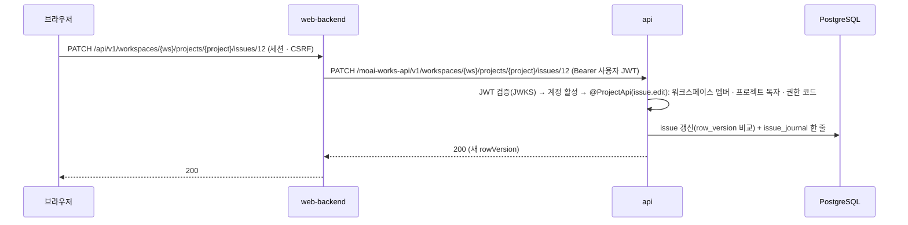
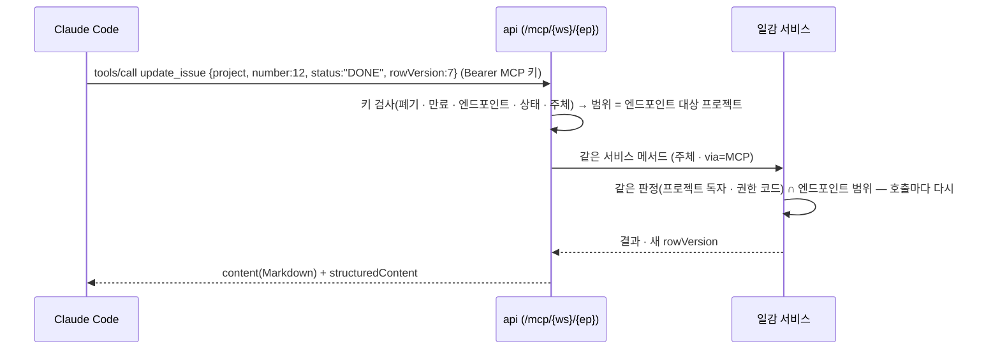

[홈](../README.md) › [설계](00-key-decisions.md) › 아키텍처

# 아키텍처

moai-works 의 구성 요소 · 층 · 호출 흐름 · 저장소 · 기술 스택을 한 쪽에 모은다. moai-wiki 와 같은 모양이고([ADR-002](00-key-decisions.md#adr-002)), 위키 자리에 **프로젝트**, 페이지 자리에 **일감**이 있다. AI 는 안에 없고 바깥 Agent 가 MCP 로 붙는다([ADR-003](00-key-decisions.md#adr-003)).

**바로가기:** [구성](#ar-components) · [층](#ar-layers) · [모듈](#ar-modules) · [호출 흐름](#ar-flows) · [api 내부](#ar-api) · [저장소](#ar-storage) · [기술 스택](#ar-stack) · [배치](#ar-deploy)

---

<a id="ar-components"></a>
## 1. 구성

```
                 ┌────────────────────── 사람 ──────────────────────┐
                 │  브라우저 (React · MUI) — moai-works-web-frontend │
                 └───────────────┬──────────────────────────────────┘
                                 │ HTTPS · 세션 쿠키(__Host-MOAI_WORKS_SESSION) · CSRF
                                 ▼
                 ┌──────────────────────────────────────────┐   패스워드 그랜트 · 토큰 갱신 · 로그아웃
                 │ moai-works-web-backend (BFF, :11002)     │ ─────────────────────────────┐
                 │ 세션(Redis) · /api/v1/** 1:1 전달         │                              │
                 └───────────────┬──────────────────────────┘                              ▼
                                 │ Bearer 사용자 JWT                            ┌──────────────────┐
                                 ▼                                              │ Keycloak (8180)  │
 바깥 AI Agent ──MCP──▶ ┌──────────────────────────────────────────────┐        │ 렐름 moai-works  │
 (Claude Code …)        │ moai-works-api (:11001)                      │ ◀─JWKS─│ 계정 · 조직 ·     │
 Streamable HTTP        │  REST /moai-works-api/v1/**   (JWT)           │ ──관리─▶│ 그룹 · 클라이언트 │
 Bearer MCP 키          │  MCP  /mcp/{ws}/{ep}           (MCP 키)       │   API  └──────────────────┘
                        │  판정 · 업무 · 감사 · Keycloak 쓰기 기록       │
                        └──────────────────┬───────────────────────────┘
                                           ▼
                                      PostgreSQL
                                      (moai_works)
```

- 사람과 Agent 는 **입구만 다르고 같은 api 코드**를 지난다([ADR-004](00-key-decisions.md#adr-004)).
- AI 는 api 안에 없다. moai-wiki 의 내장 Wiki Agent · collector · refiner · 자료실에 해당하는 것이 없다.
- 첨부(MinIO) · 전문 검색(OpenSearch) · 작업 큐 · 메일 알림 · 웹훅 · Git 연동은 첫 출시 범위 밖(나중 후보)이다([ADR-018](00-key-decisions.md#adr-018)).

<a id="ar-layers"></a>
## 2. 층

```
플랫폼 (Keycloak 렐름 moai-works)        ← system-admin · security-officer
 └─ 워크스페이스 (Keycloak Organization)  ← owner · admin · curator · member · 사용자 정의 역할
     ├─ 프로젝트 ×N                       ← project-admin · project-curator · project-editor · project-reader
     │   └─ 일감 ×N (유형 · 상태 · 관리자 · 담당자 · 날짜 · 상위 · 하위 · 연결 · 이력 · 댓글)
     └─ MCP 엔드포인트 ×N                 ← 엔드포인트마다 MCP 키 (개인 · 서비스)
```

| 층 | moai-wiki 의 자리 | 권한 | 설계 |
|---|---|---|---|
| 플랫폼 | 같다 | 렐름 역할 | [워크스페이스 설계 §3.1](03-workspace-identity.md#ws-permissions) |
| 워크스페이스 | 같다 | 조직 그룹 = 역할, 클라이언트 역할 = 권한 코드 | [워크스페이스 설계](03-workspace-identity.md) |
| 프로젝트 | 위키 | 공개 범위 + 프로젝트 역할(조직 그룹) — **권한 경계** | [프로젝트 설계](04-project.md) |
| 일감 | 페이지 | 프로젝트의 권한을 그대로 쓴다(일감마다 읽기를 좁히지 않는다) | [일감 설계](05-issue.md) |
| MCP 엔드포인트 | 같다(대상이 위키 → 프로젝트) | 키 주인 권한 ∩ 엔드포인트 범위 | [MCP 설계](06-mcp.md) |

<a id="ar-modules"></a>
## 3. 모듈

| 모듈 | 책임 | 하지 않는 것 | 문서 |
|---|---|---|---|
| `moai-works-api` | DB 정본 · 모든 권한 판정 · REST · MCP · Keycloak 쓰기 · 감사 | LLM 호출 | [모듈 문서](../modules/01-api.md) |
| `moai-works-web-backend` | 로그인 세션 · 토큰 보관 · 갱신 · `/api/v1/**` 전달 · 정적 파일 | 판정 · 업무 · DB | [모듈 문서](../modules/02-web-backend.md) |
| `moai-works-web-frontend` | 화면. 권한은 숨기기만(api 의 `myPermissions` · `myActions` 를 읽어서) | 판정 · 토큰 보관 | [모듈 문서](../modules/03-web-frontend.md) |

<a id="ar-flows"></a>
## 4. 호출 흐름

### 4.1 사람 — 일감 고치기



### 4.2 바깥 Agent — 같은 일을 MCP 로



상세: [MCP 설계](06-mcp.md).

### 4.3 뒷일

첫 출시에는 비동기로 처리할 일이 없다(메일 알림 · 웹훅 · 검색 색인 · 가져오기가 모두 나중 후보). 메일은 가입 인증 코드 · 초대 링크뿐이고 지금은 로그 모드다. 작업 큐는 그 기능을 고를 때 다시 본다([ADR-013](00-key-decisions.md#adr-013) 보류).

<a id="ar-api"></a>
## 5. api 내부

기능 단위 패키지(`com.moai.works.api.*`). ● 는 지금 있는 것, ○ 는 이 설계로 만드는 것.

| 패키지 | 내용 | | moai-wiki 의 자리 |
|---|---|---|---|
| `account` · `platform` | 가입 · 인증 코드 · 내 정보 · 가입 정책 · 계정 관리 | ● | 같다 |
| `workspace` | 워크스페이스 · 역할(기본 넷 + 사용자 정의) · 멤버십 · 가입 신청 · 초대 · 권한 카탈로그 | ● | 같다 |
| `security` · `security.access` | JWT · MCP 키 필터 · 접근 어노테이션 · 기동 검사 | ● (`@ProjectApi` · `ProjectContext` ○) | `@WikiApi` · `WikiContext` |
| `keycloak` · `audit` · `common` · `config` | Keycloak 관리 API · 쓰기 기록 · 감사 · 오류 · 설정 | ● | 같다 |
| `project` | 프로젝트 · 공개 범위 · 판정(`ProjectAccessService`) · 프로젝트 역할 · 기본 프로젝트 | ○ [설계](04-project.md) | `wiki` |
| `issue` | 일감 유형 · 일감 · 번호 · 상태 · 상위 · 하위 · 연결 · 이력 · 댓글 · 목록 | ○ [설계](05-issue.md) | `page` |
| `mcp` · `mcpkey` | MCP 서버 · 키(지금 고정 입구 `/mcp/project`) → 워크스페이스 엔드포인트 · 도구 | ● (엔드포인트 · 도구 ○) [설계](06-mcp.md) | 같다 |
| `storage` | 객체 저장소(MinIO) 추상 | ● (쓰는 곳 없음 — 첨부는 나중 후보) | 같다 |

<a id="ar-storage"></a>
## 6. 저장소

| 저장소 | 쓰임 | 로컬 |
|---|---|---|
| PostgreSQL | 업무 데이터 정본 · Keycloak 사본 · 감사. 스키마는 Flyway(`V1__foundation.sql` → V2 프로젝트 · 일감) | MOAI-DB, DB `moai_works`, 시험 스키마 `moai_works_test` |
| Keycloak | 계정 · 플랫폼 역할 · 워크스페이스(조직) · 역할(조직 그룹) · 권한 코드(클라이언트 역할) · 프로젝트 역할(조직 그룹 `/projects/<id>/<role>`) 의 정본 | MOAI-Keycloak, 렐름 `moai-works` |
| Redis | BFF 세션(Spring Session). api 는 쓰지 않는다 | MOAI-Redis, 키 `moai-works:` |
| MinIO | (나중) 첨부 파일 | MOAI-MinIO, 버킷 `moai-works-attachments` |
| OpenSearch | (나중) 전문 검색 색인 | MOAI-OpenSearch, 색인 `moai-works-*` |

표 목록과 정본 위치는 [데이터 모델](02-data-model.md).

<a id="ar-stack"></a>
## 7. 기술 스택

moai-wiki 와 같은 판이다([DEVELOPE.md §2](../../DEVELOPE.md#2-버전)).

| 쪽 | 기술 |
|---|---|
| api · web-backend | Java 21 · Spring Boot 4.2.0 · Spring Security 7.2.0 · Spring Session 4.2.0(BFF) · Spring AI 2.1.0(MCP Java SDK 2.2.0, Streamable HTTP) · Spring Data JPA · Flyway · Jackson 3 · AWS SDK S3 |
| web-frontend | React 19.3 · React Router 8.5 · MUI 9.5 · TanStack Query 5 · i18next · react-hook-form · zod · react-markdown(+ remark-gfm) · CodeMirror 6 · Vite 8 · TypeScript 6.0 · Vitest 5 |
| 인프라 | Keycloak 26.8.2 · PostgreSQL · Redis 8.10.2 · (나중) MinIO · OpenSearch 3.9.0(nori) |

<a id="ar-deploy"></a>
## 8. 배치

- 로컬: 모듈마다 `bin/startup.sh`. 모두 HTTPS(로컬 인증서 `infra/tls`). 같이 쓰는 컨테이너는 평문([DEVELOPE.md §5](../../DEVELOPE.md#5-로컬-환경)).
- 운영: api · web-backend 는 여러 인스턴스(세션은 Redis). api 는 판정을 DB 사본으로 요청마다 하므로 인스턴스 사이에 맞출 캐시가 없다. MCP 는 무상태라 어느 인스턴스로 가도 된다. 엔드포인트별 MCP 서버 캐시는 엔드포인트 행의 `row_version` 으로 저절로 맞는다([MCP 설계 §5](06-mcp.md#mc-server)). 속도 제한은 인스턴스 메모리에서 시작한다(여러 인스턴스면 느슨해진다).
- 운영 배치(클라우드/사내) · 규모는 정하지 않았다([정해야 할 것](../wbs/08-decisions.md)).

---

**관련 문서:** [핵심 설계 결정](00-key-decisions.md) · [데이터 모델](02-data-model.md) · [워크스페이스 · 권한](03-workspace-identity.md) · [프로젝트](04-project.md) · [일감](05-issue.md) · [MCP](06-mcp.md) · [모듈 한눈에](../modules/00-overview.md) · [SECURITY.md](../../SECURITY.md)

[← 이전: 핵심 설계 결정 (ADR)](00-key-decisions.md) | [다음: 데이터 모델 →](02-data-model.md)
