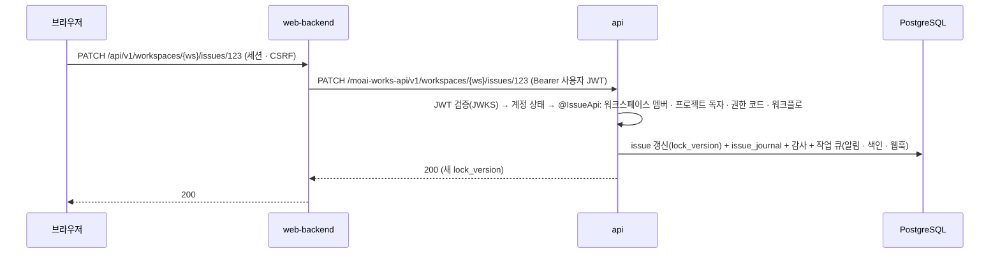
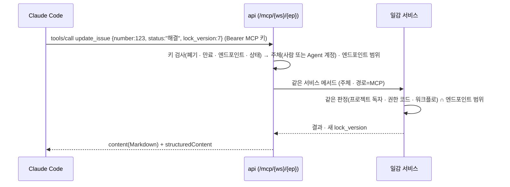

[홈](../README.md) › [설계](01-architecture.md) › 아키텍처

# 아키텍처

moai-works 의 구성 요소 · 호출 흐름 · 저장소 · 기술 스택을 한 쪽에 모은다. 토대(로그인 · 워크스페이스 · 권한)는 moai-wiki 와 같고([ADR-002](00-key-decisions.md#adr-002)), 그 위에 프로젝트 관리 도메인과 MCP 입구를 얹는다.

**바로가기:** [구성](#ar-components) · [모듈](#ar-modules) · [호출 흐름](#ar-flows) · [api 내부](#ar-api) · [저장소](#ar-storage) · [기술 스택](#ar-stack) · [배치](#ar-deploy)

---

<a id="ar-components"></a>
## 1. 구성

```
                 ┌────────────────────── 사람 ──────────────────────┐
                 │  브라우저 (React · MUI) — moai-works-web-frontend │
                 └───────────────┬──────────────────────────────────┘
                                 │ HTTPS · 세션 쿠키(__Host-MOAI_WORKS_SESSION) · CSRF
                                 ▼
                 ┌──────────────────────────────────────────┐   패스워드 그랜트 · 토큰 갱신 · 로그아웃
                 │ moai-works-web-backend (BFF, :10013)     │ ─────────────────────────────┐
                 │ 세션(Redis) · /api/v1/** 1:1 전달         │                              │
                 └───────────────┬──────────────────────────┘                              ▼
                                 │ Bearer 사용자 JWT                            ┌──────────────────┐
                                 ▼                                              │ Keycloak (8180)  │
 바깥 AI Agent ──MCP──▶ ┌──────────────────────────────────────────────┐        │ 렐름 moai-works  │
 (Claude Code …)        │ moai-works-api (:10011)                      │ ◀─JWKS─│ 계정 · 조직 ·     │
 Streamable HTTP        │  REST /moai-works-api/v1/**  (JWT)            │ ──관리─▶│ 그룹 · 클라이언트 │
 Bearer MCP 키          │  MCP  /mcp/**                (MCP 키)         │   API  └──────────────────┘
                        │  판정 · 업무 · 작업 큐 · 스케줄러             │
 Git 호스팅 ──웹훅────▶ │  /moai-works-api/v1/hooks/** (서명 검증, 계획)│
                        └──┬──────────┬──────────┬──────────┬──────────┘
                           ▼          ▼          ▼          ▼
                      PostgreSQL    MinIO     OpenSearch   Redis
                      (moai_works) (첨부)     (검색, 계획) (BFF 세션 · 캐시)
                                      │
                         메일(SMTP — 지금은 로그 모드) · 웹훅 받는 곳 ◀── 작업 큐
```

- 사람과 Agent 는 **입구만 다르고 같은 api 코드**를 지난다([ADR-004](00-key-decisions.md#adr-004)).
- AI 는 api 안에 없다. Agent 는 바깥에 있고 MCP 로 붙는다([ADR-003](00-key-decisions.md#adr-003)).

<a id="ar-modules"></a>
## 2. 모듈

| 모듈 | 책임 | 하지 않는 것 | 문서 |
|---|---|---|---|
| `moai-works-api` | DB 정본 · 모든 권한 판정 · REST · MCP · Keycloak 쓰기 · 작업 큐(메일 · 웹훅 · 색인 · 가져오기) | LLM 호출 | [모듈 문서](../modules/01-api.md) |
| `moai-works-web-backend` | 로그인 세션 · 토큰 보관 · 갱신 · `/api/v1/**` 전달 · 정적 파일 | 판정 · 업무 · DB | [모듈 문서](../modules/02-web-backend.md) |
| `moai-works-web-frontend` | 화면. 권한은 숨기기만(api 의 "내가 할 수 있는 일"을 읽어서) | 판정 · 토큰 보관 | [모듈 문서](../modules/03-web-frontend.md) |

<a id="ar-flows"></a>
## 3. 호출 흐름

### 3.1 사람 — 일감 고치기



### 3.2 바깥 Agent — 같은 일을 MCP 로



상세: [MCP · AI Agent 설계](07-mcp-agents.md).

### 3.3 뒷일

업무 트랜잭션 안에서 작업을 쌓고(아웃박스), api 안 스케줄러가 꺼내 처리한다 — 메일 보내기 · 웹훅 전달 · 검색 색인 · Git 웹훅 처리 · 가져오기([ADR-013](00-key-decisions.md#adr-013)). 실패는 지수 백오프로 다시 하고, 끝내 실패하면 기록을 남긴다.

<a id="ar-api"></a>
## 4. api 내부

기능 단위 패키지(`com.moai.works.api.*`). ● 는 지금 있는 것, ○ 는 계획.

| 패키지 | 내용 | |
|---|---|---|
| `account` · `platform` | 가입 · 인증 코드 · 내 정보 · 가입 정책 · 계정 관리 | ● |
| `workspace` | 워크스페이스 · 역할 · 멤버십 · 가입 신청 · 초대 · 권한 카탈로그 | ● |
| `security` · `security.access` | JWT · MCP 키 필터 · 접근 어노테이션 · 기동 검사 | ● (`@ProjectApi` · `@IssueApi` ○) |
| `keycloak` · `audit` · `common` · `config` | Keycloak 관리 API · 쓰기 기록 · 감사 · 오류 · 설정 | ● |
| `mcp` · `mcpkey` | MCP 서버(지금 고정 입구 `/mcp/project`) · MCP 키 | ● (워크스페이스 엔드포인트 · 도구 ○) |
| `storage` | 객체 저장소(MinIO) 추상 | ● (쓰는 곳 ○) |
| `project` | 프로젝트 · 하위 프로젝트 · 모듈 · 프로젝트 역할 | ○ [design/04](04-project-permissions.md) |
| `config`(업무) · `issue` · `query` | 트래커 · 상태 · 워크플로 · 사용자 정의 필드 · 일감 · 이력 · 관계 · 질의 · 보드 | ○ [design/05](05-issue-tracking.md) |
| `planning` · `time` | 버전 · 로드맵 · 간트 · 캘린더 · 시간 기록 · 보고서 | ○ [design/06](06-planning-time.md) |
| `agent` | Agent 계정 | ○ [design/07](07-mcp-agents.md) |
| `wiki` · `content` · `notify` · `activity` · `search` | 위키 · 뉴스 · 문서 · 파일 · 포럼 · 알림 · 메일 · 활동 · 검색 | ○ [design/08](08-collaboration.md) |
| `integration` · `job` | REST 문서 · 웹훅 · Git · 가져오기 · 작업 큐 | ○ [design/09](09-integrations.md) |

<a id="ar-storage"></a>
## 5. 저장소

| 저장소 | 쓰임 | 로컬 |
|---|---|---|
| PostgreSQL | 업무 데이터 정본 · Keycloak 사본 · 감사 · 작업 큐. 스키마는 Flyway | MOAI-DB, DB `moai_works`, 시험 스키마 `moai_works_test` |
| Keycloak | 계정 · 플랫폼 역할 · 워크스페이스(조직) · 역할(조직 그룹) · 권한 코드(클라이언트 역할) · 프로젝트 역할(조직 그룹, 계획) 의 정본 | MOAI-Keycloak, 렐름 `moai-works` |
| MinIO | 첨부 파일 | MOAI-MinIO, 버킷 `moai-works-attachments` |
| OpenSearch | 전문 검색 색인(일감 · 메모 · 위키 · 뉴스 · 문서 · 포럼) | MOAI-OpenSearch, 색인 `moai-works-*` |
| Redis | BFF 세션(Spring Session) · 짧은 캐시 | MOAI-Redis, 키 `moai-works:` |

표 목록과 정본 위치는 [데이터 모델](02-data-model.md).

<a id="ar-stack"></a>
## 6. 기술 스택

moai-wiki 와 같은 판이다([DEVELOPE.md §2](../../DEVELOPE.md#2-버전)).

| 쪽 | 기술 |
|---|---|
| api · web-backend | Java 21 · Spring Boot 4.2.0 · Spring Security 7.2.0 · Spring Session 4.2.0(BFF) · Spring AI 2.1.0(MCP Java SDK 2.2.0, Streamable HTTP) · Spring Data JPA · Flyway · Jackson 3 · AWS SDK S3 |
| web-frontend | React 19.3 · React Router 8.5 · MUI 9.5 · TanStack Query 5 · i18next · react-hook-form · zod · react-markdown(+ remark-gfm) · CodeMirror 6 · Vite 8 · TypeScript 6.0 · Vitest 5 |
| 인프라 | Keycloak 26.8.2 · PostgreSQL · Redis 8.10.2 · MinIO · OpenSearch 3.9.0(nori) |

<a id="ar-deploy"></a>
## 7. 배치

- 로컬: 모듈마다 `bin/startup.sh`. 모두 HTTPS(로컬 인증서 `infra/tls`). 같이 쓰는 컨테이너는 평문([DEVELOPE.md §5](../../DEVELOPE.md#5-로컬-환경)).
- 운영: api · web-backend 는 여러 인스턴스(세션은 Redis, 권한 캐시는 무효화 이벤트). MCP 는 무상태라 어느 인스턴스로 가도 된다. 운영 배치(클라우드/사내) · 규모는 정하지 않았다([정해야 할 것](../wbs/08-decisions.md)).

---

**관련 문서:** [핵심 설계 결정](00-key-decisions.md) · [데이터 모델](02-data-model.md) · [워크스페이스 · 권한](03-workspace-identity.md) · [MCP · AI Agent](07-mcp-agents.md) · [모듈 한눈에](../modules/00-overview.md) · [SECURITY.md](../../SECURITY.md)

[← 이전: 핵심 설계 결정 (ADR)](00-key-decisions.md) | [다음: 데이터 모델 한눈에 →](02-data-model.md)
