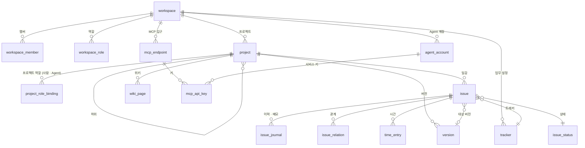

[홈](../README.md) › [설계](01-architecture.md) › 데이터 모델

# 데이터 모델 한눈에

api DB(PostgreSQL)의 표를 한 쪽에 모은다. **열 정의(DDL)의 정본은 각 설계 쪽**이고, 이 쪽은 어떤 표가 어디에 있고 무엇이 정본인지만 적는다. 지금 있는 표의 정본은 Flyway `V1__foundation.sql` 이다.

**바로가기:** [공통 규칙](#dm-rules) · [표 목록](#dm-tables) · [관계 한눈에](#dm-relations) · [정본과 사본](#dm-sor) · [바깥 저장소](#dm-external)

---

## 1. 공통 규칙

| 규칙 | 내용 |
|---|---|
| 워크스페이스 | 모든 업무 표는 `workspace_id` 를 가진다. 다른 표를 가리킬 때는 `(workspace_id, id)` 복합 외래 키로 워크스페이스를 넘는 참조를 DB 가 막는다 |
| id · 시각 | id 는 uuid, 시각은 `timestamptz`(UTC). 일감은 따로 워크스페이스 안 순번 `number` 를 가진다([ADR-009](00-key-decisions.md#adr-009)) |
| 낙관적 잠금 | `row_version`. 일감은 API 에 `lock_version` 이라는 이름으로 내보낸다 |
| 행위자 | 쓰는 표는 `*_type`(`USER` · `AGENT` · `SYSTEM`) + `*_id`, 경로 `via`(`WEB` · `REST` · `MCP` · `EMAIL` · `SCM` · `IMPORT` · `SYSTEM`) |
| 이력 | 일감 이력 · 위키 판 · 감사는 쌓기만 한다 |
| 사용자 정의 필드 | 값은 엔티티의 `custom_values` JSONB + GIN 색인([ADR-011](00-key-decisions.md#adr-011)) |
| 스키마 | Flyway 가 정본, JPA 는 `validate`. 적용된 파일은 고치지 않고 새 파일을 더한다 |

## 2. 표 목록

● 지금 있음(V1) · ○ 계획

| 영역 | 표 | | 정본 쪽(DDL) |
|---|---|---|---|
| 계정 · 플랫폼 | `user_profile` · `platform_setting` · `email_verification` | ● | [워크스페이스 · 권한 설계](03-workspace-identity.md#ws-model) · `V1__foundation.sql` |
| 워크스페이스 · 역할 | `workspace` · `permission` · `workspace_role` · `role_permission` · `workspace_member` · `member_role` · `join_request` · `invitation` | ● | 같음 |
| Keycloak · 감사 | `keycloak_operation` · `audit_log` | ● (감사에 Agent 주체 · 경로 열 더하기 ○) | 같음 |
| MCP 키 | `mcp_api_key` | ● (엔드포인트 · Agent 계정에 묶는 열 ○) | 같음 · [MCP 설계](07-mcp-agents.md#mc-ddl) |
| 프로젝트 | `project` · `project_module` · `project_tracker` · `project_custom_field` · `project_role_binding` · `project_role_group` | ○ | [프로젝트 권한 설계](04-project-permissions.md#pp-ddl) |
| 워크스페이스 업무 설정 | `tracker` · `issue_status` · `enumeration` · `workflow_transition` · `workflow_field_rule` · `custom_field` · `custom_field_tracker` · `issue_tracking_setting` | ○ | [일감 설계](05-issue-tracking.md#is-ddl) |
| 일감 | `workspace_issue_seq` · `issue` · `issue_category` · `issue_journal` · `issue_journal_detail` · `issue_journal_note_revision` · `issue_relation` · `issue_watcher` · `attachment` | ○ | 같음 |
| 질의 | `saved_query` · `issue_export` | ○ | 같음 |
| 계획 · 시간 | `version` · `time_entry` · `project_time_activity` | ○ | [계획 · 시간 설계](06-planning-time.md#pt-ddl) |
| MCP · Agent | `agent_account` · `mcp_endpoint` · `mcp_endpoint_project` · `mcp_endpoint_tool` · `mcp_call_log` · `mcp_usage_daily` · `idempotency_record` | ○ | [MCP 설계](07-mcp-agents.md#mc-ddl) |
| 위키 · 내용 | `wiki` · `wiki_page` · `wiki_page_revision` · `wiki_redirect` · `news` · `comment` · `document` · `release_file` · `forum` · `forum_message` · `content_watcher` | ○ | [협업 설계](08-collaboration.md#co-ddl) |
| 알림 · 메일 · 활동 | `notification` · `notification_preference` · `notification_setting` · `mail_outbox` · `mail_inbound` · `mail_inbound_route` · `activity` · `my_page_layout` | ○ | 같음 |
| 연동 | 웹훅 · Git 저장소 · 커밋 · 가져오기 표 | ○ | [연동 설계](09-integrations.md) |

## 3. 관계 한눈에

## 4. 정본과 사본

| 데이터 | 정본 | api DB |
|---|---|---|
| 계정 · 플랫폼 역할 · 워크스페이스 멤버십 · 워크스페이스 역할 · 역할 ↔ 권한 매핑 | Keycloak | 판정용 사본(`user_profile` · `workspace_member` · `member_role` · `workspace_role` · `role_permission`) |
| 사람의 프로젝트 역할 | Keycloak 조직 그룹 `/projects/<id>/<role>` | 사본 `project_role_binding`([ADR-006](00-key-decisions.md#adr-006)) |
| Agent 계정 · Agent 의 프로젝트 역할 | api DB | 정본(`agent_account` · `project_role_binding` 의 `AGENT` 줄) |
| 워크스페이스 설정 · 가입 신청 · 초대 · 감사 · MCP 엔드포인트 · 키 · 업무 데이터 전부 | api DB | 정본 |
| 활동 · 검색 색인 | 원본 표에서 다시 만들 수 있는 파생 | `activity`(DB) · OpenSearch |

## 5. 바깥 저장소

| 저장소 | 무엇 | 이름 |
|---|---|---|
| MinIO | 첨부 파일 본체(메타데이터는 `attachment` 표) | 버킷 `moai-works-attachments` |
| OpenSearch | 일감 · 메모 · 위키 · 뉴스 · 문서 · 포럼 검색 색인 | `moai-works-content-v{n}`(별칭 `moai-works-content`), [협업 설계](08-collaboration.md) |
| Redis | BFF 세션 · 짧은 캐시 | 키 `moai-works:` 아래 |

---

**관련 문서:** [아키텍처](01-architecture.md) · [워크스페이스 · 권한](03-workspace-identity.md) · [프로젝트 권한](04-project-permissions.md) · [일감](05-issue-tracking.md) · [MCP](07-mcp-agents.md)

[← 이전: 아키텍처](01-architecture.md) | [다음: 워크스페이스 · 계정 · 권한 설계 →](03-workspace-identity.md)
