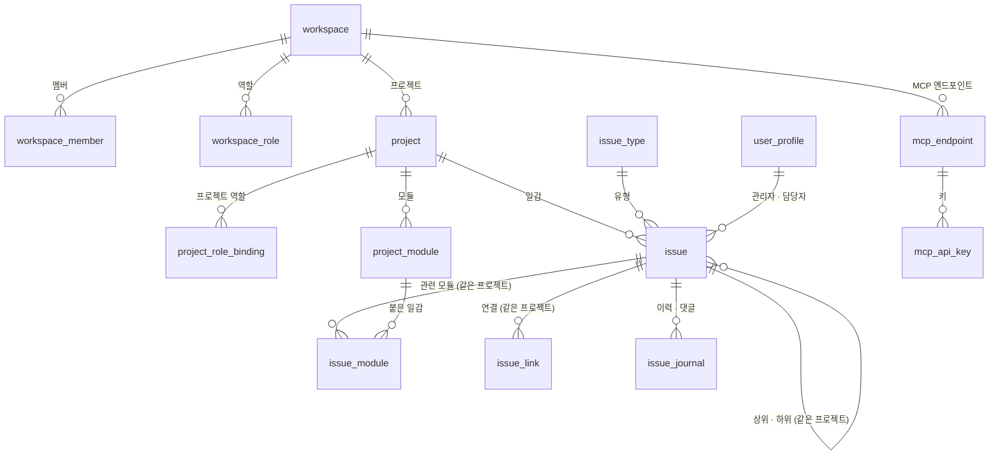

[홈](../README.md) › [설계](00-key-decisions.md) › 데이터 모델

# 데이터 모델

api DB(PostgreSQL)의 표를 한 쪽에 모은다. 토대 표의 정본은 Flyway [`V1__foundation.sql`](../../src/moai-works-api/src/main/resources/db/migration/V1__foundation.sql), 프로젝트 · 일감 표의 정본은 [`V2__project_issue.sql`](../../src/moai-works-api/src/main/resources/db/migration/V2__project_issue.sql), 일감 리비전 · 예상 공수 · 작업 시간 기록은 [`V3__issue_revision_worklog.sql`](../../src/moai-works-api/src/main/resources/db/migration/V3__issue_revision_worklog.sql) · [`V4__work_log_protect.sql`](../../src/moai-works-api/src/main/resources/db/migration/V4__work_log_protect.sql)(2026-11-22 — 뜻은 [일감 설계 — 리비전](05-issue.md#is-revision) · [작업 시간](05-issue.md#is-worklog)) 이고 이 쪽의 [§5](#dm-ddl)가 그 모양이다. 4단계(MCP) 변경은 [§6](#dm-mcp)에 초안으로 둔다. 뜻과 규칙은 각 설계 쪽([워크스페이스](03-workspace-identity.md) · [프로젝트](04-project.md) · [일감](05-issue.md) · [MCP](06-mcp.md))에 있다.

**바로가기:** [공통 규칙](#dm-rules) · [표 목록](#dm-tables) · [관계 한눈에](#dm-relations) · [정본과 사본](#dm-sor) · [V2 — 프로젝트 · 일감](#dm-ddl) · [4단계 — MCP](#dm-mcp) · [바깥 저장소](#dm-external)

---

<a id="dm-rules"></a>
## 1. 공통 규칙

| 규칙 | 내용 |
|---|---|
| 담는 쪽 | 워크스페이스 ⊃ 프로젝트 ⊃ 일감(moai-wiki 의 워크스페이스 ⊃ 위키 ⊃ 페이지와 같다). `project` 는 `workspace_id`, `issue` 는 `project_id` 를 가진다. 상위 일감은 `(project_id, parent_id)` → `(project_id, id)` 복합 외래 키로 **DB 가 프로젝트를 넘는 참조를 막는다**(moai-wiki 의 `fk_page_parent_same_wiki` 와 같다). 연결 일감의 같은 프로젝트는 서비스가 본다 |
| id · 시각 | id 는 uuid, 시각은 `timestamptz`(UTC). 일감의 날짜 다섯 개는 `date`(달력의 날) |
| "오늘" | 날짜 자동 채움의 "오늘"은 api 의 기준 시간대 **Asia/Seoul** 의 날짜다(지금은 고정 — 워크스페이스 시간대 설정은 나중). UTC 로 하면 한국 시각 오전 9시 전에 하루 전 날짜가 들어간다 |
| 일감 번호 | 프로젝트 안 순번 `number`([ADR-019](00-key-decisions.md#adr-019)) |
| 낙관적 잠금 | `row_version`. API(REST · MCP)는 `rowVersion` 으로 내보낸다. 다르면 409 `CONCURRENT_UPDATE` |
| 행위자 | 감사 `audit_log.actor_type`(`USER` · `SERVICE` · `SYSTEM`) · 일감 이력 `issue_journal.actor_type`(`USER` · `SERVICE`) + 경로 `via`(`WEB` · `MCP`). MCP 로 한 일도 늘 키 주인(`USER`)이다 — 이력은 `actor_id` = 키 주인 · `mcp_key_id`(4단계), 감사는 `actor_id` = 키 주인 · `details` 에 엔드포인트 id · 키 id. 서비스 키는 없다([ADR-024](00-key-decisions.md#adr-024)) — `SERVICE` 는 Keycloak 서비스 계정 몫이고 MCP 는 쓰지 않는다 |
| 쌓기만 | 감사(트리거가 막는다) · 일감 이력(서비스가 더하기만 한다) |
| 지우기 | 프로젝트 · 일감은 소프트 삭제(`status = 'DELETED'` · `deleted_at`). 지운 프로젝트의 key 는 바로 다시 쓸 수 있다(부분 고유 인덱스). 지운 일감의 번호는 다시 쓰지 않는다 |
| 정렬 | 이름처럼 정렬하는 글 열은 `COLLATE "C"`(DB 기본 `en_US.utf8` 은 한글을 가나다순으로 놓지 않는다 — moai-wiki 에서 겪었다). `project.name` 은 V2 에 있다. `issue.title` 은 V2 에 없다 — 제목순 정렬을 가나다순으로 하려면 다음 마이그레이션에서 더한다 |
| 스키마 | Flyway 가 정본, JPA 는 `validate`. 적용된 파일은 고치지 않고 새 파일을 더한다(V1 토대, V2 프로젝트 · 일감, 4단계 MCP) |

<a id="dm-tables"></a>
## 2. 표 목록

● V1 토대 · ◐ V2 프로젝트 · 일감 · ○ 4단계 MCP

| 영역 | 표 | | 정본/사본 | 뜻 · 설계 |
|---|---|---|---|---|
| 계정 · 플랫폼 | `user_profile` | ● | 사본 + 가입 상태 | Keycloak 사용자 id(= 토큰 sub) · 이메일 · 표시 이름 · 계정 상태 · 생긴 곳 · 플랫폼 역할 · 개인 · 마지막 워크스페이스 · 팀 워크스페이스 허용 수 · 다른 로그인을 끊은 때 `sessions_revoked_at` · 남긴 로그인 `kept_session_id`(V22, 2026-11-24 — 비밀번호 변경 · 찾기, [워크스페이스 설계 §8.3](03-workspace-identity.md#ws-password))([워크스페이스 설계 §13](03-workspace-identity.md#ws-model)) |
| | `platform_setting` · `email_verification` | ● | 정본 | 가입 정책 등 플랫폼 설정 · 인증 코드(HMAC) |
| 워크스페이스 | `workspace` | ● (V16 고침, 2026-11-23) | 정본 | 주소 · 이름 · 종류 · 공개 범위 · 가입 방식 · 허용 도메인 · 기본 역할 · 재신청 대기 · 상태 · Keycloak 조직 id. **V16 이 `suspended_at` · `suspended_reason`(시스템 관리자의 사용 중지 때와 이유 — 다시 사용하면 비운다) · `deleted_at`(지운 때 — 행은 `DELETED` 로 남긴다)을 더했다**([워크스페이스 설계 §9.1](03-workspace-identity.md#ws-suspend)) |
| 역할 · 멤버 | `permission` | ● | 정본(코드에서 맞춤) | 권한 코드 카탈로그(25개, [워크스페이스 설계 §4](03-workspace-identity.md#ws-catalog)) |
| | `workspace_role` · `role_permission` | ● | 사본 | 역할(기본 넷 + 사용자 정의) · 역할이 담는 코드 |
| | `workspace_member` · `member_role` | ● | 사본 | 멤버십 · 역할 부여 |
| | `join_request` · `invitation` | ● | 정본 | 가입 신청 · 초대 |
| Keycloak · 감사 | `keycloak_operation` | ● | 정본 | Keycloak 쓰기 기록(멱등 · 이어서 끝내기) |
| | `audit_log` | ● | 정본(추가 전용) | 감사. `workspace_id` 는 비워도 된다 — 워크스페이스 밖의 일(로그인 · 이름 바꾸기 · 2026-11-23 부터 MCP 키 발급 · 만료)은 사용자 단위 기록이다 |
| 프로젝트 | `project` | ◐ | 정본 | 프로젝트 · 공개 범위 · 상태 · 일감 번호 순번([프로젝트 설계 §2](04-project.md#pj-model)) |
| | `project_role_binding` | ◐ | 사본 | 프로젝트 역할(정본은 Keycloak 조직 그룹, [프로젝트 설계 §4](04-project.md#pj-roles)) |
| | `project_module` | ● (V21, 2026-11-23) | 정본 | 프로젝트 모듈 — key(1~32자, CHECK) · 이름 · 설명 · 순서 · 쓰는지 · 만든 · 고친 사람 · 때 · 판. (프로젝트, key) 하나 · `(project_id, id)` 고유(같은 프로젝트 FK 용). 보호 트리거 `tr_project_module_protect` 가 지우기와 key · 프로젝트 바꾸기를 막는다(쓰지 않음 `active = false` 로만)([§5.7](#dm-module) · [프로젝트 설계 §6-1](04-project.md#pj-modules)) |
| 일감 | `issue_type` | ◐ | 정본(시드) | 일감 유형 — 새기능 · 버그 · 테스트 · 기술조사(V8 — 옛 요구사항 · 작업은 `active = false`)([일감 설계 §3](05-issue.md#is-type)) |
| | `issue` | ◐ (V20 고침, 2026-11-23) | 정본 | 일감([일감 설계 §2](05-issue.md#is-model)). **V20 이 `agent_session`(에이전트 세션 — 앞뒤 공백 없는 1~100자 · 제어 문자 없음, CHECK `ck_issue_agent_session`, 없어도 됨)과 거르기 색인 `ix_issue_agent_session (project_id, lower(agent_session))` 을 더했다**([일감 설계 §10-4](05-issue.md#is-agent-session)). `issue_revision` 도 V20 `agent_session` · V21 `modules jsonb`(`[{key, name}]`)를 더했다 |
| | `issue_module` | ● (V21, 2026-11-23) | 정본 | 일감의 관련 모듈(여럿) — `(issue_id, module_id)` 기본 키, 복합 외래 키 `(project_id, issue_id)` → `issue` · `(project_id, module_id)` → `project_module` 로 같은 프로젝트끼리만([§5.7](#dm-module) · [일감 설계 §10-5](05-issue.md#is-modules)) |
| | `issue_link` | ◐ | 정본 | 연결 일감([일감 설계 §8](05-issue.md#is-links)) |
| | `issue_journal` | ◐ (V14 고침, 2026-11-23) | 정본(쌓기만) | 일감 이력 — 필드 변경 + 댓글([일감 설계 §9](05-issue.md#is-journal)). V14 가 댓글 판 · 고친 때 · 지움 표시 열과 보호 트리거를 더했다 — 댓글(`notes`)만 고치고 지움 표시하며 줄은 지우지 않는다([§5.6](#dm-issue-journal)) |
| | `issue_comment_revision` | ● (V14, 2026-11-23) | 정본(쌓기만) | 바뀌기 전 댓글 글 — 고칠 때마다 한 줄. 트리거가 고치기 · 지우기를 막는다([일감 설계 §10](05-issue.md#is-comments)) |
| MCP | `mcp_api_key` | ● (V5 · V11 · V13 고침, 2026-11-22 ~ 23) | 정본 | MCP 키(SHA-256). V5 에서 워크스페이스 · 주인 계정 · 발급 IP · User-Agent · 만료시킨 사람 · 이유 · 메모 열을 더하고 키 종류 · Keycloak 주체 · 폐기 열을 없앴다. 보호 트리거(지우기 · 발급 정보 변경 · 기간 늘리기 금지). **V11(2026-11-23)이 고정 입구 열 `endpoint` 를 지우고 보호 트리거를 그 열 없이 다시 만들었다** — 키는 입구에 묶이지 않는다([ADR-028](00-key-decisions.md#adr-028) · [MCP 설계 §3](06-mcp.md#mc-keys)). **V13(2026-11-23)이 `workspace_id` 와 그 인덱스(`ix_mcp_api_key_ws`)를 지우고 보호 함수를 그 열 없이 다시 만들었다** — 키는 사용자의 것이고 주인이 MCP 권한을 가진 모든 워크스페이스에 닿는다. 지금 키는 그대로 남는다([ADR-029](00-key-decisions.md#adr-029)) |
| 알림 | `notification` · `notification_preference` | ● (V6, 2026-11-22) | 정본 | 사람마다 알림함(종류 · 대상 · 값 · 한 사람 · 묶인 수 · 읽음)과 종류별 끈 것. 본문은 넣지 않는다([알림 설계](07-notification.md)). MCP 키 알림(`mcp_key.expiring`)은 2026-11-23 부터 `workspace_id` 가 없는 알림이다. `notification_preference.email`(V18 — 종류별 메일 켬 · 끔, NULL = 종류의 기본값) |
| | `notification_mail` | ● (V18, 2026-11-23) | 정본 | 알림 메일 보낼 통 — 알림 하나에 한 줄(`notification_id` UNIQUE), 상태 `PENDING` · `SENT` · `FAILED` · `SKIPPED` · 시도 수 · 다음 시도 때 · 까닭 코드. 주소 · 제목 · 본문은 두지 않는다(보낼 때 다시 판정하고 만든다 — [알림 설계 §8](07-notification.md#nt-mail)) |
| 일감 | `issue_attachment` | ● (V9, 2026-11-22 · V17 고침, 2026-11-23) | 정본(메타데이터) | 첨부 메타데이터 — 파일은 객체 저장소 `ws/<워크스페이스>/p/<프로젝트>/<연>/<월>/<id>`. 지움 표시만(트리거). **V17 이 정리한 때 `purged_at`(지운 뒤에만 — CHECK) · 정리 차례 인덱스(`ix_issue_attachment_purge`)를 더하고 보호 함수를 넓혔다** — 지운 행에 정리 표시를 한 번 남기는 것만 더 허락한다. 보관 기간이 지나면 정리 작업이 객체를 지우고 행은 남긴다. 미리보기 그림(png · jpeg · gif)은 DB 열 없이 원본 옆 객체 `<객체 이름>.preview` 로만 둔다(처음 받을 때 만듦, 만들 수 없으면 0바이트 표시)([일감 설계 — 첨부](05-issue.md#is-attachments)) |
| 일감 | `issue_template` | ● (V12, 2026-11-23) | 정본 | 유형별 일감 템플릿 — 워크스페이스 기본(project_id 없음) · 프로젝트 덮어쓰기, 고르는 순서 프로젝트 → 워크스페이스 → 처음 템플릿([일감 설계 — 템플릿](05-issue.md#is-templates)) |
| MCP | `attachment_ticket` | ● (V10, 2026-11-22) | 정본 | 첨부 일회용 티켓 — SHA-256 · 10분 · 한 번 · 키 주인 · 워크스페이스 · 일감에 묶음. 키가 워크스페이스에 묶이지 않은 뒤(V13)에도 티켓의 `workspace_id` 는 도구가 정한 프로젝트의 워크스페이스다([MCP 설계 — 첨부 티켓](06-mcp.md#mc-attach-ticket)) |
| | ~~`mcp_endpoint`~~ | — | — | 워크스페이스 MCP 엔드포인트 — 만들지 않는다(2026-11-23 [ADR-029](00-key-decisions.md#adr-029), 옛 설계 [MCP 설계 §4](06-mcp.md#mc-endpoint)) |
| MCP | `mcp_access_log` | ● (V19, 2026-11-23) | 정본 | 접근 기록 — MCP 키로 들어온 요청 하나 = 한 줄(읽기 · 도구 목록 · 연결 · 키 검사 거절까지), 클라이언트 정보 · IP · 세션 id, 추가 전용(트리거). 키 원문 · 본문은 없다. 키별 호출 수는 여기서 센다([MCP 설계 — 접근 기록](06-mcp.md#mc-access-log)) |
| | `mcp_idempotency` | ○ | 정본 | 멱등 키 |

moai-wiki 와 견주면: `wiki` → `project`, `wiki_role_binding` → `project_role_binding`, `page_type` → `issue_type`, `page` → `issue`, `page_link` → `issue_link`, `page_revision` → `issue_journal`. 페이지의 이름 · 주소 · 작업본 · 섹션 · 태그 · 편집 제한 표와 자료실 표는 없다.

<a id="dm-relations"></a>
## 3. 관계 한눈에



<a id="dm-sor"></a>
## 4. 정본과 사본

| 데이터 | 정본 | api DB |
|---|---|---|
| 계정 · 플랫폼 역할 · 워크스페이스 멤버십 · 워크스페이스 역할 · 역할 ↔ 권한 매핑 | Keycloak | 판정용 사본(`user_profile` · `workspace_member` · `member_role` · `workspace_role` · `role_permission`) |
| 프로젝트 역할 | Keycloak 조직 그룹 `/projects/<project id>/<role>` | 사본 `project_role_binding`([ADR-006](00-key-decisions.md#adr-006)). 역할 → 권한 코드는 api 의 `ProjectRole` 이 갖는다(그룹에 매핑하지 않는다) |
| 프로젝트 · 일감 · 일감 유형 · 연결 · 이력 | api DB | 정본 |
| 워크스페이스 설정 · 가입 신청 · 초대 · 감사 · MCP 엔드포인트 · 키 | api DB | 정본 |

판정은 요청마다 api DB 사본으로 한다. Keycloak 에 쓴 직후 같은 처리에서 사본을 고치므로 다음 요청부터 반영된다([워크스페이스 설계 §6](03-workspace-identity.md#ws-sor)).

---

<a id="dm-ddl"></a>
## 5. V2 — 프로젝트 · 일감

`V2__project_issue.sql` 의 모양이다(적용됨). 권한 코드 9개는 기동 때 `Permission` 열거형에서 `permission` 표로 맞추므로 V2 에 넣지 않았다.

<a id="dm-project"></a>
### 5.1 `project` — 프로젝트 (moai-wiki `wiki`)

```sql
CREATE TABLE project (
    id            uuid          PRIMARY KEY,
    workspace_id  uuid          NOT NULL REFERENCES workspace (id),
    key           varchar(32)   NOT NULL,                  -- 주소 이름. 바꾸지 않는다
    name          varchar(100)  NOT NULL COLLATE "C",      -- 한글 가나다순 정렬
    description   varchar(1000),
    visibility    varchar(20)   NOT NULL CHECK (visibility IN ('WORKSPACE', 'RESTRICTED')),
    status        varchar(20)   NOT NULL CHECK (status IN ('ACTIVE', 'ARCHIVED', 'DELETED')),
    issue_seq     integer       NOT NULL DEFAULT 0,        -- 마지막으로 준 일감 번호 (잠그고 올린다, ADR-019)
    settings      jsonb         NOT NULL DEFAULT '{}',     -- 나중 후보 기능의 자리. 첫 출시에는 비어 있다
    created_by    uuid          NOT NULL REFERENCES user_profile (id),
    created_at    timestamptz   NOT NULL,
    updated_at    timestamptz   NOT NULL,
    archived_at   timestamptz,
    deleted_at    timestamptz,
    row_version   integer       NOT NULL DEFAULT 0,
    CHECK (key ~ '^[a-z][a-z0-9-]{0,30}[a-z0-9]$')         -- 2~32자, 소문자로 시작, 하이픈으로 끝나지 않음
);
-- 지운 프로젝트의 key 는 바로 다시 쓸 수 있다
CREATE UNIQUE INDEX ux_project_key_live ON project (workspace_id, key) WHERE status <> 'DELETED';
CREATE INDEX ix_project_workspace ON project (workspace_id, status, name);
```

- 예약 key `new` · `archive` · `archived` · `settings` 는 서비스가 막는다(화면 주소와 부딪힌다).
- moai-wiki `wiki` 의 `root_create` · `max_security_level` · `language` 와 상태 `PAUSED` · `BLOCKED` 는 페이지 · 에이전트 전용이라 없다.
- 일감 번호는 프로젝트 행을 잠그고(`SELECT … FOR UPDATE`) `issue_seq` 를 1 올려 받는다([일감 설계 §4](05-issue.md#is-number)).

<a id="dm-project-role"></a>
### 5.2 `project_role_binding` — 프로젝트 역할 사본 (moai-wiki `wiki_role_binding`)

```sql
CREATE TABLE project_role_binding (
    project_id         uuid          NOT NULL REFERENCES project (id),
    user_id            uuid          NOT NULL REFERENCES user_profile (id),
    role               varchar(30)   NOT NULL
                           CHECK (role IN ('project-admin', 'project-curator', 'project-editor', 'project-reader')),
    keycloak_group_id  varchar(64),                        -- 조직 그룹 /projects/<project id>/<role> 의 id
    granted_by         uuid          REFERENCES user_profile (id),
    granted_at         timestamptz   NOT NULL,
    PRIMARY KEY (project_id, user_id, role)                -- 한 사람이 한 프로젝트에서 여러 역할 (권한은 합친다)
);
CREATE INDEX ix_project_role_binding_user ON project_role_binding (user_id);
```

- 멤버가 워크스페이스를 떠나면(제거 · 탈퇴) 그 워크스페이스 모든 프로젝트의 바인딩과 그룹 가입을 함께 지운다. 프로젝트를 지우면 그 프로젝트의 바인딩과 그룹을 지운다(서비스, [프로젝트 설계 §4.2](04-project.md#pj-keycloak)).

<a id="dm-issue-type"></a>
### 5.3 `issue_type` — 일감 유형 (moai-wiki `page_type`)

```sql
CREATE TABLE issue_type (
    key          varchar(30)   PRIMARY KEY,
    name         varchar(100)  NOT NULL,
    description  varchar(300)  NOT NULL DEFAULT '',
    position     integer       NOT NULL                    -- 고르는 화면의 순서
);
INSERT INTO issue_type (key, name, description, position) VALUES
    ('requirement', '요구사항', '만들어야 할 것 — 무엇을 왜', 1),
    ('feature',     '기능',     '새로 만들거나 늘리는 기능', 2),
    ('bug',         '버그',     '고쳐야 할 잘못된 동작', 3),
    ('task',        '작업',     '그 밖의 할 일', 4);
```

- 모든 프로젝트가 같은 표를 쓴다. 프로젝트마다 유형을 바꾸는 것은 나중 후보다.

<a id="dm-issue"></a>
### 5.4 `issue` — 일감 (moai-wiki `page`)

```sql
CREATE TABLE issue (
    id                uuid          PRIMARY KEY,
    project_id        uuid          NOT NULL REFERENCES project (id),
    number            integer       NOT NULL,                -- 프로젝트 안 순번 (#1, #2 …)
    issue_type        varchar(30)   NOT NULL REFERENCES issue_type (key),
    title             varchar(200)  NOT NULL,
    description       text          NOT NULL DEFAULT '' CHECK (char_length(description) <= 30000),   -- Markdown
    status            varchar(20)   NOT NULL CHECK (status IN ('NEW', 'IN_PROGRESS', 'DONE', 'CLOSED')),   -- V7 에서 'TESTING' 더함
    manager_id        uuid          NOT NULL REFERENCES user_profile (id),   -- 관리자 (기본 = 만든 사람)
    assignee_id       uuid          REFERENCES user_profile (id),            -- 담당자 (없어도 된다)
    parent_id         uuid,                                                  -- 상위 일감 (같은 프로젝트)
    due_date          date,                                                  -- 완료 기한
    start_date        date,                                                  -- 시작일
    planned_end_date  date,                                                  -- 완료 예정일
    completed_on      date,                                                  -- 완료일 (DONE 이 되면 채운다)
    closed_on         date,                                                  -- 종료일 (CLOSED 가 되면 채운다)
    created_by        uuid          NOT NULL REFERENCES user_profile (id),   -- MCP 로 만들어도 키 주인 (§6)
    created_at        timestamptz   NOT NULL,
    updated_at        timestamptz   NOT NULL,
    deleted_at        timestamptz,                                           -- 소프트 삭제
    row_version       integer       NOT NULL DEFAULT 0,
    UNIQUE (project_id, number),                              -- 지운 일감도 번호를 잡고 있다 (다시 쓰지 않는다)
    UNIQUE (project_id, id),                                  -- 같은 프로젝트 상위 FK 용
    CHECK (parent_id IS NULL OR parent_id <> id),
    CHECK (start_date IS NULL OR planned_end_date IS NULL OR start_date <= planned_end_date),
    CHECK (start_date IS NULL OR due_date IS NULL OR start_date <= due_date),
    CHECK (completed_on IS NULL OR closed_on IS NULL OR completed_on <= closed_on)
);
-- 상위 일감은 같은 프로젝트여야 한다 (parent_id 가 NULL 이면 검사하지 않는다)
ALTER TABLE issue ADD CONSTRAINT fk_issue_parent_same_project
    FOREIGN KEY (project_id, parent_id) REFERENCES issue (project_id, id);
CREATE INDEX ix_issue_list     ON issue (project_id, status, number DESC) WHERE deleted_at IS NULL;
CREATE INDEX ix_issue_children ON issue (project_id, parent_id) WHERE deleted_at IS NULL;
CREATE INDEX ix_issue_assignee ON issue (assignee_id) WHERE assignee_id IS NOT NULL AND deleted_at IS NULL;
CREATE INDEX ix_issue_manager  ON issue (manager_id) WHERE deleted_at IS NULL;
```

- 순환 금지 · 깊이 10 이하는 서비스가 검사한다(재귀 질의, [일감 설계 §7](05-issue.md#is-tree)). DB 는 자기 자신만 막는다.
- 상태와 날짜의 관계(완료일 · 종료일 자동 채움)는 서비스 규칙이다. DB 는 날짜 순서만 막는다.
- 목록 정렬 · 찾기가 규모 시험([NFR-PERF-001](../requirements/05-non-functional.md#nfr-perf-001))에서 느리면 색인(예: `(project_id, updated_at DESC)`)을 다음 마이그레이션에서 더한다. 공유 DB 에 확장(`pg_trgm` 등)은 더하지 않는다.

<a id="dm-issue-link"></a>
### 5.5 `issue_link` — 연결 일감 (moai-wiki `page_link`)

```sql
CREATE TABLE issue_link (
    id               uuid          PRIMARY KEY,
    source_issue_id  uuid          NOT NULL REFERENCES issue (id),
    target_issue_id  uuid          NOT NULL REFERENCES issue (id),
    link_type        varchar(20)   NOT NULL CHECK (link_type IN ('RELATES', 'BLOCKS', 'PRECEDES', 'DUPLICATES')),
    created_by       uuid          NOT NULL REFERENCES user_profile (id),   -- MCP 로 걸어도 키 주인 (§6)
    created_at       timestamptz   NOT NULL,
    CHECK (source_issue_id <> target_issue_id)
);
-- 같은 두 일감 사이에는 방향 · 종류와 상관없이 연결 하나
CREATE UNIQUE INDEX ux_issue_link_pair ON issue_link (LEAST(source_issue_id, target_issue_id),
    GREATEST(source_issue_id, target_issue_id));
CREATE INDEX ix_issue_link_target ON issue_link (target_issue_id);
```

- 두 일감이 같은 프로젝트인지는 서비스가 본다(대상을 경로의 프로젝트 안에서 번호로만 찾는다).
- 일감을 지우면(소프트) 서비스가 그 일감의 연결 행을 함께 지운다(행 삭제).

<a id="dm-issue-journal"></a>
### 5.6 `issue_journal` — 일감 이력 (moai-wiki `page_revision`)

```sql
CREATE TABLE issue_journal (
    id          uuid          PRIMARY KEY,
    issue_id    uuid          NOT NULL REFERENCES issue (id),
    actor_id    uuid          REFERENCES user_profile (id),   -- 사람 (MCP 면 키 주인). NULL 은 V2 가 허용할 뿐 MCP 는 쓰지 않는다
    actor_type  varchar(20)   NOT NULL CHECK (actor_type IN ('USER', 'SERVICE')),
    actor_name  varchar(200)  NOT NULL,                       -- 그때의 표시 이름
    via         varchar(10)   NOT NULL CHECK (via IN ('WEB', 'MCP')),
    created_at  timestamptz   NOT NULL,
    notes       text          CHECK (notes IS NULL OR char_length(notes) <= 30000),   -- 댓글 (Markdown)
    changes     jsonb         NOT NULL DEFAULT '[]'           -- [{"field","before","after"}]
);
CREATE INDEX ix_issue_journal_issue ON issue_journal (issue_id, created_at);
```

- 고칠 때마다 한 줄(바뀐 필드 전부가 `changes` 에), 댓글은 `notes` 만 있는 줄이다. 고치면서 댓글을 함께 달면 한 줄에 둘 다 있다. 만들 때도 처음 값을 `before: null` 로 한 줄 남긴다. `changes` 의 필드 이름 · 값 꼴은 [일감 설계 §9](05-issue.md#is-journal).
- 빈 줄(`notes` 도 `changes` 도 없음)은 서비스가 만들지 않는다.
- V3 이 판 번호 `revision_no integer`(그 줄이 만든 판, 댓글 · 연결만 있는 줄은 NULL)를 더했다.

**V14 — 댓글 고치기 · 지우기 (2026-11-23, [FR-ISS-019](../requirements/03-issue.md#fr-iss-019))**

```sql
ALTER TABLE issue_journal
    ADD COLUMN notes_row_version integer     NOT NULL DEFAULT 0,          -- 댓글 글의 판(0 = 처음 단 글). 고칠 때마다 1 올린다
    ADD COLUMN notes_edited_at   timestamptz,                             -- 마지막으로 고친 때
    ADD COLUMN notes_deleted_at  timestamptz,                             -- 지운 때
    ADD COLUMN notes_deleted_by  uuid        REFERENCES user_profile (id); -- 지운 사람

CREATE TABLE issue_comment_revision (            -- 바뀌기 전 댓글 글 — 쌓기만 (트리거 tr_issue_comment_revision_append_only)
    id            uuid          PRIMARY KEY,
    journal_id    uuid          NOT NULL REFERENCES issue_journal (id),
    row_version   integer       NOT NULL,          -- 그 글이 쓰이던 판
    notes         text          NOT NULL CHECK (char_length(notes) <= 30000),
    replaced_by   uuid          NOT NULL REFERENCES user_profile (id),
    replaced_via  varchar(10)   NOT NULL CHECK (replaced_via IN ('WEB', 'MCP')),
    replaced_at   timestamptz   NOT NULL,
    UNIQUE (journal_id, row_version)
);
CREATE INDEX ix_issue_journal_comments ON issue_journal (issue_id, created_at, id) WHERE notes IS NOT NULL;
```

- **보호 트리거 `tr_issue_journal_protect`**(작업 시간 · 첨부의 보호 트리거와 같은 방식): 줄 지우기 금지 · `id` · `issue_id` · 누가 · 경로 · 때 · `changes` 바꾸기 금지 · 판 번호는 NULL 에서 한 번만 · 댓글이 없던 줄에 댓글 붙이기 금지 · 지운 댓글은 글 · 판 · 표시 모두 더 바꾸지 못함 · 지움 표시는 때와 사람을 함께 · 글을 바꾸면 비우지 않고 판 +1 · 고친 때를 적고 **앞 글이 `issue_comment_revision` 에 먼저 남아 있어야** 한다.
- 지운 댓글의 글은 DB 에 남지만 서비스가 내주지 않는다(`IssueJournal.visibleNotes()`).

<a id="dm-module"></a>
### 5.7 `project_module` · `issue_module` — 프로젝트 모듈과 일감의 관련 모듈 (V20 · V21, 2026-11-23)

moai-wiki 에 없는 표다(일감 #26 · #27). 일감 유형처럼 지우지 않고 쓰지 않음으로 둔다.

```sql
-- V20 — 에이전트 세션 (이 일을 맡은 AI 세션 이름, 없어도 된다)
ALTER TABLE issue ADD COLUMN agent_session varchar(100)
    CONSTRAINT ck_issue_agent_session CHECK (agent_session IS NULL OR (char_length(agent_session) BETWEEN 1 AND 100
        AND agent_session = btrim(agent_session) AND agent_session !~ '[[:cntrl:]]'));
ALTER TABLE issue_revision ADD COLUMN agent_session varchar(100);
CREATE INDEX ix_issue_agent_session ON issue (project_id, lower(agent_session))
    WHERE deleted_at IS NULL AND agent_session IS NOT NULL;

-- V21 — 프로젝트 모듈 · 일감의 관련 모듈
CREATE TABLE project_module (
    id uuid PRIMARY KEY, project_id uuid NOT NULL REFERENCES project (id),
    module_key varchar(32) NOT NULL CHECK (module_key ~ '^[a-z]([a-z0-9-]{0,30}[a-z0-9])?$'),
    name varchar(100) NOT NULL CHECK (char_length(btrim(name)) >= 1), description varchar(500),
    position integer NOT NULL, active boolean NOT NULL DEFAULT true,
    created_by uuid REFERENCES user_profile (id), created_at timestamptz NOT NULL,
    updated_by uuid REFERENCES user_profile (id), updated_at timestamptz NOT NULL, row_version integer NOT NULL DEFAULT 0,
    UNIQUE (project_id, module_key), UNIQUE (project_id, id));
CREATE INDEX ix_project_module_order ON project_module (project_id, position, module_key);
-- tr_project_module_protect: DELETE 금지 · module_key · project_id 바꾸기 금지

CREATE TABLE issue_module (
    project_id uuid NOT NULL, issue_id uuid NOT NULL, module_id uuid NOT NULL,
    PRIMARY KEY (issue_id, module_id),
    FOREIGN KEY (project_id, issue_id) REFERENCES issue (project_id, id),
    FOREIGN KEY (project_id, module_id) REFERENCES project_module (project_id, id));
CREATE INDEX ix_issue_module_module ON issue_module (module_id, issue_id);

ALTER TABLE issue_revision ADD COLUMN modules jsonb;   -- [{"key","name"}] 그때의 이름, 없으면 NULL
```

- 일감의 모듈 바꾸기는 `issue_module` 줄을 넣고 빼는 일이다(일감 행의 `updated_at` · `row_version` 도 함께 — 같은 `PATCH`). 이력은 `issue_journal.changes` 의 `modules`, 판은 `issue_revision.modules`.
- 거르기(`module=` 여럿)는 `EXISTS (SELECT 1 FROM issue_module WHERE issue_id = i.id AND module_id IN (…))`. 모듈마다 일감 수는 지우지 않은 일감만 센다.
- 프로젝트 · 워크스페이스를 지워도 행은 지우지 않는다(프로젝트 행도 `DELETED` 로 남는다).

---

<a id="dm-mcp"></a>
## 6. 4단계 — MCP (초안)

4단계에 새 Flyway 파일(번호는 그때 다음 번호)로 넣는다. 설계는 [MCP 설계](06-mcp.md).

> **지금 적용된 모양 (2026-11-23)** — `mcp_api_key` 는 V1 → V5(워크스페이스 · 주인 · 발급 정보 · 만료 정보) → V11(`endpoint` 지움) → **V13(`workspace_id` 지움 — [ADR-029](00-key-decisions.md#adr-029))** 을 거쳐 열이 `id` · `name` · `key_prefix` · `key_hash` · `owner_user_id` · `owner_name` · `created_at` · `expires_at` · `last_used_at` · `issued_ip` · `issued_user_agent` · `expired_by` · `expire_reason` · `expire_note` 다. 키는 주인 계정 하나에만 묶이고, 보호 함수 `mcp_api_key_protect` 는 V13 이 `workspace_id` 없이 다시 만들었다(지우기 · 발급 정보 변경 · 기간 늘리기 · 만료 다시 쓰기 금지 — 규칙은 V5 와 같다). 워크스페이스 엔드포인트(`mcp_endpoint` · `endpoint_id`)는 만들지 않는다. 아래 SQL 은 처음 초안으로 남긴다.

```sql
-- ── 워크스페이스 MCP 엔드포인트 (moai-wiki 데이터 모델 §15.9 와 같은 모양, 대상이 위키 → 프로젝트) ──
CREATE TABLE mcp_endpoint (
    id                  uuid          PRIMARY KEY,
    workspace_id        uuid          NOT NULL REFERENCES workspace (id),
    slug                varchar(32)   NOT NULL,                 -- 주소 /mcp/{ws}/{slug}. 바꾸지 않는다
    name                varchar(100)  NOT NULL,
    description         varchar(500),
    kind                varchar(10)   NOT NULL CHECK (kind IN ('QUERY', 'AGENT')),
    project_ids         uuid[]        NOT NULL,                 -- 대상 프로젝트 (비면 DISABLED)
    tools               text[]        NOT NULL DEFAULT '{}',    -- 켠 도구. 비면 그 종류의 전부
    rate_limit_per_min  integer       NOT NULL DEFAULT 600 CHECK (rate_limit_per_min BETWEEN 1 AND 6000),
    daily_limit         integer       NOT NULL DEFAULT 50000 CHECK (daily_limit BETWEEN 1 AND 500000),
    status              varchar(10)   NOT NULL CHECK (status IN ('ACTIVE', 'DISABLED')),
    created_by          uuid          NOT NULL REFERENCES user_profile (id),
    created_at          timestamptz   NOT NULL,
    updated_at          timestamptz   NOT NULL,
    row_version         integer       NOT NULL DEFAULT 0,       -- 엔드포인트별 MCP 서버 캐시의 판
    UNIQUE (workspace_id, slug),
    CHECK (slug ~ '^[a-z][a-z0-9-]{0,30}[a-z0-9]$'),            -- 프로젝트 key 와 같은 규칙
    CHECK (status = 'DISABLED' OR cardinality(project_ids) >= 1)
);

-- (처음 설계 초안이다. V5 · V11 · V13 으로 실제 적용된 것과 다르다 — 2026-11-23 V11 이 endpoint 열을, V13 이 workspace_id 를 지웠다.
--  키는 입구 · 엔드포인트 · 워크스페이스에 묶지 않는다(ADR-028 · ADR-029). 아래 endpoint_id · workspace_id 는 적용하지 않는다)
-- ── MCP 키를 사용자 계정 · 워크스페이스 · 엔드포인트에 묶는다 (V1 의 고정 입구 열 endpoint · 키 종류 열 key_type 을 없앤다) ──
DELETE FROM mcp_api_key;                                         -- 옛 고정 입구(/mcp/project) 키는 쓸 곳이 없다 (개발 데이터뿐)
ALTER TABLE mcp_api_key
    DROP COLUMN endpoint,
    DROP COLUMN key_type,                                            -- 키는 한 종류 (사용자 키) — ADR-024
    ADD COLUMN workspace_id    uuid         NOT NULL REFERENCES workspace (id),
    ADD COLUMN endpoint_id     uuid         REFERENCES mcp_endpoint (id) ON DELETE SET NULL,  -- 엔드포인트를 지우면 비고 만료된다
    ADD COLUMN owner_user_id   uuid         NOT NULL REFERENCES user_profile (id),   -- 키 주인 = 발급한 사람. 키는 이 사람의 권한 안에서만 일한다
    ADD COLUMN expired_by      uuid         REFERENCES user_profile (id),   -- 일찍 만료시킨 사람 (moai-wiki 와 같은 이름)
    ADD COLUMN expire_reason   varchar(20)  CHECK (expire_reason IN ('MANUAL', 'MEMBER_LEFT', 'ENDPOINT_DELETED')),
    DROP COLUMN revoked_at,                                          -- 키는 지우지도 "폐기"하지도 않는다 — 일찍 만료시키면 expires_at = 지금
    ADD CONSTRAINT mcp_api_key_endpoint CHECK (endpoint_id IS NOT NULL OR expire_reason IS NOT NULL);
CREATE INDEX ix_mcp_api_key_endpoint ON mcp_api_key (endpoint_id, created_at DESC);
CREATE INDEX ix_mcp_api_key_ws_owner ON mcp_api_key (workspace_id, owner_user_id, expires_at);

-- ── MCP 로 한 일감 쓰기는 키 주인(사람)이 한 것 — issue · issue_link 의 created_by 는 NOT NULL 그대로, 이력에 어느 키인지만 더한다 ──
ALTER TABLE issue_journal ADD COLUMN mcp_key_id uuid;            -- MCP 로 온 줄이면 그 키 (WEB 이면 NULL)

-- ── 멱등 키 — 만드는 도구를 다시 보내도 한 번만 만든다 (MCP 키 기준, 24시간) ──
CREATE TABLE mcp_idempotency (
    key_id           uuid          NOT NULL,                    -- MCP 키
    idempotency_key  varchar(64)   NOT NULL,
    tool             varchar(50)   NOT NULL,
    request_hash     varchar(64)   NOT NULL,                    -- SHA-256(도구 + 멱등 키를 뺀 인자의 정규화 JSON)
    response         jsonb,
    created_at       timestamptz   NOT NULL,
    expires_at       timestamptz   NOT NULL,
    PRIMARY KEY (key_id, idempotency_key)
);
CREATE INDEX ix_mcp_idempotency_expires ON mcp_idempotency (expires_at);

-- ── 접근 기록 — MCP 키로 들어온 요청은 읽기까지 모두 한 줄씩(추가 전용, 보존 3년). 2026-11-23 V19 로 만들었다 ──
--    (2026-11-22 사용자 결정으로 30일짜리 호출 기록 mcp_call_log 를 이것으로 바꿨다 — design/06 #mc-access-log)
--    열: 받은 시각 · 걸린 시간 · 키(id · 앞부분 · 이름 · 주인 id · 주인 이름) · 입구 · 경로 · 워크스페이스(도구가 정한 곳, 없으면 NULL) ·
--        MCP 메서드 · 도구 · 작업 종류 · 프로젝트 key · 일감 번호 · 그 밖 대상 · 인자 요약(jsonb) · 결과 · HTTP 상태 · 오류 code ·
--        클라이언트(이름 · 판 · 제목 · 프로토콜 · 능력) · 세션 id · User-Agent · IP · trace_id. 전체 DDL 은 MCP 설계 "접근 기록" 절
--    외래 키를 두지 않는다 — 키를 못 찾은 요청 · 지운 워크스페이스의 줄도 그대로 남아야 한다
--    트리거 trg_mcp_access_log_append_only(UPDATE · DELETE) · trg_mcp_access_log_no_truncate(TRUNCATE) 가 고치기 · 지우기 · 비우기를 막는다
CREATE INDEX ix_mcp_access_ws_time ON mcp_access_log (workspace_id, occurred_at DESC, id DESC);
CREATE INDEX ix_mcp_access_key_time ON mcp_access_log (key_id, occurred_at DESC, id DESC);
CREATE INDEX ix_mcp_access_owner_time ON mcp_access_log (key_owner_id, occurred_at DESC);
CREATE INDEX ix_mcp_access_session ON mcp_access_log (mcp_session_id);
```

- `project_ids` · `tools` 를 배열로 두는 것은 moai-wiki(`wiki_ids` · `tools`)와 같다. 보관한 · 독자가 아닌 프로젝트는 호출 때 걸러지고, 지운 프로젝트는 프로젝트 삭제 처리가 배열에서 뺀다(외래 키가 없으니 서비스가 맡는다).
- `owner_subject` · `owner_name` 은 V1 그대로 둔다(화면 표시용). 키 주인은 `owner_user_id` 로 본다.
- 감사(`audit_log`)는 표를 바꾸지 않는다. MCP 로 온 쓰기의 경로 · 엔드포인트 id · 키 id · 도구는 `details` 에 넣는다([MCP 설계 §15](06-mcp.md#mc-audit)). MCP 키 발급 · 만료(`mcp.key.issue` · `mcp.key.expire`)는 2026-11-23 부터 `workspace_id` 없이 남는다(사용자 단위).

<a id="dm-external"></a>
## 7. 바깥 저장소

| 저장소 | 무엇 | 이름 |
|---|---|---|
| Redis | BFF 세션(api 는 쓰지 않는다) | 키 `moai-works:` 아래 |
| MinIO | (나중 후보) 첨부 파일 | 버킷 `moai-works-attachments` |
| OpenSearch | (나중 후보) 전문 검색 색인 | `moai-works-*` |

---

**관련 문서:** [아키텍처](01-architecture.md) · [워크스페이스 · 권한](03-workspace-identity.md) · [프로젝트](04-project.md) · [일감](05-issue.md) · [MCP](06-mcp.md) · [`V1__foundation.sql`](../../src/moai-works-api/src/main/resources/db/migration/V1__foundation.sql) · [`V2__project_issue.sql`](../../src/moai-works-api/src/main/resources/db/migration/V2__project_issue.sql)

[← 이전: 아키텍처](01-architecture.md) | [다음: 워크스페이스 · 계정 · 권한 →](03-workspace-identity.md)
