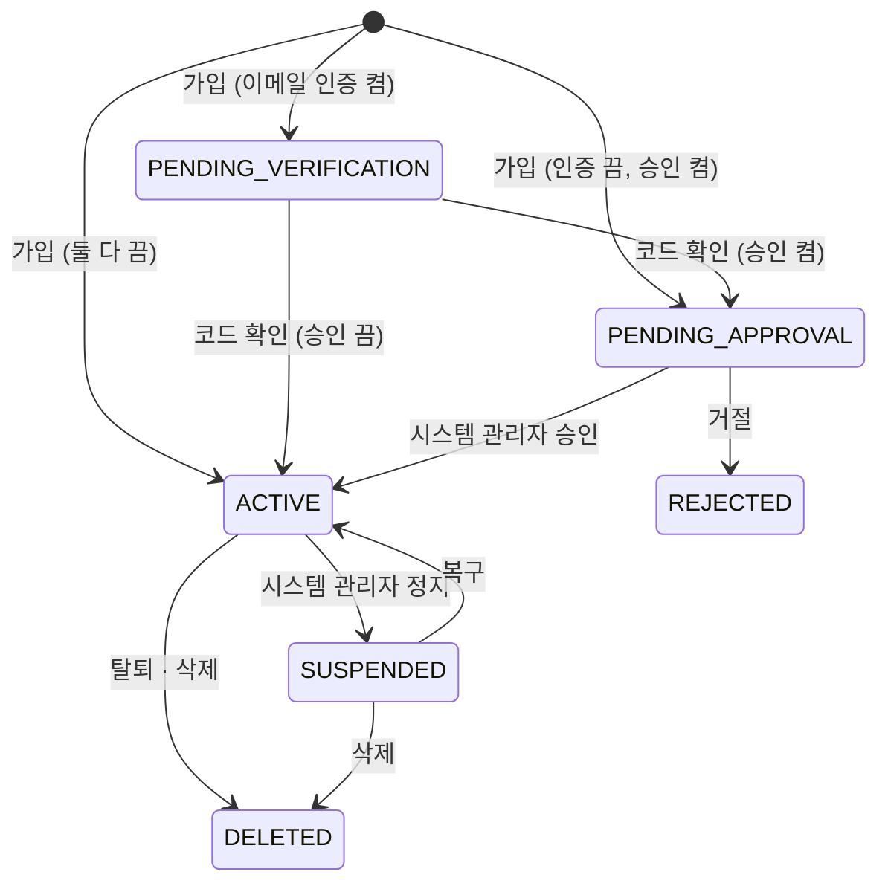
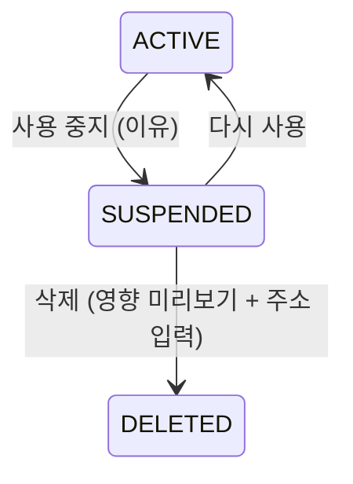
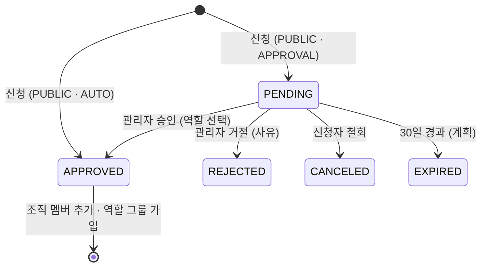
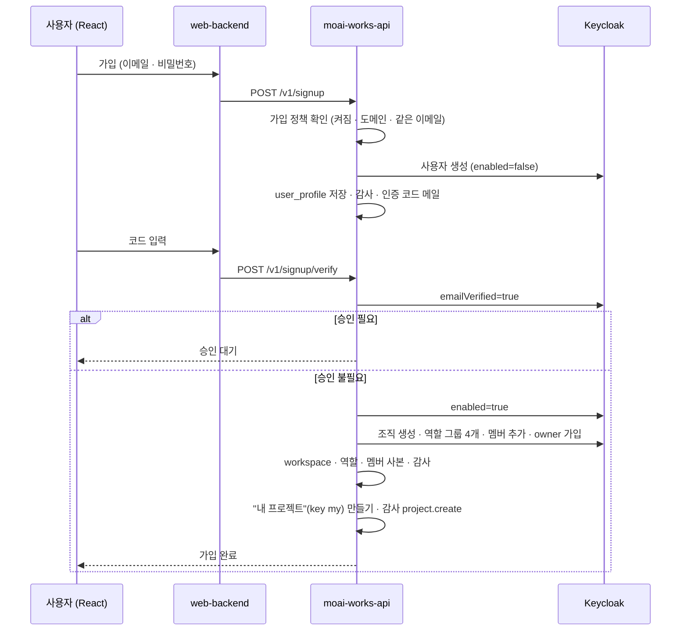
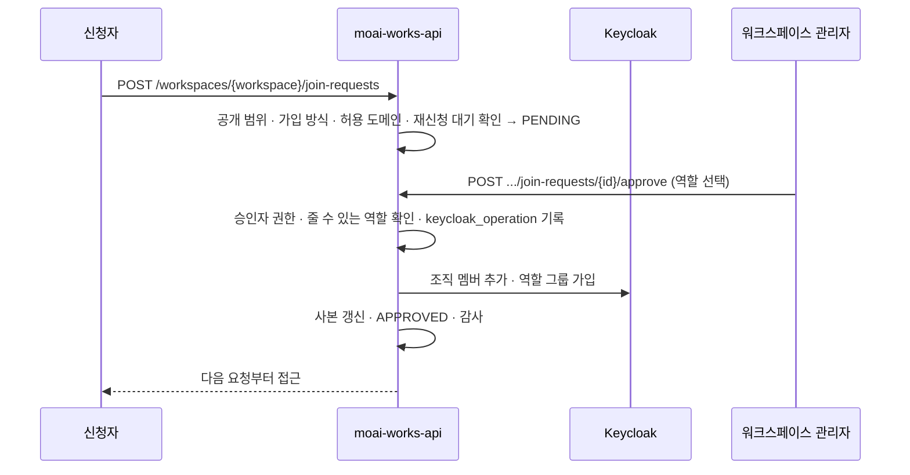
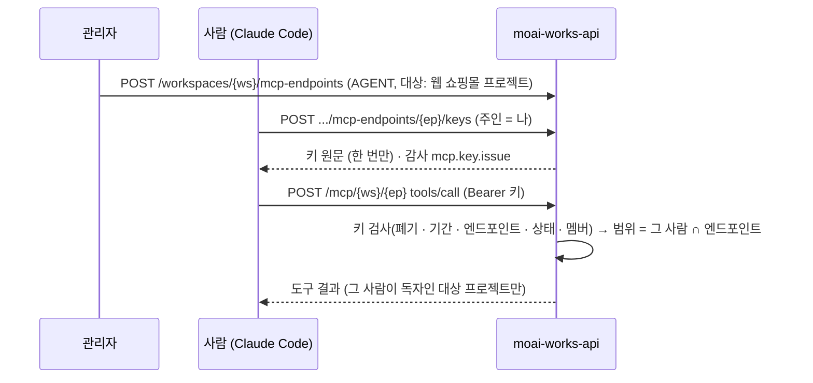

[홈](../README.md) › [설계](00-key-decisions.md) › 워크스페이스 · 계정 · 권한

# 워크스페이스 · 계정 · 권한 설계

사용자가 **회원가입**하면 **개인 워크스페이스**와 그 안의 **"내 프로젝트"** 가 생기고, 팀 워크스페이스에 **가입 신청**하거나 **초대**받아 함께 일한다. 계정 · 멤버십 · 역할은 **Keycloak** 이 정본이고, moai-works-api 가 DB 사본으로 권한을 판정한다. 워크스페이스 안의 일은 **프로젝트**마다 권한이 갈린다. 바깥 AI Agent 는 MCP 로 붙어 사람과 같은 판정을 거친다.

> **moai-wiki 설계 13 을 옮겼다 (2026-11-21, 2026-11-22 다시 맞춤).** 계층은 "플랫폼 → 워크스페이스 → 위키" 대신 "플랫폼 → 워크스페이스 → **프로젝트**" 이고, 그 밖은 moai-wiki 와 같다([ADR-002](00-key-decisions.md#adr-002)). 2026-11-22 에 기본 역할 넷(큐레이터 복원, [ADR-017](00-key-decisions.md#adr-017)) · 권한 코드 25개 · 기본 프로젝트 · moai-wiki 와 같은 MCP 체계로 다시 맞췄고 "Agent 계정" 은 뺐다([ADR-007](00-key-decisions.md#adr-007) 폐기). 달라진 점은 [§18](#ws-impl)에 모았다.
> 요구사항: [FR-WSP](../requirements/01-workspace.md) · 프로젝트 층 상세: [프로젝트 설계](04-project.md) · MCP 상세: [MCP 설계](06-mcp.md)

**바로가기:** [확정한 사항](#ws-confirmed) · [구조](#ws-layers) · [세 층의 권한](#ws-permissions) · [판정 규칙](#ws-rules) · [권한 코드](#ws-catalog) · [Keycloak 매핑](#ws-keycloak) · [정본과 사본](#ws-sor) · [회원가입](#ws-signup) · [로그인](#ws-login) · [워크스페이스](#ws-workspace) · [멤버십 · 역할](#ws-membership) · [MCP](#ws-mcp) · [보안 원칙](#ws-security) · [데이터](#ws-model) · [API](#ws-api) · [감사](#ws-audit) · [대표 흐름](#ws-scenarios) · [위험](#ws-risks) · [구현 현황](#ws-impl)

---

<a id="ws-confirmed"></a>
## 1. 확정한 사항

| 결정 | 내용 |
|---|---|
| 구조 | **워크스페이스 안에 프로젝트 여러 개.** 워크스페이스 ⊃ 프로젝트 ⊃ 일감 — moai-wiki 의 워크스페이스 ⊃ 위키 ⊃ 페이지와 같다 |
| 권한 경계 | **프로젝트.** 공개 범위는 `WORKSPACE`(멤버 전원이 독자) · `RESTRICTED`(프로젝트 역할을 받은 멤버 + 소유자 · 관리자). 독자가 아니면 그 프로젝트가 있는지도 숨긴다(404). moai-wiki 의 "위키 = 권한 경계" 와 같다([ADR-005](00-key-decisions.md#adr-005)) |
| 가입 | 가입하면 **개인 워크스페이스**가 생기고, 가입한 사람이 그 워크스페이스의 **소유자**다. 개인 워크스페이스에는 **"내 프로젝트"** 가 하나 생긴다(moai-wiki 의 "내 위키" 자리) |
| 함께 쓰기 | 팀 워크스페이스는 **시스템 관리자가 허용한 계정만** 만든다. 다른 사람은 퍼블릭이면 가입 신청으로, 프라이빗이면 초대로만 들어온다 |
| 가입 · 로그인 화면 | **자체 React 화면.** api 가 Keycloak 관리 API 로 계정을 만들고, web-backend(BFF)가 패스워드 그랜트로 로그인한다 |
| 가입 정책 | 도메인 제한 · 이메일 인증 · 관리자 승인을 **각각 켜고 끈다.** 설정은 **시스템 관리자**만 한다 |
| 정본 | 계정 · 멤버십 · 워크스페이스 역할 · 프로젝트 역할은 **Keycloak(Organizations)**. 그 밖(설정 · 프로젝트 · 일감 · 가입 신청 · 초대 · 감사 · MCP 엔드포인트 · 키)은 **api DB** |
| AI | 시스템 안에 LLM · Agent 가 없다. 바깥 AI Agent 가 **MCP** 로 붙고, 늘 키 주인(사람)의 권한 안에서만 일한다 — MCP 키는 사용자 계정에 묶인다([ADR-024](00-key-decisions.md#adr-024)) |
| 같은 모양 | 저장소 구조 · 의존성 · 인증 · 역할과 권한 · 워크스페이스 · MCP · 흐름 · 화면을 moai-wiki 와 같게 둔다(코드를 나눠 쓰지 않고 같은 모양을 유지한다) |

---

<a id="ws-layers"></a>
## 2. 구조 한눈에

```
플랫폼 (Keycloak 렐름 moai-works)          ← system-admin · security-officer                 [플랫폼 층]
 └─ 워크스페이스 (Keycloak Organization)    ← owner · admin · curator · member · 사용자 정의 역할  [워크스페이스 층]
     ├─ 프로젝트 ×N                         ← project-admin · project-curator · project-editor · project-reader  [프로젝트 층]
     │   └─ 일감 · 이력 · 댓글 · 연결
     └─ MCP 엔드포인트 ×N (조회용 · 작업용)  ← 엔드포인트마다 MCP 키 (사용자 계정에 묶임)
```

- 사람 한 명은 **개인 워크스페이스 1개**를 반드시 갖고, 다른 워크스페이스 여러 곳의 멤버가 될 수 있다.
- **권한 경계는 프로젝트다.** 워크스페이스는 프로젝트를 묶는 관리 단위이고, 멤버십 · 역할의 단위다.
- 시스템 관리자는 **시스템만 관리한다**([ADR-023](00-key-decisions.md#adr-023), 2026-11-22). 워크스페이스 영역과 나뉜다 — 시스템 관리자 계정에는 개인 워크스페이스가 생기지 않고, 팀 워크스페이스를 만들거나(허용 수를 받아도) 가입 신청 · 초대 수락으로 들어갈 수 없다(403 `SYSTEM_ADMIN_NOT_ALLOWED`). 그래서 워크스페이스의 내용(프로젝트 · 일감 · 감사)도 보지 않는다. 로그인하면 시스템 관리 화면으로 간다. 팀 워크스페이스를 사용 중지 · 다시 사용하게 할 수 있고, 삭제는 사용 중지한 뒤에만 한다([§9.1](#ws-suspend), 2026-11-23).
- MCP 엔드포인트는 워크스페이스에 속한다([§11](#ws-mcp)).

---

<a id="ws-permissions"></a>
## 3. 세 층의 권한

### 3.1 플랫폼 층 — Keycloak 렐름 역할

| 역할 | 코드명 | 할 수 있는 일 | 할 수 없는 일 |
|---|---|---|---|
| 시스템 관리자 | `system-admin` | 가입 정책(도메인 제한 · 이메일 인증 · 승인 · 속도 제한) 설정 · 가입 승인 · 거절 · 계정 정지 · 복구 · 삭제 · 계정별 팀 워크스페이스 허용 수 · 워크스페이스 정지 · 복구 · 소유자를 잃은 워크스페이스에 소유자 재지정 · 플랫폼 감사 조회 · 플랫폼 한도 | 워크스페이스 **내용** 열람, 워크스페이스 안의 역할 · 프로젝트 설정 변경(멤버가 아니면) |
| 보안 담당 | `security-officer` | (계획) 플랫폼 감사 열람 · 관리 기능 접근 통제와 플랫폼 MCP 한도 같은 보안 설정 승인 | 자기 제안 자기 승인 |

- 두 역할은 **Keycloak 렐름 역할**로 주고, 시스템 관리자 API(`/moai-works-api/v1/admin/**`, `@PlatformApi`)에서만 쓴다.
- 처음 시스템 관리자는 설치 스크립트(`infra/keycloak/ensure-realm.py`)가 만든다. 이후 지정 · 해제는 시스템 관리자 화면에서 하고 감사에 남긴다(계획).
- `security-officer` 는 moai-wiki 에서 보안등급 · 외부 모델 · MCP 신뢰 등급을 맡았는데, moai-works 에는 그 기능이 없다. **지금 코드에서 쓰는 곳이 없다** — 맡길 일(위 계획)을 정해야 한다. 한 사람이 두 역할을 함께 가지면 경고한다(직무 분리, [FR-WSP-019](../requirements/01-workspace.md#fr-wsp-019)).

### 3.2 워크스페이스 층 — 조직 그룹 = 역할, 클라이언트 역할 = 권한 코드

- 역할은 **조직 그룹** `/roles/<역할 키>` 다. 멤버는 역할 그룹에 들어가는 것으로 역할을 받는다. 역할은 여러 개 가질 수 있고 권한은 **합집합**이다.
- 역할이 담는 권한은 **권한 코드**([§4](#ws-catalog))이고, 권한 코드는 Keycloak 클라이언트 `moai-works-api` 의 **클라이언트 역할**이다. 조직 그룹에 클라이언트 역할을 매핑해 "역할 = 권한 묶음" 을 Keycloak 안에서 표현한다(moai-wiki 가 Keycloak 26.8 에서 실측한 구조).
- **기본 역할 4개**(`owner` · `admin` · `curator` · `member`)는 모든 워크스페이스에 자동으로 생기고 고칠 수 없다. 워크스페이스는 **사용자 정의 역할**을 더 만들 수 있다([§10.4](#ws-membership)).
- 워크스페이스 역할의 코드는 **모든 프로젝트에서** 통한다(예: 큐레이터는 독자인 모든 프로젝트에서 일감을 만들고 고친다). 특정 프로젝트에서만 더 주려면 프로젝트 역할을 준다(§3.3). 소유자 · 관리자는 모든 프로젝트의 독자이고 모든 코드를 가진다.

<a id="ws-project-layer"></a>
### 3.3 프로젝트 층 — 공개 범위와 프로젝트 역할

moai-wiki 설계 13 §3.3 "위키 층" 과 같다. 상세(판정 · `@ProjectApi` · 역할 주기 · Keycloak 이중 쓰기 · 화면)는 [프로젝트 설계](04-project.md)에 있다.

| 프로젝트 공개 범위 | `project.visibility` | 프로젝트 독자 |
|---|---|---|
| 워크스페이스 전체 | `WORKSPACE` (기본) | 그 워크스페이스의 활성 멤버 전원 |
| 지정 멤버만 | `RESTRICTED` | 그 프로젝트의 프로젝트 역할을 받은 멤버 + 소유자 · 관리자 |

| 프로젝트 역할 (고정 4개) | 조직 그룹 | 그 프로젝트에서 받는 코드 |
|---|---|---|
| 프로젝트 독자 `project-reader` | `/projects/<프로젝트 id>/project-reader` | `issue.read` · `issue.comment` |
| 프로젝트 편집자 `project-editor` | `/projects/<프로젝트 id>/project-editor` | 독자 + `issue.create` · `issue.edit` |
| 프로젝트 큐레이터 `project-curator` | `/projects/<프로젝트 id>/project-curator` | 편집자 + `issue.manager.assign` |
| 프로젝트 관리자 `project-admin` | `/projects/<프로젝트 id>/project-admin` | 큐레이터 + `issue.delete` · `project.manage`(그 프로젝트의 설정 · 프로젝트 역할 관리) |

- 정본은 Keycloak 조직 그룹, api DB 는 사본(`project_role_binding`). **그룹에 클라이언트 역할을 매핑하지 않는다** — 역할이 고정이라 역할 → 코드는 api 의 `ProjectRole` 이 갖는다([ADR-006](00-key-decisions.md#adr-006)).
- 한 사람이 한 프로젝트에서 역할을 여러 개 가질 수 있고 권한은 합친다. 사용자 정의 프로젝트 역할은 없다.

<a id="ws-rules"></a>
### 3.4 판정 규칙

```
워크스페이스 권한(사람, 워크스페이스) = ⋃ 그 사람의 워크스페이스 역할들의 권한 코드
                                     (멤버가 아니거나 · 멤버십 정지 · 워크스페이스가 활성이 아니면 ∅ → 404.
                                      시스템 관리자가 사용 중지한 워크스페이스의 활성 멤버에게만 403 WORKSPACE_SUSPENDED)

프로젝트 독자인가(사람, 프로젝트)    = 워크스페이스 활성 멤버
                                     ∧ ( 공개 범위 = WORKSPACE
                                         ∨ 역할 key owner · admin 을 가짐
                                         ∨ 그 프로젝트의 프로젝트 역할을 가짐 )

프로젝트 권한(사람, 프로젝트)        = 워크스페이스 권한(사람, 워크스페이스) ∪ 프로젝트 역할 권한(사람, 프로젝트)

보이는가(사람, 프로젝트)             = 프로젝트 독자인가 ∧ ( 상태 = ACTIVE ∨ project.manage ∨ project.delete )

프로젝트 작업 허용(사람, 프로젝트, 코드) = 보이는가(사람, 프로젝트) ∧ 코드 ∈ 프로젝트 권한(사람, 프로젝트)
```

- **읽기 거부는 404, 쓰기 거부는 403.** 독자가 아니거나 · 없거나 · 보관됐는데 관리 권한이 없으면 `404 PROJECT_NOT_FOUND`, 독자인데 코드가 없으면 `403 PERMISSION_REQUIRED`. 없는 대상과 남의 대상의 응답이 같다(상태 · 코드 · 설명).
- **계정**이 활성이 아니면(정지 등) 사람용 API 는 모두 403(`ACCOUNT_NOT_ACTIVE`)이다. 토큰이 살아 있어도 다음 요청부터 막힌다.
- **워크스페이스**를 시스템 관리자가 사용 중지하면(`SUSPENDED`) 그 워크스페이스 · 프로젝트 입구가 모두 막힌다 — 멤버(소유자 포함)에게는 403 `WORKSPACE_SUSPENDED`(화면이 사용 중지 안내를 보인다), 멤버가 아니면 없는 것과 같은 404 다. MCP 키에게는 보이지 않는다(목록에서 빠지고 이름을 줘도 404). 판정은 `AccessInterceptor` · `WorkspaceAccessService.suspendedFor` · `McpScope.usable` 한 곳씩이다([§9.1](#ws-suspend)).
- 판정은 **매 요청 api DB 사본**으로 한다([§6](#ws-sor)). 토큰의 역할로 판정하지 않는다. 지금은 캐시 없이 요청마다 색인 조회를 한다(`WorkspaceAccessService` · `ProjectAccessService`).
- MCP 키로 들어오면 결과는 **키 주인의 권한 ∩ 엔드포인트 범위**다. 모든 키는 사용자 계정에 묶이고, 사람 권한을 넘는 키(서비스 키)는 없다([§11](#ws-mcp)).

---

<a id="ws-catalog"></a>
## 4. 권한 코드 카탈로그

권한 코드는 플랫폼이 정의한다. 정본은 api 코드(`Permission` enum)이고, Keycloak 클라이언트 역할은 설치 스크립트가 같은 목록(`infra/keycloak/permission-catalog.json`)으로 만든다. api 는 기동 때 DB 표(`permission`)를 맞추고 Keycloak 과 대조한다. 워크스페이스는 코드를 새로 만들 수 없고, 골라서 역할을 만든다.

**카탈로그 25개 (2026-11-22)** — 토대 16개 + 프로젝트 · 일감 9개. moai-wiki 의 목록에서 위키 · 페이지 코드를 프로젝트 · 일감 코드로 바꾸고, 내장 AI · 자료실 코드를 뺐다.

| 묶음 | 코드 | 허용하는 일 | moai-wiki | 소유자 전용 |
|---|---|---|---|---|
| 워크스페이스 | `workspace.read` | 워크스페이스 정보 · 프로젝트 목록 보기(프로젝트는 독자인 것만) | 같다 | |
| | `workspace.settings.manage` | 이름 · 설명 · 공개 범위 · 가입 방식 · 가입 허용 도메인 · 기본 역할 변경 | 같다 | |
| | `workspace.ownership.transfer` | 소유권 이전, 소유자 역할 부여 · 회수 | 같다 | ● |
| | `workspace.delete` | 워크스페이스 삭제 요청 | 같다 | ● |
| 멤버 | `member.read` | 멤버 목록 보기 | 같다 | |
| | `member.invite` | 초대 보내기 · 취소 · 보낸 초대 보기 | 같다 | |
| | `member.request.review` | 가입 신청 보기 · 승인 · 거절 | 같다 | |
| | `member.remove` | 멤버 제거(가입 취소) · 정지 · 복구 | 같다 | |
| | `member.role.assign` | 멤버에게 역할 부여 · 회수 (자기가 줄 수 있는 범위 안에서) | 같다 | |
| 역할 | `role.manage` | 사용자 정의 역할 만들기 · 고치기 · 지우기 | 같다 | |
| 프로젝트 | `project.create` | 프로젝트 만들기 | `wiki.create` | |
| | `project.manage` | 프로젝트 설정 · 공개 범위 · 프로젝트 역할 관리 | `wiki.manage` | |
| | `project.delete` | 프로젝트 보관 · 복원 · 삭제 | `wiki.delete` | |
| 일감 | `issue.read` | 일감 보기(프로젝트 독자일 때) | `page.read` | |
| | `issue.create` | 일감 만들기 | `page.create` | |
| | `issue.edit` | 일감 고치기 — 상태 · 날짜 · 담당자 · 상위 · 하위 · 연결 포함 | `page.edit` | |
| | `issue.comment` | 댓글 달기 | `feedback.create` | |
| | `issue.manager.assign` | 일감 관리자 바꾸기 | `page.owner.assign` | |
| | `issue.delete` | 일감 지우기 | `page.delete` | |
| MCP | `mcp.endpoint.manage` | MCP 엔드포인트 만들기 · 고치기 · 끄기 | 같다 | |
| | `mcp.key.issue.personal` | **MCP 키로 이 워크스페이스에서 일하기** — 자기 MCP 키를 받고, 그 키로 이 워크스페이스에서 일한다. 이 권한이 있는 워크스페이스만 키에게 보인다(관리자는 역할에서 빼서 Agent 를 막는다). 화면 이름만 2026-11-23 바꿨다 — 코드는 그대로([ADR-029](00-key-decisions.md#adr-029)) | 같다 | 옛 이름 "자기 MCP 키 발급" |
| | `mcp.key.issue.service` | **쓰지 않음** — 서비스 키를 없앴다(2026-11-22, [ADR-024](00-key-decisions.md#adr-024)). MCP 단계에서 moai-wiki 와 함께 카탈로그에서 뺀다 | 같다 | |
| | `mcp.key.manage` | 다른 멤버의 키 보기(2026-11-23 부터 만료시키기는 주인만 — [ADR-029](00-key-decisions.md#adr-029)) | 같다 | |
| 감사 · 사용량 | `audit.read` | 워크스페이스 감사 기록 조회 | 같다 | |
| | `usage.read` | MCP 사용량 조회 | 같다 | |

### 4.1 기본 역할

| 권한 | 소유자 `owner` | 관리자 `admin` | 큐레이터 `curator` | 멤버 `member` |
|---|---|---|---|---|
| 워크스페이스 읽기 · 멤버 보기 | ○ | ○ | ○ | ○ |
| 워크스페이스 설정 | ○ | ○ | — | — |
| 소유권 이전 · 삭제 | ○ | — | — | — |
| 초대 · 가입 승인 · 제거 · 역할 부여 | ○ | ○ (소유자는 못 건드림) | — | — |
| 사용자 정의 역할 | ○ | ○ | — | — |
| 프로젝트 만들기 · 관리 · 보관 · 삭제 | ○ | ○ | — | — |
| 일감 보기 · 댓글 | ○ | ○ | ○ | ○ |
| 일감 만들기 · 고치기 · 관리자 바꾸기 | ○ | ○ | ○ | — |
| 일감 지우기 | ○ | ○ | — | — |
| MCP 엔드포인트 관리 · 멤버들의 키 보기 | ○ | ○ | — | — |
| MCP 키로 이 워크스페이스에서 일하기 | ○ | ○ | ○ | ○ |
| 감사 · 사용량 | ○ | ○ | — | — |
| 지정 멤버 프로젝트(`RESTRICTED`)의 독자 | 모두 | 모두 | 프로젝트 역할이 있는 것만 | 프로젝트 역할이 있는 것만 |

- **소유자는 모든 권한 코드를 가진다.** 소유자는 늘 1명 이상이다. 관리자는 소유자 전용 2개를 뺀 전부를 가진다. 코드를 더하면 소유자 · 관리자에게는 자동으로 들어간다(`BuiltinRole`).
- **큐레이터**는 `workspace.read` · `member.read` · `issue.read` · `issue.create` · `issue.edit` · `issue.comment` · `issue.manager.assign` · `mcp.key.issue.personal` 이다 — 독자인 모든 프로젝트에서 일감을 만들고 고친다. 일감 삭제 · 프로젝트 관리는 못 한다(moai-wiki 의 큐레이터와 같은 자리, [ADR-017](00-key-decisions.md#adr-017)).
- **멤버**는 `workspace.read` · `member.read` · `issue.read` · `issue.comment` · `mcp.key.issue.personal` 이다 — 읽고 댓글만 단다. 특정 프로젝트에서 일감을 만들려면 그 프로젝트의 **프로젝트 편집자** 이상을 받는다. 워크스페이스 전체에서 만들게 하려면 사용자 정의 역할을 쓴다.
- 관리자는 소유자를 제거 · 정지하거나 소유자 역할을 줄 수 없다.

<a id="ws-catalog-planned"></a>
### 4.2 카탈로그가 바뀐 내역

| 언제 | 바뀐 것 |
|---|---|
| 2026-11-21 | moai-wiki 의 33개 가운데 토대 16개만 가져왔다 |
| 2026-11-22 | 프로젝트 · 일감 코드 9개를 더했다(위 표). 2026-11-21 에 "계획"으로 적었던 코드(`project.archive` · `config.manage` · `issue.edit.own` · `issue.assign` · `issue.note` · `issue.note.private` · `issue.private.read` · `issue.relation.manage` · `issue.watcher.manage` · `issue.import` · `query.save.public` · `version.manage` · `time.*` · `wiki.*` · `news.manage` · `document.*` · `file.*` · `forum.*` · `repository.*` · `webhook.manage` · `agent.account.manage`)는 쓰지 않는다 — 나중 후보 기능을 고를 때 그 기능의 코드를 다시 정한다 |
| moai-wiki 에서 뺀 코드 | `page.archive` · `page.restrict` · `access.preview` · `changeset.review` · `agent.request` · `agent.run.manage` · `source.manage` · `document.read` · `document.upload` — 일감에는 보관 · 편집 제한이 없고, 내장 AI · 자료실이 없다 |

새 코드를 더할 때는 `Permission` · `permission-catalog.json` · 기본 역할(`BuiltinRole`) · 프로젝트 역할(`ProjectRole`) · 화면 리소스 · 이 표를 함께 고친다([SECURITY.md](../../SECURITY.md)).

---

<a id="ws-keycloak"></a>
## 5. Keycloak 매핑

moai-wiki 가 Keycloak 26.8.2 에서 실측한 구조를 그대로 쓴다. moai-works 렐름은 2026-11-22 같이 쓰는 MOAI-Keycloak 에 만들었다(`infra/keycloak/init-realm.sh` → `realm-moai-works.json` · `ensure-realm.py`).

| moai-works | Keycloak | 비고 |
|---|---|---|
| 계정 | 렐름 `moai-works` 의 **사용자**. 속성 `moai.origin`(누가 만든 계정인지) | 같이 쓰는 `MOAI-Keycloak` :8180 |
| 플랫폼 역할 | **렐름 역할** `system-admin` · `security-officer` | |
| 워크스페이스 | **Organization.** `alias` = 워크스페이스 주소, 속성 `moai.workspaceId` · `moai.kind`. 렐름에 `organizationsEnabled=true`(설치 스크립트가 켬) | |
| 멤버십 | **조직 멤버** (`UNMANAGED`) | |
| 워크스페이스 역할 | **조직 그룹** `/roles/<역할 키>` (기본 `owner` · `admin` · `curator` · `member`, 사용자 정의 `custom-<id>`) | 렐름 그룹 목록과 섞이지 않는다 |
| 권한 코드 | 클라이언트 `moai-works-api` 의 **클라이언트 역할**, 워크스페이스 역할 그룹에 매핑 | |
| 프로젝트 역할 | 조직 그룹 `/projects/<프로젝트 id>/<project-admin · project-curator · project-editor · project-reader>` | moai-wiki 의 `/wikis/<id>/<role>` 과 같은 구조. **클라이언트 역할을 매핑하지 않는다**([§3.3](#ws-project-layer)) |
| 토큰 | `organization` 클레임에 소속 조직 alias 만 실린다 | 역할은 안 실림 → 판정에 쓰지 않는다 |
| 프로젝트 · 일감 · 가입 신청 · 초대 · 워크스페이스 설정 · 감사 · MCP 엔드포인트 · 키 | **Keycloak 에 두지 않는다** → api DB | |

- **Keycloak 에 쓰는 주체는 api 하나뿐이다**(클라이언트 `moai-works-api` 의 서비스 계정). web-backend · 사람은 Keycloak 관리 API 를 직접 부르지 않는다.
- Keycloak 콘솔에서 조직 · 그룹을 직접 고치지 않는다(운영 규칙). 고치면 대사([§6.3](#ws-sor))가 찾아내 감사에 남긴다(대사는 아직 없다).
- Keycloak 의 조직 초대(`invitations`)는 쓰지 않는다 — 초대 메일 · 링크가 Keycloak 화면으로 가기 때문이다. 초대는 api 가 하고, 수락되면 api 가 조직 멤버로 넣는다.
- 권한 코드(클라이언트 역할)는 설치 스크립트가 만들고 api 는 대조만 한다 — api 에 클라이언트 관리 권한을 주지 않기 위해서다. api 서비스 계정의 realm-management 역할은 지금 `manage-realm` · `manage-users` 와 조회 역할(`view-realm` · `view-users` · `query-users` · `query-groups` · `view-clients` · `query-clients`)이다. `manage-realm` 은 넓다 — 조직 관리에 필요한 최소 역할을 실측해 줄인다.

---

<a id="ws-sor"></a>
## 6. 정본과 사본

### 6.1 무엇이 어디의 정본인가

| 데이터 | 정본 | api DB |
|---|---|---|
| 계정(로그인 ID · 비밀번호 · 이메일 인증 · 잠금 · 활성) | Keycloak | `user_profile` **사본** + 가입 절차 상태 |
| 플랫폼 역할 | Keycloak 렐름 역할 | `user_profile.platform_roles` 사본 |
| 멤버십 · 역할 부여 · 역할 ↔ 권한 매핑 | Keycloak 조직 · 조직 그룹 | `workspace_member` · `member_role` · `workspace_role` · `role_permission` **사본** |
| 프로젝트 역할 | Keycloak 조직 그룹 `/projects/…` | `project_role_binding` **사본** ([프로젝트 설계 §4](04-project.md#pj-roles)) |
| 가입 정책 · 워크스페이스 설정 · 프로젝트 · 일감 · 가입 신청 · 초대 · Keycloak 쓰기 기록 · 감사 · MCP 엔드포인트 · 키 | **api DB** | 정본 |

### 6.2 권한 판정은 사본으로 한다

- 요청마다 Keycloak 을 부르면 응답이 느려지고 **Keycloak 장애가 모든 조회 장애가 된다.** 그래서 api 는 자기 DB 의 사본으로 판정한다.
- 멤버십 · 역할을 바꾸는 길은 **api 하나뿐**이므로, api 가 Keycloak 에 쓴 직후 같은 처리에서 사본을 고친다 → **다음 요청부터 바로 반영**된다(토큰 갱신을 기다리지 않는다).
- 지금은 캐시가 없다. 여러 인스턴스에서 캐시가 필요해지면 (사람, 워크스페이스, 권한 판) 키로 두고, 바뀌면 모든 인스턴스의 캐시를 지운다.

### 6.3 쓰기 순서와 실패 처리 (이중 쓰기)

```
1. api DB  : keycloak_operation 기록 (PENDING, 멱등 키)            ┐ 트랜잭션 ①
2. Keycloak: 관리 API 호출 (이미 반영돼 있으면 성공으로 본다 = 멱등)
3. api DB  : 사본 갱신 + keycloak_operation DONE                   ┐ 트랜잭션 ②
   실패    : FAILED 로 남기고 오류 — 같은 요청(같은 멱등 키)을 다시 하면 이어서 한다
```

- 계정 생성처럼 Keycloak 이 먼저 성공하고 DB 가 실패하면 **보상**한다(Keycloak 사용자 삭제).
- 워크스페이스 만들기는 상태 `PROVISIONING` 으로 시작해 단계마다 기록하고, 끊기면 다음 요청이 이어서 끝낸다([§8.2](#ws-login)).
- 프로젝트 역할 주기 · 빼기도 같은 길이다([프로젝트 설계 §4.2](04-project.md#pj-keycloak)).
- **대사(계획):** 15분마다 Keycloak 조직 · 그룹 · 멤버와 사본을 비교한다. 차이가 있으면 **Keycloak 을 기준으로 사본을 고치고** 감사에 남긴다. 실패한 쓰기를 다시 시도하는 예약 작업도 이때 둔다.

---

<a id="ws-signup"></a>
## 7. 회원가입

### 7.1 가입 정책 (시스템 관리자만 설정)

| 설정 (`platform_setting.key`) | 값 | 기본 | 뜻 |
|---|---|---|---|
| `signup.enabled` | bool | true | 가입을 받는가 |
| `signup.allowed_email_domains` | 도메인 목록 | (비어 있음) | 비어 있으면 **누구나**, 있으면 **그 도메인만** |
| `signup.require_email_verification` | bool | true | 이메일 인증 코드를 확인해야 다음 단계로 |
| `signup.require_admin_approval` | bool | false | 시스템 관리자가 승인해야 활성화 |
| `signup.rate_limit_per_ip_hour` | int | 10 | 가입 요청 속도 제한 |
| `workspace.team_workspace_grant_default` | int | 2 | 시스템 관리자가 계정에 팀 워크스페이스 만들기를 허용할 때 기본으로 넣는 수. 계정마다 실제로 만들 수 있는 수는 `user_profile.team_workspace_limit`(가입하면 0) |

세 가지(도메인 제한 · 이메일 인증 · 승인)는 **서로 독립된 스위치**다. 예: "사내 도메인만 + 승인 필요", "누구나 + 승인 없음".

### 7.2 계정 상태



- `ACTIVE` 가 아니면 Keycloak 사용자 `enabled=false` → 로그인할 수 없다. 정지하면 이미 받은 토큰도 다음 요청부터 403 이다(사본의 상태를 본다).
- 인증 대기는 7일, 승인 대기는 30일이 지나면 계정을 지운다(계획 — 예약 작업이 아직 없다).
- 탈퇴(계획, [FR-WSP-029](../requirements/01-workspace.md#fr-wsp-029)): Keycloak 사용자를 끄고 지우고, 멤버십 · 프로젝트 역할을 거두고 그 사람의 MCP 키를 모두 만료시킨다. 그 사람이 쓴 일감 · 이력은 남기고 "탈퇴한 사용자" 로 보인다. 그 사람이 관리자 · 담당자인 일감은 그대로 두고 화면에 "떠난 사람" 으로 보인다([일감 설계 §6](05-issue.md#is-people)).

### 7.3 흐름

1. React 가입 화면 → web-backend → api `POST /moai-works-api/v1/signup`(이메일 · 비밀번호 · 표시 이름). 공개 경로이고 IP별 속도 제한을 건다.
2. api: 가입 정책 확인(켜짐 · 도메인 · 같은 이메일) → Keycloak 사용자 생성(**비밀번호 정책은 Keycloak 렐름 정책이 검사**, 지금 `length(8)`) → `user_profile` 저장 · 감사. DB 실패 시 Keycloak 사용자 삭제(보상).
3. 이메일 인증: api 가 6자리 코드를 메일로 보낸다(DB 에는 HMAC 만, 10분, 5회). `POST /signup/verify` → Keycloak `emailVerified=true`. 재발송 `POST /signup/resend`(속도 제한).
4. 승인: 시스템 관리자 화면에서 승인 · 거절.
5. `ACTIVE` 가 되면 **개인 워크스페이스를 만든다**([§8.2](#ws-login)).

Keycloak 에서 직접 만든 계정(설치 스크립트의 시스템 관리자 · 개발 계정 `moaiworks01~10`)은 가입 절차를 건너뛴다. 처음 로그인할 때 api(`POST /me/login`)가 사본(`origin = KEYCLOAK`)을 만들고 개인 워크스페이스를 보장한다.

---

<a id="ws-login"></a>
## 8. 로그인과 워크스페이스 만들기

### 8.1 로그인 · 세션

- React 로그인 화면 → web-backend `POST /api/auth/sign-in` → Keycloak **패스워드 그랜트**(클라이언트 `moai-works-web-backend`) → web-backend 가 토큰을 **서버 세션**(Spring Session, Redis 키 `moai-works:web-backend:session:…`)에 둔다. 브라우저에는 HttpOnly · Secure 쿠키 `__Host-MOAI_WORKS_SESSION` 만 간다. 세션은 8시간 쓰지 않으면 끝난다(`server.servlet.session.timeout`).
- 로그인하면 세션 id 를 바꾸고, CSRF 는 SPA 쿠키 방식으로 막는다. 로그인 시도 제한 · CSP · 헤더 허용 목록을 둔다. 로그아웃(`POST /api/auth/sign-out`)은 Keycloak 세션도 끝낸다.
- web-backend 는 `/api/v1/**` 를 api `/moai-works-api/v1/**` 로 1:1 전달하며 사용자 토큰을 실어 보낸다(만료 전 갱신). api 는 JWT 를 JWKS 로 직접 검증하고 권한은 사본으로 판정한다.
- 로그인 직후 web-backend 가 api `POST /me/login` 을 부른다 → 로그인 기록 · 감사(`account.login`) · 개인 워크스페이스 보장 · 들어갈 워크스페이스(마지막에 쓴 곳 → 먼저 들어간 팀 → 개인).
- 무차별 대입 방지: 렐름 `bruteForceProtected=true`, 실패 10회(설치 스크립트가 맞춤). 비밀번호 변경 · 찾기는 Keycloak 화면이 아니라 우리 화면 → api → Keycloak 관리 API 다([§8.3](#ws-password), [FR-WSP-006](../requirements/01-workspace.md#fr-wsp-006)).
- ⚠️ 패스워드 그랜트는 OAuth 2.1 에서 빠지는 방식이다. 자체 화면을 쓰기로 해서 채택했다(moai-wiki 와 같은 결정). MFA(OTP)를 이 방식에서 받을 수 있는지는 확인이 필요하다([FR-WSP-025](../requirements/01-workspace.md#fr-wsp-025)).

### 8.2 개인 워크스페이스 만들기 (멱등 단계)

| 단계 | 하는 일 |
|---|---|
| 1 | `workspace` 행(PERSONAL · PRIVATE · `PROVISIONING`, 주소 = `workspace-` + 고유 id 12자). 계정에 바로 연결(같은 계정의 동시 요청 차단) |
| 2 | Keycloak 조직 생성(`alias` = 주소, 속성 `moai.workspaceId`). 이미 있으면 속성으로 찾아 쓴다 |
| 3 | 조직 그룹 `/roles` 와 기본 역할 그룹 `owner` · `admin` · `curator` · `member` 생성 + 권한 코드 매핑 |
| 4 | `workspace_role` · `role_permission` 사본 |
| 5 | 가입자를 조직 멤버로 추가 → `/roles/owner` 가입 |
| 6 | `workspace_member` · `member_role` 사본, 워크스페이스 `ACTIVE`, 감사 `workspace.create` |
| 7 | **개인 워크스페이스면** 기본 프로젝트 **"내 프로젝트"**(key `my`, `WORKSPACE`)를 만든다 — 그 워크스페이스에 프로젝트를 만든 적이 한 번도 없을 때만(멱등). 감사 `project.create`(`default: true`) |

- 2~6 은 `keycloak_operation` 에 기록돼 몇 번이든 다시 돌릴 수 있다(멱등). 팀 워크스페이스도 같은 단계를 쓴다(7단계 없음).
- 7단계는 moai-wiki 의 "내 위키"(`WikiService.ensureDefault`)와 같다 — `ProjectService.ensureDefault`. 상세는 [프로젝트 설계 §5](04-project.md#pj-default).

<a id="ws-password"></a>
### 8.3 비밀번호 변경 · 찾기 (2026-11-24, [FR-WSP-006](../requirements/01-workspace.md#fr-wsp-006) · moai-works 일감 #28)

사용자: "로그인 후 자기 비밀번호 변경 기능 있어?" → "응 등록하고 진행해". 그전에는 관리자가 Keycloak 콘솔에서 바꾸는 길뿐이었다. 사람은 Keycloak 의 화면을 보지 않으므로(렐름 `resetPasswordAllowed=false` 그대로) 우리 화면 → api → Keycloak 관리 API 로 한다. moai-wiki 에도 아직 없다(같은 모양으로 옮기면 된다).

**변경 — 로그인한 사람** (개인 설정 › 비밀번호 `?settings=password`, 계정 메뉴의 "비밀번호 변경"도 그 칸을 연다)

| 단계 | 하는 일 |
|---|---|
| 1 | `POST /v1/me/password` `{currentPassword, newPassword, signOutOtherSessions}` — `@UserApi(systemAdmin = true)`(시스템 관리자 계정도 자기 비밀번호를 바꾼다). 서비스 계정 403 `USER_ONLY` |
| 2 | 틀린 횟수 제한 — 사람마다 15분에 5번(`PasswordAttemptLimiter`, 맞혀도 그 창 동안 429 `RATE_LIMITED`). 새 비밀번호가 지금 것과 같으면 400 `PASSWORD_UNCHANGED` |
| 3 | **지금 비밀번호 확인** — api 가 Keycloak 토큰 엔드포인트에 그 사람의 아이디로 패스워드 그랜트를 한다(클라이언트 `moai-works-api`, 확인 전용). 맞으면 그 확인으로 생긴 Keycloak 세션을 바로 끝내고 토큰은 버린다. 틀리면 400 `CURRENT_PASSWORD_INVALID` + 남은 횟수 — **401 이 아니다**(화면이 로그아웃되지 않게). Keycloak 이 잠근 계정은 423 `ACCOUNT_LOCKED`. Keycloak 관리 API 에는 비밀번호 확인 입구가 없어서 이 길을 골랐다 — api 서비스 계정은 이미 비밀번호를 정할 수 있으므로(manage-users) 이 클라이언트에 패스워드 그랜트를 켜도 할 수 있는 일은 늘지 않는다. 틀린 확인은 Keycloak 무차별 대입 잠금(10번)에도 센다 — 2단계의 5번이 먼저 막아 비밀번호 칸만으로 로그인이 잠기지는 않는다 |
| 4 | Keycloak 관리 API `PUT /users/{id}/reset-password`(임시 아님). 정책 위반은 400 `PASSWORD_POLICY` + `reason`(`MIN_LENGTH` · `HISTORY` …) · `value`(예: 8) — 가입과 같은 변환(`PasswordPolicyError`), 화면이 그 언어의 문장을 만든다 |
| 5 | **다른 기기의 로그인 끊기**(기본 켬): ① DB `user_profile.sessions_revoked_at`(초 단위로 올림) · `kept_session_id`(이 요청 토큰의 `sid`) — 그보다 먼저 시작한 로그인(토큰 `auth_time`, 없으면 `iat`)의 토큰은 만료 전이어도 다음 요청부터 401 `SESSION_REVOKED`, 이 로그인(같은 `sid`)은 갱신한 토큰까지 그대로 ② Keycloak 의 그 사람 세션 가운데 이 `sid` 가 아닌 것을 지운다(갱신 토큰도 못 쓴다) ③ web-backend 는 api 가 401 을 주면 그 자리에서 그 세션(Redis)을 지운다 — 다른 기기의 로그인은 처음 요청에서 끝난다. 토큰에 `sid` 가 없어 이 로그인을 가려낼 수 없으면 모두 끊고 `currentSessionKept=false` — 화면이 로그아웃시켜 다시 로그인하게 한다 |
| 6 | 감사 `account.password.change`(사용자 단위 — `workspace_id` 없음, `otherSessionsEnded` · `currentSessionKept`만, 비밀번호 없음) · 메일 "비밀번호가 바뀌었습니다"(때 · 방법 · 요청 IP · 다른 로그인을 끊었는지 · 직접 바꾸지 않았으면 비밀번호 찾기 링크) |

**찾기 — 로그인하지 않은 사람** (로그인 화면 "비밀번호를 잊으셨나요?" → `/password-reset` → `/password-reset/confirm?email=`)

| 단계 | 하는 일 |
|---|---|
| 1 | `POST /v1/password-reset/request` `{email}` — `@PublicApi`(공개 경로가 `/v1/signup/**` 에 `/v1/password-reset/**` 를 더했다). web-backend 는 가입과 같이 토큰 없이 넘기고 CSRF 는 그대로 본다. **늘 같은 202(본문 없음)** — 응답은 속도 제한(IP 시간당 10 · 이메일 시간당 5, 계정이 있든 없든 같이 센다)만 보고 바로 나가고, 계정 찾기 · 코드 · 메일은 뒤에서 한다(`BackgroundTasks`) — 응답 시간도 계정이 있는지로 갈리지 않는다 |
| 2 | 코드를 받는 계정 = 활성(ACTIVE) 사람 계정, 시스템 관리자 아님. 인증 · 승인 대기 · 정지 · 거절 계정과 시스템 관리자(로그인해 개인 설정에서 바꾼다)는 받지 않는다 — 응답은 같다 |
| 3 | 코드는 가입 인증과 같은 장치(`VerificationCodes`, `email_verification.purpose = PASSWORD_RESET`): 6자리 · HMAC 만 · 10분 · 5번 · 새 코드가 이전 코드를 무효로 |
| 4 | `POST /v1/password-reset/confirm` `{email, code, newPassword}`(IP 시간당 30) — 코드 줄을 잠그고(동시에 두 번 못 씀) 확인 → Keycloak 에 새 비밀번호 → 다 씀. 틀림 · 만료 · 다 씀 · 받을 수 없는 계정 · 없는 이메일은 모두 같은 400 `INVALID_CODE`. 정책 위반이면 400 `PASSWORD_POLICY` 이고 코드는 남는다(횟수만 센다) |
| 5 | 성공하면 그 계정의 로그인을 **모두** 끊는다(Keycloak `POST /users/{id}/logout` + DB 표시로 이미 나간 토큰도), Keycloak 무차별 대입 잠금을 풀고(`DELETE /attack-detection/brute-force/users/{id}`), 감사 `account.password.reset`(`via: EMAIL_CODE`) · 메일 "비밀번호가 바뀌었습니다". 204 → 화면은 로그인으로 |

- 재설정은 끊기를 고르지 않는다 — 메일 코드로 비밀번호를 되찾는 것은 누가 계정을 쓰고 있을지 모를 때라서 늘 모두 끊는다. 고르는 것은 로그인한 변경에서(요구사항 세부 3, 2026-11-24 정함).
- MCP 키는 비밀번호와 따로인 자격이라 비밀번호를 바꿔도 만료되지 않는다(키 화면에서 만료시킨다).
- Keycloak 세션 지우기 · 잠금 풀기 · 메일이 실패해도 비밀번호는 이미 바뀌었고 토큰은 DB 표시로 막힌다 — 경고 로그만 남긴다.
- 메일은 계정 메일 길(`Mailer.send` — 가입 인증 코드와 같다)이다. 알림 메일 보낼 통(V18)은 워크스페이스 알림을 보낼 때 다시 판정하는 장치라 쓰지 않는다. 로그 모드(로컬)에서는 재설정 코드가 api 로그에 본문째 남는다 — 로컬 개발자가 코드를 읽는 길이고, 운영은 smtp 모드다.

---

<a id="ws-workspace"></a>
## 9. 워크스페이스

| 항목 | 내용 |
|---|---|
| 종류 | `PERSONAL` — 가입 때 자동, **계정당 정확히 1개**, 늘 프라이빗, 소유자는 계정 주인으로 고정(이전 · 탈퇴 · 따로 삭제 불가). `TEAM` — 여러 사람이 함께 쓰는 워크스페이스, 소유권 이전 · 삭제 가능 |
| 팀 워크스페이스 만들기 | **가입한 계정은 만들 수 없다(0개).** 시스템 관리자가 계정마다 만들 수 있는 수를 정한다(`user_profile.team_workspace_limit`, 0~100, 허용할 때 기본 2). 세는 것은 그 계정이 만든 팀 워크스페이스(지운 것 제외)다. 수를 줄여도 있는 워크스페이스는 그대로이고 더 만들지 못할 뿐이다 |
| 주소 | `workspace-` + 고유 id 12자(무작위, 순번 아님, 서버가 정함). 플랫폼 전체에서 고유하고 **만든 뒤 바꾸지 않는다**(Keycloak 조직 alias · MCP 주소 · URL 에 들어간다). 사람은 이름만 정한다 |
| 공개 범위 | **퍼블릭**(`PUBLIC`) — 워크스페이스 찾기에 보이고 가입 신청할 수 있다. **프라이빗**(`PRIVATE`) — 다른 사람에게 보이지 않고(찾기 · 신청 모두 "없는 워크스페이스" 로 답한다) 초대로만 들어온다 |
| 가입 방식 | 퍼블릭에만 있다. `APPROVAL`(기본) — 관리자 승인 후 가입. `AUTO` — 신청하면 바로 기본 역할의 멤버. 프라이빗이면 `APPROVAL` 로 맞춰 저장한다 |
| 가입 허용 도메인 | 비어 있으면 누구나, 있으면 그 도메인 계정만 신청할 수 있다 |
| 기본 역할 | 새 멤버가 받는 역할(기본 `member`). 소유자 역할은 안 된다 |
| 재신청 대기 | 거절된 뒤 다시 신청하기까지 기다리는 날(기본 7일) |
| 상태 | `PROVISIONING`(만드는 중) · `ACTIVE` · `SUSPENDED`(시스템 관리자가 사용 중지 — 접근 차단, 데이터 보존, [§9.1](#ws-suspend)) · `DELETION_PENDING`(소유자가 삭제 요청, 7일 유예, 취소 가능, 읽기 전용 — 계획) · `DELETED`(Keycloak 조직 삭제, 데이터는 보존 규칙대로 — [§9.1](#ws-suspend) · [데이터 모델](02-data-model.md)) |

<a id="ws-suspend"></a>
### 9.1 사용 중지 · 다시 사용 · 삭제 (시스템 관리자, 2026-11-23)

사용자 결정(2026-11-22): "팀 워크스페이스는 시스템 어드민이 사용 못 하게 막을 수도 있어" · "다만 삭제는 사용 중지 후에만 가능해". moai-wiki 설계 13 의 상태(`ACTIVE` → `SUSPENDED` → `DELETED`, "시스템 관리자 정지 — 접근 차단, 데이터 보존" · "Keycloak 조직 삭제, 데이터는 보존 규칙대로")를 따른다(moai-wiki 에는 아직 코드가 없다). 코드는 `platform/WorkspaceAdminService` · `WorkspaceAdminController`([FR-WSP-019](../requirements/01-workspace.md#fr-wsp-019) · [FR-WSP-020](../requirements/01-workspace.md#fr-wsp-020), [WBS 1.8](../wbs/02-stage-1-foundation.md#w-1-8)).



| 항목 | 내용 |
|---|---|
| 대상 | **팀 워크스페이스만.** 개인 워크스페이스는 계정에 묶여 따로 막거나 지우지 않는다 — 409 `PERSONAL_WORKSPACE`. 한 사람을 막으려면 계정을 정지한다(moai-wiki §9 "개인: 이전 · 삭제 불가, 계정을 지우면 함께 처리") |
| 사용 중지 | 이유(1~500자)를 받는다. **Keycloak 조직을 먼저 끄고**(`enabled=false`, 받은 표현 전체를 다시 보내 이름 · 별칭 · 속성은 그대로) 사본을 `SUSPENDED` 로(`suspended_at` · `suspended_reason`). 멤버의 REST 403 `WORKSPACE_SUSPENDED` · MCP 숨김 · 그 워크스페이스의 알림을 알림함에서 숨김 · 찾기 · 가입 신청 · 초대 수락은 없는 워크스페이스와 같음 · 들어갈 곳(로그인 뒤)으로 고르지 않음. `/me` 의 내 워크스페이스에는 상태 `SUSPENDED` 로 남는다(화면이 "사용 중지" 표시 · 안내). 멤버십 · 역할 · 데이터는 그대로다. 이유는 시스템 관리 화면 · 감사에만 보이고 멤버에게는 보이지 않는다. 사용 중이 아니면 409 `WORKSPACE_NOT_ACTIVE` |
| 다시 사용 | Keycloak 조직을 켜고 사본을 `ACTIVE` 로(사용 중지 때 · 이유를 비움). 지운 것이 없으므로 모든 것이 그대로 돌아온다. 사용 중지가 아니면 409 `WORKSPACE_NOT_SUSPENDED` |
| 삭제 조건 | 사용 중지한 것만(아니면 409 `WORKSPACE_NOT_SUSPENDED` — 확인 문구보다 먼저 본다). 위험 작업 확인([FR-WSP-028](../requirements/01-workspace.md#fr-wsp-028)): 화면은 영향 미리보기(`GET …/deletion-preview` — 멤버 · 프로젝트 · 일감 · 첨부 수와 크기)를 보인 뒤 주소를 그대로 입력해야 단추가 통하고, api 가 `?confirm=<주소>` 를 다시 본다(틀리면 400 `CONFIRM_MISMATCH`) |
| 삭제 순서 | Keycloak 조직 지우기(`keycloak_operation`, 워크스페이스마다 멱등 키 하나) → 객체 저장소 `ws/<워크스페이스 id>/` 아래 전부(버전 보관분까지) → DB 한 트랜잭션. 앞 단계는 다시 해도 같은 결과라 끊기면 같은 요청을 다시 하면 이어서 끝난다. DB 가 끝나기 전에는 여전히 "사용 중지" 로 보인다 |
| 삭제가 지우는 것 | Keycloak 조직(조직 멤버십 · 역할 그룹 · 프로젝트 역할 그룹) · 첨부 파일 · DB 의 `workspace_member` · `member_role` · `workspace_role` · `role_permission` · `project_role_binding` · `join_request` · `invitation` · `issue_template` · 그 워크스페이스의 `notification` · `attachment_ticket`, 누군가의 `last_workspace_id` |
| 삭제가 남기는 것 | `workspace` 행(`DELETED` · `deleted_at` — 주소를 다시 쓰지 않고 감사가 가리키는 곳이 남는다) · `project`(`DELETED`) · 일감 · 이력 · 리비전 · 작업 시간 · 연결 · `issue_attachment`(지움 표시) · `audit_log` · MCP 접근 기록 — 추가 전용이라 지우지 않고 아무에게도 보이지 않는다. 영구 삭제는 나중의 보존 작업(프로젝트 삭제와 같다). MCP 키는 사용자의 것이라 그대로이고 이 워크스페이스만 보이지 않는다([ADR-029](00-key-decisions.md#adr-029)). 만든 사람의 팀 워크스페이스 수에서 빠진다 |
| 목록 | `GET /admin/workspaces?kind=&status=&query=` — 이름 · 주소 · 종류 · 공개 범위 · 소유자(소유자 역할의 활성 멤버) · 멤버 수 · 상태 · 만든 날 · 사용 중지 때 · 이유. 지운 것은 빼고 이름 순. 설명 · 프로젝트 · 일감 같은 **내용은 넣지 않는다** |
| 감사 | `admin.workspace.suspend`(이유) · `admin.workspace.resume` · `admin.workspace.delete`(지운 수 · 객체 수). **`workspace_id` 를 남긴다** — 다시 사용한 뒤 그 워크스페이스의 감사(`audit.read`)에서 소유자도 누가 언제 왜 멈췄는지 본다(화면의 동작 묶음 "시스템 관리") |
| 화면 | 시스템 관리 › 워크스페이스 관리(`/admin/workspaces`, 탭 사용 중 · 사용 중지 · 개인 · 전체를 주소 `?tab=` 에). 멤버가 사용 중지한 워크스페이스에 들어가면 사용 중지 안내와 "다른 워크스페이스로", 전환 메뉴에 "사용 중지" 표시 |

---

<a id="ws-membership"></a>
## 10. 가입 신청 · 초대 · 멤버십 · 역할

### 10.1 가입 신청



- 같은 사람이 같은 워크스페이스에 `PENDING` 신청을 2개 가질 수 없다. 거절된 뒤 다시 신청하려면 재신청 대기 일수를 기다린다.
- 승인할 때 줄 수 있는 역할은 **승인자가 줄 수 있는 역할**뿐이다(§10.4 규칙). 역할을 고르지 않으면 기본 역할이다.
- 처리한 신청은 다시 처리할 수 없다. 다른 워크스페이스의 신청은 404 다.
- 신청자와 관리자에게 알리는 것은 나중 후보(알림)다. 지금은 화면의 대기 목록 · 알림 점으로 본다.

### 10.2 초대

`PENDING` → `ACCEPTED` · `DECLINED` · `REVOKED` · `EXPIRED`(7일).

- 이메일 하나에 묶인다. **그 이메일의 계정만** 수락 · 거절할 수 있다(링크가 새도 다른 사람은 못 들어온다).
- 링크 토큰은 SHA-256 만 저장하고 한 번만 쓴다. 메일이 로그 모드라 보낸 직후 응답에 링크를 한 번 돌려준다.
- 초대에 담는 역할은 보내는 사람이 줄 수 있는 역할뿐이다. 같은 이메일의 대기 초대는 하나, 이미 멤버면 보낼 수 없다.
- 수락하면 같은 사람의 대기 가입 신청은 승인으로 닫힌다. 가입하지 않은 주소면 가입한 뒤 수락한다. 그 주소가 **플랫폼 가입 정책** 밖이면 가입할 수 없다(플랫폼 정책이 우선).

### 10.3 멤버십

| 상태 | 들어가는 길 | 결과 |
|---|---|---|
| `ACTIVE` | 승인 · 자동 가입 · 초대 수락 · 워크스페이스 생성자 | |
| `SUSPENDED` (계획) | `member.remove` 권한자가 정지 | 접근 차단(404), 역할은 보존 |
| (행 삭제) 제거 | 관리자의 **가입 취소** | 조직 멤버 · 역할 그룹 · **프로젝트 역할 그룹**에서 빼고, 사본(`member_role` · `project_role_binding`)을 지운다. 그 사람의 MCP 키는 만료시키지 않는다 — 키는 사용자의 것이라 다음 호출부터 이 워크스페이스만 보이지 않는다(2026-11-23 [ADR-029](00-key-decisions.md#adr-029). 그 전에는 `MEMBER_LEFT` 로 만료시켰다) |
| (행 삭제) 탈퇴 | 본인이 나가기 | 제거와 같은 처리 |

- 소유자는 관리자가 제거 · 정지할 수 없다. 마지막 소유자는 역할을 빼거나 나갈 수 없다 → 먼저 소유자를 더하거나 소유권을 이전한다(TEAM). 개인 워크스페이스는 나갈 수 없다.
- 자기 자신은 내보내기가 아니라 나가기로 한다.
- 떠난 사람이 관리자 · 담당자인 일감은 그대로 둔다(다른 사람에게 저절로 넘기지 않는다 — 누가 맡을지 추측할 수 없다). 화면에 "떠난 사람" 으로 보이고 일감 목록에서 거를 수 있다([일감 설계 §6](05-issue.md#is-people)).
- 마지막 소유자의 계정이 정지 · 삭제되면 시스템 관리자가 소유자를 다시 지정한다(계획).

### 10.4 역할 관리

- **기본 역할 4개**는 고치거나 지울 수 없다(권한 카탈로그가 바뀌면 플랫폼이 맞춘다 — `PermissionCatalogMigrator`, Keycloak 먼저).
- **사용자 정의 역할**: 이름 · 설명 · 권한 코드 목록. `role.manage` 권한자가 만든다. 역할 키는 `custom-고유id`, Keycloak 그룹 `/roles/custom-…`.
  - 자기가 가진 권한 코드만 넣을 수 있다. 고치거나 지울 때도 그 역할의 권한을 모두 가져야 한다(권한 상승 방지).
  - 소유자 전용 코드(§4 의 ●) · 없는 코드 · 빈 목록은 넣을 수 없다.
  - 쓰는 멤버가 있거나 새 멤버 기본 역할로 지정된 역할은 지울 수 없다.
- 멤버에게 역할을 주고 빼는 것은 `member.role.assign`. 자기가 가진 권한을 넘는 역할은 줄 수 없고, 소유자 역할은 소유자만 주며, 소유자를 가진 멤버는 소유자만 손댄다.
- 프로젝트 역할을 주고 빼는 것은 `project.manage` 이고 규칙은 [프로젝트 설계 §4](04-project.md#pj-roles)에 있다.

---

<a id="ws-mcp"></a>
## 11. MCP 엔드포인트 · 키 (요약)

> **2026-11-23 [ADR-029](00-key-decisions.md#adr-029)** — 키는 사용자의 것이다. 키는 워크스페이스에 묶이지 않고, 주인이 활성 멤버이고 역할에 `mcp.key.issue.personal`("MCP 키로 이 워크스페이스에서 일하기")이 있는 워크스페이스 모두에 닿는다. 워크스페이스 엔드포인트는 만들지 않는다 — 입구는 기능별 고정 둘이고, 어느 워크스페이스인지는 도구 호출마다 정한다(선택 인자 `workspace`, 여럿이면 `PROJECT_AMBIGUOUS`). 워크스페이스 관리자는 역할에서 이 권한을 빼서 Agent 를 막고, `mcp.key.manage` 로 멤버들의 키를 보기만 한다. 아래 표의 엔드포인트 줄은 옛 설계다.

moai-wiki 설계 13 §11 과 같은 체계다. 엔드포인트의 대상이 위키 대신 프로젝트일 뿐이다. 상세(키 검사 순서 · 도구 · 안전장치 · 화면)는 [MCP 설계](06-mcp.md), 요구사항은 [FR-MCP](../requirements/04-mcp.md)에 있다. moai-works 는 AI Agent 를 내장하지 않으므로 moai-wiki 의 "내장 Wiki Agent · 플랫폼 내부 입구"(§11.3)는 없다.

| 항목 | 결정 |
|---|---|
| 엔드포인트 | 워크스페이스마다 여러 개. 주소 `/mcp/{워크스페이스 주소}/{엔드포인트 주소}`(Streamable HTTP, 무상태). 설정 = 종류(`QUERY` 읽기 · `AGENT` 읽기 + 쓰기) · 대상 프로젝트(하나 이상) · 켤 도구 · 한도(분당 · 일 호출 수) · 상태 `ACTIVE` · `DISABLED`. `mcp.endpoint.manage` 권한자가 관리한다 |
| 키 | **사용자 계정 하나(주인 = 발급한 사람)에 묶이고 그 계정의 권한 범위만 접근한다**(2026-11-22 사용자 결정 — [ADR-024](00-key-decisions.md#adr-024)). 결과 = **주인이 독자인 프로젝트 ∩ 엔드포인트 대상 ∩ 주인의 권한 코드 ∩ 켠 도구**. 발급 `mcp.key.issue.personal`. 워크스페이스 명의로 일하는 서비스 키 · 엔드포인트의 서비스 읽기 방식은 없다 |
| 키 공통 | 키는 입구 · 엔드포인트에 묶이지 않는다(2026-11-23 — [ADR-028](00-key-decisions.md#adr-028); 옛 설계 "엔드포인트 하나에 묶임 · 다른 곳 403" 은 없앴다). 원문은 한 번만 보여 주고 SHA-256 만 저장한다. 요청마다 캐시 없이 검사한다. 지우지 않고 만료시킨다. 주인이 나가거나 정지되면 그 키는 바로 무효다. 엔드포인트를 끄면 그 키 전부가 거절된다 |
| 판정 · 감사 | 범위는 요청 문맥(키 · 엔드포인트)에서만 온다. 도구는 REST 와 같은 서비스 · 같은 판정을 부르고 호출마다 다시 판정한다. 쓰기는 일감 이력과 감사에 `via = MCP` 로 남는다([§15](#ws-audit)) |
| 하지 않는 것 | 지우기 · 프로젝트 설정 · 역할 · 멤버 · 워크스페이스 설정 · 엔드포인트 · 키 바꾸기는 MCP 로 하지 않는다 — 사람만 웹에서 |
| 지금 코드 | 기능별 고정 입구 둘 — 일감 `/mcp/issue`(도구 19개) · 프로젝트 관리 `/mcp/project`(`list_workspaces` · `list_projects` · 일감 템플릿 관리 셋), 키 하나로 둘 다(2026-11-23 — [ADR-028](00-key-decisions.md#adr-028)). 키는 사용자의 것(2026-11-23 V13 — [ADR-029](00-key-decisions.md#adr-029)) — 개인 설정에서 받고(MCP 권한이 있는 워크스페이스가 하나는 있어야), 주인만 만료시키고, 관리자(`mcp.key.manage`)는 멤버들의 키를 보기만 한다. 발급 · 만료는 사용자 단위 감사, 떠나도 만료시키지 않음, 지우기 금지. 워크스페이스 엔드포인트는 만들지 않는다([MCP 설계 §2](06-mcp.md#mc-gap)) |

---

<a id="ws-security"></a>
## 12. 보안 원칙

moai-wiki 보안 설계 가운데 moai-works 에 해당하는 것만 남겼다(보안등급 · 문서 적격성 · 원천 ACL · 외부 LLM 라우팅은 위키 전용이라 뺐다). 요구사항은 [FR-WSP-022~029](../requirements/01-workspace.md#6-보안-원칙).

### 12.1 인증 입구는 둘뿐이다

| 입구 | 경로 | 인증 | 주체 |
|---|---|---|---|
| REST | `/moai-works-api/**` | Keycloak JWT — api 가 JWKS 로 서명 확인, 만료 · 발급자 · audience(`moai-works-api`) 확인. 요청마다 Keycloak 에 묻지 않는다 | 사람(웹 화면은 web-backend 세션을 거쳐), Keycloak 서비스 계정(바깥 자동화) |
| MCP | `/mcp/**` | MCP 키(Bearer) — 요청마다 SHA-256 으로 찾아 기간(만료) · 엔드포인트 · 주인 상태를 검사. Keycloak 을 부르지 않는다 | 키 주인(사람) |

- 공개 경로는 가입 · 인증 코드(`/moai-works-api/v1/signup/**`), 비밀번호 찾기(`/moai-works-api/v1/password-reset/**`, 2026-11-24 — [§8.3](#ws-password))와 상태 확인(`/actuator/health`)뿐이다.
- 비밀번호를 바꾸며 다른 로그인을 끊었거나 메일 코드로 다시 정했으면, 그보다 먼저 시작한 로그인의 토큰은 만료 전이어도 401 `SESSION_REVOKED` 다(DB 표시를 요청마다 본다 — [§8.3](#ws-password)).
- 두 입구는 서로 다른 필터 체인이다. 세션이 없다(stateless). web-backend 가 무엇을 확인했든 api 는 다시 판정한다.
- 사람용 API(`@UserApi` · `@PlatformApi` · `@WorkspaceApi` · `@ProjectApi`)는 서비스 계정 토큰을 403(`USER_ONLY`)으로 막는다.
- OAuth 2.1(MCP 권한 부여 사양)로 MCP 에 붙는 방식은 나중이다.

### 12.2 판정은 api 한 곳 — 접근 어노테이션

| 어노테이션 | 뜻 | 거부 |
|---|---|---|
| `@PublicApi` | 로그인 없이 (가입 · 비밀번호 찾기 경로 안에서만 쓸 수 있다) | — |
| `@AuthenticatedApi` | 유효한 토큰이면 사람 · 서비스 계정 모두 | 401 |
| `@UserApi` | 활성 계정의 사람만 | 401 · 403 |
| `@ServiceApi(clients)` | 지정한 Keycloak 클라이언트의 서비스 계정만 (지금 쓰는 곳 없음) | 403 |
| `@PlatformApi(role)` | 렐름 역할(`system-admin`)을 가진 사람만 | 403 |
| `@WorkspaceApi(권한)` | 경로의 `{workspace}` 멤버 + 권한 코드. 멤버 아님 → 404, 권한 없음 → 403 | 404 · 403 |
| `@ProjectApi(권한)` | 경로의 `{workspace}` · `{project}`(key) 에서 보이는 프로젝트 + 프로젝트 권한 코드. moai-wiki 의 `@WikiApi` 자리. 일감 API 도 모두 이것을 쓴다([프로젝트 설계 §3.1](04-project.md#pj-access)) | 404 · 403 |

- REST 핸들러마다 **정확히 하나**. 없거나 둘이면 기동 검사(`AccessContractVerifier`)가 기동을 멈춘다. `@WorkspaceApi` 경로에 `{workspace}` 가 없거나, `@ProjectApi` 경로에 `{workspace}` · `{project}` 가 없어도 멈춘다.
- 화면 · web-backend 는 판정하지 않고 숨기기만 한다. 화면은 api 와 같은 규칙(`features/workspace/role-rules.ts`)과 api 가 준 `myPermissions` · `myActions` 로 못 하는 일을 미리 꺼 두고 이유를 보이지만, 판정은 여전히 api 가 한다.

### 12.3 전송 · 저장

- 모든 서비스는 HTTPS 로 연다(api :11001 · web-backend :11002 · web-frontend 개발 서버 :11003). 로컬 인증서는 `infra/tls/make-certs.sh`. 인증서 확인을 끄는 설정을 두지 않는다.
- HSTS 는 HTTPS 이고 호스트가 localhost 가 아닐 때만 보낸다(`HstsRule`). localhost 에 걸리면 같은 PC 의 다른 서비스가 열리지 않는다.
- TLS 는 앞단이 TLS 를 끝내는 배치에서만 끈다(`MOAI_WORKS_TLS_ENABLED=false`).
- 운영 저장소(PostgreSQL · 백업)는 저장 암호화를 켠다.

### 12.4 비밀값

- 비밀값은 git 에서 뺀 `.env` 또는 운영 비밀 저장소에만 둔다. 설정 파일 · 문서에는 키 이름만 적는다(예: `MOAI_WORKS_API_CLIENT_SECRET` · `MOAI_WORKS_CODE_SECRET` · `MOAI_WORKS_DB_PASSWORD`).
- DB 에는 원문이 없다: MCP 키 · 초대 토큰은 SHA-256, 인증 코드는 HMAC(비밀값 32자 이상, 없으면 기동 실패).
- 감사 · 로그 · 오류 메시지에 비밀값을 넣지 않는다. 메일 로그 모드는 로컬 개발에서만.

### 12.5 위험 작업 · 관리 기능

- 워크스페이스 삭제 · 소유권 이전 · 프로젝트 삭제 같은 작업은 확인 문구를 거치고, 확인 문구는 api 가 다시 검사한다(프로젝트 삭제는 `?confirm=<key>`, 시스템 관리자의 워크스페이스 삭제는 영향 미리보기 + `?confirm=<주소>` — [§9.1](#ws-suspend), 소유권 이전은 계획). MCP 로는 하지 않는다.
- 플랫폼 관리 기능은 MFA 세션 · 허용 IP 대역 · 유휴 15분 만료로 더 강하게 지킨다(계획).

---

<a id="ws-model"></a>
## 13. 데이터 (api DB)

토대 테이블의 DDL 정본은 [`V1__foundation.sql`](../../src/moai-works-api/src/main/resources/db/migration/V1__foundation.sql) 이다(moai-wiki 토대 스키마의 최종 모양을 한 파일로 합쳤다). 프로젝트 · 일감 표는 V2, MCP 표는 4단계 파일이다. 모든 표와 DDL 은 [데이터 모델](02-data-model.md)에 있다.

| 테이블 | 정본/사본 | 내용 |
|---|---|---|
| `user_profile` | 사본 + 가입 상태 | Keycloak 사용자 id(= 토큰 sub), 이메일, 표시 이름, 계정 상태, 생긴 곳(`SIGNUP` · `KEYCLOAK`), 플랫폼 역할, 개인 · 마지막 워크스페이스, 팀 워크스페이스 허용 수, 다른 로그인을 끊은 때 · 남긴 로그인(V22 — [§8.3](#ws-password)) |
| `platform_setting` | 정본 | 가입 정책 등 플랫폼 설정(키 · JSON 값), 카탈로그 적용 표시 |
| `email_verification` | 정본 | 가입 · 재설정 · 이메일 변경 코드(HMAC) |
| `workspace` | 정본 | 주소 · 이름 · 종류 · 공개 범위 · 가입 방식 · 허용 도메인 · 기본 역할 · 재신청 대기 · 상태 · Keycloak 조직 id |
| `permission` | 정본(코드에서 맞춤) | 권한 코드 카탈로그(25개). 빠진 코드는 `retired_at` 으로 남긴다 |
| `workspace_role` · `role_permission` | 사본 | 역할 키 · 이름 · 기본 여부 · Keycloak 그룹 id, 역할이 담는 코드(외래 키 — 없는 코드는 못 넣는다) |
| `workspace_member` · `member_role` | 사본 | 멤버십(상태 · 들어온 길) · 역할 부여 |
| `join_request` · `invitation` | 정본 | 가입 신청 · 초대와 결정 기록(초대 토큰은 SHA-256) |
| `keycloak_operation` | 정본 | Keycloak 쓰기 기록(사가 id · 멱등 키 · 상태 · 시도 수) |
| `audit_log` | 정본 (추가 전용) | 감사. 트리거가 UPDATE · DELETE 를 막는다 |
| `mcp_api_key` | 정본 | MCP 키(SHA-256 · 앞부분 · 종류 · 주인 · 기간 · 폐기 · 마지막 사용 — 지금 코드). 4단계에 사용자 계정(주인) · 워크스페이스 · 엔드포인트 열을 더하고 종류 · 폐기 열을 없앤다([데이터 모델 §6](02-data-model.md#dm-mcp)) |
| `project` · `project_role_binding` | 정본 · 사본 | 프로젝트 · 프로젝트 역할 — [프로젝트 설계](04-project.md) |
| `issue_type` · `issue` · `issue_link` · `issue_journal` | 정본 | 일감 — [일감 설계](05-issue.md) |
| `mcp_endpoint` · `mcp_idempotency` · `mcp_call_log` (4단계) | 정본 | [MCP 설계](06-mcp.md) |

감사 테이블은 바꾸지 않는다. MCP 로 온 쓰기의 경로 · 엔드포인트 · 키 · 도구는 `details` 에 넣는다([§15](#ws-audit)).

---

<a id="ws-api"></a>
## 14. API

경로는 `/moai-works-api/v1` 아래다(따로 적은 것 빼고). 웹 화면은 web-backend 의 `/api/v1/**` 로 같은 경로를 부른다.

| 묶음 | 경로 | 접근 |
|---|---|---|
| 가입 | `GET /signup/policy` · `POST /signup` · `POST /signup/verify` · `POST /signup/resend` | `@PublicApi` (속도 제한) |
| 나 | `GET /me` · `POST /me/login` · `PATCH /me`(표시 이름) · `POST /me/password`(비밀번호 변경 — [§8.3](#ws-password)) · `GET /me/workspaces` · `PUT /me/last-workspace` · `GET /me/join-requests` · `DELETE /me/join-requests/{id}`(철회) · `GET /me/invitations` · `POST /me/invitations/{id}/accept` · `.../decline` | `@UserApi`(내 정보 · 로그인 · 이름 · 비밀번호는 `systemAdmin = true`) |
| 비밀번호 찾기 | `POST /password-reset/request` · `POST /password-reset/confirm` | `@PublicApi` (속도 제한, 계정이 있든 없든 같은 응답 — [§8.3](#ws-password)) |
| 워크스페이스 | `GET /workspaces?query=`(퍼블릭 찾기) · `POST /workspaces`(팀) | `@UserApi` |
| | `GET /workspaces/{workspace}` · `PATCH /workspaces/{workspace}` | `workspace.read` · `workspace.settings.manage` |
| 역할 | `GET /workspaces/{workspace}/roles` · `POST .../roles` · `PATCH · DELETE .../roles/{key}` · `GET /permission-catalog` | `workspace.read` · `role.manage` · `@UserApi` |
| 멤버 | `GET .../members` · `PUT .../members/{userId}/roles` · `DELETE .../members/{userId}` · `POST .../leave` | `member.read` · `member.role.assign` · `member.remove` · `workspace.read` |
| 가입 신청 | `POST .../join-requests`(멤버가 아닌 사람이 신청) · `GET .../join-requests` · `POST .../join-requests/{id}/approve` · `.../reject` | `@UserApi` · `member.request.review` |
| 초대 | `POST · GET .../invitations` · `DELETE .../invitations/{id}` · `GET /invitations/{token}` · `POST /invitations/{token}/accept` · `.../decline` | `member.invite` · `@UserApi`(받는 사람) |
| 감사 | `GET .../audit` | `audit.read` |
| 프로젝트 | `GET · POST /workspaces/{workspace}/projects` · `GET · PATCH · DELETE .../projects/{project}` · `POST .../archive` · `.../restore` · `GET .../roles` · `PUT .../roles/{userId}` | `workspace.read` · `project.create` · `@ProjectApi(…)` — [프로젝트 설계 §6](04-project.md#pj-api) |
| 일감 | `.../projects/{project}/issue-types` · `.../issues` · `.../issues/{number}` · `.../comments` · `.../links` | `@ProjectApi(issue.*)` — [일감 설계 §15](05-issue.md#is-api) |
| ~~MCP (4단계)~~ | ~~`GET · POST /workspaces/{workspace}/mcp-endpoints` · `GET · PATCH · DELETE .../{ep}` · `POST .../{ep}/keys`~~ · `GET .../mcp-usage` | 엔드포인트는 만들지 않는다(2026-11-23 [ADR-029](00-key-decisions.md#adr-029)). 사용량은 계획 — [MCP 설계 §16](06-mcp.md#mc-api) |
| 시스템 관리자 | `GET · PUT /admin/settings/signup` · `GET /admin/accounts` · `POST /admin/accounts/{id}/approve` · `reject` · `suspend` · `resume` · `PUT /admin/accounts/{id}/team-workspace-limit` · `GET /admin/workspaces` · `POST /admin/workspaces/{slug}/suspend`(이유) · `.../resume` · `GET .../deletion-preview` · `DELETE /admin/workspaces/{slug}?confirm=<주소>`(사용 중지한 것만 — [§9.1](#ws-suspend)) | `@PlatformApi(system-admin)` |
| MCP 키 (2026-11-23 — [ADR-029](00-key-decisions.md#adr-029)) | `POST · GET /me/mcp-keys` · `POST /me/mcp-keys/{id}/expire` · `GET /workspaces/{workspace}/mcp-keys` | 내 키 받기 · 목록 · 만료시키기 `@UserApi`(만료는 주인만, MCP 권한이 있는 워크스페이스가 없으면 받기 403 `MCP_KEY_ISSUE_NOT_ALLOWED`) · 워크스페이스 멤버들의 키 보기 `@WorkspaceApi(mcp.key.manage)`. 옛 `POST /workspaces/{workspace}/mcp-keys` · `…/{id}/expire` 는 없앴다 |
| 누구인가 | `GET /moai-works-api/me` (v1 밖, 토큰 내용 확인) | `@AuthenticatedApi` |
| 계획 | `POST /workspaces/{workspace}/ownership-transfer` · `DELETE /workspaces/{workspace}`(소유자의 삭제 요청 · 7일 유예) · `PATCH .../members/{userId}`(정지 · 복구) · `DELETE /me` · `/admin/workspaces/{slug}/owner`(소유자 재지정) · `/admin/audit` | |

- 오류는 RFC 9457(problem+json)이고 `code` 로 이유를 구별한다(예: `WORKSPACE_NOT_FOUND` · `WORKSPACE_SUSPENDED` · `PROJECT_NOT_FOUND` · `ISSUE_NOT_FOUND` · `PERMISSION_REQUIRED` · `OWNER_ONLY` · `ESCALATION_DENIED` · `LAST_OWNER` · `CONCURRENT_UPDATE` · `WORKSPACE_NOT_SUSPENDED` · `PERSONAL_WORKSPACE` · `CONFIRM_MISMATCH`).
- 읽기 거부는 **404**(존재를 숨김), 쓰기 거부는 **403**.
- 모든 쓰기는 감사에 남는다([§15](#ws-audit)). 일감의 쓰기는 일감 이력에도 남는다([일감 설계 §9](05-issue.md#is-journal)).

---

<a id="ws-audit"></a>
## 15. 감사

- 감사(`audit_log`)는 **추가만** 한다. 업무와 같은 트랜잭션에 저장한다 — 업무가 되돌려지면 기록도 없고, 기록이 실패하면 업무도 실패한다.
- `workspace_id` 를 남겨 워크스페이스 관리자가 자기 워크스페이스 기록만 본다(`audit.read`). 플랫폼 행동(가입 · 가입 정책 · 계정 관리)은 `workspace_id` 가 비어 있고 시스템 관리자가 본다(플랫폼 감사 화면은 계획).
- 지금 남기는 행동: `account.*`(signup · verify_email · login · link · rename · approve · reject · suspend · resume · team_workspace_limit · password.change · password.reset — 비밀번호 둘은 2026-11-24, [§8.3](#ws-password)) · `platform.signup_policy.update` · `admin.workspace.suspend` · `admin.workspace.resume` · `admin.workspace.delete`(시스템 관리자의 조치지만 그 워크스페이스의 `workspace_id` 를 남긴다 — [§9.1](#ws-suspend)) · `workspace.create` · `workspace.settings.update` · `member.add` · `member.roles.update` · `member.remove` · `member.leave` · `join_request.*` · `invitation.*` · `role.*`.
- 더할 행동: `project.create` · `project.update` · `project.archive` · `project.restore` · `project.delete` · `project.roles.update`([프로젝트 설계 §7](04-project.md#pj-audit)) · 일감 쓰기 `issue.create` · `issue.update` · `issue.comment` · `issue.link.add` · `issue.link.remove` · `issue.delete`(경로와 상관없이 같은 이름, [일감 설계 §9](05-issue.md#is-journal)) · `mcp.endpoint.create` · `mcp.endpoint.update` · `mcp.endpoint.delete` · `mcp.key.issue` · `mcp.key.expire`([MCP 설계 §15](06-mcp.md#mc-audit)).
- **주체와 경로.** 사람과 바깥 Agent 가 같은 일을 하므로 둘을 구별한다.

  | 주체 종류 `actor_type` | 뜻 | `actor_id` |
  |---|---|---|
  | `USER` | 사람 (웹 · MCP 키 — MCP 로 한 일은 키 주인) | 사람 id |
  | `SERVICE` | Keycloak 서비스 계정(바깥 자동화). MCP 는 쓰지 않는다(서비스 키 없음) | 서비스 계정 id |
  | `SYSTEM` | 예약 작업 · 기동 작업 | 없음 |

  경로는 `details.via`(`WEB` · `MCP`)에 넣고, MCP 면 `details.mcpEndpointId` · `details.mcpKeyId` · `details.tool` 을 함께 넣는다(표는 바꾸지 않는다). 감사 화면에서 경로로 거를 수 있다.

- 일감 이력에도 "사람 (MCP)" 가 보인다 — MCP 로 한 일은 늘 키 주인이다([일감 설계 §9](05-issue.md#is-journal)).
- 비밀번호 · 토큰 · 인증 코드 · 키 원문은 `details` 에 넣지 않는다. 기본 보존 3년, 변조 감지(하루 단위 해시 체인 또는 WORM)는 운영 배치에서 정한다.

---

<a id="ws-scenarios"></a>
## 16. 대표 흐름

### 16.1 가입 → 개인 워크스페이스



### 16.2 가입 신청 → 승인



### 16.3 MCP 엔드포인트 → 키 → 호출

> 옛 설계다(대체 — 2026-11-23 [ADR-029](00-key-decisions.md#adr-029)). 지금은 키를 개인 설정에서 받고(`POST /me/mcp-keys`), `/mcp/issue` · `/mcp/project` 로 붙어 도구 호출마다 `workspace`(선택)로 워크스페이스를 고른다. 판정 = 그 사람 ∩ 키로 쓸 수 있는 워크스페이스(멤버 ∧ `mcp.key.issue.personal`).



상세는 [MCP 설계](06-mcp.md). 이 쪽의 판정([§3.4](#ws-rules))과 감사([§15](#ws-audit))를 그대로 거친다.

---

<a id="ws-risks"></a>
## 17. 위험과 확인할 것

| 항목 | 내용 | 대응 |
|---|---|---|
| 패스워드 그랜트 | OAuth 2.1 에서 빠지는 방식. 화면이 비밀번호를 직접 받는다 | moai-wiki 와 같은 결정. BFF 가 토큰을 서버에 두고, 무차별 대입 잠금, HTTPS. MFA 가능 여부 실측 |
| 조직 수 | 개인 워크스페이스 때문에 **조직 수 ≥ 사용자 수**. 1만~10만 조직에서 Keycloak 성능 | 부하 시험(같이 쓰는 MOAI-Keycloak 이므로 moai-wiki 와 합친 수로) |
| 조직 그룹 수 | 프로젝트 × 쓰는 프로젝트 역할만큼 그룹이 생긴다 | 빈 역할 그룹은 만들지 않는다. 규모 시험([프로젝트 설계 §4.2](04-project.md#pj-keycloak)) |
| 이중 쓰기 | Keycloak 과 api DB 가 어긋날 수 있다 | 쓰기 기록 + 멱등 재시도 + 보상 + 15분 대사(대사는 아직 없음) |
| 콘솔 직접 수정 | Keycloak 콘솔에서 고치면 사본과 다르다 | 운영 금지 + 대사가 찾아 감사 |
| 같이 쓰는 Keycloak | MOAI-Keycloak 을 다른 프로젝트와 같이 쓴다 | 렐름을 나눈다(`moai-works`). 우리 렐름 · 클라이언트만 다룬다 |
| api 관리 권한 | api 서비스 계정에 `manage-realm` 이 있다(넓다) | 최소 권한을 실측해 줄인다([§5](#ws-keycloak)) |
| 메일 | 인증 · 초대에 SMTP 가 필요하다. 지금은 로그 모드(`moai-works.mail.mode=log`) | SMTP 미정. 플랫폼 설정 |
| 가입 남용 | "누구나" 일 때 스팸 가입 | 속도 제한, 봇 방지(선택), 팀 워크스페이스는 허용제 |
| Agent 남용 | 바깥 Agent 가 많이 · 잘못 쓸 수 있다 | 엔드포인트 범위 · 켠 도구 · 한도 · 낙관적 잠금 · 멱등 키 · 지우기 금지 · 감사([MCP 설계](06-mcp.md)) |

---

<a id="ws-impl"></a>
## 18. 구현 현황과 moai-wiki 에서 달라진 점 (2026-11-22)

moai-wiki 의 토대 코드를 가져와 이름만 바꾸고(`moai-wiki` → `moai-works`, `com.moai.wiki` → `com.moai.works`, `MOAI_WIKI_` → `MOAI_WORKS_`) 위키 · 페이지 · 자료실 부분을 걷어 냈다. 빌드와 자동 테스트가 모두 통과한다(api 66건, web-frontend 60건). 2026-11-22 moai-works 렐름을 만들고 서비스를 띄워 로그인 흐름을 확인했다. 같은 날 설계를 moai-wiki 와 같은 모양으로 다시 맞췄다([ADR-002](00-key-decisions.md#adr-002)).

### 18.1 가져온 것

| 묶음 | 내용 |
|---|---|
| api | 계정(가입 · 이메일 인증 코드 · 가입 정책 · 시스템 관리자 계정 관리) · 워크스페이스(개인/팀, 퍼블릭/프라이빗, 가입 방식 `APPROVAL` · `AUTO`, `workspace-` + 12자 주소) · 역할(기본 + 사용자 정의) · 멤버십 · 가입 신청 · 초대 · 감사(추가 전용) · Keycloak 쓰기 기록(멱등 · 보상) · 권한 카탈로그 동기화와 이행 · 접근 어노테이션과 기동 검사 · JWT JWKS 검증 · MCP 키(SHA-256) · MCP 입구 · 객체 저장소 추상 |
| web-backend | 패스워드 그랜트 로그인 · 서버 세션(Spring Session Redis) · CSRF · 세션 id 교체 · 로그인 시도 제한 · CSP · `/api/v1/**` 1:1 전달 · 토큰은 브라우저에 없음 |
| web-frontend | 로그인 · 가입 · 인증 코드 · 워크스페이스 홈 · 찾기 · 만들기 · 멤버(초대 · 보낸 초대) · 가입 신청 · 역할과 권한 · 설정 · 감사 · 초대 링크 · 시스템 관리자(가입 정책 · 계정) 화면 |
| infra | 렐름 설치 파일(`realm-moai-works.json` · `ensure-realm.py` · `permission-catalog.json`) · TLS 인증서 스크립트 · 개발 시드 · MinIO 초기화 |
| 자동 테스트 (api) | `TokenAuthenticationTest` · `WorkspaceAccessTest` · `MembershipRulesTest` · `RoleRulesTest` · `PermissionCatalogTest` · `JoinRequestTest` · `InvitationTest` · `TeamWorkspaceRuleTest` — 8개 클래스 66건. Keycloak 관리 API 만 가짜(`FakeKeycloak`)이고 나머지는 진짜 코드 · DB(시험 스키마 `moai_works_test`)다 |

### 18.2 moai-works 에서 달라진 점

| 항목 | moai-wiki | moai-works | 이유 |
|---|---|---|---|
| 계층 | 플랫폼 → 워크스페이스 → **위키** → 페이지 | 플랫폼 → 워크스페이스 → **프로젝트** → 일감 | "위키냐 프로젝트냐 차이만" |
| 기본 역할 | `owner` · `admin` · `curator` · `member` 4개 | **같다** (2026-11-21 에 큐레이터를 뺐다가 2026-11-22 되살림 — [ADR-017](00-key-decisions.md#adr-017)) | moai-wiki 와 같게 |
| 권한 코드 | 33개(위키 · 페이지 · 에이전트 · 데이터 포함) | **25개** — 토대 16 + 프로젝트 · 일감 9([§4](#ws-catalog)) | 내장 AI · 자료실이 없다 |
| 개인 워크스페이스 | 기본 위키 "내 위키"(key `my`) | 기본 프로젝트 **"내 프로젝트"**(key `my`) | 같은 자리 |
| 세 번째 층 | 위키 역할 그룹 `/wikis/<id>/…` · `wiki_role_binding` · `@WikiApi` · `WikiContext` · `WikiAccessService` | `/projects/<id>/…` · `project_role_binding` · `@ProjectApi` · `ProjectContext` · `ProjectAccessService` | 같은 모양. 그룹에 클라이언트 역할을 매핑하지 않는다는 점을 moai-wiki 도 따르도록 적어 둔다 |
| 자료실 · 문서 권한 | `source.manage` · `document.read` · `document.upload` · 자료실 버킷 | 없다. 객체 저장소는 추상(`storage/ObjectStore`)만 남긴다(쓰는 곳 없음 — 첨부는 나중 후보) | 수집 · 정제가 없다 |
| MCP 입구 | 고정 `/mcp/agent` · `/mcp/query` + 플랫폼 내부 `/mcp/_platform/agent`(설계는 워크스페이스 엔드포인트) | 기능별 고정 입구 둘(일감 `/mcp/issue` · 프로젝트 관리 `/mcp/project`, 2026-11-23 [ADR-028](00-key-decisions.md#adr-028)). **워크스페이스 엔드포인트는 만들지 않는다** — 키는 사용자의 것이고 워크스페이스는 도구 호출마다 고른다(2026-11-23 [ADR-029](00-key-decisions.md#adr-029)). 플랫폼 내부 입구는 없다 | AI Agent 를 내장하지 않는다. 사용자 결정 — moai-wiki 세션에 알린다 |
| 서비스 MCP 키 | 워크스페이스 명의 | **없다** — 모든 키는 사용자 계정에 묶이고 그 사람의 권한 안에서만 일한다(2026-11-22, [ADR-024](00-key-decisions.md#adr-024)). "Agent 계정에 묶는다"(2026-11-21)도 폐기 — [ADR-007](00-key-decisions.md#adr-007) | 사용자 결정. moai-wiki 세션에 알린다 |
| 워커 · 서비스 계정 | collector · refiner · agent 가 Keycloak 서비스 계정으로 작업을 가져간다 | 워커 모듈이 없다. `@ServiceApi` 는 남아 있지만 쓰는 핸들러가 없다 | 비동기 일이 없다 |
| Flyway | V1~V10 여러 파일 | **`V1__foundation.sql`**(토대) → V2 프로젝트 · 일감 → 4단계 MCP | 새 저장소라 토대는 한 파일 |
| 이름 · 포트 | 렐름 `moai-wiki`, :10001 · :10003 · :10004 | 렐름 **`moai-works`**(같은 MOAI-Keycloak :8180), api **:11001** · web-backend **:11002** · web-frontend 개발 서버 **:11003**, 클라이언트 `moai-works-api` · `moai-works-web-backend`, DB `moai_works`, 쿠키 `__Host-MOAI_WORKS_SESSION`, Redis `moai-works:`, 헤더 `x-moai-works-`, 개발 계정 `moaiworks01~10` | 포트는 사람이 정했다(moai-wiki 와 겹치지 않음) |
| 플랫폼 역할 | `security-officer` 가 보안등급 · 외부 모델 · MCP 신뢰 등급 승인 | 이름만 남았고 쓰는 곳이 없다 | 맡길 일을 정해야 한다([§3.1](#ws-permissions)) |
| 감사 주체 | `USER` · `SERVICE` · `SYSTEM` | 같다. MCP 로 한 일은 키 주인 `USER`, 경로는 `details.via` · 엔드포인트 id · 키 id | 표를 바꾸지 않는다 |

### 18.3 moai-wiki 에서 이미 바꿔 둔 것 (그대로 가져옴)

| 항목 | 내용 |
|---|---|
| REST 토큰 확인 | introspection 대신 **JWT 를 JWKS 로 api 가 직접 검증** + 발급자 · audience 확인 |
| 권한 판정 위치 | 핸들러마다 **접근 어노테이션 하나**, 없으면 **기동 실패** |
| 역할 → 권한 사본 | 배열 열 대신 **`permission` · `role_permission` 표**(외래 키) |
| 권한 코드 카탈로그 | 코드가 정본, Keycloak 쪽은 **설치 스크립트**가 만들고 api 는 기동 때 대조 + 카탈로그가 바뀌면 기존 역할 이행 |
| 워크스페이스 상태 | **`PROVISIONING`** 추가 — 끊기면 다음 요청이 이어서 끝낸다 |
| 권한 상승 방지 | 자기 권한 범위 안 + 소유자 역할은 소유자만 · 소유자를 가진 멤버는 소유자만 손댐 · 마지막 소유자 보호 |
| 로그인 뒤 들어갈 곳 | 마지막에 쓴 워크스페이스 → 먼저 들어간 팀 → 개인 |
| 메일 | **로그 모드** — 코드 · 초대 링크를 api 로그에 남긴다 |
| 워크스페이스 주소 | 사람이 정하는 슬러그 대신 **`workspace-` + 고유 id 12자** |
| 팀 워크스페이스 | 가입한 계정은 0개, 시스템 관리자가 계정마다 허용 수를 정한다 |
| 초대 | 이메일 하나에 묶임, 토큰은 SHA-256, 7일, 줄 수 있는 역할만, 수락하면 대기 신청은 승인으로 닫힘 |

### 18.4 아직 안 한 것 · 고칠 것

- 권한 코드 9개 · 큐레이터 역할 · 권한 카탈로그(Keycloak) — **이미 있는 워크스페이스에도 큐레이터 역할(Keycloak 그룹 `/roles/curator` + 권한 매핑 + `workspace_role` 사본)이 생겨야 한다.** 기동 이행(`PermissionCatalogMigrator` 자리)이 멱등하게 만든다.
- 프로젝트 층 전체(프로젝트 · 공개 범위 · 프로젝트 역할 · `@ProjectApi` · 기본 프로젝트) — [프로젝트 설계](04-project.md). 이 기능 전에 만든 개인 워크스페이스(개발 계정)에도 "내 프로젝트" 를 한 번 채운다(이행 — 프로젝트를 만든 적이 없는 곳만, [프로젝트 설계 §5](04-project.md#pj-default)).
- 일감 — [일감 설계](05-issue.md).
- 워크스페이스 MCP 엔드포인트 · 키를 워크스페이스 · 엔드포인트에 묶기 · 키 발급 권한 검사 · 키 감사 — [MCP 설계 §2](06-mcp.md#mc-gap).
- 감사 기록 자동 시험.
- Keycloak 대사(15분) · 실패한 쓰기 다시 시도 · 예약 작업(인증 대기 7일 · 승인 대기 30일 · 신청 30일 만료).
- 멤버 정지 · 복구, 소유권 이전, 소유자의 워크스페이스 삭제 요청(7일 유예), 탈퇴. (비밀번호 변경 · 찾기는 2026-11-24 만들었다 — [§8.3](#ws-password)) (시스템 관리자의 워크스페이스 사용 중지 · 삭제는 2026-11-23 만들었다 — [§9.1](#ws-suspend))
- 코드 주석 정리: `WorkspaceProvisioner` 클래스 주석에 옛 단계가 남아 있다. 렐름 설치 파일의 `moai-works-api` 클라이언트 설명("Bearer 토큰 introspection")도 지금 방식(JWKS 직접 검증)과 다르다.

---

**관련 문서:** [워크스페이스 · 계정 요구사항](../requirements/01-workspace.md) · [프로젝트 설계](04-project.md) · [MCP 설계](06-mcp.md) · [데이터 모델](02-data-model.md) · [아키텍처](01-architecture.md) · [핵심 설계 결정](00-key-decisions.md)

[← 이전: 데이터 모델](02-data-model.md) | [다음: 프로젝트 →](04-project.md)
