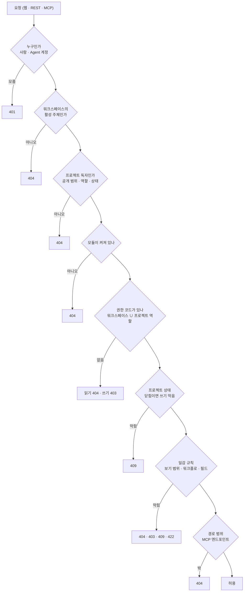
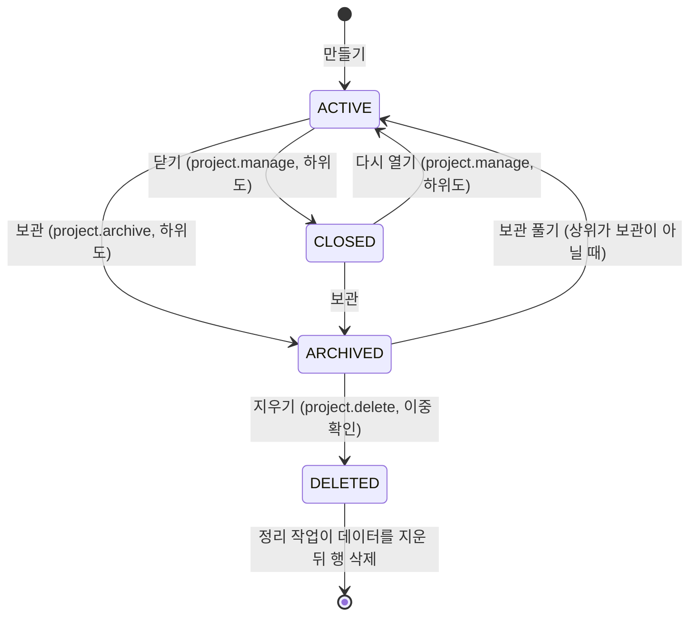

[홈](../README.md) › [설계](01-architecture.md) › 프로젝트와 권한

# 프로젝트와 권한 — 공개 범위 · 프로젝트 역할 · 권한 코드 · 판정

프로젝트에서 누가 무엇을 볼 수 있고 할 수 있는지 정한다. 웹 화면 · REST · MCP 가 **모두 api 의 같은 판정**을 쓴다. 계정 · 워크스페이스 · 워크스페이스 역할의 바탕은 [워크스페이스 · 계정 · 권한 설계](03-workspace-identity.md)에 있고, 이 쪽은 그 위의 **프로젝트 층**을 정한다. moai-wiki 의 위키 층(위키 공개 범위 · 위키 역할 4종 · `@WikiApi`)을 프로젝트 층으로 옮기고, Redmine 의 프로젝트 멤버십 · 역할 · 모듈 · 하위 프로젝트 동작을 맞췄다.

일감 자체의 규칙(워크플로 · 필드 권한 · 질의의 권한 조건)은 [일감 추적 설계](05-issue-tracking.md)에 있다. 요구사항: [프로젝트 요구사항](../requirements/02-project.md) · [일감 요구사항](../requirements/03-issue.md).

**바로가기:** [원칙](#pp-principles) · [판정 층](#pp-layers) · [권한 코드](#pp-codes) · [프로젝트 역할](#pp-roles) · [공개 범위](#pp-visibility) · [Keycloak](#pp-keycloak) · [판정 규칙](#pp-rule) · [하위 프로젝트](#pp-subprojects) · [모듈](#pp-modules) · [프로젝트 상태](#pp-status) · [비공개 일감](#pp-private) · [접근 어노테이션](#pp-annotations) · [캐시](#pp-cache) · [만들기 · 복사](#pp-lifecycle) · [API](#pp-api) · [감사 · 이벤트](#pp-audit) · [테이블](#pp-ddl) · [시험](#pp-tests) · [정해야 할 것](#pp-decisions)

---

<a id="pp-principles"></a>
## 1. 원칙

| 원칙 | 내용 |
|---|---|
| 판정은 api 한 곳 | 화면 · BFF · MCP 클라이언트는 판정하지 않는다. 화면은 단추를 숨기기만 한다 |
| 권한 경계는 프로젝트 | 프로젝트의 독자가 그 프로젝트의 내용을 본다. 프로젝트 안에서 읽기를 더 좁히는 것은 **비공개 일감 · 비공개 메모 하나뿐**이다(Redmine 과 같다, [§11](#pp-private)) |
| 사람과 Agent 는 같은 규칙 | Agent 계정도 프로젝트 역할을 받고 같은 함수로 판정한다. 다른 것은 주체 종류와 Keycloak 에 없다는 점뿐이다([§6](#pp-keycloak)) |
| 좁히기만 한다 | 모듈 · 프로젝트 상태 · 워크플로 · 필드 권한 · MCP 엔드포인트 범위는 권한 코드가 허락한 것을 좁힐 뿐 넓히지 못한다 |
| 모르면 404, 보이면 403, 상태면 409 | 독자가 아니면 프로젝트가 있는지도 모른다(404). 읽기 거부는 404, 독자의 쓰기 거부는 403, 닫힌 프로젝트 · 잠금 충돌처럼 상태 때문이면 409 다 |
| 매 요청 DB 사본 | 토큰에 든 역할로 판정하지 않는다. api DB 사본(`member_role` · `project_role_binding`)으로 판정한다 |
| 웹 · REST · MCP 동등 | MCP 도구는 REST 와 같은 서비스 메서드를 부른다. 모델이 넘긴 프로젝트 · 일감도 다시 판정한다 |

### 1.1 비공개 일감을 두는 이유와 새는 길

moai-wiki 는 페이지마다 읽기를 좁히지 않았다(새는 길이 많아서). 여기서는 Redmine 사용자가 꼭 쓰는 **비공개 일감**을 둔다. 대신 조건을 "작성자 · 담당자 · 코드" 셋으로 고정하고, 모든 읽기 길이 한 함수(`IssueVisibility`, [§11](#pp-private))를 거친다.

| 새는 길 | 막는 방법 |
|---|---|
| 목록 · 질의 · 보드 · 간트 · 캘린더 · 로드맵 | 질의 엔진이 늘 보기 범위 조건을 SQL 에 넣는다([일감 설계 §12.3](05-issue-tracking.md#is-query-acl)) |
| 하위 일감 · 상위 일감 · 관계 · 텍스트 링크 `#123` | 대상이 안 보이면 줄 자체를 빼거나 글자로만 둔다(제목 · 상태를 보이지 않는다) |
| 검색 색인 | 색인 문서에는 프로젝트 id · `is_private` · 작성자 · 담당자만 넣고, 권한 조건은 질의할 때 api 가 계산해 넣는다([공동 작업 설계](08-collaboration.md)) |
| 알림 · 활동 · 웹훅 · 피드 | 이벤트에 `private` 표시를 싣고, 받는 사람마다 같은 함수로 다시 거른다 |
| 내보내기 · MCP | 같은 질의 엔진 · 같은 서비스를 쓴다 |
| 시간 기록 | 시간 수는 합계에 넣고 일감 칸 · 메모를 가린다(계획 · 시간 설계의 규칙) |

---

<a id="pp-layers"></a>
## 2. 판정 층



| 층 | 정하는 것 | 정본 | 판정하는 곳 |
|---|---|---|---|
| 주체 | 사람 계정 · Agent 계정이 활성인가 | 사람 = Keycloak + `user_profile`, Agent = api DB `agent_account` | 인증 필터 · `requireActiveUser`(지금 코드) |
| 워크스페이스 | 멤버십 · 워크스페이스 역할 코드 | Keycloak 조직(api 는 사본) | `@WorkspaceApi`(지금 코드) |
| 프로젝트 | 독자 · 프로젝트 역할 코드 · 모듈 · 상태 | 프로젝트 = api DB, 사람의 프로젝트 역할 = Keycloak 조직 그룹(api 는 사본), Agent 의 프로젝트 역할 = api DB | `@ProjectApi` · `@IssueApi`(새로, [§12](#pp-annotations)) · `ProjectAccessService` |
| 일감 | 비공개 · 보기 범위 | api DB | `IssueVisibility`([§11](#pp-private)) |
| 워크플로 | 상태 전이 · 필드 읽기전용 · 필수 | api DB | `WorkflowEngine`([일감 설계 §8](05-issue-tracking.md#is-workflow)) |
| 경로 | MCP 엔드포인트의 대상 프로젝트 · 켤 도구 · 키 | api DB | MCP 필터 체인([MCP · Agent 설계](07-mcp-agents.md)) |

- MCP 엔드포인트 범위는 실제로는 "읽을 수 있는 프로젝트 집합"을 계산할 때 교집합으로 먼저 들어간다. 그림의 순서는 뜻을 보인 것이다.
- 판정은 **주체 + 경로**를 함께 받는다: `Principal(kind = USER 또는 AGENT, id)` · `Channel(WEB · REST · MCP, endpoint id, key id)`. 결과는 같은 함수가 내고, 경로는 좁히기 · 기록에만 쓴다.

---

<a id="pp-codes"></a>
## 3. 권한 코드

카탈로그에 그 기능을 만들 때 더한다(지금 `Permission` enum 에는 토대 코드 16개만 있다). 이름은 아래 그대로 쓴다. 더할 때 고치는 곳: `Permission` enum · `infra/keycloak/permission-catalog.json` · 기본 역할(`BuiltinRole`) · 프로젝트 역할(`ProjectRole`, 새로) · 화면 리소스 · 이 표.

<a id="pp-catalog"></a>
### 3.1 코드 전체 표 (계획)

- **층**: `W` = 워크스페이스 역할로만 받는다(프로젝트 역할이 줄 수 없다). `P` = 워크스페이스 역할로도, 프로젝트 역할로도 받는다. 워크스페이스 역할로 받은 `P` 코드는 그 사람이 독자인 **모든 프로젝트**에서 통한다.
- **모듈**: 그 모듈이 꺼진 프로젝트에서는 코드가 있어도 404 다([§9](#pp-modules)).

| 묶음 | 코드 | 층 | 모듈 | 허용하는 일 |
|---|---|---|---|---|
| 토대(있음) | `workspace.*` · `member.*` · `role.manage` · `mcp.*` · `audit.read` · `usage.read` | W | — | [워크스페이스 설계](03-workspace-identity.md)의 16개 그대로 |
| 프로젝트 | `project.create` | W | — | 최상위 프로젝트 만들기 · 복사로 최상위 만들기. 하위 프로젝트는 상위의 `project.manage` 로도 만든다 |
| | `project.manage` | P | — | 프로젝트 설정(이름 · 설명 · 홈페이지 · 공개 범위 · 기본 역할 · 이어받기 · 사용자 정의 필드 값 · 기본 담당 · 기본 버전 · 일감 보기 범위) · 모듈 · 트래커 · 사용자 정의 필드 고르기 · 멤버 · 카테고리 · 하위 프로젝트 만들기 · 옮기기 · 닫기 · 다시 열기 · 남의 메모 숨기기. **워크스페이스 층에서 가지면 모든 프로젝트의 독자**다 |
| | `project.archive` | W | — | 보관 · 보관 풀기. 보관한 프로젝트를 볼 수 있는 유일한 코드 |
| | `project.delete` | W | — | 보관한 프로젝트 지우기(이중 확인) |
| 워크스페이스 설정 | `config.manage` | W | — | 트래커 · 상태 · 워크플로 · 필드 권한 · 열거형(우선순위 · 작업 분류 · 문서 분류) · 사용자 정의 필드 · 일감 추적 설정. **가지면 워크플로를 우회한다**([일감 설계 §8](05-issue-tracking.md#is-workflow)) |
| 일감 | `issue.read` | P | `issue_tracking` | 일감 보기 · 목록 · 질의 · 보드 · 내보내기 · 개인 질의 저장 · 나를 관찰자로 넣고 빼기 · 관찰자 목록 보기 |
| | `issue.create` | P | `issue_tracking` | 일감 만들기 · 복사해 만들기 · 만들 때 첨부 |
| | `issue.edit` | P | `issue_tracking` | 아무 일감의 필드 고치기(담당 빼고) · 트래커 바꾸기 · 상위 일감 정하기 · 첨부 붙이고 지우기 · 다른 프로젝트로 옮기기(원래 쪽) |
| | `issue.edit.own` | P | `issue_tracking` | 내가 만든 일감의 필드 고치기(담당 빼고) · 첨부 |
| | `issue.assign` | P | `issue_tracking` | 담당자 정하기 · 바꾸기(만들 때 포함) |
| | `issue.delete` | P | `issue_tracking` | 일감 지우기(하위 포함) |
| | `issue.note` | P | `issue_tracking` | 메모 쓰기 · 내 메모 고치기 |
| | `issue.note.private` | P | `issue_tracking` | 비공개 메모 쓰기 · 보기 · 메모를 비공개로 바꾸기 |
| | `issue.private.read` | P | `issue_tracking` | 비공개 일감 모두 보기(보기 범위 "전체") · 일감을 비공개로 정하고 풀기 |
| | `issue.relation.manage` | P | `issue_tracking` | 관계 더하기 · 빼기 |
| | `issue.watcher.manage` | P | `issue_tracking` | 다른 사람 · Agent 계정을 관찰자로 넣고 빼기 |
| | `issue.import` | P | `issue_tracking` | CSV · Redmine 에서 일감 가져오기([연동 요구사항](../requirements/11-integration.md)) |
| 질의 | `query.save.public` | P | `issue_tracking` | 공개 · 역할별 질의 저장 · 고치기 · 지우기. 워크스페이스 층이면 "모든 프로젝트" 질의도 |
| 계획 | `version.manage` | P | `issue_tracking` | 버전 만들기 · 고치기 · 닫기 · 공유([계획 · 시간 설계](06-planning-time.md)) |
| 시간 | `time.read` | P | `time_tracking` | 시간 기록 보기 · 보고서 |
| | `time.log` | P | `time_tracking` | 내 시간 기록 |
| | `time.edit.own` | P | `time_tracking` | 내 기록 고치기 · 지우기 |
| | `time.edit.all` | P | `time_tracking` | 모든 기록 고치기 · 지우기 · 남 대신 기록 |
| 위키 | `wiki.read` | P | `wiki` | 위키 읽기 · 이력 · 차이 |
| | `wiki.edit` | P | `wiki` | 쪽 만들기 · 고치기 · 첨부 |
| | `wiki.manage` | P | `wiki` | 보호 · 이름 바꾸기 · 지우기 · 시작 쪽 |
| 내용 | `news.manage` | P | `news` | 뉴스 쓰기 · 고치기 · 지우기 (읽기 · 댓글 규칙은 [내용 요구사항](../requirements/08-content.md)) |
| | `document.read` · `document.manage` | P | `documents` | 문서 보기 · 만들기 · 고치기 · 지우기 |
| | `file.read` · `file.manage` | P | `files` | 내려받기 파일 보기 · 올리기 · 지우기 |
| | `forum.post` · `forum.manage` | P | `forums` | 포럼 글 쓰기 · 내 글 고치기 / 포럼 · 남의 글 관리 |
| 저장소 | `repository.read` · `repository.manage` | P | `repository` | 커밋 · 연결 보기 / 저장소 연결 · 설정([연동 설계](09-integrations.md)) |
| 연동 | `webhook.manage` | W | — | 웹훅 만들기 · 고치기(프로젝트 단위 웹훅을 둘지는 연동 설계가 정한다) |
| | `agent.account.manage` | W | — | Agent 계정 만들기 · 고치기 · 끄기([MCP · Agent 설계](07-mcp-agents.md)) |

<a id="pp-role-matrix"></a>
### 3.2 역할별 표 (확정안)

`○` 받음 · `—` 받지 않음 · `·` 줄 수 없음(층 `W` 코드라 프로젝트 역할에 넣지 않는다).

| 코드 | 소유자 | 관리자 | 멤버 | 프로젝트 관리자 | 개발자 | 보고자 | 독자 |
|---|---|---|---|---|---|---|---|
| `project.create` | ○ | ○ | — | · | · | · | · |
| `project.manage` | ○ | ○ | — | ○ | — | — | — |
| `project.archive` · `project.delete` | ○ | ○ | — | · | · | · | · |
| `config.manage` | ○ | ○ | — | · | · | · | · |
| `issue.read` | ○ | ○ | — | ○ | ○ | ○ | ○ |
| `issue.create` · `issue.edit.own` · `issue.note` · `issue.watcher.manage` | ○ | ○ | — | ○ | ○ | ○ | — |
| `issue.edit` · `issue.assign` · `issue.relation.manage` | ○ | ○ | — | ○ | ○ | — | — |
| `issue.note.private` · `issue.private.read` | ○ | ○ | — | ○ | ○ | — | — |
| `issue.delete` · `issue.import` | ○ | ○ | — | ○ | — | — | — |
| `query.save.public` · `version.manage` | ○ | ○ | — | ○ | — | — | — |
| `time.read` | ○ | ○ | — | ○ | ○ | ○ | ○ |
| `time.log` · `time.edit.own` | ○ | ○ | — | ○ | ○ | — | — |
| `time.edit.all` | ○ | ○ | — | ○ | — | — | — |
| `wiki.read` · `document.read` · `file.read` · `repository.read` | ○ | ○ | — | ○ | ○ | ○ | ○ |
| `wiki.edit` | ○ | ○ | — | ○ | ○ | — | — |
| `forum.post` | ○ | ○ | — | ○ | ○ | ○ | — |
| `wiki.manage` · `news.manage` · `document.manage` · `file.manage` · `forum.manage` · `repository.manage` | ○ | ○ | — | ○ | — | — | — |
| `webhook.manage` · `agent.account.manage` | ○ | ○ | — | · | · | · | · |

- **소유자 · 관리자는 모든 코드를 가진다**(관리자는 소유자 전용 2개만 빠진다 — 지금 `BuiltinRole` 그대로). 새 코드를 카탈로그에 더하면 두 역할에 자동으로 들어간다.
- **멤버는 프로젝트 코드를 워크스페이스 층에서 받지 않는다.** 프로젝트에서 하는 일은 프로젝트 역할이 정한다. 워크스페이스 공개 프로젝트에서는 역할이 없어도 그 프로젝트의 **기본 역할**(독자 또는 보고자) 코드를 받는다([§5](#pp-visibility)).
- 워크스페이스 전체에서 같은 일을 하게 하려면 사용자 정의 역할을 만든다. 예: "QA" = `issue.read` · `issue.create` · `issue.note` → 그 사람이 독자인 모든 프로젝트에서 일감을 올린다. 넣을 수 있는 코드는 만드는 사람이 가진 것뿐이다(지금 코드의 권한 상승 방지).
- 프로젝트 역할은 **포함 관계**다: 독자 ⊂ 보고자 ⊂ 개발자 ⊂ 관리자. 표가 이 관계를 지키는지 단위 테스트로 확인한다.

<a id="pp-code-changes"></a>
### 3.3 브리프 초안에서 바뀐 것

| 항목 | 초안 | 확정안 | 이유 |
|---|---|---|---|
| 보고자의 시간 기록 | `time.log` (메모: 정해서 적는다) | **주지 않는다**(`time.read` 만) | 보고자는 일감을 올리고 지켜보는 역할(고객 · 다른 팀)이다. 일을 맡는 사람은 개발자다. [계획 · 시간 설계](06-planning-time.md)의 PT-Q1 권고와 같다 |
| 버전 관리 | `project.manage` 설명에 "버전" | `version.manage` 가 따로 맡는다 | 코드가 둘이면 뜻이 겹친다. Redmine 도 `manage_versions` 가 따로다 |
| 모든 프로젝트의 독자 | 역할 키 `owner` · `admin` | **워크스페이스 층 `project.manage`** 를 가진 사람(기본은 소유자 · 관리자) | 역할 키를 코드에 박지 않는다. "모든 프로젝트를 관리하는 PMO" 같은 사용자 정의 역할이 같은 대우를 받는다 |
| 워크플로 우회 | `owner` · `admin` | **워크스페이스 층 `config.manage`**(기본은 소유자 · 관리자) | 같은 이유. 워크플로를 정하는 사람이 우회한다 |
| 워크스페이스 공개 프로젝트의 비회원 | "멤버 전원이 독자" | 독자이면서 **기본 역할의 코드**를 받는다(기본 `project-viewer`, 프로젝트 설정으로 `project-reporter`) | `member` 역할에는 `issue.read` 가 없다. 그대로면 독자인데 일감을 못 본다. Redmine 의 "비회원(Non member)" 내장 역할 자리다 |
| Agent 계정 | (정하지 않음) | 워크스페이스 권한 = ∅. 워크스페이스 공개 프로젝트라도 **프로젝트 역할을 받아야** 독자 | Agent 는 최소 권한으로 시작한다. 멤버 · 권한 · 설정은 사람만 바꾼다 |
| 보관된 프로젝트 보기 | "관리 권한 필요" | `project.archive` | 보관 · 보관 풀기를 하는 사람이 본다 |
| 나를 관찰자로 | (정하지 않음) | `issue.read` 로 된다. 남을 넣고 빼기만 `issue.watcher.manage` | Redmine 과 같다 |

<a id="pp-enum"></a>
### 3.4 `Permission` enum 에 더할 속성

```java
public enum Permission {
  // 지금: code, ownerOnly
  // 더함: layer — WORKSPACE(층 W) · PROJECT(층 P), module — 그 코드를 막는 모듈 (없으면 NONE)
  ISSUE_READ("issue.read", Layer.PROJECT, ProjectModule.ISSUE_TRACKING),
  PROJECT_CREATE("project.create", Layer.WORKSPACE, ProjectModule.NONE),
  ...
}

public enum ProjectRole {   // 고정 4종 — 코드는 플랫폼이 정한다 (Keycloak 에 매핑하지 않는다, §6)
  MANAGER("project-manager"), DEVELOPER("project-developer"), REPORTER("project-reporter"), VIEWER("project-viewer");
  Set<Permission> permissions();   // §3.2 의 표
  int rank();                      // 4 · 3 · 2 · 1 — 실효 역할 = 가장 높은 것
  boolean assignable();            // 담당자가 될 수 있나 (VIEWER 만 false)
}
```

- `layer = WORKSPACE` 인 코드는 `ProjectRole` 에 넣을 수 없다(기동 때 확인).
- `@WorkspaceApi` 에 `layer = PROJECT` 코드를 쓰면 기동하지 않는다([§12](#pp-annotations)) — 프로젝트 역할을 무시하고 판정하게 되기 때문이다.

---

<a id="pp-roles"></a>
## 4. 프로젝트 역할

| 역할 | 키 | Keycloak 조직 그룹 | 받는 코드 | 담당자 |
|---|---|---|---|---|
| 프로젝트 관리자 | `project-manager` | `/projects/<project id>/project-manager` | 그 프로젝트의 층 `P` 코드 전부 | 될 수 있다 |
| 개발자 | `project-developer` | `/projects/<project id>/project-developer` | 보고자 + 일감 고치기 · 담당 · 관계 · 비공개 · 시간 기록 · 위키 고치기 | 될 수 있다 |
| 보고자 | `project-reporter` | `/projects/<project id>/project-reporter` | 독자 + 일감 만들기 · 내 일감 고치기 · 메모 · 관찰자 · 포럼 글 | 될 수 있다 |
| 독자 | `project-viewer` | `/projects/<project id>/project-viewer` | 읽기 코드(일감 · 시간 · 위키 · 문서 · 파일 · 저장소) | 될 수 없다 |

### 4.1 규칙

| 항목 | 규칙 |
|---|---|
| 주체 | 워크스페이스의 활성 멤버(사람)와 활성 Agent 계정. 다른 워크스페이스의 사람 · Agent 는 넣을 수 없다 |
| 직접 역할 수 | **한 주체는 한 프로젝트에서 직접 역할을 하나만** 가진다. 역할이 포함 관계라 여러 개가 뜻이 없다. 사용자 정의 프로젝트 역할(C)이 생기면 여럿을 허용한다 |
| 실효 역할 | 직접 역할 · 이어받은 역할([§8](#pp-subprojects)) 가운데 가장 높은 것. 기본 역할(워크스페이스 공개 프로젝트의 비회원)은 실효 역할이 없을 때만 쓴다 |
| 누가 바꾸나 | 그 프로젝트에서 `project.manage` 를 가진 사람(프로젝트 관리자 · 소유자 · 관리자). Agent 는 MCP 로 멤버를 바꾸지 못한다 |
| 줄 수 있는 역할 | 네 역할 모두. 프로젝트 관리자는 그 프로젝트 안에서만 힘이 있어서, 관리자 역할을 줘도 워크스페이스 권한이 오르지 않는다 |
| 마지막 프로젝트 관리자 | 빼거나 낮추면 경고한다. 막지는 않는다(소유자 · 관리자가 늘 관리할 수 있다) |
| 자기 역할 낮추기 | 확인을 받는다. 낮춘 뒤 `project.manage` 가 없어지면 멤버 화면에서 나간다 |
| 멤버 정지 · 제거 | 정지(워크스페이스 멤버 `SUSPENDED`)면 바인딩은 남고 판정에서 빠진다. 제거(`REMOVED` · `LEFT`)면 바인딩을 지우고 Keycloak 프로젝트 그룹에서 뺀다 — 워크스페이스 멤버 제거 사가([워크스페이스 설계](03-workspace-identity.md))가 이 단계를 포함해야 한다 |
| Agent 계정 정지 · 지우기 | 정지하면(`SUSPENDED`, [MCP 설계](07-mcp-agents.md)) 바인딩은 남고 판정에서 빠진다. 지우면 바인딩도 지운다 |
| 감사 | 넣기 · 바꾸기 · 빼기를 `project.member.*` 로 남긴다(누가 · 누구를 · 전 역할 · 후 역할) |

<a id="pp-assignable"></a>
### 4.2 담당자가 될 수 있는 주체

```
담당 가능(주체, 프로젝트) = 주체가 활성
                          ∧ 실효 역할(주체, 프로젝트) ∈ {관리자, 개발자, 보고자}   -- 직접 또는 이어받은 역할
```

- 기본 역할로만 독자인 사람(워크스페이스 공개 프로젝트의 비회원)은 담당자가 될 수 없다. 담당자 목록이 워크스페이스 전원으로 커지는 것을 막는다(Redmine 도 멤버만 담당자다).
- 소유자 · 관리자도 그 프로젝트의 역할이 없으면 담당자 목록에 나오지 않는다. 필요하면 멤버로 넣는다.
- 담당자가 이 조건을 잃어도(역할을 빼거나 낮춤) 일감의 담당은 그대로 둔다. 화면은 "담당 자격 없음"을 보이고, 다음에 고칠 때 바꾸게 한다(Redmine 과 같다).
- 카테고리 · 프로젝트의 기본 담당자도 같은 조건으로 고른다.

---

<a id="pp-visibility"></a>
## 5. 공개 범위와 기본 역할

| 공개 범위 | `project.visibility` | 독자 | Redmine |
|---|---|---|---|
| 워크스페이스 공개 | `WORKSPACE` (기본) | 워크스페이스의 활성 멤버(사람) 전원 + 역할을 받은 Agent 계정 | Public 프로젝트(로그인한 사용자 대상) |
| 지정 멤버 | `RESTRICTED` | 그 프로젝트(또는 이어받은 상위)의 역할을 받은 사람 · Agent + 워크스페이스 층 `project.manage` 를 가진 사람 | Private 프로젝트 |

- 워크스페이스 밖의 사람(익명 · 다른 워크스페이스)에게 프로젝트를 여는 공개 범위는 없다. Redmine 의 "익명 사용자" 역할은 두지 않는다.
- 새 프로젝트의 기본 공개 범위는 워크스페이스 설정(`issue_tracking_setting.default_project_visibility`, [일감 설계 §10.5](05-issue-tracking.md#is-settings))이 정한다.

### 5.1 기본 역할 (`default_member_role`)

워크스페이스 공개 프로젝트에서 **실효 역할이 없는 사람**이 받는 역할이다. Redmine 의 내장 "비회원" 역할과 같은 자리다.

| 값 | 뜻 | 쓰는 예 |
|---|---|---|
| `project-viewer` (기본) | 누구나 읽는다 | 일반 개발 프로젝트 |
| `project-reporter` | 누구나 일감을 올리고 메모를 단다 | 사내 IT 지원 · 버그 접수 프로젝트 |

- `RESTRICTED` 프로젝트에서는 쓰지 않는다(값은 남는다).
- 기본 역할은 하위 프로젝트로 이어받지 않는다. 담당 가능 조건에도 들지 않는다([§4.2](#pp-assignable)).
- 개발자 · 관리자는 고를 수 없다. 워크스페이스 전원에게 고치기를 주려면 사용자 정의 워크스페이스 역할을 쓴다.

### 5.2 바꿀 때

| 바꿈 | 결과 |
|---|---|
| `WORKSPACE` → `RESTRICTED` | 역할 없는 사람은 다음 요청부터 404. 그 사람의 관찰자 행은 남지만 알림 · 목록에서 빠진다(받는 사람마다 다시 판정). 화면이 저장 전에 "독자가 N명 줄어든다"를 보인다 |
| `RESTRICTED` → `WORKSPACE` | 모든 활성 멤버가 기본 역할로 독자가 된다. 확인을 받는다 |
| 기본 역할 바꿈 | 비회원의 코드가 바뀐다 |

- 모두 `project.manage` 가 필요하고, 감사(전 · 후)와 `project.updated` · `project.access.changed` 를 남긴다. **검색 색인은 다시 쓰지 않는다** — 색인에는 프로젝트 id · 비공개 · 작성자 · 담당자만 있고, 읽을 수 있는 프로젝트는 질의할 때 api 가 계산해 넣는다([공동 작업 설계](08-collaboration.md)).
- 하위 프로젝트의 공개 범위는 상위와 **따로** 정한다. 상위가 `RESTRICTED` 이고 하위가 `WORKSPACE` 일 수 있다(Redmine 과 같다). 이때 독자가 아닌 상위는 이름도 보이지 않는다 — 트리에서 하위는 읽을 수 있는 가장 가까운 조상 아래(없으면 맨 위)에 붙는다([§8.1](#pp-tree)).

---

<a id="pp-keycloak"></a>
## 6. Keycloak 매핑 · 사본 · Agent 계정

### 6.1 매핑

| moai-works | Keycloak | 비고 |
|---|---|---|
| 프로젝트 | 없음 (api DB `project` 가 정본) | 프로젝트 설정 · 모듈 · 트래커 · 상태도 api DB |
| 프로젝트 묶음 그룹 | 조직 그룹 `/projects` · `/projects/<project id>` | 처음 그 프로젝트에 사람 역할을 줄 때 만든다 |
| 사람의 프로젝트 역할 | 조직 그룹 `/projects/<project id>/<role key>` 가입 | **정본.** api 사본은 `project_role_binding`(주체 종류 `USER`) |
| Agent 계정 · Agent 의 프로젝트 역할 | 없음 | `project_role_binding`(주체 종류 `AGENT`)이 **정본**. Agent 계정은 Keycloak 사용자가 아니다 |
| 프로젝트 역할의 권한 코드 | **매핑하지 않는다** | 역할 → 코드는 플랫폼 코드(`ProjectRole`)가 정한다. 그룹에 클라이언트 역할을 매핑하면 Keycloak 에서 워크스페이스 전체 권한처럼 보여 헷갈린다 |
| 이어받은 역할 · 기본 역할 | 없음 | api 가 계산한다. Keycloak 에 펼쳐 쓰지 않는다 |

- 그룹 이름에 식별자가 아니라 **프로젝트 id** 를 쓴다. 식별자도 바뀌지 않지만, 지운 뒤 같은 식별자를 다시 쓰는 경우 옛 그룹과 섞이지 않게 한다.
- Keycloak 에 쓰는 주체는 api 하나다(지금 코드 그대로). 콘솔에서 고치면 대사가 찾아 감사에 남긴다.

### 6.2 쓰기 순서 (사람)

지금 코드의 이중 쓰기(`keycloak_operation`)를 그대로 쓴다.

```
1. api DB  : keycloak_operation PENDING (멱등 키 prj-role:{project}:{user}:{role})          ┐ 트랜잭션 ①
2. Keycloak: /projects · /projects/<id> · /projects/<id>/<role> 그룹이 없으면 만든다(멱등)
             그 프로젝트의 다른 역할 그룹에서 뺀다 → 새 역할 그룹에 넣는다
3. api DB  : project_role_binding upsert · keycloak_operation DONE · 감사 · 이벤트(작업 큐)   ┐ 트랜잭션 ②
   실패    : 재시도(지수 백오프, 5회) → FAILED → 시스템 관리자 알림 (지금 코드와 같다)
```

- 빼기는 그룹에서 빼고 → 바인딩을 지운다. 프로젝트를 지우면 `/projects/<id>` 그룹을 하위 그룹째 지운다.
- 2단계가 끝나기 전에는 사본이 없으므로 그 사람은 아직 독자가 아니다(늦게 열리는 쪽으로만 틀린다).
- **Agent 계정**은 1 · 2 단계 없이 3단계만 한다. 같은 감사 · 이벤트를 남긴다.

### 6.3 대사

- 워크스페이스 대사(15분, [워크스페이스 설계](03-workspace-identity.md))가 `/projects/*/*` 그룹의 멤버와 `USER` 바인딩을 견준다. 다르면 Keycloak 을 기준으로 사본을 고치고 `security.drift.detected` 를 감사에 남긴다.
- `AGENT` 바인딩은 대사하지 않는다(DB 가 정본).
- 한 사람이 한 프로젝트의 그룹 두 개에 들어가 있으면(콘솔 수정) 가장 높은 역할 하나로 맞추고 나머지 그룹에서 뺀다.

### 6.4 규모

- 조직 그룹 수 = 1(`/projects`) + 프로젝트 수 × (1 + 실제로 쓰는 역할 수, 최대 4). 프로젝트 1,000개면 최대 5,001개다.
- 빈 역할 그룹은 만들지 않는다(처음 줄 때 만든다). 그래도 큰 워크스페이스에서 Keycloak 조직 그룹 조회 성능은 실측이 필요하다([정해야 할 것 P-6](#pp-decisions)).

---

<a id="pp-rule"></a>
## 7. 판정 규칙

브리프의 초안(워크스페이스 설계 §3.4 와 같은 꼴)을 다듬었다. 함수 이름은 코드(`ProjectAccessService`)에서 그대로 쓴다.

```
주체 P = (kind ∈ {USER, AGENT}, id)

-- 워크스페이스 층
워크스페이스 활성 주체(P, W) = W.status = ACTIVE
    ∧ (P.kind = USER  ⇒ P 가 W 의 멤버 ∧ 멤버십 ACTIVE ∧ 계정 ACTIVE)
    ∧ (P.kind = AGENT ⇒ P 가 W 의 Agent 계정 ∧ 상태 ACTIVE)

워크스페이스 권한(P, W) = P.kind = USER ? ⋃ 워크스페이스 역할 코드(P, W) : ∅
    (워크스페이스 활성 주체가 아니면 ∅)

전체 독자(P, W) = project.manage ∈ 워크스페이스 권한(P, W)        -- 기본: 소유자 · 관리자

-- 프로젝트 역할
직접 역할(P, X)    = project_role_binding 에서 (X, P) 의 역할 (없으면 ∅)
이어받은 역할(P, X) = X.inherit_members ∧ X.parent ≠ ∅ ? 실효 역할들(P, X.parent) : ∅
실효 역할들(P, X)   = 직접 역할(P, X) ∪ 이어받은 역할(P, X)
실효 역할(P, X)     = rank 가 가장 높은 것 (없으면 ∅)
기본 역할 적용(P, X) = X.visibility = WORKSPACE ∧ P.kind = USER ∧ 실효 역할(P, X) = ∅

-- 프로젝트 독자
독자인가(P, X) = 워크스페이스 활성 주체(P, X.workspace)
    ∧ 상태 보기(P, X)
    ∧ ( 전체 독자(P, W)
        ∨ 실효 역할(P, X) ≠ ∅
        ∨ (X.visibility = WORKSPACE ∧ P.kind = USER) )

상태 보기(P, X) = X.status ∈ {ACTIVE, CLOSED}
    ∨ (X.status = ARCHIVED ∧ project.archive ∈ 워크스페이스 권한(P, W))
    -- DELETED 는 늘 거짓

-- 코드
프로젝트 코드(P, X) = 워크스페이스 권한(P, W)
    ∪ 코드(실효 역할(P, X))
    ∪ (기본 역할 적용(P, X) ? 코드(X.default_member_role) : ∅)

-- 허용
허용(P, X, 코드 c, 쓰기 w) =
    독자인가(P, X)                                  else 404
    ∧ 모듈 켜짐(X, c.module)                         else 404
    ∧ c ∈ 프로젝트 코드(P, X)                         else (w ? 403 : 404)
    ∧ (¬w ∨ 쓰기 열림(X, c))                          else 409 PROJECT_READ_ONLY

쓰기 열림(X, c) = X.status = ACTIVE
    ∨ (X.status = CLOSED ∧ c ∈ {다시 열기 · 개인 일})   -- 개인 일: 나를 관찰자로 · 개인 질의 · 내보내기
    ∨ (X.status = ARCHIVED ∧ c ∈ {보관 풀기 · 지우기})

-- 경로 (MCP)
허용_MCP(P, X, c, w, 엔드포인트 E) = 허용(P, X, c, w)
    ∧ X ∈ E.대상 프로젝트(전체면 참)                    else 404
    ∧ c 를 쓰는 도구가 E 에서 켜져 있음                   else 404 (tools/list 에도 없다)
```

### 7.1 결과 표

| 상황 | 읽기(GET) | 쓰기 | 오류 `code` |
|---|---|---|---|
| 워크스페이스 멤버 아님 · 정지 · Agent 꺼짐 | 404 | 404 | `NOT_FOUND` |
| 프로젝트 독자 아님(`RESTRICTED` · 보관 · 삭제) | 404 | 404 | `NOT_FOUND` |
| 모듈 꺼짐 | 404 | 404 | `NOT_FOUND` |
| 독자지만 코드 없음 | 404 | 403 | `forbidden` |
| 일감이 보기 범위 밖(비공개) | 404 | 404 | `NOT_FOUND` |
| 프로젝트 닫힘 · 보관 | 됨 | 409 | `PROJECT_READ_ONLY` |
| 워크플로에 없는 전이 · 읽기전용 필드 | — | 403 | `TRANSITION_NOT_ALLOWED` · `FIELD_READONLY` |
| 필수 필드 비었음 · 값 오류 | — | 422 | `FIELD_REQUIRED` · `INVALID_VALUE` |
| 닫을 수 없음(열린 하위 · 막는 일감) · 다시 열 수 없음 | — | 409 | `ISSUE_NOT_CLOSABLE` · `ISSUE_NOT_REOPENABLE` |
| 잠금 충돌 | — | 409 | `CONCURRENT_UPDATE` |

- 404 본문은 "없는 프로젝트 · 없는 일감"과 **똑같다**(문구 · 모양 · `code`). 모듈 꺼짐도 같은 `NOT_FOUND` 다 — 독자는 프로젝트 쪽에서 모듈이 꺼진 것을 이미 알고, 비독자에게는 앞 단계에서 끝난다.
- 판정 순서: 404 조건을 모두 먼저 본 뒤 403 · 409 · 422 를 본다. 그래서 비독자는 프로젝트 상태 · 코드 유무를 알 수 없다.

### 7.2 예

| 주체 | 프로젝트 | 결과 |
|---|---|---|
| 멤버(역할 없음) | `WORKSPACE`, 기본 역할 독자 | 일감 보기 ○ · 만들기 403 |
| 멤버(역할 없음) | `WORKSPACE`, 기본 역할 보고자 | 일감 만들기 ○ · 담당자 목록에는 안 나옴 |
| 멤버(역할 없음) | `RESTRICTED` | 404 |
| 멤버 + 사용자 정의 역할 "QA"(`issue.create`) | `RESTRICTED`, 역할 없음 | 404 — 코드가 있어도 독자가 아니다 |
| 관리자(워크스페이스) | `RESTRICTED`, 역할 없음 | 모든 일 ○ · 워크플로 우회 |
| Agent(개발자 역할) | `WORKSPACE` | 일감 고치기 ○ · 워크플로는 개발자 표대로 |
| Agent(역할 없음) | `WORKSPACE` | 404 |
| 개발자 | 닫힌 프로젝트 | 보기 ○ · 고치기 409 |
| 개발자 | `time_tracking` 꺼짐 | 시간 기록 404 |
| 상위 프로젝트 보고자 | 하위(이어받기 켬) | 하위에서도 보고자 |

---

<a id="pp-subprojects"></a>
## 8. 하위 프로젝트 · 멤버 이어받기

<a id="pp-tree"></a>
### 8.1 트리

| 항목 | 규칙 |
|---|---|
| 상위 | `project.parent_id`. 같은 워크스페이스의 프로젝트만(DB 복합 FK 가 막는다) |
| 트리 열 | `root_id`(맨 위 프로젝트, 자기면 자기) · `ancestor_ids`(맨 위부터 부모까지, 자기 빼고) · `depth`(맨 위 = 1). 조상 · 하위 질의를 재귀 없이 한다: 하위 전체 = `:p = ANY(ancestor_ids)` |
| 깊이 | 1 ~ 10 |
| 순서 | 형제끼리 이름순(Redmine 과 같다). 손으로 정하는 순서는 두지 않는다 |
| 순환 | 자기나 자기 하위 아래로 옮길 수 없다 |
| 보이는 것 | 읽을 수 있는 프로젝트만 나온다. 상위를 읽을 수 없으면 읽을 수 있는 가장 가까운 조상 아래(없으면 맨 위)에 붙고, 경로 표시(빵 부스러기)에서도 숨긴 상위는 빠진다 |

```
회사 공통 (WORKSPACE)
├─ 모바일 앱 (RESTRICTED, 이어받기 끔)        ← 모바일 팀만
│   ├─ iOS (RESTRICTED, 이어받기 켬)           ← 모바일 앱의 멤버 + iOS 직접 멤버
│   └─ Android (RESTRICTED, 이어받기 켬)
└─ IT 지원 (WORKSPACE, 기본 역할 보고자)       ← 누구나 일감을 올린다
```

### 8.2 하위 프로젝트 만들기

- 상위에서 `project.manage` 가 있으면 만든다(Redmine 의 "하위 프로젝트 추가" 권한을 관리자에게 준 것과 같다). 워크스페이스 층 `project.create` 만으로는 하위를 만들지 못한다 — 상위의 독자가 아닐 수 있기 때문이다.
- 상위가 `ACTIVE` 여야 한다. 깊이 10 을 넘지 않아야 한다.
- 새 하위의 기본값: 공개 범위 = 상위와 같음, 이어받기 = 켬, 모듈 · 트래커 = 상위와 같음(바꿀 수 있다).

### 8.3 이어받기 (`inherit_members`)

| 항목 | 규칙 |
|---|---|
| 뜻 | 켜면 상위의 **실효 역할**(상위가 이어받은 것 포함, 재귀)을 그대로 이어받는다. Redmine 의 "상위 프로젝트 멤버 이어받기"와 같다 |
| 직접 역할과 겹침 | 둘 중 높은 것. 하위에서 더 높은 역할을 줄 수는 있지만 낮출 수는 없다 |
| 하위에서 빼기 | 이어받은 멤버는 하위에서 뺄 수 없다. 상위에서 빼거나 이어받기를 끈다. 화면은 "상위에서 이어받음 (상위 이름)"을 보인다 |
| 기본 역할 | 이어받지 않는다. 기본 역할은 그 프로젝트의 공개 범위로만 정해진다 |
| Keycloak | 펼쳐 쓰지 않는다. api 가 계산한다 |
| 켜고 끌 때 | `project.manage`. 화면이 저장 전에 "독자가 N명 늘고 M명 준다"를 보인다. 감사 · `project.access.changed` |

### 8.4 상위 바꾸기 (옮기기)

| 검사 | 내용 |
|---|---|
| 권한 | 옮길 프로젝트의 `project.manage` ∧ (새 상위의 `project.manage`, 맨 위로 옮기면 워크스페이스 층 `project.create`) |
| 순환 · 깊이 | 새 상위가 자기 · 자기 하위가 아니다. 옮길 묶음의 높이 + 새 상위의 깊이 ≤ 10 |
| 상태 | 옮길 프로젝트와 새 상위가 `ACTIVE` |
| 동시 옮기기 | 워크스페이스마다 한 번에 하나. 트랜잭션 안에서 워크스페이스 단위 잠금(`pg_advisory_xact_lock`)을 잡는다(moai-wiki 페이지 옮기기와 같다) |

옮기면 바뀌는 것과 처리:

| 바뀌는 것 | 처리 |
|---|---|
| 트리 열 | 옮긴 묶음 전체의 `root_id` · `ancestor_ids` · `depth` 를 같은 트랜잭션에서 고친다 |
| 이어받은 멤버 | 새 상위의 멤버로 바뀐다. 화면이 독자 증감을 미리 보인다 |
| 공유 버전 | 더는 공유되지 않는 버전을 대상으로 한 일감의 대상 버전을 비운다([계획 · 시간 설계](06-planning-time.md)) |
| 하위 일감 범위 | 워크스페이스 설정 "하위 일감 범위"(`tree` 등)를 어기는 상위-하위 일감 쌍이 생기면 옮기기를 막고 목록을 보인다 |
| 검색 색인 | 옮긴 묶음의 문서에서 프로젝트 경로(`project_path`)만 다시 쓴다. 공개 범위 · 멤버 때문에 다시 쓰는 일은 없다([공동 작업 설계](08-collaboration.md)) |
| 기록 | 감사 · `project.updated`(바뀐 필드 `parent`) · `project.access.changed` |

---

<a id="pp-modules"></a>
## 9. 모듈

| 모듈 키 | 이름 | 막히는 코드 · 화면 · REST · MCP 도구 | 필요한 모듈 |
|---|---|---|---|
| `issue_tracking` | 일감 | `issue.*` · `query.save.public` · `version.manage` · 일감 목록 · 보드 · 로드맵 · `search_issues` · `get_issue` · `create_issue` · `update_issue` · `add_issue_note` · `*_issue_relation` · `list_versions` · `get_roadmap` | — |
| `time_tracking` | 시간 | `time.*` · 일감 쪽의 소요 시간 칸 · `log_time` · `list_time_entries` | — |
| `news` | 뉴스 | `news.manage` · 뉴스 화면 | — |
| `documents` | 문서 | `document.*` | — |
| `files` | 파일 | `file.*` | — |
| `wiki` | 위키 | `wiki.*` · `get_wiki_page` · `list_wiki_pages` · `create_wiki_page` · `update_wiki_page` | — |
| `repository` | 저장소 | `repository.*` · 커밋 연결 표시 | — |
| `forums` | 포럼 | `forum.*` | — |
| `calendar` | 캘린더 | 캘린더 화면 · API | `issue_tracking` |
| `gantt` | 간트 | 간트 화면 · API | `issue_tracking` |
| `kanban` | 보드 | 보드 화면 · API (Redmine 에 없는 추가) | `issue_tracking` |

| 항목 | 규칙 |
|---|---|
| 꺼짐의 뜻 | 그 프로젝트에 그 기능이 없는 것과 같다. 화면 메뉴에서 빠지고, REST 는 404, MCP 도구는 그 프로젝트를 대상으로 하면 404, 검색 결과에서 빠진다 |
| 데이터 | 끄더라도 지우지 않는다. 다시 켜면 그대로 보인다(Redmine 과 같다) |
| 의존 | `issue_tracking` 을 끄면 `calendar` · `gantt` · `kanban` 도 함께 꺼진다(확인을 받는다). 그 셋은 `issue_tracking` 없이 켤 수 없다 |
| 텍스트 링크 | 꺼진 모듈의 대상(`#123` · `[[쪽]]` · `commit:…`)은 글자로만 보인다 |
| 판정 위치 | `@ProjectApi` · `@IssueApi` 가 코드의 `module` 로 본다. 코드 없이 모듈만 필요한 화면(뉴스 목록 등)은 어노테이션의 `module` 속성으로 정한다([§12](#pp-annotations)) |
| 새 프로젝트 | 워크스페이스 설정 "새 프로젝트의 기본 모듈"(기본: `issue_tracking` · `time_tracking` · `wiki` · `kanban`) |
| 바꾸기 | `project.manage`. 감사 · `project.module.changed`(켠 것 · 끈 것) · `project.access.changed` |

---

<a id="pp-status"></a>
## 10. 프로젝트 상태 — 닫힘 · 보관 · 삭제



| 상태 | 목록 · 트리 | 읽기 | 쓰기 | MCP | 검색 |
|---|---|---|---|---|---|
| `ACTIVE` | 보임 | 독자 | 코드대로 | 됨 | 됨 |
| `CLOSED` | 보임("닫힘" 표시. 목록 기본 필터는 활성만) | 독자 | 409 — 다시 열기와 개인 일(나를 관찰자로 · 개인 질의 · 내보내기)만 | 읽기 도구만 | 됨 |
| `ARCHIVED` | `project.archive` 가진 사람의 "보관함"에만 | `project.archive` 만, 읽기 전용 | 409 — 보관 풀기 · 지우기만 | 안 됨(404) | 숨김 |
| `DELETED` | 없음 | 404 | 404 | 404 | 지움 |

| 일 | 규칙 |
|---|---|
| 닫기 | 하위 프로젝트도 모두 닫는다(Redmine 과 같다). 열린 일감은 그대로 둔다 |
| 다시 열기 | 하위도 함께 연다. 상위가 닫혀 있으면 열 수 없다 |
| 보관 | 하위도 모두 보관한다. 화면이 하위 목록을 보이고 확인을 받는다 |
| 보관 풀기 | 상위가 보관 상태면 거부(409). 하위도 함께 풀지 고른다(기본: 함께) |
| 지우기 | 보관 상태에서만. 하위 프로젝트 전체를 함께 지운다. 사유와 **식별자를 다시 입력**(이중 확인). 되돌릴 수 없다 |
| 정리 작업 | 지우면 바로 `DELETED`(모두에게 404)로 바꾸고, 작업 큐가 차례로 지운다: 일감(저널 · 관계 · 관찰자) → 첨부(MinIO 객체) → 시간 기록 → 버전 · 위키 · 뉴스 · 문서 · 파일 · 포럼 → 질의 → 역할 바인딩 → Keycloak `/projects/<id>` 그룹 → 검색 색인 → 프로젝트 행. 끝나면 식별자를 다시 쓸 수 있다 |
| 일감 번호 | 지운 일감의 번호는 다시 쓰지 않는다 |
| 감사 | `project.closed` · `project.reopened` · `project.archived` · `project.unarchived` · `project.deleted`(지운 일감 · 첨부 수 요약), 정리 작업이 끝나면 `project.purged` |

---

<a id="pp-private"></a>
## 11. 비공개 일감 · 보기 범위

### 11.1 보기 범위 세 단계 (Redmine 의 "일감 보기 범위")

| 단계 | 보이는 일감 | 누가 |
|---|---|---|
| 전체 `ALL` | 비공개 포함 모든 일감 | 그 프로젝트에서 `issue.private.read` 를 가진 주체(개발자 · 관리자 · 소유자 · 관리자) |
| 기본 `DEFAULT` | 비공개가 아닌 일감 + 내가 만들었거나 맡은 비공개 일감 | `issue.private.read` 가 없는 주체(보고자 · 독자 · 기본 역할) |
| 내 것만 `OWN` | 내가 만들었거나 맡은 일감만 | 프로젝트 설정 `issue_visibility = OWN` 일 때, `issue.private.read` 가 없는 주체 |

```
보기 범위(P, X) = issue.private.read ∈ 프로젝트 코드(P, X) ? ALL
                : X.issue_visibility = OWN ? OWN
                : DEFAULT

보이나(P, 일감 I) = 허용(P, I.project, issue.read, 읽기)
    ∧ ( 보기 범위 = ALL
        ∨ (보기 범위 = DEFAULT ∧ (¬I.is_private ∨ 내 것(P, I)))
        ∨ (보기 범위 = OWN     ∧ 내 것(P, I)) )

내 것(P, I) = (I.author_type, I.author_id) = P ∨ (I.assignee_type, I.assignee_id) = P
```

- 관찰자라서 보이지는 않는다(Redmine 과 같다). 그래서 관찰자로 넣을 수 있는 주체는 그 일감을 볼 수 있는 주체뿐이다.
- `OWN` 은 고객 지원처럼 보고자끼리 서로의 일감을 보면 안 되는 프로젝트에 쓴다. 개발자 이상은 영향이 없다.
- 담당자가 바뀌면 옛 담당자는 (다른 조건이 없으면) 다음 요청부터 그 비공개 일감을 못 본다.

### 11.2 비공개로 정하기

| 일 | 필요한 것 |
|---|---|
| 만들 때 · 고칠 때 비공개로 · 풀기 | `issue.private.read` (자기가 볼 수 없게 되는 일을 막는다). 트래커 · 상태별 필드 권한(`is_private` 읽기전용 · 필수)도 따른다 |
| 하위 일감 | 상위가 비공개라도 하위는 따로다. 상위가 안 보이면 하위 쪽의 "상위 일감" 칸을 "비공개 일감"으로만 보인다 |

### 11.3 비공개 메모

- 메모마다 `private_notes` 표시. 쓰기 · 보기 · 바꾸기 모두 `issue.note.private`.
- 없는 주체에게는 그 저널의 메모가 빠진다. 같은 저널에 필드 변경이 있으면 변경은 보이고 메모만 빠진다. 변경도 없으면 저널 줄 자체가 빠진다.
- 이벤트 · 알림 · 웹훅 · 검색 색인 · MCP `get_issue` 모두 같은 규칙. 알림은 받는 사람마다 다시 거른다.

---

<a id="pp-annotations"></a>
## 12. 접근 어노테이션과 기동 검사

지금 코드의 접근 어노테이션(`@PublicApi` · `@AuthenticatedApi` · `@UserApi` · `@ServiceApi` · `@PlatformApi` · `@WorkspaceApi`)에 둘을 더한다. **핸들러마다 정확히 하나** 규칙은 그대로다.

```java
/** 프로젝트 안의 일. 경로에 {workspace} 와 {project}(식별자)가 있어야 한다. */
@Retention(RUNTIME) @Target(METHOD)
public @interface ProjectApi {
  /** 필요한 권한 코드 0개 또는 1개. 비우면 "그 프로젝트의 독자"면 된다 */
  Permission[] value() default {};
  /** 코드와 상관없이 켜져 있어야 하는 모듈 (코드가 있으면 코드의 모듈을 쓴다) */
  ProjectModule module() default ProjectModule.NONE;
}

/** 일감 번호로 들어오는 일. 경로에 {workspace} 와 {number} 가 있어야 한다. */
@Retention(RUNTIME) @Target(METHOD)
public @interface IssueApi {
  /** 필요한 권한 코드 1개 (층 PROJECT) */
  Permission value();
}
```

| 어노테이션 | 하는 일 | 컨트롤러가 받는 문맥 |
|---|---|---|
| `@ProjectApi` | `{workspace}` → 워크스페이스, `{project}` → 프로젝트를 찾고 [§7](#pp-rule)의 `허용` 을 부른다. GET · HEAD 는 읽기, 나머지는 쓰기 | `ProjectContext(workspace, project, principal, roles, codes, issueScope, readOnly)` |
| `@IssueApi` | `{number}` → 일감 → 그 프로젝트로 `허용` + `보이나`([§11](#pp-private)). 없는 일감과 안 보이는 일감은 같은 404 | `IssueContext(projectContext, issue)` |

### 12.1 기동 검사 (`AccessContractVerifier` 에 더함)

| 검사 | 어기면 |
|---|---|
| `@ProjectApi` 경로에 `{workspace}` 와 `{project}` 가 있다 | 기동 실패 |
| `@IssueApi` 경로에 `{workspace}` 와 `{number}` 가 있고, `{number}` 는 숫자만 받는 패턴이다 | 기동 실패 |
| `@ProjectApi.value` 는 0개 또는 1개 | 기동 실패 |
| `@IssueApi.value` 는 층 `PROJECT` 코드 | 기동 실패 |
| `@WorkspaceApi.value` 는 층 `WORKSPACE` 코드 — 층 `PROJECT` 코드를 쓰면 프로젝트 역할을 무시하게 된다 | 기동 실패 |
| `ProjectRole` 에 층 `WORKSPACE` 코드가 없다 · 역할이 포함 관계다 | 기동 실패(단위 테스트로도) |
| 모든 `Permission` 에 `layer` 와 `module` 이 있다 | 컴파일 |
| MCP 도구마다 필요한 코드를 선언한다(없으면 기동 실패 — moai-wiki · SeedSiteKeeper 규칙) | 기동 실패([MCP · Agent 설계](07-mcp-agents.md)) |

### 12.2 어노테이션 하나로 못 정하는 일

`PATCH /issues/{number}` 처럼 바꾸는 필드에 따라 필요한 코드가 다르면, 어노테이션은 **문지기 코드**(`issue.read`)만 걸고 서비스의 정책 객체가 필드마다 판정한다. 정책 객체도 같은 `ProjectContext` 를 쓴다.

| 정책 | 판정 |
|---|---|
| `IssueChangePolicy` | 필드 → `issue.edit` 또는 (`issue.edit.own` ∧ 작성자), 담당 → `issue.assign`, 상태 → 워크플로, 비공개 → `issue.private.read`, 메모 → `issue.note`(비공개면 `issue.note.private`) ([일감 설계 §4](05-issue-tracking.md#is-lock)) |
| `WatcherPolicy` | 나 → `issue.read`, 남 → `issue.watcher.manage` |
| `MemberPolicy` | 줄 역할 · 대상 주체가 같은 워크스페이스의 활성 주체인가 |
| `ProjectMovePolicy` | [§8.4](#pp-subprojects) |

### 12.3 MCP 와의 관계

- Agent 계정은 REST 를 쓰지 못한다(로그인이 없고 서비스 키는 MCP 입구에만 통한다). 그래서 REST 어노테이션은 사람만 지나간다. Keycloak 서비스 계정을 Agent 계정으로 이어 REST 도 쓰게 할지는 [연동 요구사항](../requirements/11-integration.md)과 함께 나중에 정한다([정해야 할 것](../wbs/08-decisions.md#d-13)).
- MCP 도구는 어노테이션 없이 같은 `ProjectAccessService.check(principal, channel, project, code, write)` 를 부른다. 같은 함수라 결과가 같다는 것을 동등성 테스트로 지킨다.

---

<a id="pp-cache"></a>
## 13. 권한 캐시 · 무효화

| 캐시 | 키 | 내용 | 유효 | 지우는 때 |
|---|---|---|---|---|
| 요청 안 | (요청) | 한 요청에서 계산한 `ProjectContext` · 읽을 수 있는 프로젝트 집합 | 그 요청 | — |
| 주체 권한 | (워크스페이스, 주체) | 워크스페이스 코드 · 직접 바인딩 · 계산한 실효 역할 맵 | 30초 | `security.authz.changed`(워크스페이스 역할 · 멤버십, 지금 코드) · `project.access.changed` |
| 프로젝트 메타 | 프로젝트 id | 상태 · 공개 범위 · 기본 역할 · 이어받기 · 트리 열 · 모듈 · 트래커 · 일감 보기 범위 | 30초 | `project.*` 이벤트 |
| 식별자 → id | (워크스페이스, 식별자) | 프로젝트 id | 10분 | 프로젝트 지우기 정리 끝 |

- api 인스턴스 메모리 캐시(Caffeine). 인스턴스끼리는 Redis 채널 `moai-works:authz` 로 무효화를 알린다(워크스페이스 층과 같은 길). 같은 인스턴스는 쓰는 트랜잭션이 끝날 때 바로 지운다.
- 캐시가 어긋나도 **늦게 닫히는 시간은 30초를 넘지 않는다.** 역할 빼기 · 공개 범위 좁히기가 이 범위다. MCP 키 검사 자체는 지금처럼 캐시 없이 한다.
- 결과(일감 목록 · 검색 결과)를 사람 사이에 나누는 캐시는 두지 않는다. 두게 되면 키에 주체와 권한 판을 넣는다.

### 13.1 읽을 수 있는 프로젝트 집합 — 질의 하나

```sql
-- 주체 :kind/:pid 의 직접 바인딩을 하위로 펼친다 (이어받기 켠 하위만)
WITH RECURSIVE eff(project_id, rank) AS (
    SELECT b.project_id, r.rank
      FROM project_role_binding b JOIN project_role_rank r ON r.role_key = b.role_key
     WHERE b.workspace_id = :ws AND b.principal_type = :kind AND b.principal_id = :pid
    UNION ALL
    SELECT c.id, eff.rank
      FROM eff JOIN project c ON c.parent_id = eff.project_id AND c.inherit_members
)
SELECT p.id, p.status, p.visibility, p.default_member_role, p.issue_visibility,
       max(eff.rank) AS rank                                  -- NULL = 실효 역할 없음
  FROM project p LEFT JOIN eff ON eff.project_id = p.id
 WHERE p.workspace_id = :ws AND p.status <> 'DELETED'
 GROUP BY p.id;
-- 그 뒤 §7 의 독자 · 상태 · 기본 역할 규칙을 메모리에서 적용한다 (프로젝트 수가 수천 이하)
```

- `project_role_rank` 는 4행짜리 고정 표(또는 `CASE` 식)다.
- 이 결과(프로젝트 id → 실효 역할 · 보기 범위 · 모듈)가 질의 엔진의 권한 조건 재료다([일감 설계 §12.3](05-issue-tracking.md#is-query-acl)).

---

<a id="pp-lifecycle"></a>
## 14. 만들기 · 식별자 · 복사

### 14.1 식별자

| 규칙 | 내용 |
|---|---|
| 모양 | 영문 소문자로 시작, 소문자 · 숫자 · 하이픈, 2 ~ 50자, 하이픈으로 끝나지 않고 두 번 잇지 않는다 |
| 고유 | 워크스페이스 안에서 하나. 지운 프로젝트의 식별자는 정리 작업이 끝난 뒤 다시 쓸 수 있다 |
| 바꾸기 | **만든 뒤 바꾸지 않는다**(REST 경로 · MCP 리소스 `moai-works://{ws}/projects/{식별자}` 에 들어간다). 이름은 바꿀 수 있다 |
| 못 쓰는 말 | `new` · `settings` · `archived` · `templates` (화면 경로와 겹치는 말) |
| 제안 | 화면이 이름으로 제안한다(영문은 줄여서, 한글은 비워 두고 입력받는다) |

### 14.2 만들기

| 단계 | 하는 일 |
|---|---|
| 1 | 권한 확인: 맨 위면 워크스페이스 층 `project.create`, 하위면 상위의 `project.manage` |
| 2 | `project` 행(`ACTIVE`) · 모듈 · 트래커 · 사용자 정의 필드 연결(워크스페이스 기본값 또는 입력) |
| 3 | 만든 사람이 워크스페이스 층 `project.manage` 를 갖고 있지 **않으면** 그 사람에게 `project-manager` 를 준다(Redmine 의 "프로젝트를 만든 비관리자에게 주는 역할"과 같다). Keycloak 사가([§6.2](#pp-keycloak)) |
| 4 | 감사 `project.created` · 이벤트 `project.created` |

- 3단계가 실패해도 프로젝트는 남고 사가가 이어서 끝낸다. 끝나기 전에 만든 사람이 `RESTRICTED` 프로젝트를 못 볼 수 있다 — 화면은 "권한을 준비하고 있다"를 보인다.

<a id="pp-copy"></a>
### 14.3 복사 · 틀 (C)

Redmine 의 프로젝트 복사와 같다. 원본은 읽을 수 있으면 되고(`@ProjectApi` 독자), 새 프로젝트를 만들 권한(§14.2 의 1단계)이 있어야 한다.

| 고르는 것 | 복사하는 것 | 하지 않는 것 |
|---|---|---|
| 늘 | 설명 · 홈페이지 · 공개 범위 · 기본 역할 · 이어받기 · 모듈 · 트래커 · 사용자 정의 필드 연결 · 값 · 일감 보기 범위 | — |
| 멤버 | 직접 바인딩(사람은 사가, Agent 는 바로) | 이어받은 멤버(새 상위가 정한다) |
| 버전 | 이름 · 설명 · 기한 · 상태 · 공유 범위 | — |
| 카테고리 | 이름 · 기본 담당자 | — |
| 일감 | 복사하는 사람에게 **보이는 일감만**. 하위 일감 구조 · 묶음 안의 관계 · 관찰자. 버전 · 카테고리는 복사본으로 맞춘다. 새 번호. 상태는 그대로, 작성자는 복사한 사람. 첨부는 고른다 | 저널 · 시간 기록 · 묶음 밖으로 가는 관계 |
| 질의 | 공개 · 역할별 질의 | 개인 질의 |
| 위키 · 포럼 | 쪽 · 포럼 틀([공동 작업 설계](08-collaboration.md)) | 판 이력 · 글 |

- 큰 프로젝트는 작업 큐로 돌리고 끝나면 알린다. 중간에 실패하면 새 프로젝트를 `ARCHIVED` 로 두고 무엇이 빠졌는지 보인다.
- **틀**: 프로젝트 설정 `is_template`. 틀은 "틀에서 만들기" 고르기에 나오고, 목록에는 "틀" 표시로 나온다. 틀도 보통 프로젝트처럼 권한 판정을 받는다(읽을 수 있는 틀만 고른다).

---

<a id="pp-api"></a>
## 15. API

경로 앞부분 `/moai-works-api/v1/workspaces/{workspace}` 는 줄였다.

| 메서드 · 경로 | 하는 일 | 어노테이션 |
|---|---|---|
| `GET /projects?view=list 또는 tree&status=&mine=&q=&archived=` | 읽을 수 있는 프로젝트 목록 · 트리 · 찾기 | `@WorkspaceApi(WORKSPACE_READ)` + 읽을 수 있는 집합으로 거름 |
| `POST /projects` | 맨 위 프로젝트 만들기 | `@WorkspaceApi(PROJECT_CREATE)` |
| `POST /projects/{project}/subprojects` | 하위 프로젝트 만들기 | `@ProjectApi(PROJECT_MANAGE)` |
| `GET /projects/{project}` | 프로젝트 정보 · 내 역할 · 내 코드 · 켜진 모듈 | `@ProjectApi` |
| `GET /projects/{project}/overview` | 개요(일감 수 · 멤버 · 하위 · 최근 뉴스 · 시간) | `@ProjectApi` |
| `PATCH /projects/{project}` | 정보 · 공개 범위 · 기본 역할 · 이어받기 · 기본 담당 · 기본 버전 · 일감 보기 범위 · 사용자 정의 필드 값(`lock_version` 필수) | `@ProjectApi(PROJECT_MANAGE)` |
| `POST /projects/{project}/move` | 상위 바꾸기 | `@ProjectApi(PROJECT_MANAGE)` + `ProjectMovePolicy` |
| `POST /projects/{project}/close` · `/reopen` | 닫기 · 다시 열기 | `@ProjectApi(PROJECT_MANAGE)` |
| `POST /projects/{project}/archive` · `/unarchive` | 보관 · 보관 풀기 | `@ProjectApi(PROJECT_ARCHIVE)` |
| `DELETE /projects/{project}` | 지우기(본문에 사유 · 식별자) | `@ProjectApi(PROJECT_DELETE)` |
| `PUT /projects/{project}/modules` | 모듈 켜고 끄기 | `@ProjectApi(PROJECT_MANAGE)` |
| `PUT /projects/{project}/trackers` · `/custom-fields` | 쓸 트래커 · 사용자 정의 필드 | `@ProjectApi(PROJECT_MANAGE)` |
| `GET /projects/{project}/members` | 멤버(직접 · 이어받음 표시, 사람 · Agent) | `@ProjectApi` |
| `POST /projects/{project}/members` | 여러 주체에게 한 역할 주기 | `@ProjectApi(PROJECT_MANAGE)` + `MemberPolicy` |
| `PATCH · DELETE /projects/{project}/members/{bindingId}` | 역할 바꾸기 · 빼기 | `@ProjectApi(PROJECT_MANAGE)` |
| `GET /projects/{project}/assignables` | 담당 가능 주체 | `@ProjectApi(ISSUE_READ)` |
| `POST /projects/{project}/copy` | 복사(C) | `@ProjectApi` + 만들 권한 확인 |

- 응답의 프로젝트에는 화면용 `myAccess`(실효 역할 · 코드 · 켜진 모듈 · 보기 범위 · `readOnly`)를 넣는다. 화면은 이것으로 단추를 끄고 이유를 보인다. 판정은 api 가 다시 한다.
- MCP 도구 `list_projects` · `get_project` 는 같은 서비스를 부른다([MCP · Agent 설계](07-mcp-agents.md)).

---

<a id="pp-audit"></a>
## 16. 감사 · 이벤트

| 감사 행동 | 언제 | 내용 |
|---|---|---|
| `project.created` · `project.updated` | 만들기 · 설정 바꾸기 | 바뀐 필드 전 · 후(설명 본문은 길이만) |
| `project.closed` · `project.reopened` · `project.archived` · `project.unarchived` | 상태 | 함께 바뀐 하위 프로젝트 |
| `project.deleted` · `project.purged` | 지우기 · 정리 끝 | 사유 · 지운 일감 · 첨부 수 |
| `project.moved` | 상위 바꾸기 | 전 · 후 상위 · 독자 증감 |
| `project.module.changed` · `project.tracker.changed` · `project.custom_field.changed` | 설정 | 켠 것 · 끈 것 |
| `project.member.added` · `project.member.changed` · `project.member.removed` | 멤버 | 주체 종류 · id · 전 · 후 역할 · 이유(직접 / 워크스페이스에서 나감 / Agent 지움) |

- 감사의 행위자는 지금 코드의 `Actor`(USER · SERVICE · SYSTEM)다. Agent 계정은 멤버 · 설정을 바꾸지 못하므로 이 행동들의 행위자가 되지 않는다.
- 도메인 이벤트(작업 큐로 나감)는 `project.created` · `project.updated` · `project.closed` · `project.reopened` · `project.archived` · `project.unarchived` · `project.deleted` · `project.module.changed` · `project.member.added` · `project.member.changed` · `project.member.removed` · `project.access.changed` 다. 봉투와 일감 이벤트는 [일감 설계 §18](05-issue-tracking.md#is-events)에 모았다.
- `project.access.changed` 는 "누가 이 프로젝트를 읽을 수 있나"가 바뀔 수 있는 모든 일(공개 범위 · 기본 역할 · 이어받기 · 상위 · 멤버 · 상태 · 모듈)에 낸다. 받는 곳: 권한 캐시 무효화 · MCP 엔드포인트 대상 확인 · 검색 색인 — 색인은 **상위가 바뀐 경우만** 프로젝트 경로를 다시 쓴다. 공개 범위 · 멤버 · 역할 · 모듈 · 상태는 질의할 때 api 가 계산하므로 색인 일이 없다([공동 작업 설계](08-collaboration.md)).

---

<a id="pp-ddl"></a>
## 17. 테이블 (SQL 초안)

토대 스키마(V1)의 표기를 따른다: uuid id · `timestamptz` · 상태 값 대문자 · 낙관적 잠금 `row_version`. 주체 열은 `*_type`(`USER` · `AGENT` · `SYSTEM`) + `*_id` 로 쓴다([일감 설계 §5.1](05-issue-tracking.md#is-actor)). 참조하는 `tracker` · `custom_field` 는 [일감 설계 §20](05-issue-tracking.md#is-ddl), `version` 은 [계획 · 시간 설계](06-planning-time.md), `agent_account` 는 [MCP · Agent 설계](07-mcp-agents.md)에 있다.

```sql
-- ── 프로젝트 ──────────────────────────────────────────────────────────
CREATE TABLE project (
    id                   uuid          PRIMARY KEY,
    workspace_id         uuid          NOT NULL REFERENCES workspace (id),
    identifier           varchar(50)   NOT NULL,                  -- 주소 이름. 바꾸지 않는다 (§14.1)
    name                 varchar(100)  NOT NULL,
    description          text,                                     -- Markdown (GFM)
    homepage             varchar(500),
    visibility           varchar(20)   NOT NULL DEFAULT 'WORKSPACE'
                             CHECK (visibility IN ('WORKSPACE', 'RESTRICTED')),
    default_member_role  varchar(30)   NOT NULL DEFAULT 'project-viewer'
                             CHECK (default_member_role IN ('project-viewer', 'project-reporter')),   -- §5.1
    issue_visibility     varchar(10)   NOT NULL DEFAULT 'DEFAULT'
                             CHECK (issue_visibility IN ('DEFAULT', 'OWN')),                          -- §11.1
    parent_id            uuid,
    root_id              uuid          NOT NULL,                  -- 맨 위 프로젝트 (자기면 자기)
    ancestor_ids         uuid[]        NOT NULL DEFAULT '{}',     -- 맨 위부터 부모까지 (자기 빼고)
    depth                smallint      NOT NULL DEFAULT 1 CHECK (depth BETWEEN 1 AND 10),
    inherit_members      boolean       NOT NULL DEFAULT false,
    is_template          boolean       NOT NULL DEFAULT false,
    default_assignee_type varchar(10)  CHECK (default_assignee_type IN ('USER', 'AGENT')),
    default_assignee_id  uuid,                                     -- 담당 가능 주체 (§4.2)
    -- default_version_id 는 version 표와 함께 더한다 (계획 · 시간 설계)
    custom_values        jsonb         NOT NULL DEFAULT '{}',     -- 대상이 "프로젝트"인 사용자 정의 필드
    status               varchar(20)   NOT NULL DEFAULT 'ACTIVE'
                             CHECK (status IN ('ACTIVE', 'CLOSED', 'ARCHIVED', 'DELETED')),
    keycloak_group_id    varchar(64),                              -- /projects/<id> (처음 사람 역할을 줄 때)
    created_by           uuid          NOT NULL REFERENCES user_profile (id),
    created_at           timestamptz   NOT NULL,
    updated_at           timestamptz   NOT NULL,
    closed_at            timestamptz,
    archived_at          timestamptz,
    deleted_at           timestamptz,
    row_version          integer       NOT NULL DEFAULT 0,
    UNIQUE (workspace_id, id),                                     -- 복합 FK 대상
    UNIQUE (workspace_id, identifier),                             -- 정리 작업이 행을 지우면 다시 쓸 수 있다
    FOREIGN KEY (workspace_id, parent_id) REFERENCES project (workspace_id, id),
    CONSTRAINT project_identifier_format CHECK (identifier ~ '^[a-z][a-z0-9-]*[a-z0-9]$'
                                                AND identifier !~ '--' AND length(identifier) BETWEEN 2 AND 50),
    CHECK ((default_assignee_type IS NULL) = (default_assignee_id IS NULL)),
    CHECK ((parent_id IS NULL) = (depth = 1))
);
CREATE INDEX ix_project_parent ON project (workspace_id, parent_id);
CREATE INDEX ix_project_ancestors ON project USING gin (ancestor_ids);
CREATE INDEX ix_project_status ON project (workspace_id, status, name);
CREATE INDEX ix_project_cf ON project USING gin (custom_values jsonb_path_ops);

-- ── 모듈 (행이 있으면 켜짐) ──────────────────────────────────────────────
CREATE TABLE project_module (
    workspace_id  uuid         NOT NULL,
    project_id    uuid         NOT NULL,
    module_key    varchar(30)  NOT NULL CHECK (module_key IN ('issue_tracking', 'time_tracking', 'news', 'documents',
                                   'files', 'wiki', 'repository', 'forums', 'calendar', 'gantt', 'kanban')),
    enabled_by    uuid         REFERENCES user_profile (id),
    enabled_at    timestamptz  NOT NULL,
    PRIMARY KEY (project_id, module_key),
    FOREIGN KEY (workspace_id, project_id) REFERENCES project (workspace_id, id) ON DELETE CASCADE
);

-- ── 프로젝트에서 쓰는 트래커 ─────────────────────────────────────────────
CREATE TABLE project_tracker (
    workspace_id  uuid  NOT NULL,
    project_id    uuid  NOT NULL,
    tracker_id    uuid  NOT NULL,
    PRIMARY KEY (project_id, tracker_id),
    FOREIGN KEY (workspace_id, project_id) REFERENCES project (workspace_id, id) ON DELETE CASCADE,
    FOREIGN KEY (workspace_id, tracker_id) REFERENCES tracker (workspace_id, id) ON DELETE CASCADE   -- 트래커는 일감이 없을 때만 지운다
);

-- ── 프로젝트에서 쓰는 일감 사용자 정의 필드 (custom_field.is_for_all = false 인 것만) ──
CREATE TABLE project_custom_field (
    workspace_id     uuid  NOT NULL,
    project_id       uuid  NOT NULL,
    custom_field_id  uuid  NOT NULL,
    PRIMARY KEY (project_id, custom_field_id),
    FOREIGN KEY (workspace_id, project_id) REFERENCES project (workspace_id, id) ON DELETE CASCADE,
    FOREIGN KEY (workspace_id, custom_field_id) REFERENCES custom_field (workspace_id, id) ON DELETE CASCADE
);

-- ── 프로젝트 역할 바인딩 ──────────────────────────────────────────────────
--   USER : 사본 (정본 = Keycloak 조직 그룹 /projects/<project id>/<role key>)
--   AGENT: 정본 (Agent 계정은 Keycloak 에 없다)
CREATE TABLE project_role_binding (
    id                  uuid          PRIMARY KEY,
    workspace_id        uuid          NOT NULL,
    project_id          uuid          NOT NULL,
    principal_type      varchar(10)   NOT NULL CHECK (principal_type IN ('USER', 'AGENT')),
    principal_id        uuid          NOT NULL,          -- user_profile.id 또는 agent_account.id
    role_key            varchar(30)   NOT NULL CHECK (role_key IN
                            ('project-manager', 'project-developer', 'project-reporter', 'project-viewer')),
    granted_by          uuid          REFERENCES user_profile (id),
    granted_at          timestamptz   NOT NULL,
    keycloak_synced_at  timestamptz,                     -- USER: Keycloak 그룹 가입을 확인한 때. AGENT: 늘 NULL
    row_version         integer       NOT NULL DEFAULT 0,
    UNIQUE (project_id, principal_type, principal_id),   -- 직접 역할은 하나 (§4.1)
    FOREIGN KEY (workspace_id, project_id) REFERENCES project (workspace_id, id) ON DELETE CASCADE
);
CREATE INDEX ix_prb_principal ON project_role_binding (workspace_id, principal_type, principal_id);
-- 워크스페이스 멤버를 지우거나 Agent 계정을 지우면 서비스가 같은 트랜잭션에서 그 주체의 행을 지운다
-- (주체 열이 두 표를 가리켜 FK 를 걸 수 없다 — 15분 대사가 고아 행을 찾아 지운다)

-- ── 프로젝트 역할 그룹 (Keycloak 그룹 id) ──────────────────────────────────
CREATE TABLE project_role_group (
    workspace_id       uuid         NOT NULL,
    project_id         uuid         NOT NULL,
    role_key           varchar(30)  NOT NULL,
    keycloak_group_id  varchar(64)  NOT NULL,
    created_at         timestamptz  NOT NULL,
    PRIMARY KEY (project_id, role_key),
    FOREIGN KEY (workspace_id, project_id) REFERENCES project (workspace_id, id) ON DELETE CASCADE
);
```

- 프로젝트 쪽의 일감 설정 열 중 `default_version_id` 는 `version` 표와 함께 더한다([계획 · 시간 설계](06-planning-time.md)의 `ALTER TABLE project ADD COLUMN default_version_id`).
- 이어받은 역할 · 기본 역할은 저장하지 않는다(§13.1 의 질의로 계산).

---

<a id="pp-tests"></a>
## 18. 시험

권한 시험은 api 자동 테스트 틀 위에 만든다. 웹(REST)과 MCP 가 같은 결과인지 같은 경우로 두 번 돌린다(동등성).

| 묶음 | 꼭 넣을 경우 |
|---|---|
| 공개 범위 | `RESTRICTED` 비독자 → 프로젝트 · 일감 · 목록 · 검색 · 보드 · 텍스트 링크 제목 모두 404 또는 숨김. 404 본문이 없는 프로젝트와 같다 |
| 기본 역할 | `WORKSPACE` + 독자 기본값 → 일감 보기 ○ · 만들기 403. 보고자로 바꾸면 만들기 ○, 담당자 목록에는 없음 |
| 코드 | 멤버 + 사용자 정의 역할 `issue.create` 가 `RESTRICTED` 비독자 → 404. 워크스페이스 층 `project.manage` → 모든 프로젝트 독자 |
| 역할 표 | §3.2 의 모든 칸을 코드로 확인. 포함 관계(독자 ⊂ 보고자 ⊂ 개발자 ⊂ 관리자) |
| 이어받기 | 상위 보고자 → 이어받기 켠 하위에서 보고자, 끈 하위에서 404(`RESTRICTED`). 하위 직접 개발자 + 상위 보고자 → 개발자. 하위에서 이어받은 멤버 빼기 → 400 |
| 옮기기 | 순환 · 깊이 11 → 400. 새 상위 권한 없음 → 403. 동시 옮기기 두 개 → 하나는 기다림 |
| 모듈 | `time_tracking` 끔 → 시간 REST · MCP `log_time` 404, 일감 쪽 소요 시간 칸 없음. 다시 켜면 데이터 그대로 |
| 상태 | 닫힘 → 읽기 ○ · 쓰기 409 · 나를 관찰자로 ○. 보관 → 관리자 외 404. 보관 아닌 프로젝트 지우기 → 409 |
| Agent | 역할 없는 Agent → `WORKSPACE` 프로젝트도 404. 개발자 Agent → 담당자 목록에 나옴. Agent 끄기 → 다음 호출부터 404 |
| 비공개 | 보고자 → 남의 비공개 일감 404, 자기가 만든 비공개 일감 ○. 담당에서 빠지면 다음 요청부터 404. `OWN` 프로젝트의 보고자 → 남의 공개 일감도 404 |
| 캐시 | 역할을 빼면 같은 인스턴스는 즉시, 다른 인스턴스는 30초 안에 막힌다 |
| 어노테이션 | `@WorkspaceApi(ISSUE_READ)` 를 단 핸들러가 있으면 기동 실패. `{project}` 없는 `@ProjectApi` → 기동 실패 |
| Keycloak | 사가 중간 실패 주입 → 바인딩 없음(독자 아님) → 재시도로 끝남. 콘솔에서 그룹 두 개 → 대사가 하나로 맞춤 |

---

<a id="pp-decisions"></a>
## 19. 정해야 할 것

확정안을 적었다. 사용자 확인이 필요하다.

| ID | 결정 | 확정안 | 막는 일 |
|---|---|---|---|
| P-1 | 워크스페이스 기본 역할 `member` 에 `project.create` 를 줄까 | **주지 않는다.** 소유자 · 관리자가 만든다. 필요하면 사용자 정의 역할 "프로젝트 생성자" | 카탈로그에 프로젝트 코드 더하기 |
| P-2 | 보고자에게 `time.log` · `time.edit.own` 을 줄까 | **주지 않는다**(`time.read` 만). [계획 · 시간 설계](06-planning-time.md) PT-Q1 과 같다 | 프로젝트 역할 시드 |
| P-3 | "모든 프로젝트 독자" · "워크플로 우회"를 역할 키가 아니라 코드(`project.manage` · `config.manage`)로 정할까 | **코드로.** 기본 결과는 같다(소유자 · 관리자) | 판정 함수 |
| P-4 | Agent 계정은 워크스페이스 공개 프로젝트라도 역할이 있어야 독자인가 | **그렇다.** Agent 의 워크스페이스 권한은 ∅ | Agent 계정 · MCP |
| P-5 | 한 주체의 직접 프로젝트 역할을 하나로 할까 | **하나.** 사용자 정의 프로젝트 역할(C) 때 여럿 | 멤버 화면 · 바인딩 표 |
| P-6 | 프로젝트 역할 그룹을 첫 부여 때 만들까, Keycloak 조직 그룹 수 한도 | **첫 부여 때.** 프로젝트 1,000개 · 그룹 5,000개로 실측 | Keycloak 사가 · 규모 시험 |
| P-7 | 프로젝트 관리자에게 보관 · 지우기를 줄까 | **주지 않는다**(닫기 · 다시 열기만) | 코드 층 |
| P-8 | 워크스페이스 공개 프로젝트의 기본 역할로 보고자를 허용할까 | **허용**(독자 · 보고자 둘 중) | 프로젝트 설정 |
| P-9 | 닫힌 프로젝트 쓰기 거부를 409 로 할까 | **409 `PROJECT_READ_ONLY`**(권한이 아니라 상태다) | 오류 규약([연동 설계](09-integrations.md)) |
| P-10 | 모듈이 꺼진 프로젝트의 요청을 404 로 할까 | **404**(그 프로젝트에 그 기능이 없다) | `@ProjectApi` |
| P-11 | 프로젝트 지우기에 유예 기간(되살리기)을 둘까 | **두지 않는다.** 대신 보관을 먼저 거치게 해 실수를 막는다 | 정리 작업 |

---

**관련 문서:** [워크스페이스 · 계정 · 권한 설계](03-workspace-identity.md) · [일감 추적 설계](05-issue-tracking.md) · [계획 · 시간 설계](06-planning-time.md) · [MCP · Agent 설계](07-mcp-agents.md) · [프로젝트 요구사항](../requirements/02-project.md) · [일감 요구사항](../requirements/03-issue.md) · [워크스페이스 요구사항](../requirements/01-workspace.md)

[← 이전: 워크스페이스 · 계정 · 권한 설계](03-workspace-identity.md) | [다음: 일감 추적 — 모델 · 번호 · 이력 · 관계 · 워크플로 · 사용자 정의 필드 · 질의 · 보드 →](05-issue-tracking.md)
