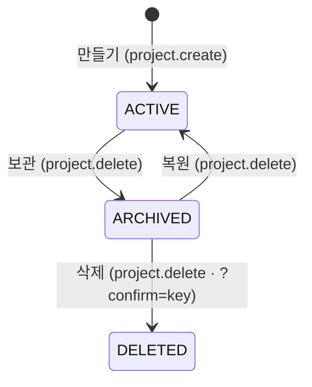
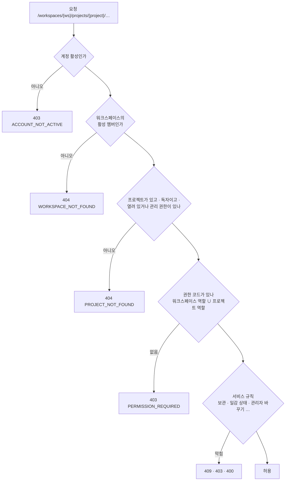

[홈](../README.md) › [설계](00-key-decisions.md) › 프로젝트

# 프로젝트 — 공개 범위 · 프로젝트 역할 · 판정 · 화면

프로젝트는 워크스페이스 안에 여러 개 있는 **일감 묶음이자 권한 경계**다. moai-wiki 의 **위키**와 같은 자리이고, 표 · 판정 · API · 화면을 위키와 한 줄씩 맞춘다([ADR-002](00-key-decisions.md#adr-002) · [ADR-005](00-key-decisions.md#adr-005) · [ADR-006](00-key-decisions.md#adr-006)). 계정 · 워크스페이스 · 역할의 바탕은 [워크스페이스 설계](03-workspace-identity.md), 표의 DDL 은 [데이터 모델 §5](02-data-model.md#dm-project), 프로젝트 안의 일감은 [일감 설계](05-issue.md)에 있다.

> 요구사항: [FR-PRJ-001](../requirements/02-project.md#fr-prj-001) 만들기 · [002](../requirements/02-project.md#fr-prj-002) 목록 · [003](../requirements/02-project.md#fr-prj-003) 설정 · [004](../requirements/02-project.md#fr-prj-004) 보관 · 복원 · [005](../requirements/02-project.md#fr-prj-005) 삭제 · [006](../requirements/02-project.md#fr-prj-006) 공개 범위와 독자 판정 · [007](../requirements/02-project.md#fr-prj-007) 프로젝트 역할 · [008](../requirements/02-project.md#fr-prj-008) 역할의 정본 · [009](../requirements/02-project.md#fr-prj-009) 기본 프로젝트 · [010](../requirements/02-project.md#fr-prj-010) 화면 · [011](../requirements/02-project.md#fr-prj-011) 감사

**바로가기:** [원칙](#pj-principles) · [프로젝트](#pj-model) · [key](#pj-key) · [상태](#pj-status) · [판정](#pj-read) · [`@ProjectApi`](#pj-access) · [오류](#pj-errors) · [프로젝트 역할](#pj-roles) · [Keycloak](#pj-keycloak) · [기본 프로젝트](#pj-default) · [REST](#pj-api) · [감사](#pj-audit) · [화면](#pj-screens) · [시험](#pj-tests) · [moai-wiki 대응](#pj-diff)


> **구현 상태 (2026-11-22)** — 만든 것: 프로젝트 표 · `@ProjectApi` · 판정 · 만들기 · 목록 · 상세(`issueCount` · `myRoles` · `myPermissions` · `myActions`) · 설정 · 보관 · 복원 · 삭제 · 내 프로젝트 · 프로젝트 역할(Keycloak 그룹 먼저 · 사본 · 권한 상승 방지 · 워크스페이스를 나가면 사본 삭제) · 화면. **아직(계획):** `GET …/people`(화면은 지금 워크스페이스 멤버 목록을 쓰고 서버가 비독자를 거절한다) · 역할 목록의 `grantedBy` · `grantedAt` · 프로젝트를 지울 때 Keycloak 그룹과 사본 정리 · 대사.

---

<a id="pj-principles"></a>
## 1. 원칙

| 원칙 | 내용 |
|---|---|
| 판정은 api 한 곳 | 화면 · BFF · MCP 도구는 판정하지 않는다. 화면은 숨기기만 한다([ADR-004](00-key-decisions.md#adr-004)) |
| 읽기 경계는 프로젝트 | 프로젝트의 독자는 그 프로젝트의 일감을 모두 읽는다. **일감마다 읽기를 좁히지 않는다**(비공개 일감 없음). 좁혀야 하면 지정 멤버 프로젝트(`RESTRICTED`)를 따로 만든다 — moai-wiki 가 페이지마다 읽기를 좁히지 않는 것과 같은 이유다(목록 · 하위 · 연결 · 검색 · MCP 마다 거름이 필요해져 새는 길이 많다) |
| 권한은 합친다 | 프로젝트 권한 = 워크스페이스 역할의 권한 ∪ 그 프로젝트의 프로젝트 역할 권한 |
| 모르면 404, 보이면 403 | 볼 수 없는 프로젝트는 없는 것과 똑같이 404 다. 볼 수는 있지만 할 수 없으면 403 이다 |
| moai-wiki 와 같은 모양 | 위키(`wiki` · `WikiAccessService` · `@WikiApi` · `WikiContext` · `WikisPage` …)의 자리에 프로젝트를 둔다. 다른 점은 [§10](#pj-diff) |

---

<a id="pj-model"></a>
## 2. 프로젝트

| 필드 | 뜻 | 규칙 |
|---|---|---|
| `key` | 주소 이름(`/w/{ws}/projects/{key}`, MCP 도구 입력) | [§2.1](#pj-key). 만든 뒤 바꾸지 않는다 |
| `name` | 이름 | 1~100자, 앞뒤 공백 제거. 정렬은 `COLLATE "C"`(가나다순) |
| `description` | 설명 | 1,000자까지, 비우면 NULL |
| `visibility` | 공개 범위 | `WORKSPACE`(기본 — 멤버 전원이 독자) · `RESTRICTED`(프로젝트 역할을 받은 멤버 + 소유자 · 관리자) |
| `status` | 상태 | [§2.2](#pj-status) |
| `issue_seq` | 마지막으로 준 일감 번호 | 일감을 만들 때 잠그고 하나 올린다([일감 설계 §4](05-issue.md#is-number)) |
| `settings` | 프로젝트 설정 | jsonb, 지금은 비어 있다(나중 후보 기능의 자리) |
| `created_by` · `created_at` · `updated_at` · `archived_at` · `deleted_at` · `row_version` | | |

DDL 은 [데이터 모델 §5.1](02-data-model.md#dm-project). moai-wiki `wiki` 의 `root_create` · `max_security_level` · `language` 와 상태 `PAUSED` · `BLOCKED` 는 페이지 · 에이전트 전용이라 없다.

<a id="pj-key"></a>
### 2.1 key

| 규칙 | 내용 | 어기면 |
|---|---|---|
| 모양 | `^[a-z][a-z0-9-]{0,30}[a-z0-9]$` — 2~32자, 영문 소문자로 시작, 소문자 · 숫자 · 하이픈, 하이픈으로 끝나지 않음 | 400 `INVALID_PROJECT_KEY` |
| 예약어 | `new` · `archive` · `archived` · `settings` (화면 주소와 부딪힌다) | 400 `RESERVED_PROJECT_KEY` |
| 고유 | 워크스페이스 안에서 지우지 않은 프로젝트끼리 고유. 지운 프로젝트의 key 는 바로 다시 쓸 수 있다(부분 고유 인덱스). 동시에 같은 key 로 만들면 인덱스가 하나만 통과시킨다 | 409 `PROJECT_KEY_TAKEN` |
| 바꾸기 | 하지 않는다 — 주소 · MCP 입력 · 사람의 기억에 들어간다 | — |

화면은 이름에서 key 를 제안한다(moai-wiki `wiki-key.ts` 와 같은 규칙 검사를 `project-key.ts` 로). 판정은 api 가 다시 한다.

<a id="pj-status"></a>
### 2.2 상태



| 상태 | 누가 보나 | 할 수 있는 일 |
|---|---|---|
| `ACTIVE` | 독자 | 권한대로 |
| `ARCHIVED` | `project.manage` 또는 `project.delete` 가 있는 독자만(목록의 보관 탭). 그 밖에는 404 | **읽기 전용** — 설정 고치기 · 프로젝트 역할 · 복원 · 삭제만. 일감 만들기 · 고치기 · 댓글 · 지우기 · 연결은 409 `PROJECT_NOT_WRITABLE`. MCP 에는 보이지 않는다 |
| `DELETED` | 아무도(404) | 없음. 행은 남는다(소프트 삭제). 영구 삭제는 보존 규칙으로 따로 한다(나중) |

- 삭제는 **보관한 프로젝트만**, `?confirm=<key>` 로 key 를 다시 넣어야 한다(이중 확인). 다르면 400 `CONFIRM_MISMATCH`, 보관하지 않았으면 409 `PROJECT_NOT_ARCHIVED`. 이미 보관했는데 보관하면 409 `PROJECT_ALREADY_ARCHIVED`.
- 삭제하면 Keycloak 그룹 `/projects/<id>` 를 하위째 지우고 바인딩을 지운다(멱등, [§4.2](#pj-keycloak)). 일감 · 이력 · 연결 행은 그대로 둔다(프로젝트가 404 라 닿을 길이 없다).
- 지운 프로젝트는 MCP 엔드포인트의 대상에서 빠진다. 대상이 하나도 남지 않은 엔드포인트는 `DISABLED` 로 바꾼다(4단계, [MCP 설계 §4](06-mcp.md#mc-endpoint)).
- 화면은 지우기 전에 영향(일감 수)을 보이고 key 입력을 받는다.
- moai-wiki 의 위키 보관 · 복원 · 삭제와 같다(`WikiService.archive` · `restore` · `delete`).

### 2.3 공개 범위 바꾸기

- `project.manage` 로 `PATCH` 에서 바꾼다. 다음 요청부터 반영된다(판정은 요청마다 사본으로 한다).
- `WORKSPACE` → `RESTRICTED` 로 바꾸면 프로젝트 역할이 없는 멤버(소유자 · 관리자 빼고)는 바로 404 다. 그들이 관리자 · 담당자인 일감은 그대로 두고 "떠난 멤버"(`active: false`)로 보인다([일감 설계 §6](05-issue.md#is-people)). 고친 사람도 독자가 아니게 될 수 있다 — 고친 결과는 돌려주되 다음 요청부터 404 다(moai-wiki `WikiService.update` 와 같다). 화면은 바꾸기 전에 이것을 알린다.
- MCP 엔드포인트는 `RESTRICTED` 프로젝트도 대상으로 둘 수 있다. MCP 키는 늘 주인의 권한 안에서만 일하므로, 그 프로젝트는 주인이 독자인 키에만 보인다. 대상이던 프로젝트가 `RESTRICTED` 가 되면 독자가 아닌 주인의 키에서는 다음 호출부터 빠진다(호출 때 판정, [MCP 설계 §7](06-mcp.md#mc-authz)). 사람 권한을 넘어 읽던 서비스 키 · 서비스 읽기 방식은 없앴다([ADR-024](00-key-decisions.md#adr-024)).

---

<a id="pj-read"></a>
## 3. 판정

moai-wiki `WikiAccessService` 와 같은 식이다.

```
독자(사람, 프로젝트)      = 워크스페이스 활성 멤버
                          ∧ ( 프로젝트.공개 범위 = WORKSPACE
                              ∨ 역할 key owner · admin 을 가짐
                              ∨ 그 프로젝트의 프로젝트 역할을 하나라도 가짐 )
프로젝트 권한(사람, 프로젝트) = 워크스페이스 역할의 권한 ∪ 그 프로젝트의 프로젝트 역할들의 권한
보이는가(사람, 프로젝트)    = 독자 ∧ 상태 ≠ DELETED ∧ ( 상태 = ACTIVE ∨ project.manage ∨ project.delete )
허용(사람, 프로젝트, 코드)  = 보이는가 ∧ 코드 ∈ 프로젝트 권한
```



| 사람 | `WORKSPACE` 프로젝트 | `RESTRICTED` 프로젝트 (역할 없음) | `RESTRICTED` 프로젝트 (project-editor) |
|---|---|---|---|
| 소유자 · 관리자 | 전부 | 전부 | 전부 |
| 큐레이터 | 보기 · 댓글 · 만들기 · 고치기 · 관리자 바꾸기 | 404 | 보기 · 댓글 · 만들기 · 고치기 · 관리자 바꾸기(큐레이터 코드 ∪ 편집자 코드) |
| 멤버 | 보기 · 댓글 | 404 | 보기 · 댓글 · 만들기 · 고치기 |
| 멤버가 아님 · 멤버십 정지 | 404(워크스페이스) | 404 | 404 |

<a id="pj-access"></a>
### 3.1 `@ProjectApi` · `ProjectContext` · `ProjectAccessService`

moai-wiki 의 `@WikiApi` · `WikiContext` · `WikiAccessService` 를 이름만 바꿔 옮긴다. 일감 API 도 모두 `@ProjectApi` 다(따로 `@IssueApi` 를 두지 않는다 — 일감을 번호로 찾는 것은 서비스가 프로젝트 문맥 안에서 한다).

```java
/**
 * 프로젝트 하나 안의 일. 경로에 {workspace}(워크스페이스 주소)와 {project}(프로젝트 key)가 있어야 한다(기동 때 확인).
 *  - 워크스페이스 멤버가 아니면 404 WORKSPACE_NOT_FOUND
 *  - 프로젝트가 없거나 · 독자가 아니거나 · 보관됐는데 관리 권한이 없으면 404 PROJECT_NOT_FOUND (존재를 숨긴다)
 *  - 보이지만 value() 권한이 없으면 403 PERMISSION_REQUIRED
 * 권한은 워크스페이스 역할의 권한과 그 프로젝트의 프로젝트 역할 권한을 합친 것이다.
 * 통과하면 컨트롤러 인자로 ProjectContext 를 받는다.
 */
@Retention(RUNTIME) @Target(METHOD)
public @interface ProjectApi {
  Permission value();
}

/** @ProjectApi 를 통과한 요청의 프로젝트 문맥 — 요청마다 한 번만 계산한다. */
public record ProjectContext(WorkspaceContext workspace, Project project, Set<ProjectRole> roles,
    Set<Permission> permissions) {
  public boolean has(Permission p) { return permissions.contains(p); }
  public UUID userId() { return workspace.userId(); }
  public UUID workspaceId() { return workspace.workspaceId(); }
  public UUID projectId() { return project.getId(); }
}

@Service
public class ProjectAccessService {
  /** 보이면 문맥, 아니면 empty (호출자는 404 로 숨긴다). */
  public Optional<ProjectContext> contextFor(WorkspaceContext ws, String key);
  public Optional<ProjectContext> contextFor(WorkspaceContext ws, Project project);
  /** 독자인가 — WORKSPACE ∨ owner · admin ∨ 프로젝트 역할 */
  public boolean isReader(WorkspaceContext ws, Project project, Set<ProjectRole> roles);
  /** 그 프로젝트에서 가진 권한 = 워크스페이스 역할 ∪ 프로젝트 역할 */
  public Set<Permission> permissionsIn(WorkspaceContext ws, Set<ProjectRole> roles);
  /** 보관한 프로젝트를 볼 수 있는가 — project.manage ∨ project.delete */
  public static boolean canManage(ProjectContext ctx);
}
```

- `AccessInterceptor` 에 `case ProjectApi p -> …` 를 더한다(`WikiApi` 줄과 같다). `AccessContractVerifier` 는 `@ProjectApi` 경로에 `{workspace}` · `{project}` 가 없으면 기동을 멈춘다.
- 프로젝트 역할은 `project_role_binding` 에서 (프로젝트, 사람)으로 한 번 읽는다(PK 색인). 목록처럼 여러 프로젝트를 볼 때는 그 워크스페이스의 내 바인딩을 한 번에 읽는다(`WHERE user_id = :me AND project_id IN (…)`).
- MCP 도구는 어노테이션 없이 같은 `ProjectAccessService.contextFor` 를 부르고, 결과를 엔드포인트 범위로 더 좁힌다([MCP 설계 §7](06-mcp.md#mc-authz)).

<a id="pj-errors"></a>
### 3.2 오류

| code | HTTP | 뜻 |
|---|---|---|
| `WORKSPACE_NOT_FOUND` | 404 | 워크스페이스 멤버가 아니다(지금 코드) |
| `PROJECT_NOT_FOUND` | 404 | 프로젝트가 없다 · 독자가 아니다 · 보관됐는데 관리 권한이 없다 — 셋을 가리지 않는다 |
| `PERMISSION_REQUIRED` | 403 | 보이지만 권한 코드가 없다(지금 코드와 같은 code) |
| `INVALID_PROJECT_KEY` · `RESERVED_PROJECT_KEY` | 400 | key 모양 · 예약어([§2.1](#pj-key)) |
| `PROJECT_KEY_TAKEN` | 409 | 같은 key 의 프로젝트가 있다 |
| `PROJECT_ALREADY_ARCHIVED` · `PROJECT_NOT_ARCHIVED` | 409 | 보관 · 복원 · 삭제의 상태 규칙 |
| `PROJECT_NOT_WRITABLE` | 409 | 보관한 프로젝트에 일감 쓰기 |
| `CONFIRM_MISMATCH` | 400 | 삭제 확인 key 가 다르다 |
| `UNKNOWN_PROJECT_ROLE` | 400 | 없는 프로젝트 역할 key |
| `MEMBER_NOT_FOUND` | 404 | 프로젝트 역할을 줄 사람이 워크스페이스 활성 멤버가 아니다 |
| `ESCALATION_DENIED` | 403 | 자기가 그 프로젝트에서 갖지 않은 코드를 담은 역할을 주거나 빼려 했다(지금 코드와 같은 code) |

오류 본문은 RFC 9457(problem+json)이고 지금 `ApiExceptionHandler` 를 쓴다.

---

<a id="pj-roles"></a>
## 4. 프로젝트 역할

moai-wiki 설계 15 §4.3 의 위키 역할과 같은 모양이다. 역할은 아래 역할을 포함한다(관리자 ⊃ 큐레이터 ⊃ 편집자 ⊃ 독자).

| 역할 | 이름 | Keycloak 조직 그룹 | 그 프로젝트에서 받는 코드 | moai-wiki |
|---|---|---|---|---|
| `project-reader` | 프로젝트 독자 | `/projects/<project id>/project-reader` | `issue.read` · `issue.comment` | `wiki-reader` |
| `project-editor` | 프로젝트 편집자 | `/projects/<project id>/project-editor` | 독자 + `issue.create` · `issue.edit` | `wiki-editor` |
| `project-curator` | 프로젝트 큐레이터 | `/projects/<project id>/project-curator` | 편집자 + `issue.manager.assign` | `wiki-curator` |
| `project-admin` | 프로젝트 관리자 | `/projects/<project id>/project-admin` | 큐레이터 + `issue.delete` · `project.manage` | `wiki-admin` |

**워크스페이스 역할과 합친 결과** (그 프로젝트의 독자일 때)

| 코드 | owner · admin | curator | member | + project-reader | + project-editor | + project-curator | + project-admin |
|---|---|---|---|---|---|---|---|
| `issue.read` · `issue.comment` | ○ | ○ | ○ | ○ | ○ | ○ | ○ |
| `issue.create` · `issue.edit` | ○ | ○ | — | — | ○ | ○ | ○ |
| `issue.manager.assign` | ○ | ○ | — | — | — | ○ | ○ |
| `issue.delete` | ○ | — | — | — | — | — | ○ |
| `project.manage` | ○ | — | — | — | — | — | ○ |
| `project.delete` | ○ | — | — | — | — | — | — |

("+ 역할" 칸은 멤버가 그 역할을 받았을 때다. `project.create` 는 워크스페이스 코드라 프로젝트 역할에 없다. `project.delete` 는 워크스페이스 소유자 · 관리자만 가진다 — 프로젝트 관리자는 보관 · 삭제를 못 한다.)

### 4.1 규칙

| 규칙 | 내용 |
|---|---|
| 고정 | 역할은 넷으로 고정이다. 사용자 정의 프로젝트 역할은 없다. 역할 → 코드는 api 의 `ProjectRole` 열거형이 갖는다(포함 관계는 단위 테스트로 지킨다) |
| 여러 개 | 한 사람이 한 프로젝트에서 역할을 여러 개 가질 수 있다(PK `(project_id, user_id, role)`). 권한은 합친다. 화면은 가장 높은 역할을 앞에 보인다 |
| 받는 사람 | 그 워크스페이스의 **활성 멤버**만. 아니면 404 `MEMBER_NOT_FOUND`. 없는 역할 key 는 400 `UNKNOWN_PROJECT_ROLE` |
| 주고 빼는 사람 | 그 프로젝트에서 `project.manage` 를 가진 사람 — 워크스페이스 소유자 · 관리자, 또는 그 프로젝트의 `project-admin` |
| 권한 상승 방지 | 더하거나 빼는 역할마다, 그 역할의 코드를 주는 사람이 **그 프로젝트에서 모두** 가져야 한다. 아니면 403 `ESCALATION_DENIED` (워크스페이스 역할의 규칙과 같다 — [워크스페이스 설계 §10.4](03-workspace-identity.md#ws-membership)) |
| 바꾸는 방식 | `PUT /roles/{userId}` 에 그 사람의 역할 목록 전체를 보낸다. 빈 목록 = 모두 뺌. 지금과 같으면 아무것도 하지 않는다(감사도 없음) |
| 독자와의 관계 | 역할이 하나라도 있으면 `RESTRICTED` 프로젝트의 독자다. 역할을 모두 빼면 다음 요청부터 404 다 |
| 멤버가 떠남 | 제거 · 탈퇴하면 그 워크스페이스 모든 프로젝트의 역할을 함께 뺀다(그룹 · 바인딩, [워크스페이스 설계 §10.3](03-workspace-identity.md#ws-membership)) |
| 보관한 프로젝트 | 관리 권한이 있으면 역할을 바꿀 수 있다 |

<a id="pj-keycloak"></a>
### 4.2 Keycloak — 정본과 이중 쓰기

| moai-works | Keycloak | 비고 |
|---|---|---|
| 프로젝트 | 없음 (api DB `project` 가 정본) | |
| 프로젝트 묶음 그룹 | 조직 그룹 `/projects` · `/projects/<project id>` | 그 프로젝트에 처음 역할을 줄 때 만든다 |
| 프로젝트 역할 | 조직 그룹 `/projects/<project id>/<role>` 가입 | **정본.** api 사본은 `project_role_binding`(`keycloak_group_id` 에 그룹 id) |
| 역할의 권한 코드 | **매핑하지 않는다** | 역할이 고정이라 `ProjectRole` 이 갖는다. 그룹에 클라이언트 역할을 매핑하면 Keycloak 에서 워크스페이스 전체 권한처럼 보여 헷갈린다. moai-wiki 가 위키 역할을 만들 때도 같게 한다 |

- 그룹 이름에 key 가 아니라 **프로젝트 id** 를 쓴다(지운 뒤 같은 key 를 다시 쓸 때 옛 그룹과 섞이지 않게 — moai-wiki 도 위키 id 다).
- 쓰기는 지금 코드의 이중 쓰기(`keycloak_operation`, [워크스페이스 설계 §6.3](03-workspace-identity.md#ws-sor))를 그대로 쓴다.

```
PUT /workspaces/{ws}/projects/{project}/roles/{userId}  { "roles": ["project-editor"] }

0. 판정: @ProjectApi(project.manage) → 받는 사람이 활성 멤버인가 → 더할 · 뺄 역할 계산 → 권한 상승 방지
1. api DB  : keycloak_operation PENDING (멱등 키 project-roles:{project id}:{user id}:{바꾼 뒤 역할 목록})   ┐ 트랜잭션 ①
2. Keycloak: /projects · /projects/<id> · /projects/<id>/<role> 그룹이 없으면 만든다(멱등)
             더할 역할 그룹에 넣고, 뺄 역할 그룹에서 뺀다 (이미 그렇게 돼 있으면 성공으로 본다)
3. api DB  : project_role_binding 넣기 · 지우기 · keycloak_operation DONE · 감사 project.roles.update      ┐ 트랜잭션 ②
   실패    : FAILED 로 남기고 오류 — 같은 요청을 다시 하면 이어서 한다
```

- 2단계가 끝나기 전에는 사본이 바뀌지 않으므로, 실패하면 "늦게 열리는 쪽"으로만 틀린다(역할을 더할 때). 뺄 때는 Keycloak 에서 뺀 뒤 사본을 지운다.
- 프로젝트를 지우면 `/projects/<id>` 그룹을 하위째 지우고 바인딩을 지운다(같은 길, 멱등 키 `project-delete:{project id}`).
- **대사(계획):** 워크스페이스 대사(15분)가 `/projects/*/*` 그룹의 멤버와 바인딩을 견준다. 다르면 Keycloak 을 기준으로 사본을 고치고 감사에 남긴다.
- **규모:** 조직 그룹 수 = 1(`/projects`) + 역할을 준 프로젝트 수 × (1 + 실제로 쓰는 역할 수, 최대 4). 빈 역할 그룹은 만들지 않는다. 큰 워크스페이스에서 조직 그룹 조회 성능은 규모 시험에서 잰다.

---

<a id="pj-default"></a>
## 5. 기본 프로젝트 — "내 프로젝트"

moai-wiki 의 "내 위키"(`WikiService.ensureDefault`)와 같다.

| 항목 | 내용 |
|---|---|
| 언제 | 개인 워크스페이스를 만들 때 마지막 단계(7단계, [워크스페이스 설계 §8.2](03-workspace-identity.md#ws-login)) — `WorkspaceProvisioner` 가 `ProjectService.ensureDefault(workspaceId, ownerId, actor)` 를 부른다 |
| 무엇 | key `my`, 이름 "내 프로젝트", 설명 없음, 공개 범위 `WORKSPACE`, 만든 사람 = 가입한 사람 |
| 멱등 | 그 워크스페이스에 프로젝트를 만든 적이 한 번도 없을 때만 만든다(지운 것까지 센다 — `countEver`). 사람이 "내 프로젝트" 를 지운 뒤 다시 만들어지지 않는다 |
| 감사 | `project.create` (`details.default = true`) |
| 팀 워크스페이스 | 만들지 않는다 |
| 이행 | 이 기능을 넣기 전에 만든 개인 워크스페이스에도 한 번 채운다 — 프로젝트를 만든 적이 한 번도 없는 곳만(같은 `ensureDefault`, 기동 이행 또는 로그인 때 개인 워크스페이스 보장에서) |
| 이름 | 사람이 나중에 고칠 수 있다. key 는 다른 프로젝트처럼 바꿀 수 없다 |

---

<a id="pj-api"></a>
## 6. REST

경로는 `/moai-works-api/v1/workspaces/{workspace}/projects` 아래다. 웹 화면은 web-backend 의 `/api/v1/**` 로 같은 경로를 부른다.

| 일 | 메서드 · 경로 | 접근 어노테이션 | 비고 |
|---|---|---|---|
| 목록 | `GET /projects?archived=false` | `@WorkspaceApi(workspace.read)` | 내가 볼 수 있는 프로젝트(이름순). `archived=true` 면 보관한 것도 — 관리 권한이 있는 것만 실제로 나온다 |
| 만들기 | `POST /projects` | `@WorkspaceApi(project.create)` | 201 + 상세. 감사 `project.create` |
| 상세 | `GET /projects/{project}` | `@ProjectApi(issue.read)` | `myPermissions` · `myActions` 를 담는다 |
| 설정 | `PATCH /projects/{project}` | `@ProjectApi(project.manage)` | 이름 · 설명 · 공개 범위. 감사 `project.update`(전 · 후) |
| 보관 | `POST /projects/{project}/archive` | `@ProjectApi(project.delete)` | 본문 `{reason?}`(500자). 감사 `project.archive` |
| 복원 | `POST /projects/{project}/restore` | `@ProjectApi(project.delete)` | 감사 `project.restore` |
| 삭제 | `DELETE /projects/{project}?confirm={key}` | `@ProjectApi(project.delete)` | 보관한 것만. 204. 감사 `project.delete` |
| 역할 목록 | `GET /projects/{project}/roles` | `@ProjectApi(issue.read)` | 프로젝트 역할을 가진 사람과 역할들(준 사람 · 준 때 포함). 독자는 누가 프로젝트에 있는지 본다 |
| 역할 바꾸기 | `PUT /projects/{project}/roles/{userId}` | `@ProjectApi(project.manage)` | 본문 `{roles: [...]}` — 빈 목록 = 모두 뺌. 감사 `project.roles.update` |
| 고를 수 있는 사람 | `GET /projects/{project}/people?q=&limit=20` | `@ProjectApi(issue.read)` | 관리자 · 담당자로 고를 수 있는 사람 = 그 프로젝트의 독자인 활성 멤버(이름 · 이메일 앞부분으로 찾기, 최대 50). 일감 화면의 고르기 칸이 쓴다 |

**요청 · 응답 꼴** (moai-wiki `WikiController` · `WikiViews` 와 같은 모양)

```java
record CreateRequest(@NotBlank @Size(min = 2, max = 32) String key, @NotBlank @Size(max = 100) String name,
    @Size(max = 1000) String description, @NotNull Project.Visibility visibility) {}

record SettingsRequest(@NotBlank @Size(max = 100) String name, @Size(max = 1000) String description,
    @NotNull Project.Visibility visibility) {}

record SetRolesRequest(@NotNull @Size(max = 4) Set<String> roles) {}   // 역할 key 들

/** 목록 한 줄 */
record Summary(UUID id, String key, String name, String description, Project.Visibility visibility,
    Project.Status status, Instant updatedAt) {}

/**
 * 상세 (독자에게).
 * @param myPermissions 이 프로젝트에서 내가 가진 권한 코드 — 화면은 이것으로 단추를 숨기기만 한다(판정은 api)
 * @param myActions     권한 코드만으로는 알 수 없는 것 — createIssue(프로젝트가 열려 있고 issue.create 가 있다)
 */
record Detail(UUID id, String key, String name, String description, Project.Visibility visibility,
    Project.Status status, int issueCount, Instant createdAt, Instant updatedAt, Instant archivedAt,
    List<String> myRoles, List<String> myPermissions, List<String> myActions) {}

/** 역할 목록 한 줄 — grantedBy · grantedAt 은 가장 최근에 준 역할의 것 */
record Holder(UUID userId, String username, String displayName, List<String> roles, UUID grantedBy,
    Instant grantedAt) {}
```

- 설정 `PATCH` 는 moai-wiki 와 같이 `rowVersion` 을 받지 않는다(마지막에 쓴 것이 남는다). 동시 수정 검사는 일감에만 둔다.
- `issueCount` 는 지우지 않은 일감 수다(삭제 대화상자가 영향으로 보인다).

---

<a id="pj-audit"></a>
## 7. 감사

| 행동 | 대상 | `details` |
|---|---|---|
| `project.create` | `project` · id | key · name · visibility · (기본 프로젝트면) `default: true` |
| `project.update` | `project` · id | key · 바뀐 값의 `before` · `after` |
| `project.archive` | `project` · id | key · reason |
| `project.restore` | `project` · id | key |
| `project.delete` | `project` · id | key · name · 일감 수 |
| `project.roles.update` | `project` · id | key · 받는 사람(userId) · 역할 `before` · `after` |

- 업무와 같은 트랜잭션에 남긴다(지금 `AuditService`) — 감사 저장이 실패하면 그 쓰기도 되돌린다. 워크스페이스 · 주체 · 경로 · IP 를 함께 남긴다. 프로젝트 관리는 MCP 로 열지 않으므로 경로는 늘 웹이다.
- 감사 화면(지금 있음)에서 대상 종류 `project` 로 거를 수 있게 한다(`audit.read`).

---

<a id="pj-screens"></a>
## 8. 화면

moai-wiki 의 위키 화면 구조를 그대로 쓴다(`features/wiki/*` → `features/project/*`). 반응형(390px · 데스크톱)과 메뉴 자리는 [WEB-DESIGN.md](../../WEB-DESIGN.md)를 따른다.

| 주소 | 화면 (컴포넌트) | 내용 | moai-wiki |
|---|---|---|---|
| `/w/:slug/projects` | 프로젝트 목록 (`ProjectsPage`) | 탭 **진행 중** · **보관함**(관리 권한이 있을 때만). 카드(`ProjectCards`) — 이름 · key · 설명 · 공개 범위 칩 · 일감 수 · 고친 때. "새 프로젝트" 단추(`project.create`) | `WikisPage` · `WikiCards` |
| (대화상자) | 만들기 · 설정 (`ProjectDialog`) | key(만들 때 이름에서 제안 · 규칙을 입력 자리에서 알림, 설정에서는 읽기 전용) · 이름 · 설명 · 공개 범위. 설정 모드에서 `RESTRICTED` 로 바꾸면 "역할이 없는 멤버는 볼 수 없게 된다" 를 알린다 | `WikiDialog` |
| (대화상자) | 삭제 (`RemoveProjectDialog`) | 영향(일감 수)을 보이고, key 를 그대로 쳐야 지우기 단추가 켜진다 | `RemoveWikiDialog` |
| (훅) | 보관 · 복원 · 지우기 · 설정 (`use-project-actions`) | 동작을 한 곳에 두고, 뒤에 목록 · 상세 질의를 고친다 | `use-wiki-actions` |
| `/w/:slug/projects/:projectKey` | 프로젝트 틀 (`ProjectLayout`) | 상세를 읽어(독자가 아니면 api 가 404 → "프로젝트를 찾을 수 없습니다") 문맥(`project-context`)으로 내려준다. 머리에 이름 · 공개 범위 칩 · 메뉴(일감 · 멤버 · 설정 · 보관 · 삭제 — 권한대로). 보관한 프로젝트면 "보관됨" 띠와 복원 단추 | `WikiLayout` · `wiki-context` |
| `…/:projectKey` (`''`) | 프로젝트 홈 (`ProjectHomePage`) | **일감 목록**(필터 · 정렬 · 페이지) — [일감 설계 §16](05-issue.md#is-screens) | `WikiHomePage` |
| `…/:projectKey/issues/new` · `issues/:number` · `issues/:number/edit` | 일감 만들기 · 보기 · 고치기 | [일감 설계 §16](05-issue.md#is-screens) | `new` · `p/:pageSlug` · `p/:pageSlug/edit` |
| `…/:projectKey/members` | 프로젝트 멤버 (`ProjectMembersPage`) | 역할을 가진 사람 표(이름 · 역할 칩들) · "사람 더하기"(워크스페이스 멤버 고르기 + 역할) · 역할 바꾸기 · 빼기. `project.manage` 가 없으면 보기만. 줄 수 없는 역할은 꺼 두고 이유를 보인다 | (위키 역할 화면 — moai-wiki 도 같은 자리에 둔다) |

- 사이드바: "프로젝트" 메뉴(`/w/:slug/projects`, `workspace.read`) 아래에 내가 볼 수 있는 프로젝트를 늘어놓고, 프로젝트 안에 있으면 그 프로젝트를 강조한다(moai-wiki 사이드바의 위키 목록과 같다). 개인 워크스페이스에서는 "내 프로젝트" 로 바로 간다.
- 없거나 볼 수 없는 프로젝트는 같은 "프로젝트를 찾을 수 없습니다" 화면이다. 390px · 데스크톱에서 가로 스크롤 없이 쓴다. ko/en, 다크 모드.
- 주소 도우미: `app/routes.tsx` 에 `projectsPath` · `projectPath` · `projectMembersPath` · `issuePath` · `issueEditPath` · `newIssuePath` (moai-wiki 의 `wikisPath` · `wikiPath` · `pagePath` … 자리).
- 단추 숨기기는 상세의 `myPermissions` · `myActions` 로 한다(`projectCan(detail, code)`). 판정은 api 가 한다.
- 다국어 리소스는 `workspace` 이름공간의 `projects.*`(목록 · 대화상자)와 새 `issue` 이름공간(일감 화면).

---

<a id="pj-tests"></a>
## 9. 시험

api 자동 테스트(진짜 DB · 가짜 Keycloak, 지금 틀)에 더한다.

| 묶음 | 꼭 넣을 경우 |
|---|---|
| 만들기 | 소유자 · 관리자 → 201. 큐레이터 · 멤버 → 403. key 모양 · 예약어 → 400. 같은 key → 409. 지운 프로젝트의 key 다시 쓰기 → 201 |
| 독자 | `RESTRICTED` 프로젝트: 역할 없는 멤버 · 큐레이터 → 상세 · 목록 · 일감 모두 404. 소유자 · 관리자 → 보인다. `project-reader` 를 받으면 보이고, 빼면 다음 요청부터 404 |
| 권한 합치기 | 멤버 + `project-editor` → 그 프로젝트에서만 일감을 만든다(다른 프로젝트는 403). 큐레이터 + `project-reader` → 큐레이터 코드가 그대로 |
| 상태 | 보관 → 독자에게 404, 관리자에게 보인다. 삭제하면 프로젝트 역할 그룹 · 바인딩이 사라진다. 보관한 프로젝트에 일감 만들기 → 409 `PROJECT_NOT_WRITABLE`. 보관하지 않고 삭제 → 409. 확인 key 가 다르면 → 400. 삭제 뒤 → 모두 404 |
| 역할 | `project-admin` 이 `project-admin` 을 준다 → 된다. `project-curator` 가 역할을 준다 → 403(`project.manage` 없음). 활성 멤버가 아닌 사람에게 → 404 `MEMBER_NOT_FOUND`. Keycloak 그룹 가입 · 사본이 함께 바뀐다. 같은 요청을 다시 → 변화 없음. Keycloak 이 중간에 실패한 뒤 다시 → 이어서 끝난다 |
| 멤버 떠남 | 멤버를 제거하면 그 사람의 프로젝트 역할 바인딩 · 그룹 가입이 모두 빠진다 |
| 기본 프로젝트 | 가입 → "내 프로젝트"(key `my`, `WORKSPACE`)가 하나. 다시 돌려도 하나. 지운 뒤 다시 돌려도 생기지 않는다. 이행이 프로젝트가 없던 옛 개인 워크스페이스에만 채운다 |
| 감사 | 만들기 · 설정 · 보관 · 복원 · 삭제 · 역할 바꾸기마다 한 줄 |
| 기동 검사 | `{project}` 없는 경로에 `@ProjectApi` → 기동 실패 |

---

<a id="pj-diff"></a>
## 10. moai-wiki 대응과 다른 점

| moai-wiki | moai-works | 다른 점 |
|---|---|---|
| `wiki` (V5) | `project` (V2) | `root_create` · `max_security_level` · `language` · `PAUSED` · `BLOCKED` 없음. `issue_seq` 더함 |
| `WikiAccessService` · `@WikiApi` · `WikiContext` | `ProjectAccessService` · `@ProjectApi` · `ProjectContext` | moai-wiki 코드는 위키 역할이 아직 없어 `isReader` 가 공개 범위 · 소유자 · 관리자만 본다. moai-works 는 처음부터 프로젝트 역할을 넣는다 |
| `WikiService.create · update · archive · restore · delete · ensureDefault` | `ProjectService` 의 같은 이름 | 같다. 오류 code 의 `WIKI` → `PROJECT` |
| `WikiViews.Detail.myActions = [createRootPage]` | `myActions = [createIssue]` | 최상위 만들기 정책이 없다 |
| 위키 역할(설계, 코드 없음) `/wikis/<id>/<role>` · `wiki_role_binding` | 프로젝트 역할 `/projects/<id>/<role>` · `project_role_binding` + API · 멤버 화면 | **그룹에 클라이언트 역할을 매핑하지 않는다**를 적었다 — moai-wiki 도 위키 역할을 만들 때 같게 한다 |
| `WikisPage` · `WikiDialog` · `RemoveWikiDialog` · `WikiLayout` · `WikiHomePage` · `use-wiki-actions` | `ProjectsPage` · `ProjectDialog` · `RemoveProjectDialog` · `ProjectLayout` · `ProjectHomePage` · `use-project-actions` | 프로젝트 홈은 페이지 트리 대신 일감 목록이다 |
| 보관한 위키를 관리자만 본다 | 같다 | 보관한 프로젝트의 일감 쓰기는 409 `PROJECT_NOT_WRITABLE` 로 막는다(읽기 전용) |

---

**관련 문서:** [워크스페이스 · 권한](03-workspace-identity.md) · [일감](05-issue.md) · [MCP](06-mcp.md) · [데이터 모델](02-data-model.md) · [핵심 설계 결정](00-key-decisions.md) · [프로젝트 요구사항](../requirements/02-project.md) · [SECURITY.md](../../SECURITY.md)

[← 이전: 워크스페이스 · 계정 · 권한](03-workspace-identity.md) | [다음: 일감 →](05-issue.md)
