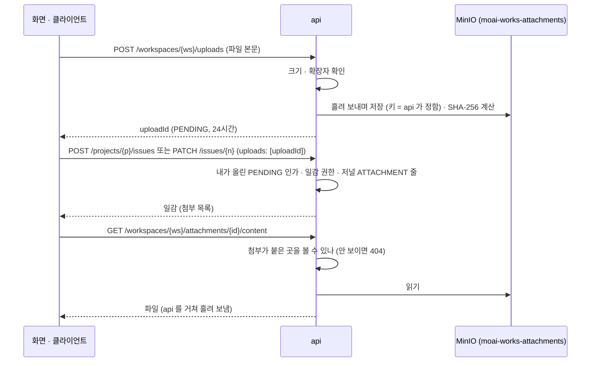

[홈](../README.md) › [설계](01-architecture.md) › 일감 추적

# 일감 추적 — 모델 · 번호 · 이력 · 관계 · 워크플로 · 사용자 정의 필드 · 질의 · 보드

일감 하나가 어떻게 생기고, 바뀌고, 이어지고, 찾아지는지 정한다. Redmine 의 일감 · 저널 · 하위 일감 · 관계 · 워크플로 · 필드 권한 · 사용자 정의 필드 · 질의 동작을 기준으로 하고, moai-works 결정(워크스페이스 순번 · Markdown · JSONB 사용자 정의 필드 · 웹과 MCP 의 같은 판정 · 칸반 보드)을 더했다. "누가 이 프로젝트에서 무엇을 할 수 있나"는 [프로젝트와 권한 설계](04-project-permissions.md)가 정하고, 이 쪽은 그 판정 위에서 일감 규칙을 정한다.

요구사항: [일감](../requirements/03-issue.md) · [트래커 · 워크플로 · 필드](../requirements/04-workflow.md) · [질의 · 목록 · 보드](../requirements/05-query.md). 버전 · 시간 기록은 [계획 · 시간 설계](06-planning-time.md), 알림 · 활동 · 검색은 [공동 작업 설계](08-collaboration.md), MCP 도구의 입출력은 [MCP · Agent 설계](07-mcp-agents.md)에 있다.

**바로가기:** [원칙](#is-principles) · [일감 모델](#is-model) · [번호](#is-number) · [고치기 · 잠금](#is-lock) · [저널](#is-journal) · [하위 일감](#is-tree) · [관계](#is-relation) · [워크플로](#is-workflow) · [필드 권한](#is-field-rule) · [설정](#is-config) · [사용자 정의 필드](#is-cf) · [질의 엔진](#is-query) · [보드](#is-board) · [첨부](#is-attachment) · [텍스트 링크](#is-links) · [관찰자](#is-watcher) · [일괄 · 복사 · 옮기기](#is-bulk) · [이벤트](#is-events) · [API](#is-api) · [테이블](#is-ddl) · [시험](#is-tests) · [정해야 할 것](#is-decisions)

---

<a id="is-principles"></a>
## 1. 원칙

| 원칙 | 내용 |
|---|---|
| 한 서비스, 여러 입구 | 화면 · REST · MCP · 메일 · 커밋 · 가져오기가 모두 같은 `IssueService` 를 부른다. 판정 · 검증 · 저널 · 이벤트가 한 곳에서 일어난다 |
| 쌓기만 하는 이력 | 일감의 모든 변경은 저널로 남는다. 메모를 고쳐도 옛 글을 남긴다. 저널을 지우는 길은 일감을 지울 때뿐이다 |
| 권한 조건은 늘 들어간다 | 질의 엔진은 권한 범위 없이 SQL 을 만들 수 없다(타입으로 막는다). 목록 · 보드 · 내보내기 · MCP 가 같은 엔진이다 |
| Redmine 과 같은 뜻 | 상태 전이 · 필드 권한 합치기 · 롤업 식 · 일정 이동 · 닫기 조건은 Redmine 과 같게 한다. 다르게 한 곳은 표에 "Redmine 과 다름"으로 적는다 |
| Agent 는 주체 | 작성자 · 담당자 · 관찰자 · 저널 행위자 자리에 사람과 Agent 계정이 똑같이 들어간다(주체 열 `*_type` + `*_id`) |
| 값은 id 로 | 저널 · 이벤트 · 질의 값은 이름이 아니라 id 로 둔다. 이름을 바꿔도 이력이 깨지지 않는다 |

---

<a id="is-model"></a>
## 2. 일감 모델

### 2.1 필드

| 키 | 이름 | 형식 · 규칙 | 트래커에서 끌 수 있나 | 필드 권한 대상 | Redmine |
|---|---|---|---|---|---|
| `project` | 프로젝트 | 바꾸면 옮기기([§17.3](#is-move)) | 못 끔 | ○(읽기전용) | `project_id` |
| `tracker` | 트래커 | 그 프로젝트에서 쓰는 트래커 | 못 끔 | ○(읽기전용) | `tracker_id` |
| `subject` | 제목 | 1 ~ 255자, 앞뒤 공백 자름. 늘 필수 | 못 끔 | ○(읽기전용) | `subject` |
| `description` | 설명 | Markdown(GFM), 20만 자까지 | 끔 | ○ | `description` |
| `status` | 상태 | 워크플로([§8](#is-workflow)) | 못 끔 | — (워크플로 자체) | `status_id` |
| `priority` | 우선순위 | 켜진 우선순위. 비우면 기본 우선순위 | 끔(끄면 기본값으로 숨김) | ○ | `priority_id` |
| `assignee` | 담당 | 담당 가능 주체([프로젝트 권한 §4.2](04-project-permissions.md#pp-assignable)) | 끔 | ○ | `assigned_to_id` |
| `category` | 카테고리 | 그 프로젝트의 카테고리 | 끔 | ○ | `category_id` |
| `fixed_version` | 대상 버전 | 그 프로젝트에 공유된 열린 버전([계획 · 시간 설계](06-planning-time.md)) | 끔 | ○ | `fixed_version_id` |
| `parent` | 상위 일감 | [§6](#is-tree) | 끔 | ○ | `parent_id` |
| `start_date` | 시작일 | 날짜. 선행 일감이 있으면 가장 이른 시작 이후([§7.3](#is-schedule)) | 끔 | ○ | `start_date` |
| `due_date` | 기한 | 날짜, 시작일 이후 | 끔 | ○ | `due_date` |
| `estimated_hours` | 예상 시간 | 0 이상 100,000 미만, 소수 둘째 자리 | 끔 | ○ | `estimated_hours` |
| `done_ratio` | 진척률 | 0 ~ 100 정수(화면은 10 단위). "상태로 정함"이면 읽기전용 | 끔 | ○ | `done_ratio` |
| `is_private` | 비공개 | 예/아니요([프로젝트 권한 §11](04-project-permissions.md#pp-private)) | 못 끔 | ○ | `is_private` |
| `cf:<id>` | 사용자 정의 필드 | [§11](#is-cf) | 트래커 · 프로젝트 연결로 | ○ | `custom_field_values` |

자동으로 정하는 값: `number`(번호) · 작성자(`author_type` · `author_id`) · `created_at` · `updated_at` · `closed_at`(닫힌 상태로 바뀐 마지막 때, 다시 열어도 남는다 — Redmine `closed_on`) · `total_estimated_hours`(자기 + 하위) · `created_via`(만든 경로) · `lock_version`(= `row_version`). 소요 시간 · 합계 소요 시간은 시간 기록에서 계산한다([계획 · 시간 설계](06-planning-time.md)).

- 트래커에서 끈 필드는 화면 · API 응답에 나오지 않는다. 값을 보내면 무시하지 않고 422 `FIELD_DISABLED` 다(Redmine 은 조용히 무시 — Agent 가 실수를 알게 한다). 트래커를 바꿔 꺼진 필드의 값은 지우지 않고 숨긴다.

<a id="is-validation"></a>
### 2.2 검증

| 검사 | 오류 |
|---|---|
| 트래커가 그 프로젝트에서 쓰인다 | 422 `INVALID_VALUE` |
| 새 일감의 상태가 허용 첫 상태다 · 고칠 때는 워크플로가 허용한다 | 403 `TRANSITION_NOT_ALLOWED` |
| 담당이 담당 가능 주체다(바꿀 때만 — 그대로 두면 자격이 없어도 통과) | 422 `INVALID_VALUE` |
| 카테고리가 그 프로젝트 것이다 | 422 |
| 대상 버전이 그 프로젝트에 공유되고 `OPEN` 이다(바꿀 때만) | 422 |
| 기한 ≥ 시작일 | 422 |
| 시작일 ≥ 가장 이른 시작(선행 일감) | 422 — "선행 일감 #12 때문에 11-25 보다 이를 수 없다" |
| 상위 일감 규칙([§6.1](#is-tree)) | 422 `INVALID_PARENT` |
| 하위에서 계산하는 상위 필드 · "상태로 정함"의 진척률을 바꿈 | 403 `FIELD_READONLY` |
| 필드 권한 · 사용자 정의 필드 필수 | 403 `FIELD_READONLY` · 422 `FIELD_REQUIRED` |
| 사용자 정의 필드 형식 · 길이 · 정규식 · 목록 | 422 `INVALID_VALUE`(필드 id 와 이유) |

- 오류는 RFC 9457(problem+json). 필드 오류는 `errors: [{field, code, message}]` 로 한 번에 모두 돌려준다. Agent 가 고쳐서 다시 보내기 쉽게 한다.

### 2.3 만든 경로 (`created_via`)

`WEB` · `REST` · `MCP` · `EMAIL`(메일로 일감, [알림 요구사항](../requirements/09-notification.md)) · `SCM`(커밋, [연동 요구사항](../requirements/11-integration.md)) · `IMPORT`(CSV · Redmine 이관) · `SYSTEM`. MCP 로 만들면 `mcp_endpoint_id` · `mcp_key_id` 도 남긴다. 화면은 일감 쪽 머리에 "MCP 로 만듦 · Agent 빌드봇" 처럼 보인다.

---

<a id="is-number"></a>
## 3. 번호 매기기

| 항목 | 규칙 |
|---|---|
| 범위 | 워크스페이스 안 하나의 순번(프로젝트와 상관없음). Redmine 의 일감 id 와 같은 뜻이다 |
| 표기 | `#123`. REST 경로 `/workspaces/{workspace}/issues/{number}` |
| 다시 쓰기 | 지운 일감의 번호는 다시 쓰지 않는다 |
| 옮기기 | 다른 프로젝트로 옮겨도 그대로다 |
| 이관 | Redmine 번호를 그대로 쓰지 않는다. 옛 번호 → 새 번호 대응표를 둔다([연동 설계](09-integrations.md)) |

```sql
-- 일감 INSERT 와 같은 트랜잭션에서. 행 잠금이 커밋까지 가므로 같은 워크스페이스의 만들기는 줄을 선다.
-- 되돌리면(rollback) 번호도 되돌아가 빈 번호가 생기지 않는다.
INSERT INTO workspace_issue_seq (workspace_id, last_number) VALUES (:ws, 1)
ON CONFLICT (workspace_id) DO UPDATE SET last_number = workspace_issue_seq.last_number + 1
RETURNING last_number;
-- 가져오기처럼 한꺼번에 만들 때는 + :n 으로 구간을 받는다
```

- **왜 이 방식인가:** `max(number) + 1` 은 동시에 같은 번호를 낸다. PostgreSQL 시퀀스는 워크스페이스마다 DDL 이 필요하고 되돌려도 번호가 빈다. 카운터 행 하나면 단순하고 빈 번호가 없다.
- 만들기 트랜잭션을 짧게 둔다(첨부 올리기 · 메일은 밖에서). 만들기가 몰리는 워크스페이스는 카운터 행에서 줄을 서지만, 일감 만들기는 초당 수십 건을 넘지 않는다고 본다([비기능 요구사항](../requirements/13-non-functional.md)).

---

<a id="is-lock"></a>
## 4. 만들기 · 고치기 · 낙관적 잠금

### 4.1 만들기 순서

| 단계 | 하는 일 |
|---|---|
| 1 | `@ProjectApi(ISSUE_CREATE)` (MCP 는 같은 `check`) |
| 2 | 기본값: 트래커(프로젝트 첫 트래커) · 상태(트래커 기본 상태) · 우선순위(기본) · 사용자 정의 필드 기본값 |
| 3 | 필드마다 권한: 담당 → `issue.assign`, 비공개 → `issue.private.read`, 상위 → `issue.edit` 과 상위를 볼 수 있음, 관찰자 → `issue.watcher.manage` |
| 4 | 첫 상태가 허용되는가([§8](#is-workflow) "새 일감" 줄) · 필드 권한(첫 상태 기준) · 검증 |
| 5 | 자동 담당: 담당이 비었으면 카테고리의 기본 담당, 없으면 프로젝트의 기본 담당(Redmine `default_assign`, 만들 때만) |
| 6 | 번호 · `issue` 행 · 첨부 붙이기 · 관찰자 · 멘션 |
| 7 | 상위 롤업 · 이벤트 `issue.created` (작업 큐) |

- 만들기에는 저널을 남기지 않는다(Redmine 과 같다). 작성자 · 만든 때 · 경로가 일감 행에 있다.
- MCP 의 `create_issue` 는 멱등 키를 받는다([MCP · Agent 설계](07-mcp-agents.md)). 같은 키는 24시간 같은 일감을 돌려준다.

### 4.2 고치기 순서

| 단계 | 하는 일 |
|---|---|
| 1 | `@IssueApi(ISSUE_READ)` — 문지기. 필드별 판정은 3 · 5단계 |
| 2 | `SELECT … FOR UPDATE` 로 일감 행을 잠근다. 보낸 `lock_version` ≠ `row_version` 이면 409 `CONCURRENT_UPDATE` |
| 3 | 트래커 → 상태를 먼저 적용한다. 트래커를 바꿔 지금 상태가 새 트래커에서 쓰이지 않으면 새 트래커의 기본 상태로 바꾼다. 그 다음 필드 권한은 **바뀐 뒤 상태** 기준으로 본다(Redmine 과 같다) |
| 4 | 정책(`IssueChangePolicy`, 아래 표)으로 바뀐 필드마다 권한 |
| 5 | 필드 권한([§9](#is-field-rule)) · 검증([§2.2](#is-validation)) |
| 6 | 적용 · 저널 하나(바뀐 필드마다 상세 한 줄 + 메모) · `row_version + 1` |
| 7 | 뒤따름: 상위 롤업([§6.2](#is-rollup)) · 후행 일정 이동([§7.3](#is-schedule)) · 중복 닫기([§7.4](#is-dup-block)) · `closed_at` |
| 8 | 이벤트(작업 큐) · 응답(새 `lock_version` · 저널 id) |

- 바뀐 것이 없으면(같은 값만 보냄, 메모 없음) 저널 · 이벤트 없이 200 이다.
- 7단계는 같은 트랜잭션이다. 트리 · 관계가 얽힌 쓰기는 일감 트리의 맨 위 일감 단위로 잠금(`pg_advisory_xact_lock(root_id)`)을 잡는다. 관계로 다른 트리까지 번지면 그 트리 잠금도 잡고, 교착이 나면 트랜잭션을 다시 한다(3회).

<a id="is-change-policy"></a>
### 4.3 필드별 권한 (`IssueChangePolicy`)

| 바꾸는 것 | 필요한 것 |
|---|---|
| 제목 · 설명 · 우선순위 · 카테고리 · 대상 버전 · 시작 · 기한 · 예상 · 진척률 · 사용자 정의 필드 · 트래커 | `issue.edit`, 또는 `issue.edit.own` ∧ 내가 작성자 |
| 상위 일감 | `issue.edit` + 새 상위를 볼 수 있음 |
| 담당 | `issue.assign` |
| 상태 | 워크플로가 허용(편집 코드는 필요 없다 — Redmine 과 같다. 보고자의 "닫기"가 이 길이다) |
| 비공개 | `issue.private.read` + 위 편집 권한 |
| 메모 · 비공개 메모 | `issue.note` · `issue.note.private` |
| 첨부 붙이기 | 편집 권한 또는 `issue.note`(메모와 함께 — Redmine `attachments_addable?`) |
| 프로젝트 | 옮기기 규칙([§17.3](#is-move)) |

### 4.4 잠금 충돌

- 409 본문: `currentLockVersion` · 보낸 판 뒤에 쌓인 저널 목록(보는 사람에게 보이는 것만) · 충돌한 필드.
- 화면은 Redmine 처럼 세 가지를 고르게 한다: **덮어쓰기**(새 판으로 다시 보냄) · **메모만 남기기** · **취소**. MCP 는 오류를 받고 `get_issue` 로 다시 읽어 판단한다.

### 4.5 메모만 쓰기

`POST /issues/{number}/notes` 와 MCP `add_issue_note` 는 `lock_version` 이 필요 없다. 메모는 쌓기만 하므로 겹쳐도 잃는 것이 없다. **메모만 쓰면 `row_version` 을 올리지 않는다**(필드를 고치던 사람이 남의 메모 때문에 충돌을 받지 않게, [정해야 할 것 I-10](#is-decisions)). `updated_at` 은 바뀐다.

### 4.6 화면 · Agent 에 주는 값

일감 응답에 `myActions` 를 넣는다: `edit` · `editFields`(고칠 수 있는 필드 키) · `assign` · `delete` · `note` · `notePrivate` · `relation` · `watch` · `watcherManage` · `move` · `copy` · `allowedStatuses`(id 목록) · `fieldRules`(바뀔 수 있는 상태마다 `{field: READONLY 또는 REQUIRED}`). 화면은 단추를 끄고 이유를 보이며, MCP `get_issue` · `list_issue_metadata` 도 같은 값을 준다. 판정은 쓰기 때 다시 한다.

---

<a id="is-journal"></a>
## 5. 저널 (이력 · 메모)

저장한 번마다 저널 하나가 생긴다. 저널 = 행위자 · 경로 · 원인 · 메모 + 바뀐 필드마다 상세 한 줄.

<a id="is-actor"></a>
### 5.1 주체 · 경로 표기

모든 업무 표의 주체 열은 `*_type`(`USER` · `AGENT` · `SYSTEM`) + `*_id`(uuid) 다. 경로 열은 `via`(`WEB` · `REST` · `MCP` · `EMAIL` · `SCM` · `IMPORT` · `SYSTEM`)와 MCP 면 `mcp_endpoint_id` · `mcp_key_id` 다. 계획 · 시간 설계의 `time_entry` 도 같은 표기를 쓴다.

| 행위자 · 경로 | 화면 표시 | 예 |
|---|---|---|
| `USER` · `WEB` / `REST` | 이름 | 김지원 |
| `USER` · `MCP`(개인 키) | 이름 + "MCP 로" + 엔드포인트 이름 | 김지원 (MCP 로 · 개발팀 Claude Code) |
| `AGENT` · `MCP`(서비스 키) | Agent 이름 + `Agent` 표 + 책임자 | 빌드봇 `Agent` (책임: 김지원) |
| `USER` · `EMAIL` / `SCM` | 이름 + "메일로" / "커밋 abc123 으로" | 이민수 (커밋 a1b2c3d 으로) |
| `USER` · `IMPORT` | 이름 + "가져옴" | 박하늘 (Redmine 에서 가져옴) |
| `SYSTEM` | "시스템" + 원인 | 시스템 (#12 의 기한이 바뀌어 일정 이동) |

- 주체 열은 두 표(`user_profile` · `agent_account`)를 가리켜 외래 키를 걸 수 없다. 서비스가 쓸 때 확인하고, 주체를 지울 때는 표시 이름만 남기는 사본(`principal_name` 캐시)을 쓴다. 지운 Agent 는 "(지운 Agent)"로 보인다.
- 원인 `cause`: `USER`(직접) · `BULK`(일괄) · `RESCHEDULE`(선행 일감 때문에 일정 이동) · `DUPLICATE_CLOSE`(원본이 닫혀 중복을 닫음) · `VERSION_SHARING`(버전 공유 범위가 바뀌어 대상 버전을 비움) · `MOVE` · `SCM` · `EMAIL` · `IMPORT`. 원인이 다른 일감 · 커밋이면 `cause_ref` 에 둔다. 일정 이동 · 중복 닫기의 행위자는 원인을 만든 사람이다(Redmine 과 같다).

### 5.2 상세 줄

| `property` | `prop_key` | 값 | 예 |
|---|---|---|---|
| `ATTR` | 필드 키(`status` · `assignee` …) | 전 · 후 id 또는 값(주체는 `USER:<id>` · `AGENT:<id>`) | 상태: 신규 → 진행 |
| `CF` | 사용자 정의 필드 id | 전 · 후 JSON 값(문자열로) | 고객사: (없음) → A사 |
| `ATTACHMENT` | 첨부 id | 후 = 파일 이름(붙임) · 전 = 파일 이름(지움) | 파일 log.txt 를 붙임 |
| `RELATION` | 관계 종류(보는 쪽 기준) | 후 = 상대 번호(더함) · 전 = 상대 번호(뺌) | #45 에 막힘 더함 |

- 긴 글(설명 · 긴 글 사용자 정의 필드)은 전 · 후 전체를 두고 화면은 차이(diff)로 보인다(Redmine 의 "설명 바뀜 (차이)").
- 이름은 읽을 때 id 로 찾는다. 지운 값은 "(지운 값)"으로 보인다.

<a id="is-private-notes"></a>
### 5.3 보이는 규칙

| 대상 | 보는 사람이 못 보면 |
|---|---|
| 비공개 메모(`private_notes`) | 메모를 뺀다. 상세 줄이 남으면 저널은 보이고, 없으면 저널 줄 자체를 뺀다 |
| 보이지 않는 사용자 정의 필드의 `CF` 줄 | 그 줄을 뺀다([§11.4](#is-cf-visibility)) |
| 상대 일감이 안 보이는 `RELATION` 줄 | 그 줄을 뺀다 |
| 숨긴 메모 | `project.manage` 만 원문을 본다. 다른 사람에게는 "(관리자가 숨긴 메모)" |

- 같은 규칙을 화면 · REST · MCP `get_issue` · 알림 · 웹훅 · 검색 색인 · 내보내기 · PDF 에 쓴다(`JournalVisibility` 하나).

<a id="is-note-edit"></a>
### 5.4 메모 고치기 · 숨기기

| 일 | 필요한 것 | 남는 것 |
|---|---|---|
| 내 메모 고치기 | 쓴 사람 + `issue.note`(비공개 메모면 `issue.note.private`) | 옛 글을 `issue_journal_note_revision` 에 쌓는다. 저널에 "고침 (언제 · 누가)" 표시 |
| 내 메모를 비공개로 · 풀기 | `issue.note.private` | 같은 이력 |
| 내 메모 비우기 | 쓴 사람 | 상세 줄이 없으면 저널이 화면에서 빠진다. 이력은 남는다 |
| 남의 메모 숨기기 · 다시 보이기 | `project.manage` | 이력(`HIDE` · `UNHIDE`) |

- Redmine 은 메모를 고쳐도 옛 글을 남기지 않는다. 여기서는 남긴다(Redmine 과 다름 — 브리프 결정). 고친 이력은 `issue.read` 로 보되, 비공개 메모의 이력은 `issue.note.private` 로만 본다.
- 저널 행은 `notes` · `private_notes` · `notes_edited_*` · `notes_hidden_*` 열만 바꿀 수 있다(DB 트리거가 막는다). 이력 표는 추가만 한다.

### 5.5 저널을 남기지 않는 변경

- 상위 일감의 계산 값(하위에서 계산하는 시작 · 기한 · 진척률 · 우선순위 · 총 예상)은 저널을 남기지 않는다(Redmine 과 같다). 화면은 그 칸에 "하위에서 계산" 표시를 한다. 이벤트는 `issue.updated`(`cause = ROLLUP`, 알림 없음)로 낸다 — 검색 색인 · 웹훅이 값을 맞추게.
- 관찰자 더하기 · 빼기는 저널이 아니라 이벤트만 남긴다(Redmine 과 같다).

---

<a id="is-tree"></a>
## 6. 하위 일감과 롤업

### 6.1 규칙

| 항목 | 규칙 |
|---|---|
| 저장 | `parent_id` + `root_id`(맨 위 일감, 자기면 자기) + `depth`(맨 위 = 1, 10 까지). 하위 전체는 `parent_id` 색인으로 재귀 질의 |
| 범위 | 상위와 하위의 프로젝트 관계는 워크스페이스 설정 `cross_project_subtasks` 를 따른다: `NONE`(같은 프로젝트) · `TREE`(같은 맨 위 프로젝트 아래, **기본**) · `HIERARCHY`(조상 · 자손 프로젝트) · `DESCENDANTS`(하위 프로젝트만) · `WORKSPACE`. Redmine 의 "프로젝트 간 하위 일감" 설정과 같다 |
| 권한 | 상위를 정하거나 바꾸려면 그 일감에서 `issue.edit`, 그리고 새 상위를 볼 수 있어야 한다 |
| 순환 | 자기 · 자기 하위를 상위로 정할 수 없다 |
| 관계와 겹침 | 상위 · 하위 사이에는 관계를 걸 수 없고, 선행 · 차단으로 이어진 일감을 상위로 정할 수 없다(Redmine 과 같다) |
| 닫기 | 열린 하위가 있으면 상위를 닫을 수 없다(허용 상태에서 닫힌 상태가 빠진다, [§8.3](#is-closable)) |
| 다시 열기 | 상위가 닫혀 있으면 하위를 다시 열 수 없다 |
| 비공개 | 상위 · 하위가 따로다. 안 보이는 상위는 "비공개 일감"으로만 보이고, 안 보이는 하위는 목록에서 빠진다 |
| 지우기 | 상위를 지우면 하위 전체를 함께 지운다(목록을 보이고 확인) |
| 옮기기 | 상위를 다른 프로젝트로 옮기면 같은 프로젝트에 있던 하위가 따라간다 |

<a id="is-rollup"></a>
### 6.2 롤업 — 상위 값 계산

워크스페이스 설정(`issue_tracking_setting`, [§10.5](#is-settings))으로 필드마다 "하위에서 계산"(`DERIVED`) · "따로"(`INDEPENDENT`)를 고른다. Redmine 의 "상위 일감 값" 설정과 같다. `DERIVED` 인 필드는 상위에서 읽기전용이다.

```
-- 하위가 있는 일감 p 의 값 (하위 = p 의 바로 아래 일감들, 보는 사람과 상관없이 전체)

시작 · 기한 (parent_dates = DERIVED)
    p.시작 = min(하위.시작)           p.기한 = max(하위.기한)
    둘 다 있고 기한 < 시작이면 맞바꾼다

우선순위 (parent_priority = DERIVED)
    열린 하위가 있으면 p.우선순위 = 열린 하위 중 가장 높은 우선순위(position 이 가장 큰 것)
    없으면 기본 우선순위 (기본 우선순위가 없으면 그대로)

예상 시간
    p.총예상 = p.예상(자기) + Σ 하위.총예상                       -- 늘 계산 (Redmine 3.3 이후)
    parent_estimated = DERIVED 이면 p.예상(자기) = Σ 하위.총예상 이고 읽기전용 (Redmine 3.2 이전 동작)

진척률 (parent_done_ratio = DERIVED)
    done_ratio_mode = STATUS 이고 p.상태의 기본 진척률이 있으면 그것을 쓴다 (계산하지 않는다)
    아니면:
      가중을 가진 하위 = 총예상 > 0 인 하위
      평균 = 가중을 가진 하위가 있으면 그들의 총예상 평균, 없으면 1
      진척 = Σ_하위 (하위.총예상 > 0 ? 하위.총예상 : 평균) × (하위가 닫힘 ? 100 : 하위.진척률)
      p.진척률 = floor( 진척 / (평균 × 하위 수) )
```

- 식은 Redmine `Issue#recalculate_attributes_for` 와 같다. 버전 진척([계획 · 시간 설계](06-planning-time.md))은 잎 일감만 쓰므로 이 값과 겹치지 않는다.
- 소요 시간 합계는 저장하지 않고 시간 기록에서 계산한다(자기 + 하위의 기록).

### 6.3 언제 다시 계산하나

| 일 | 다시 계산할 일감 |
|---|---|
| 하위 만들기 · 지우기 | 새(옛) 상위부터 맨 위까지 |
| 하위의 시작 · 기한 · 우선순위 · 진척률 · 예상 · 상태(열림↔닫힘) 바꿈 | 그 상위부터 맨 위까지 |
| 상위 바꾸기 · 옮기기 | 옛 상위 줄과 새 상위 줄 둘 다 |
| 설정(`parent_*` · `done_ratio_mode`) 바꿈 | 워크스페이스의 모든 상위 — 작업 큐로 나눠서 |

- 같은 트랜잭션에서 아래에서 위로 한 단계씩 계산한다(깊이 10 이하). 트리 잠금([§4.2](#is-lock)) 안에서 하므로 형제를 동시에 고쳐도 상위 값이 어긋나지 않는다.

---

<a id="is-relation"></a>
## 7. 관계

### 7.1 종류

한 방향으로만 저장하고 양쪽에서 다르게 보인다(Redmine 과 같다). 입력은 반대 이름(`duplicated_by` · `blocked_by` · `follows` · `copied_from`)도 받아 저장 방향으로 바꾼다.

| 저장 값 (A → B) | A 쪽 표시 | B 쪽 표시 | 효과 |
|---|---|---|---|
| `RELATES` | 관련 B | 관련 A | 없음 |
| `DUPLICATES` | B 의 중복 | 중복: A | B 가 닫히면 A 도 닫힌다(설정 `close_duplicates`, [§7.4](#is-dup-block)) |
| `BLOCKS` | B 를 막음 | A 에 막힘 | A 가 열려 있으면 B 를 닫을 수 없다 |
| `PRECEDES` (지연 d 일) | 다음: B (d일) | 앞: A | B 의 시작 ≥ A 의 기한 + d + 1 작업일. A 가 바뀌면 B 가 움직인다([§7.3](#is-schedule)) |
| `COPIED_TO` | B 로 복사함 | A 의 복사본 | 없음. 복사할 때 "원본과 잇기"를 고르면 생긴다 |

### 7.2 검사

| 검사 | 오류 |
|---|---|
| 권한: 보고 있는 일감의 프로젝트에서 `issue.relation.manage` + 상대 일감을 볼 수 있음 | 403 · 상대가 안 보이면 404(없는 번호와 같다) |
| 자기 자신 아님 · 같은 워크스페이스 | 422 |
| 두 일감 사이에는 관계 하나(종류 · 방향 상관없이) | 409 `RELATION_EXISTS` |
| 다른 프로젝트: 설정 `cross_project_relations`(기본 켬)가 꺼져 있으면 같은 프로젝트만 | 422 |
| 상위 · 하위 사이 아님 | 422 |
| 순환: `PRECEDES` 그래프와 `BLOCKS` 그래프에 고리가 생기지 않는다. `PRECEDES` 는 상위 일감을 거치는 의존(하위 일감의 날짜가 상위를 따라감)까지 본다 | 422 `CIRCULAR_DEPENDENCY` |
| 지연: `PRECEDES` 만, 0 ~ 999 정수 | 422 |

- 순환 검사는 새 관계의 끝에서 시작해 같은 종류의 관계를 따라가는 BFS 다. 워크스페이스 단위 잠금(`pg_advisory_xact_lock`)을 잡아 두 관계를 동시에 걸어 고리가 생기는 일을 막는다.
- 관계를 더하고 빼면 **양쪽 일감 모두**에 `RELATION` 상세 줄이 있는 저널을 남긴다(Redmine 과 같다). 관계를 더하는 것은 `lock_version` 이 필요 없다.

<a id="is-schedule"></a>
### 7.3 선행 · 후행 일정 자동 이동

```
작업일 더하기(d, n) = d 에서 쉬는 요일(설정 non_working_weekdays, 기본 토 · 일)을 건너 n 작업일 뒤
작업 기간(B)       = B 의 시작 ~ 기한 사이 작업일 수 (기한이 없으면 0)

가장 이른 시작(B) = max( 작업일 더하기(A.기한 ?? A.시작, 1 + 지연)   -- B 앞의 모든 선행 A
                        , 가장 이른 시작(B.상위)                    -- 상위의 날짜가 하위에서 계산될 때 )

다시 놓기(B, d):  d = 다음 작업일(d);  B.시작 = d;  B.기한 = 작업일 더하기(d, 작업 기간(B))

A 의 시작 · 기한이 바뀐 뒤:
    큐 ← A 의 후행들;  방문 = {}
    while 큐:
        B ← 꺼냄;  B ∈ 방문이면 건너뜀;  방문에 넣음
        목표 = 가장 이른 시작(B)
        if B 가 잎이거나 parent_dates = INDEPENDENT:
            if B.시작 ≠ 목표:
                다시 놓기(B, 목표);  저널(B, cause = RESCHEDULE, cause_ref = A.번호)
                큐 ← B 의 후행들;  B 의 상위 롤업
        else:   -- 하위에서 날짜를 계산하는 상위
            B 의 잎마다: 잎의 시작이 B 의 시작과 같거나 목표보다 이르면 다시 놓기(잎, 목표)
```

- Redmine 3.3 이후와 같다: 선행이 바뀌면 후행을 **가장 이른 시작으로 맞춘다**(늦어지면 밀고, 당겨지면 당긴다). 후행을 손으로 더 늦게 둘 수는 있지만, 선행이 다시 바뀌면 다시 맞춘다. 사이를 두려면 지연 일수를 쓴다.
- 기간은 작업일로 지킨다(금요일 시작 2일짜리는 다음 주 월 · 화로 간다).
- 공휴일은 C 다(지금은 쉬는 요일만).
- 한 번에 움직이는 일감이 500개를 넘으면 저장을 거부하고 알린다(드문 경우 — 큰 그래프는 나눠서 고친다).
- 움직인 후행의 행위자는 선행을 바꾼 사람이다. 후행을 고칠 권한이 그 사람에게 없어도 움직인다(시스템 규칙이다 — Redmine 과 같다). 알림은 "일정 이동"으로 묶는다.

<a id="is-dup-block"></a>
### 7.4 중복 닫기 · 차단

- **중복 닫기:** B 가 닫힌 상태로 바뀌고 `close_duplicates` 가 켜져 있으면, B 의 중복(A `DUPLICATES` B)인 열린 일감 A 를 같은 상태로 바꾼다. 워크플로는 보지 않는다. A 의 저널에 B 의 메모를 그대로 옮기고(비공개 표시 포함) `cause = DUPLICATE_CLOSE` 다(Redmine `close_duplicates` 와 같다).
- **차단:** B 를 막는 열린 일감이 하나라도 있으면 B 의 허용 상태에서 닫힌 상태가 빠진다. 화면은 "#45 가 열려 있어 닫을 수 없다"를 보인다.

---

<a id="is-workflow"></a>
## 8. 워크플로 엔진

### 8.1 입력 · 출력

| 입력 | 내용 |
|---|---|
| 일감 | 워크스페이스 · 프로젝트 · 트래커 · 지금 상태(새 일감이면 없음) · 작성자 · 지금 담당자 · 하위 · 막는 일감 · 상위 상태 |
| 주체 | 워크플로 역할들(아래) · 작성자인가 · 담당자인가 · 우회하나 |

| 출력 | 내용 |
|---|---|
| `allowedStatuses` | 바꿀 수 있는 상태(지금 상태 포함) |
| `fieldRules` | 바뀔 수 있는 상태마다 필드 → `READONLY` · `REQUIRED`([§9](#is-field-rule)) |
| `reasons` | 빠진 상태의 이유(`OPEN_SUBTASKS` · `BLOCKED` · `CLOSED_PARENT`) |

```
워크플로 역할들(P, X) = { 실효 프로젝트 역할(P, X) }                                -- 직접 · 이어받음
                     ∪ { 기본 역할(X) }  (워크스페이스 공개 프로젝트의 비회원일 때)
                     ∪ { 개발자 }  (issue.edit ∈ 워크스페이스 권한(P))           -- 사용자 정의 워크스페이스 역할의 대응
                     ∪ { 보고자 }  (issue.create ∈ 워크스페이스 권한(P))
우회(P) = config.manage ∈ 워크스페이스 권한(P)                                     -- 기본: 소유자 · 관리자
```

- 워크스페이스 사용자 정의 역할만 가진 사람(예: "QA" = `issue.edit`)은 프로젝트 역할이 없어 워크플로 표가 없다. 그래서 가진 코드에 맞는 표(개발자 · 보고자)를 쓴다([정해야 할 것 I-8](#is-decisions)).

### 8.2 허용 상태

```
허용 상태(I, P) =
    우회(P) ? 그 트래커가 쓰는 모든 상태
    : 
      역할들 = 워크플로 역할들(P, I.project)
      출발 = I.상태 (새 일감이면 NULL)
      줄 = workflow_transition 에서 tracker = I.트래커 ∧ role ∈ 역할들 ∧ old_status = 출발
           ∧ ( scope = ALWAYS
               ∨ (scope = AUTHOR   ∧ P 가 I 의 작성자)
               ∨ (scope = ASSIGNEE ∧ P 가 I 의 지금 담당자) )      -- 바꾸기 전 담당자 (Redmine assigned_to_was)
      결과 = 줄.new_status ∪ (새 일감 ? {트래커 기본 상태} : {출발})
    닫을 수 없음(I)  → 결과에서 닫힌 상태를 뺀다 (출발이 이미 닫힘이면 그대로)
    다시 열 수 없음(I) → 결과에서 열린 상태를 뺀다
```

- 여러 역할의 줄은 **합친다**(Redmine 과 같다).
- "트래커가 쓰는 상태" = 그 트래커의 워크플로 줄에 나오는 상태 + 기본 상태. 보드의 열 기본값이 이것이다.
- 트래커를 바꾸면 새 트래커 기준으로 다시 계산한다. 지금 상태가 새 트래커에서 쓰이지 않으면 새 트래커의 기본 상태로 간다.

<a id="is-closable"></a>
### 8.3 닫기 · 다시 열기 조건 (Redmine `closable?` · `reopenable?`)

| 조건 | 결과 | 이유 표시 |
|---|---|---|
| 열린 하위 일감이 있다 | 닫힌 상태로 못 간다 | "하위 일감 N개가 열려 있다" |
| 이 일감을 막는 열린 일감이 있다 | 닫힌 상태로 못 간다 | "#45 가 막고 있다" |
| 닫힌 일감이고 상위가 닫혀 있다 | 열린 상태로 못 간다 | "상위 #10 이 닫혀 있다" |

- 우회하는 사람에게도 적용한다(데이터 모순을 막는 규칙이라서). 어기면 409 `ISSUE_NOT_CLOSABLE` · `ISSUE_NOT_REOPENABLE`.

### 8.4 캐시

- 워크스페이스마다 워크플로 표 전체(트래커 10 × 역할 4 × 상태 10² ≈ 4,000줄)와 필드 권한 표를 메모리에 둔다. 키는 `(워크스페이스, config_version)`.
- 설정을 바꾸면 같은 트랜잭션에서 `config_version` 을 올리고 `config.changed` 를 낸다 → Redis 채널로 모든 인스턴스가 지운다. 30초 유효 기간을 함께 둔다.
- 일감마다 다른 값(작성자 · 담당자 · 하위 · 막는 일감)은 캐시하지 않는다. 목록 · 보드는 (트래커, 상태, 작성자인가, 담당자인가) 조합으로 묶어 한 번씩만 계산한다.

---

<a id="is-field-rule"></a>
## 9. 필드 권한 (읽기전용 · 필수)

| 항목 | 규칙 |
|---|---|
| 열쇠 | (트래커, 프로젝트 역할, 상태) → 필드 → `READONLY` · `REQUIRED`. 필드는 [§2.1](#is-model)의 "필드 권한 대상" 과 `cf:<id>` |
| 기준 상태 | 저장 뒤 상태(상태를 바꾸면 새 상태의 규칙) |
| 여러 역할 합치기 | Redmine 과 같다: 워크플로 역할 **모두**가 그 필드에 규칙을 가질 때만 규칙이 선다. 모두 같으면 그것, 섞이면(`READONLY` 와 `REQUIRED`) `REQUIRED`. 한 역할이라도 규칙이 없으면 고칠 수 있고 필수가 아니다 |
| 보이지 않는 사용자 정의 필드 | 그 역할에는 `READONLY` 로 본다([§11.4](#is-cf-visibility)) |
| 우회 | `READONLY` 없음. `REQUIRED` 는 그대로(데이터 품질) |
| 고정 읽기전용 | 하위에서 계산하는 상위 필드 · "상태로 정함"의 진척률 — 규칙과 상관없이 |
| 끈 필드 | 필수로 만들 수 없다(설정 화면이 막는다) |
| 어기면 | `READONLY` 필드의 값을 바꾸면 403 `FIELD_READONLY`(같은 값은 통과). 저장 뒤 `REQUIRED` 필드가 비면 422 `FIELD_REQUIRED` — 그 필드를 건드리지 않았어도(예: "해결"로 바꾸는데 담당이 비었음) |

- Redmine 은 읽기전용 필드 값을 조용히 무시한다. 여기서는 오류로 알린다(Agent 가 조용히 실패하지 않게, [정해야 할 것 I-11](#is-decisions)).
- 화면 · MCP 는 `fieldRules`(상태마다)를 받아, 상태를 고르면 필드를 잠그거나 필수 표시를 한다.

---

<a id="is-config"></a>
## 10. 트래커 · 상태 · 열거형 · 카테고리 · 설정

모두 **워크스페이스 설정**이다(카테고리만 프로젝트). 바꾸기는 `config.manage`(카테고리는 `project.manage`), 읽기는 그 워크스페이스의 활성 주체 누구나(화면 · MCP `list_issue_metadata` 가 쓴다). 모든 변경은 감사(`config.*`, 전 · 후)와 `config.changed` 를 남긴다.

### 10.1 트래커

| 항목 | 규칙 | Redmine |
|---|---|---|
| 이름 | 워크스페이스 안에서 겹치지 않는다(대소문자 무시), 30자 | 같다 |
| 기본 상태 | 새 일감의 첫 상태 | Default status |
| 쓰는 표준 필드 | `assignee` · `category` · `fixed_version` · `parent` · `start_date` · `due_date` · `estimated_hours` · `done_ratio` · `description` · `priority` 를 켜고 끈다 | Standard fields |
| 로드맵에 보이기 | 로드맵 · 버전 진척 기본 트래커([계획 · 시간 설계](06-planning-time.md)) | Issues displayed in roadmap |
| 순서 | 목록 · 고르기 순서 | position |
| 만들 때 | "워크플로 복사해 오기"(다른 트래커의 전이 · 필드 권한) · 쓸 프로젝트 고르기 | 같다 |
| 지우기 | 쓰는 일감이 있으면 거부. 프로젝트 연결 · 워크플로 줄은 함께 지운다 | 같다 |

### 10.2 상태

| 항목 | 규칙 |
|---|---|
| 이름 · 설명 · 순서 | 이름은 겹치지 않음, 30자 |
| 닫힘 여부 `is_closed` | 닫힌 상태로 바뀌면 `closed_at` 을 적는다. 닫힘 여부를 바꿔도 이미 있는 일감의 `closed_at` 은 그대로다(Redmine 과 같다) |
| 기본 진척률 | 0 ~ 100 또는 없음. "상태로 정함"일 때 쓴다 |
| 지우기 | 쓰는 일감이 있거나 어느 트래커의 기본 상태면 거부. 워크플로 줄은 함께 지운다 |

### 10.3 열거형

| 종류 `kind` | 쓰는 곳 | 시드 |
|---|---|---|
| `PRIORITY` 우선순위 | 일감 | 낮음 · **보통(기본)** · 높음 · 긴급 · 즉시 |
| `TIME_ACTIVITY` 작업 분류 | 시간 기록([시간 요구사항](../requirements/07-time.md)) | 설계 · 개발 · 시험 · 회의 · 지원 · 문서 |
| `DOCUMENT_CATEGORY` 문서 분류 | 문서([내용 요구사항](../requirements/08-content.md)) | 사용자 문서 · 기술 문서 |

- 이름 · 순서 · 기본값(종류마다 하나) · 켜짐. 우선순위는 **순서가 높을수록 높다**(롤업 · 정렬이 이것을 쓴다).
- 끄면 새로 고를 수 없고, 이미 쓴 값은 그대로 보인다.
- 지우기: 쓰는 곳이 있으면 다른 값으로 옮기라고 한다(옮기기와 지우기를 한 트랜잭션에서, 일감 저널은 남기지 않고 감사에만).
- 작업 분류를 프로젝트에서 켜고 끄는 것은 계획 · 시간 설계(`project_time_activity`)가 맡는다.

<a id="is-category"></a>
### 10.4 카테고리

| 항목 | 규칙 |
|---|---|
| 범위 | 프로젝트마다. 이름은 프로젝트 안에서 겹치지 않음, 60자 |
| 기본 담당 | 담당 가능 주체(사람 · Agent). 담당이 빈 새 일감에 자동으로 넣는다(만들 때만, Redmine 과 같다). 카테고리에 기본 담당이 없으면 프로젝트의 기본 담당 |
| 바꾸기 | `project.manage`. MCP 로는 못 한다 |
| 지우기 | 쓰는 일감이 있으면 다른 카테고리로 옮기거나 비우기를 고른다. 일감마다 저널(`cause = USER`, 지운 사람) |
| 옮기기 | 일감을 다른 프로젝트로 옮기면, 새 프로젝트에 같은 이름의 카테고리가 있으면 그것, 없으면 비운다 |

<a id="is-settings"></a>
### 10.5 일감 추적 설정 (워크스페이스마다 한 행)

| 설정 | 값 · 기본 | Redmine |
|---|---|---|
| `done_ratio_mode` | `FIELD`(진척률 필드, 기본) · `STATUS`(상태의 기본 진척률) | 일감 진척률 계산 |
| `parent_dates` · `parent_priority` · `parent_done_ratio` | `DERIVED`(기본) · `INDEPENDENT` | 상위 일감 값 |
| `parent_estimated` | `INDEPENDENT`(기본 — 자기 값 + 총 예상) · `DERIVED`(자기 값 = 하위 합) | 3.3 이후 / 이전 동작 |
| `cross_project_relations` | 켬(기본) | 프로젝트 간 관계 허용 |
| `cross_project_subtasks` | `TREE`(기본) · `NONE` · `HIERARCHY` · `DESCENDANTS` · `WORKSPACE` | 프로젝트 간 하위 일감 |
| `close_duplicates` | 켬(기본) | 중복 일감 자동 닫기 |
| `display_subprojects_issues` | 켬(기본) — 프로젝트 목록에 하위 프로젝트 일감 포함 | 같다 |
| `non_working_weekdays` · `start_of_week` | 토 · 일 / 월 | 쉬는 요일 · 주 시작 |
| `default_project_visibility` · `default_project_modules` · `default_project_tracker_ids` | `WORKSPACE` / 일감 · 시간 · 위키 · 보드 / 모든 트래커 | 새 프로젝트 기본값 |
| `attachment_max_bytes` · `attachment_allowed_ext` · `attachment_denied_ext` | 20 MB / 비면 모두 / 실행 파일 | 첨부 크기 · 확장자 |
| `export_sync_limit` | 5,000 행 | 내보내기 한도 |
| `default_list_columns` | 트래커 · 상태 · 우선순위 · 제목 · 담당 · 고친 때 | 기본 열 |

- `done_ratio_mode` 를 `STATUS` 로 바꾸면 "모든 일감의 진척률을 상태로 맞추기" 작업을 고를 수 있다(Redmine 의 "진척률 갱신" 단추, 작업 큐).
- `parent_*` 를 바꾸면 모든 상위를 다시 계산한다(작업 큐).

<a id="is-seed"></a>
### 10.6 시드 — 워크스페이스를 처음 만들 때

| 대상 | 값 |
|---|---|
| 상태 | 신규 · 진행 · 해결 · 피드백 · **닫힘**(닫힘) · **거절**(닫힘). 기본 진척률: 신규 0 · 진행 50 · 해결 90 · 피드백 50 · 닫힘 100 · 거절 100 |
| 트래커 | 버그 · 기능 · 지원(셋 다 기본 상태 신규, 표준 필드 모두 켬. 지원은 로드맵에 안 보임) |
| 우선순위 | 낮음 · 보통(기본) · 높음 · 긴급 · 즉시 |
| 작업 분류 · 문서 분류 | [§10.3](#is-config) 의 시드 |
| 일감 추적 설정 | [§10.5](#is-settings) 의 기본값 |

기본 워크플로(모든 트래커에 같게, Redmine 기본 데이터를 바탕으로):

| 역할 | 전이 | Redmine 과 |
|---|---|---|
| 프로젝트 관리자 | 모든 상태 → 다른 모든 상태 | 같다 |
| 개발자 | {신규 · 진행 · 해결 · 피드백} → {진행 · 해결 · 피드백 · 닫힘} | 같다 |
| 보고자 | {신규 · 진행 · 해결 · 피드백} → 닫힘, 해결 → 피드백 — **작성자일 때만**(`scope = AUTHOR`) | 다름 — Redmine 기본은 누구 일감이나. 보고자가 남의 일감을 닫지 않게 한다([I-7](#is-decisions)) |
| 독자 | 없음 | — |
| 새 일감 | 모든 역할: (새 일감) → 신규 | 같다 |

- 필드 권한 시드는 없다(모두 고칠 수 있고 필수 아님).
- 시드는 멱등이다(워크스페이스 만들기 사가의 한 단계 — [워크스페이스 설계](03-workspace-identity.md)). 이미 있는 워크스페이스는 Flyway 데이터 단계로 한 번 채운다.

### 10.7 트래커별 설명 틀 (C)

트래커마다 `description_template`(Markdown). 웹의 새 일감 화면이 설명 칸에 채우고, MCP `list_issue_metadata` 가 돌려준다. Agent 가 정해진 꼴(재현 절차 · 기대 결과 · 실제 결과)로 버그를 쓰게 한다. Redmine 에는 없다(플러그인 영역).

### 10.8 설정 묶음 내보내기 · 가져오기 (C)

트래커 · 상태 · 열거형 · 워크플로 · 필드 권한 · 사용자 정의 필드 정의를 JSON 하나로 내보내고 다른 워크스페이스에 가져온다(데이터는 아님). 이름으로 맞추고, 가져오기 전에 차이(더함 · 바뀜 · 그대로)를 보여 준다. `config.manage` 가 양쪽에 필요하다.

---

<a id="is-cf"></a>
## 11. 사용자 정의 필드

### 11.1 정의

| 속성 | 뜻 | Redmine |
|---|---|---|
| 대상 `target` | `ISSUE` · `PROJECT` · `VERSION` · `TIME_ENTRY` · `USER` | 같다(그룹 · 문서 등은 뺌) |
| 이름 · 설명 · 순서 | 이름은 (워크스페이스, 대상) 안에서 겹치지 않음, 60자 | 같다 |
| 형식 `format` | [§11.2](#is-cf-formats). 만든 뒤 바꾸지 않는다 | 같다 |
| 필수 · 기본값 | 필수면 저장할 때 비면 422. 기본값은 새 엔티티에 채운다 | 같다 |
| 검증 | 최소 · 최대 길이 · 정규식 · 목록 값 | 같다 |
| 여러 값 | 목록 · 키-값 · 사용자 · 버전만 | 같다 |
| 보이는 범위 | 모두, 또는 고른 프로젝트 역할만([§11.4](#is-cf-visibility)) | Visible / roles |
| 찾기 `searchable` | 글 형식이면 검색 색인 · "텍스트" 필터에 넣는다 | Searchable |
| 필터 `is_filter` | 질의 필터로 쓴다 | Used as a filter |
| 합계 `summable` | 정수 · 실수 — 목록 합계에 쓴다 | Totals |
| 연결(일감) | 트래커들 + `is_for_all`(모든 프로젝트) 또는 프로젝트별 선택(`project_custom_field`) | 같다 |
| 본인 수정(사용자) | 사용자 대상 필드를 본인이 고칠 수 있나 | Editable |
| 형식 옵션 | 링크 주소 꼴(`%value%`) · 긴 글 Markdown 여부 · 표시(목록/체크박스) · 사용자 형식의 역할 거르기 · 버전 형식의 상태 거르기 | 같다 |

- 일감에 보이는 필드 = 그 일감의 트래커에 연결됨 ∧ (모든 프로젝트 ∨ 그 프로젝트가 고름) ∧ 보는 사람에게 보임.
- 대상 `USER` 의 값은 워크스페이스 멤버마다 둔다(`workspace_member.custom_values` — 워크스페이스 설계와 맞춘다). `VERSION` · `TIME_ENTRY` 의 값은 계획 · 시간 설계의 표에 있다.

<a id="is-cf-formats"></a>
### 11.2 형식

| 형식 | JSON 값 | 검증 | 연산자 | 정렬 | 묶기 | 합계 |
|---|---|---|---|---|---|---|
| `STRING` 문자 | 문자열 | 길이 · 정규식 | 같다 · 아니다 · 포함 · 포함 안 함 · 시작 · 끝 · 비어 있음 · 아님 | ○ | ○ | — |
| `TEXT` 긴 글 | 문자열(Markdown 선택) | 길이 | 포함 · 포함 안 함 · 비어 있음 · 아님 | — | — | — |
| `INT` 정수 | 정수(±2^53) | 범위 | 같다 · 이상 · 이하 · 사이 · 비어 있음 · 아님 | ○ | ○ | ○ |
| `FLOAT` 실수 | 수 | 범위 | 같음 | ○ | ○ | ○ |
| `DATE` 날짜 | `"YYYY-MM-DD"` | 날짜 | 날짜 연산자 전부([§12.4](#is-operators)) | ○ | ○ | — |
| `BOOL` 예/아니요 | `true` · `false` | — | 같다 · 비어 있음 · 아님 | ○ | ○ | — |
| `LIST` 목록 | 문자열(여러 값이면 배열) — 값 자체 | 목록 안 | 같다 · 아니다 · 비어 있음 · 아님 | ○(목록 순서) | ○(한 값) | — |
| `KEY_VALUE` 키-값 목록 | 선택지 id(여러 값이면 배열) — 이름을 바꿔도 값은 그대로 | 켜진 선택지 | 같음 | ○ | ○(한 값) | — |
| `USER` 사용자 | `"USER:<id>"` · `"AGENT:<id>"` | 그 프로젝트의 주체(역할 거르기) | 같다 · 아니다 · 비어 있음 · 아님 · `me` | ○(이름) | ○(한 값) | — |
| `VERSION` 버전 | 버전 id | 그 프로젝트에 공유된 버전(상태 거르기) | 같다 · 아니다 · 비어 있음 · 아님 | ○ | ○(한 값) | — |
| `LINK` 링크 | 문자열 | `http` · `https` 만 | 같다 · 포함 · 비어 있음 · 아님 | ○ | — | — |

- 링크는 `rel="noopener noreferrer"` 로 그린다. 주소 꼴이 있으면 `%value%` 자리에 URL 인코딩한 값을 넣는다.
- 목록 값의 이름을 바꾸면 그 값을 쓰는 모든 엔티티를 고치는 작업을 작업 큐로 돌린다(저널은 남기지 않고 감사에만). 키-값 목록은 고칠 것이 없다.

### 11.3 저장 · 색인

```sql
-- 값: 엔티티의 custom_values = {"<custom_field id>": 값}. 키가 없으면 비어 있음. 빈 배열 · 빈 문자열은 저장하지 않는다.
CREATE INDEX ix_issue_cf ON issue USING gin (custom_values jsonb_path_ops);

-- 같다(목록 · 키-값 · 사용자 · 버전 · 예/아니요 · 문자) → 포함(@>) 질의로 GIN 을 탄다
WHERE i.custom_values @> jsonb_build_object(:cf, :v)                        -- 한 값
   OR i.custom_values @> jsonb_build_object(:cf, jsonb_build_array(:v))     -- 여러 값 필드
-- 범위 · 포함(글) → 식으로 비교한다. 색인은 못 타고 프로젝트 · 상태 같은 다른 조건이 줄인다
WHERE (i.custom_values ->> :cf)::numeric >= :v
WHERE (i.custom_values ->> :cf) ILIKE :pattern ESCAPE '\'
-- 비어 있음
WHERE NOT (i.custom_values ? :cf)
```

- 쓰기 길(REST · MCP · 일괄 · 복사 · 가져오기 · 메일)은 모두 `CustomFieldValidator` 를 거친다. 모르는 키 · 연결되지 않은 필드 · 보이지 않는 필드의 값은 422 다.
- 트래커 · 프로젝트가 바뀌어 연결이 끊긴 필드의 값은 지우지 않고 숨긴다(다시 연결되면 보인다).
- 정렬 · 범위가 많은 필드는 운영자가 식 색인을 더할 수 있다([ADR 목록](00-key-decisions.md)의 JSONB 결정의 위험 항목).

<a id="is-cf-visibility"></a>
### 11.4 보이는 범위

```
보이나(P, 필드 F, 프로젝트 X) = F.visible
                            ∨ 우회(P)
                            ∨ (워크플로 역할들(P, X) ∩ F.visible_role_keys ≠ ∅)
```

못 보는 필드는 그 사람에게 **없는 필드**다: 응답 · MCP · 필터 · 열 · 정렬 · 묶기 · 합계 · 저널 상세 · 내보내기 · 알림 어디에도 나오지 않고, 그 사람에게는 필드 권한상 읽기전용이다. 검색 색인에는 `visible = true` 인 필드만 넣는다.

<a id="is-cf-query"></a>
### 11.5 질의에서

- 필터: `is_filter` 인 필드만 `cf:<id>` 로 쓴다(MCP `search_issues` 도 같은 키 — `list_issue_metadata` 가 id 와 이름을 준다).
- 열: 보이는 필드는 필터 표시와 상관없이 열로 쓴다. 정렬 · 묶기 · 합계는 형식 표를 따른다.
- 프로젝트 대상 필드는 일감 질의에서 `project.cf:<id>` 로 거른다(Redmine 과 같다).

### 11.6 지우기

필드를 지우면 정의 · 연결 · 필드 권한 줄을 지우고, 모든 엔티티에서 그 키를 빼는 작업을 작업 큐로 돌린다. 저널의 옛 `CF` 줄은 남고 "(지운 필드)"로 보인다. 감사에 남긴다.

---

<a id="is-query"></a>
## 12. 질의 엔진

### 12.1 흐름


- 쓰는 곳: 프로젝트 일감 목록 · 워크스페이스 "모든 일감" · 보드 · 내보내기 · 내 페이지 블록 · 간트 · 캘린더 · 로드맵의 일감 목록([계획 · 시간 설계](06-planning-time.md)) · MCP `search_issues`. 시간 기록 목록도 같은 엔진의 다른 대상(`target = TIME_ENTRY`)이다.
- 만드는 함수는 `IssueQuerySql.build(AccessScope scope, IssueQuery query)` 하나다. `scope` 없이 SQL 을 만들 길이 없다.

```json
{
  "scope": { "project": "mobile-app", "subprojects": true },
  "filters": [
    { "field": "status",   "op": "open" },
    { "field": "assignee", "op": "eq", "values": ["me"] },
    { "field": "due_date", "op": "in_next_days", "values": ["7"] },
    { "field": "cf:6f1c0e2a-…", "op": "eq", "values": ["A사"] }
  ],
  "columns": ["tracker", "status", "priority", "subject", "assignee", "updated_at"],
  "sort": [ { "field": "priority", "dir": "desc" }, { "field": "updated_at", "dir": "desc" } ],
  "groupBy": "assignee",
  "totals": ["estimated_hours", "spent_hours"],
  "page": { "size": 25, "cursor": null }
}
```

- 필터끼리는 그리고(AND), 한 필터의 값끼리는 또는(OR) — Redmine 과 같다.
- `scope.project` 가 없으면 워크스페이스의 읽을 수 있는 모든 프로젝트다. `subprojects` 기본값은 설정 `display_subprojects_issues`.
- 화면은 같은 질의를 주소에 담는다(`?f=status:open&f=assignee:eq:me&c=…&s=priority:desc&g=assignee`). 주소를 보내면 받는 사람의 권한으로 다시 돈다.

<a id="is-filters"></a>
### 12.2 필터 필드

| 필드 | 형식 | 연산자 묶음 | 비고 |
|---|---|---|---|
| `project` | 목록 | 같다 · 아니다 (`mine` = 내가 역할을 가진 프로젝트) | 범위 안에서만 |
| `tracker` · `priority` | 목록 | 같다 · 아니다 | |
| `status` | 상태 | 열림 · 닫힘 · 같다 · 아니다 · 아무것 | 기본 필터: 열림 |
| `category` · `fixed_version` | 목록 | 같다 · 아니다 · 비어 있음 · 아님 | |
| `author` · `assignee` | 주체 | 같다 · 아니다 (+ 담당은 비어 있음 · 아님), 값 `me` | 사람 · Agent |
| `assignee_role` | 프로젝트 역할 | 같다 · 아니다 | Redmine "담당자의 역할" |
| `author_type` · `created_via` | 목록 | 같다 · 아니다 | moai-works 추가 — "Agent 가 만든 일감", "MCP 로 만든 일감" |
| `watcher` · `updated_by` · `last_updated_by` | 주체 | 같다, 값 `me` | |
| `subject` · `description` | 문자 | 포함 · 포함 안 함 · 시작 · 끝 · 비어 있음 · 아님 | |
| `notes` | 문자 | 포함 · 포함 안 함 | 볼 수 있는 메모만([§12.3](#is-query-acl)) |
| `text` | 문자 | 포함 | 제목 + 설명 + 볼 수 있는 메모 + 찾기 켠 사용자 정의 필드(Redmine 5 "아무 텍스트") |
| `number` | 수 | 같다(목록) · 이상 · 이하 · 사이 | |
| `created_at` · `updated_at` · `closed_at` · `start_date` · `due_date` | 날짜 | 날짜 연산자 전부 | 시각은 보는 사람의 시간대 날짜로 |
| `estimated_hours` · `total_estimated_hours` · `done_ratio` | 수 | 같다 · 이상 · 이하 · 사이 · 비어 있음 · 아님 | |
| `spent_hours` | 수 | 같음 | `time.read` 가 있는 프로젝트만 |
| `is_private` | 예/아니요 | 같다 | |
| `parent` | 일감 | 같다 · 이 일감과 그 아래(`~`) · 비어 있음 · 아님 | |
| `child` | 일감 | 같다 · 비어 있음 · 아님 | |
| `relation.<종류>` | 일감 | 같다 · 비어 있음 · 아님 · 열린 일감과 · 열린 일감과 없음 · 프로젝트 안 · 프로젝트 밖 | 종류 9가지(양쪽 이름) |
| `attachment` | 문자 | 포함 · 비어 있음 · 아님 | 파일 이름 |
| `fixed_version.due_date` · `fixed_version.status` | 날짜 · 목록 | 날짜 연산자 · 같다 | |
| `project.status` · `project.cf:<id>` | 목록 · 형식대로 | 같음 | |
| `cf:<id>` | 형식대로 | [§11.2](#is-cf-formats) | `is_filter` · 보이는 필드만 |

<a id="is-query-acl"></a>
### 12.3 권한 · 비공개 조건 — 늘 들어간다

`AccessScope` 는 [프로젝트 권한 §13.1](04-project-permissions.md#pp-cache)의 질의 결과에서 만든다.

| 집합 | 뜻 |
|---|---|
| `scope_projects` | 고른 범위(하위 포함) ∩ 독자인 프로젝트 ∩ `issue_tracking` 켜짐 ∩ `issue.read` 있음 ∩ (MCP 면 엔드포인트 대상) |
| `all_projects` · `default_projects` · `own_projects` | `scope_projects` 를 보기 범위(`ALL` · `DEFAULT` · `OWN`)로 나눈 것 |
| `private_note_projects` | `issue.note.private` 가 있는 프로젝트 |
| `time_projects` | `time.read` 와 `time_tracking` 이 있는 프로젝트 |

```sql
FROM issue i
WHERE i.workspace_id = :ws
  AND i.project_id = ANY(:scope_projects)
  AND (    i.project_id = ANY(:all_projects)
       OR (i.project_id = ANY(:default_projects) AND (NOT i.is_private OR <내 것>))
       OR (i.project_id = ANY(:own_projects)     AND <내 것>) )
  AND <사용자 필터들>
-- <내 것> = (i.author_type = :kind AND i.author_id = :pid) OR (i.assignee_type = :kind AND i.assignee_id = :pid)
-- scope_projects 가 비면 SQL 을 돌리지 않고 빈 결과
```

- **다른 일감을 보는 필터에도 같은 조건을 건다.** `parent` · `child` · `relation.*` 의 상대 일감, `watcher` 대상, `notes`(`NOT j.private_notes OR i.project_id = ANY(:private_note_projects)`), `spent_hours`(`time_projects`).
- 필터 값으로 보낸 일감 번호 중 안 보이는 것은 없는 번호로 본다(그 값은 아무것도 맞지 않는다). 오류로 존재를 알리지 않는다.
- SQL 조각이 빠지지 않았는지를 단위 테스트가 본다(모든 질의 길에서 만든 SQL 을 잡아 `scope_projects` 조건이 있는지 확인).

<a id="is-operators"></a>
### 12.4 연산자

| 연산자 | 뜻 | 값 | Redmine | SQL 꼴 |
|---|---|---|---|---|
| `eq` | 같다 | 1개 이상(또는) | `=` | `col = ANY(:v)` |
| `ne` | 아니다 | 1개 이상 | `!` | `(col IS NULL OR col <> ALL(:v))` |
| `open` · `closed` | 열림 · 닫힘 | — | `o` · `c` | `s.is_closed = false` · `true` |
| `any` · `none` | 비어 있지 않음 · 비어 있음 | — | `*` · `!*` | `IS NOT NULL` · `IS NULL` |
| `contains` · `not_contains` | 포함 · 포함 안 함 | 글(띄어 쓴 낱말이 모두 있어야 한다 — Redmine 5 와 같다) | `~` · `!~` | `ILIKE '%낱말%' ESCAPE '\'` 를 그리고로 |
| `starts_with` · `ends_with` | 시작 · 끝 | 글 | `^` · `$` | `ILIKE '낱말%'` |
| `gte` · `lte` · `between` | 이상 · 이하 · 사이 | 1 · 1 · 2 | `>=` · `<=` · `><` | |
| `today` · `yesterday` · `tomorrow` | 오늘 · 어제 · 내일 | — | `t` · `ld` · `nd` | 그날 [00:00, 24:00) |
| `this_week` · `last_week` · `last_2_weeks` · `next_week` | 이번 주 · 지난주 · 지난 2주 · 다음 주 | — | `w` · `lw` · `l2w` · `nw` | 주 시작은 설정 |
| `this_month` · `last_month` · `next_month` · `this_year` | 이번 달 · 지난달 · 다음 달 · 올해 | — | `m` · `lm` · `nm` · `y` | |
| `in_past_days` | 지난 N일 안 | N | `><t-` (`>t-`) | 오늘−N ≤ d ≤ 오늘 |
| `more_than_days_ago` | N일보다 전 | N | `<t-` | d ≤ 오늘−N |
| `days_ago` | 꼭 N일 전 | N | `t-` | d = 오늘−N |
| `in_next_days` | 앞으로 N일 안 | N | `><t+` (`<t+`) | 오늘 ≤ d ≤ 오늘+N |
| `in_more_than_days` | N일보다 뒤 | N | `>t+` | d ≥ 오늘+N |
| `in_days` | 꼭 N일 뒤 | N | `t+` | d = 오늘+N |
| `descendant_of` | 이 일감과 그 아래 | 번호 | `~`(상위 필드) | 재귀 |
| `any_open` · `none_open` | 열린 일감과 관계 있음 · 없음 | — | `*o` · `!o` | |
| `in_project` · `not_in_project` | 관계 상대가 그 프로젝트 안 · 밖 | 프로젝트 | `=p` · `=!p` | |

- `me` = 지금 주체(사람이면 그 사람, 서비스 키로 온 MCP 면 그 Agent 계정). `mine` = 내가 역할을 가진 프로젝트.
- "오늘"은 보는 사람의 시간대(없으면 워크스페이스 시간대, 기본 Asia/Seoul) 기준이다. 시각 열은 그 시간대의 하루 [시작, 끝)으로 바꿔 비교한다.
- 연산자 이름은 영어 키로 API · MCP 에 쓰고, 화면은 한국어 · 영어 리소스로 보인다.

<a id="is-query-list"></a>
### 12.5 열 · 정렬 · 묶기 · 합계

| 열 | 정렬 | 묶기 | 합계 |
|---|---|---|---|
| 번호 · 제목 · 상위 | ○ | — | — |
| 프로젝트 · 트래커 · 상태 · 우선순위 · 카테고리 · 대상 버전 | ○(트래커 · 상태 · 우선순위는 순서, 버전은 기한 뒤 이름) | ○ | — |
| 작성자 · 담당 · 마지막 고친 사람 · 작성자 종류 · 만든 경로 · 비공개 | ○ | ○ | — |
| 시작일 · 기한 · 만든 때 · 고친 때 · 닫힌 때 | ○ | ○(날짜별) | — |
| 예상 시간 · 총 예상 · 소요 시간 · 총 소요 | ○ | — | ○ |
| 진척률 | ○ | ○ | — |
| 관계 · 첨부 · 관찰자 | — | — | — |
| 사용자 정의 필드 | 형식대로 | 형식대로(한 값만) | 정수 · 실수 중 `summable` |
| 설명 · 마지막 메모(줄 아래 펼침) | — | — | — |

- 기본 열은 설정 `default_list_columns`(트래커 · 상태 · 우선순위 · 제목 · 담당 · 고친 때), 번호는 늘 맨 앞이다.
- 정렬은 세 개까지, 같으면 번호 내림차순으로 끝낸다. 기본 정렬은 번호 내림차순(Redmine `id desc`).
- 묶기는 하나. 묶은 필드가 정렬의 첫 열쇠가 된다. 묶음마다 건수 · 합계를 보이고, 비어 있는 값은 "(없음)" 묶음이다.
- 합계는 쪽이 아니라 **질의 결과 전체**다. 같은 WHERE 로 집계 질의를 따로 돈다. 예상 시간 합계는 자기 값(`estimated_hours`)의 합이다(Redmine 과 같다).
- 마지막 메모는 그 사람이 볼 수 있는 메모 가운데 마지막이다.

<a id="is-paging"></a>
### 12.6 쪽 나누기

| 쓰는 곳 | 방식 |
|---|---|
| 화면 | 쪽 번호 + 쪽 크기(25 · 50 · 100, Redmine 과 같다). 전체 건수는 10,000 까지 세고 넘으면 "10,000+". 10,000 행 뒤로는 쪽 번호로 가지 않는다(필터를 좁히게 한다) |
| REST · MCP | `limit`(REST 100, MCP 50 까지) + 불투명 `cursor`. 커서 = 마지막 행의 정렬 값 + 번호 + 질의 해시(키셋). 다른 질의에 커서를 쓰면 400 |

- 키셋 조건은 정렬 열쇠로 만든다: `(k1, k2, number) < (:v1, :v2, :n)`(방향 · NULL 순서를 맞춰서). 정렬 끝이 늘 번호라 순서가 흔들리지 않는다.

<a id="is-saved-query"></a>
### 12.7 저장한 질의

| 항목 | 규칙 |
|---|---|
| 담는 것 | 이름 · 범위(프로젝트 하나 또는 모든 프로젝트) · 필터 · 열 · 정렬 · 묶기 · 합계 · 옵션(설명 · 마지막 메모 · 하위 프로젝트) · 보기 종류(`LIST` · `BOARD`) · 보드 설정 |
| 공개 범위 | `PRIVATE`(나만) · `ROLES`(고른 프로젝트 역할) · `PUBLIC`(그 프로젝트의 독자 모두, 모든 프로젝트 질의면 워크스페이스의 활성 멤버 모두) |
| 저장 · 고치기 | 개인: `issue.read`. 공개 · 역할별: 그 프로젝트의 `query.save.public`. 모든 프로젝트의 공개 질의: 워크스페이스 층 `query.save.public`. 남의 공개 질의도 같은 코드로 고치고 지운다 |
| 누가 보나 | `ROLES` 는 실효 역할이 고른 역할에 드는 주체 + 만든 사람 + `project.manage` |
| 돌릴 때 | **언제나 돌리는 사람의 권한으로** 돈다. 질의를 나눠도 데이터는 나눠지지 않는다 |
| 낡은 조건 | 지운 상태 · 못 보는 필드를 가리키는 조건은 빼고 돌린 뒤 "조건 N개를 뺐다"를 보인다 |
| 기본 질의 (C) | 프로젝트마다 하나(`project.manage`), 워크스페이스에 하나(`config.manage`). 일감 목록을 처음 열 때 쓴다 |
| 저장하는 주체 | 사람만. Agent 는 MCP `search_issues` 에 질의 id 를 넘겨 공개 질의를 쓸 수 있다([MCP · Agent 설계](07-mcp-agents.md)) |

<a id="is-export"></a>
### 12.8 내보내기

| 형식 | 내용 |
|---|---|
| CSV (S) | 지금 열 또는 모든 열 · 설명 · 마지막 메모 고르기. 인코딩 UTF-8(BOM, 기본) 또는 CP949, 구분자 `,` · `;`. 날짜는 ISO, 주체는 이름(Agent 표시) |
| PDF (C) | 목록(고른 열, A4 가로) · 일감 한 건(필드 · 설명 · 볼 수 있는 저널). 서버에서 만들고 한글 글꼴을 넣는다 |
| Atom (C) | 질의 결과의 최근 고친 일감 50개. 피드 리더는 세션이 없으므로 **개인 피드 토큰**(SHA-256 만 저장, 끄고 다시 만들기)을 주소에 쓴다. 새 접근 어노테이션 `@FeedApi`(경로 `/moai-works-api/v1/feeds/**`, 토큰 → 사람 → 같은 판정) |

- 같은 질의 엔진 · 같은 권한 조건 · 같은 열 보이기 규칙을 쓴다. 비공개 메모 · 못 보는 필드는 나가지 않는다.
- **CSV 수식 주입 막기:** `=` `+` `-` `@` 탭 · 줄바꿈으로 시작하는 칸은 앞에 `'` 를 붙인다.
- 행이 `export_sync_limit`(5,000)을 넘으면 작업 큐로 만들고 MinIO 에 둔다(`{workspace_id}/exports/{id}`, 24시간). 끝나면 알리고, 내려받기는 만든 사람만 api 를 거친다.
- 감사 `issue.exported`(형식 · 건수 · 질의). 대량 반출을 나중에 추적한다.

### 12.9 성능

- 색인: `(project_id, status_id)` · `(workspace_id, assignee_type, assignee_id)` · `(workspace_id, author_type, author_id)` · `(workspace_id, updated_at DESC)` · `(workspace_id, due_date)` · `(fixed_version_id)` · `(parent_id)` · `(category_id)` · GIN `custom_values`. 상태의 닫힘 여부는 작은 `issue_status` 와 조인한다.
- 시간 한도: 화면 · REST · MCP 5초, 내보내기 작업 30초. 넘으면 "조건을 좁혀 달라"는 오류.
- 목표 응답 시간과 규모는 [비기능 요구사항](../requirements/13-non-functional.md)에 있다.

---

<a id="is-board"></a>
## 13. 보드 (칸반)

Redmine 에 없는 추가 기능이다. 질의의 보기 종류 `BOARD` 이고, 프로젝트 모듈 `kanban` 이 켜져 있어야 한다.

| 항목 | 규칙 |
|---|---|
| 열 | 상태. 기본값은 범위 안 트래커들이 쓰는 상태를 상태 순서로. 숨길 상태 · 닫힌 상태 접기를 고른다 |
| 묶음 줄 | 없음 · 담당(+ "담당 없음") · 트래커 · 대상 버전(+ "버전 없음") |
| 카드 | 번호 · 제목 · 트래커 · 우선순위 · 담당(사진 · `Agent` 표) · 기한(늦음 표시) · 진척률 막대 · 하위 수 · 비공개 표시 |
| 열 안 순서 | 질의 정렬(기본: 우선순위 내림 · 고친 때 내림). 손으로 순서 정하기는 C |
| 불러오기 | 질의 엔진 한 번. 열마다 100장까지(`ROW_NUMBER() OVER (PARTITION BY status_id …)`), 넘으면 그 열에 "더 보기"(열마다 커서) |
| 끌 수 있는 곳 | 카드마다 `allowedStatuses` 를 함께 준다. (트래커 · 상태 · 작성자인가 · 담당자인가) 조합으로 묶어 계산한다. 끌기 시작하면 갈 수 없는 열은 흐리게 하고 이유(워크플로 · 하위 열림 · 막힘)를 보인다 |
| 놓기 | `PATCH /issues/{number}` 에 `status` 와 `lock_version` — 고치기와 같은 순서(§4.2). 새 상태에서 필수인 필드가 비면 작은 창으로 채우게 한다 |
| 줄을 넘는 끌기 | 담당 줄 → 담당 바꾸기(`issue.assign`), 트래커 줄 → 트래커(`issue.edit`), 버전 줄 → 대상 버전(`issue.edit`). 열과 줄을 함께 바꾸면 한 저널 |
| 충돌 | 409 면 카드를 되돌리고 새 값으로 다시 그린다 |
| WIP 한도 (C) | 열마다 수. 넘으면 열을 붉게 — 막지는 않는다 |
| 좁은 화면 | 390px 에서 열을 가로로 넘기고(한 열씩 맞춤), 끌기는 길게 누르기. 카드 메뉴의 "상태 바꾸기"로도 같은 일을 한다(키보드 · 화면 읽기 도구) |
| MCP | 보드 도구는 없다. Agent 는 `update_issue` 로 같은 일을 한다 |

---

<a id="is-attachment"></a>
## 14. 첨부

### 14.1 흐름



### 14.2 규칙

| 항목 | 규칙 |
|---|---|
| 키 | `{workspace_id}/{yyyy}/{mm}/{attachment_id}`. 파일 이름 · 프로젝트를 넣지 않는다 — 일감 · 프로젝트를 옮겨도 객체는 그대로다 |
| 올리기 권한 | `@WorkspaceApi(WORKSPACE_READ)` + 사람마다 속도 제한. 붙일 때 일감 권한을 본다. 안 붙인 올림은 24시간 뒤 지운다(작업 큐) |
| 붙이기 | 올린 사람만 자기 PENDING 을 붙인다. 같은 워크스페이스 · 한 번에 10개 |
| 크기 · 형식 | 설정 `attachment_max_bytes`(기본 20 MB, 플랫폼 상한 100 MB) · 허용 확장자(비면 모두) · 막는 확장자(기본 `exe` `msi` `bat` `cmd` `com` `scr` `ps1` `vbs`). 파일 이름은 경로 · 제어 문자를 빼고 255바이트까지 |
| 내용 형식 | 앞 바이트로 판별한다. 선언한 형식과 다르면 `application/octet-stream` 으로 둔다 |
| 내려받기 | 붙은 곳의 판정(`AttachmentContainerPolicy`): 일감 → 일감이 보이나, 위키 · 문서 · 파일 · 뉴스 · 포럼 → 그 모듈의 읽기 규칙([공동 작업 설계](08-collaboration.md)). 안 보이면 404 |
| 응답 머리 | `Content-Disposition: attachment; filename*=UTF-8''…`(그림 png · jpeg · gif · webp 만 `?inline=1` 로 바로 보기) · `X-Content-Type-Options: nosniff` · `Content-Security-Policy: sandbox` · `Cache-Control: private` · 범위 요청(`Range`) |
| 지우기 | 일감을 고칠 수 있는 주체(`issue.edit`, 또는 `issue.edit.own` ∧ 작성자). 저널 `ATTACHMENT` 줄(지움). 행은 `DELETED` 로, 객체는 작업 큐가 지운다 |
| 복사 | 일감 복사에서 첨부를 고르면 MinIO 서버 쪽 복사로 새 키 · 새 행 |
| 본문 그림 | Markdown `` 은 그 일감의 그 이름 첨부(가장 최근)로 푼다. 편집기에 그림을 붙여 넣으면 올리고 이 꼴로 넣는다 |
| 바이러스 검사 (C) | 작업 큐에서 검사 도구에 넘기고, 걸리면 `QUARANTINED` 로 내려받기를 막는다 |
| 다른 쓰는 곳 | 위키 · 문서 · 파일 · 뉴스 · 포럼도 같은 `attachment` 표와 흐름을 쓴다(`container_type` 만 다르다) |

---

<a id="is-links"></a>
## 15. 텍스트 링크 · 멘션

### 15.1 표기

| 표기 | 대상 | 보이는 것 |
|---|---|---|
| `#123` | 일감 | "#123" 링크. 마우스를 올리면 트래커 · 제목 · 상태. 닫힌 일감은 줄을 긋는다(Redmine 과 같다) |
| `##123` | 일감 | "버그 #123: 제목 (상태)" |
| `#123#note-4` · `#note-4` | 일감의 4번째 저널 · 같은 일감의 저널 | 링크 |
| `!#123` | — | 풀지 않고 글자 그대로 |
| `project:식별자` | 프로젝트 | 이름 링크 |
| `attachment:파일이름` | 같은 일감의 첨부 | 링크 |
| `version:"1.0"` · `[[쪽]]` · `[[프로젝트:쪽]]` · `document#3` · `news#2` · `forum#1` | 버전 · 위키 · 문서 · 뉴스 · 포럼 | [공동 작업 설계](08-collaboration.md) · [계획 · 시간 설계](06-planning-time.md)가 푸는 쪽을 더한다 |
| `commit:abc123` · `식별자:commit:abc123` | 커밋 | [연동 설계](09-integrations.md) |
| `@[이름](mention:user/<id>)` · `@[이름](mention:agent/<id>)` | 멘션 | "@이름" |

- 코드 칸(`` ` ``)과 코드 묶음 안에서는 풀지 않는다.
- 저널 번호 `note-N` 은 그 일감 저널의 차례(`issue_journal.seq`)다.

### 15.2 푸는 방법

- 저장은 쓴 그대로의 Markdown 이다. 읽을 때 api 가 응답에 `references` 를 함께 준다: `{"#123": {"kind": "ISSUE", "visible": true, "label": "…", "closed": false, "url": "…"}}`.
- 안 보이는 대상과 없는 대상은 똑같이 `{"visible": false}` 이고, 화면은 글자 그대로 둔다. 제목 · 상태가 새지 않는다.
- 푸는 쪽은 종류마다 `TextReferenceResolver` 를 꽂는다(일감 · 프로젝트 · 첨부는 여기, 나머지는 각 설계). 모두 같은 판정 함수로 본다. 한 응답의 토큰을 종류별로 모아 한 번씩 읽는다.
- 편집기 미리보기는 `POST /workspaces/{ws}/text-references` 로 푼다.
- MCP 는 원문 Markdown 과 `references` 를 함께 준다([MCP · Agent 설계](07-mcp-agents.md)).

<a id="is-mention"></a>
### 15.3 멘션

| 항목 | 규칙 |
|---|---|
| 입력 | 편집기가 `@` 를 치면 그 일감을 볼 수 있는 프로젝트 주체(사람 · Agent)를 고르게 하고 표준 꼴로 넣는다. `@이메일` 도 받아 저장할 때 표준 꼴로 바꾼다(Agent 가 쓰기 쉽게) |
| 저장할 때 | 설명(만들 때) · 메모에서 멘션을 찾는다. 그 일감을 볼 수 있는 주체만(비공개 메모면 `issue.note.private` 도) **관찰자로 넣고**(브리프 결정 — Redmine 은 알리기만) `issue.mentioned` 를 낸다 |
| 못 보는 주체 | 조용히 건너뛰고 글자로만 보인다(존재를 알리지 않는다) |
| 한도 | 글 하나에 50명 |

---

<a id="is-watcher"></a>
## 16. 관찰자

| 항목 | 규칙 |
|---|---|
| 누구 | 그 일감을 볼 수 있는 사람 · Agent 계정 |
| 나를 넣고 빼기 | `issue.read` (닫힌 프로젝트에서도 된다) |
| 남을 넣고 빼기 | `issue.watcher.manage`. 만들 때 함께 고를 수 있다 |
| 목록 보기 | `issue.read` |
| 볼 수 없게 됨 | 행은 남고 알림 · 목록에서 빠진다(받을 때마다 다시 판정). 화면은 관리자에게 "볼 수 없는 관찰자"를 따로 보인다 |
| 자동 | 멘션하면 넣는다(§15.3). 내가 만들거나 고친 일감을 자동으로 관찰할지는 사람마다의 알림 설정이다([알림 요구사항](../requirements/09-notification.md)) |
| 기록 | 저널을 남기지 않고 이벤트 `issue.watcher.added` · `removed` 를 낸다 |

---

<a id="is-bulk"></a>
## 17. 일괄 편집 · 복사 · 옮기기 · 지우기

### 17.1 일괄 편집 (S, 웹만)

| 항목 | 규칙 |
|---|---|
| 대상 | 목록에서 고른 일감 200개까지. 여러 프로젝트에 걸쳐도 된다 |
| 고를 수 있는 값 | 고른 일감 **모두에** 쓸 수 있는 값만(Redmine 과 같다): 상태 = 일감마다 허용 상태의 교집합, 트래커 = 모든 프로젝트가 쓰는 것, 담당 = 모두에서 담당 가능, 버전 = 모두에 공유된 것, 카테고리 = 한 프로젝트일 때만, 사용자 정의 필드 = 모두에 연결된 것. "비우기"를 고를 수 있다 |
| 처리 | 일감마다 **따로 트랜잭션**으로, 하나씩 고치기 순서(§4.2) 전체를 거친다(권한 · 워크플로 · 필드 권한 · 검증). `lock_version` 은 받지 않고 행 잠금으로 순서만 지킨다 |
| 메모 | 모두에 같은 메모(비공개 선택) |
| 결과 | 일감마다 성공 · 실패(`code` · 이유). 실패한 것만 다시 고를 수 있게 남긴다 |
| 기록 | 일감마다 저널(`cause = BULK`, `cause_ref` = 일괄 id) + 감사 `issue.bulk_updated`(건수 · 필드). 알림은 일괄 id 로 묶는다 |
| MCP | 없다(브리프 결정 — 일괄 수정은 사람만) |

<a id="is-copy"></a>
### 17.2 복사 (S)

| 항목 | 규칙 |
|---|---|
| 권한 | 원본 `issue.read` + 대상 프로젝트 `issue.create`(대상 필드마다 §4.1 의 권한) |
| 고르는 것 | 대상 프로젝트 · 트래커 · 상태 · 첨부 복사 · 하위 일감 복사 · 관찰자 복사 · 원본과 잇기(`COPIED_TO`) |
| 복사하는 값 | 번호 · 작성자(= 복사한 사람) · 때 · `closed_at` · 저널 · 시간 기록을 뺀 전부 |
| 맞추기 | 상태는 복사한 사람에게 허용된 첫 상태면 그대로, 아니면 기본 상태. 담당 · 카테고리 · 버전 · 사용자 정의 필드는 대상에서 쓸 수 있으면 그대로, 아니면 비우거나 기본값(카테고리는 같은 이름) |
| 하위 | 보이는 하위만 같은 구조로 복사(새 번호). 묶음 안의 관계도 복사 |
| 잇기 | 다른 프로젝트인데 `cross_project_relations` 가 꺼져 있으면 잇지 않는다 |
| 기록 | 새 일감의 `issue.created`(`copiedFrom`) · 원본에 `RELATION` 저널(이었으면) |

<a id="is-move"></a>
### 17.3 옮기기 (S)

| 항목 | 규칙 |
|---|---|
| 방법 | 고치기의 `project` 필드 또는 일괄 편집 |
| 권한 | 원래 쪽 `issue.edit`(또는 `issue.edit.own` ∧ 작성자) + 대상 프로젝트 `issue.create` |
| 번호 | 그대로 |
| 트래커 · 상태 | 대상이 그 트래커를 쓰지 않으면 같은 요청에서 트래커를 골라야 한다(422). 상태가 새 트래커에서 쓰이지 않으면 기본 상태 |
| 담당 · 카테고리 · 버전 | 대상에서 쓸 수 있으면 그대로, 아니면 비운다(카테고리는 같은 이름이 있으면 그것) |
| 상위 | 하위 일감 범위 설정을 어기면 거부(422 `INVALID_PARENT` — Redmine 과 같다). 같은 프로젝트에 있던 하위는 함께 옮긴다 |
| 관계 | `cross_project_relations` 가 꺼져 있으면 다른 프로젝트와의 관계를 지운다(양쪽 저널) |
| 시간 기록 | 같은 트랜잭션에서 프로젝트를 옮긴다(시간 서비스를 바로 부른다) |
| 사용자 정의 필드 | 대상에 연결되지 않은 값은 숨긴다(지우지 않는다) |
| 기록 | 저널 `ATTR project` (`cause = MOVE`) · 이벤트 `issue.updated`(`projectChanged`, 옛 프로젝트 id) — 검색 색인이 그 문서의 프로젝트 id 를 다시 쓰고, 활동이 프로젝트를 고친다 |

<a id="is-delete"></a>
### 17.4 지우기 (M, 웹만)

| 항목 | 규칙 |
|---|---|
| 권한 | `issue.delete`. MCP 에는 없다 |
| 하위 | 하위 전체를 함께 지운다(목록을 보이고 확인) |
| 시간 기록 | 지우기 · 프로젝트에 남기기(기본) · 다른 일감으로 옮기기 중 고른다([계획 · 시간 설계](06-planning-time.md)) |
| 지우는 것 | 일감 행 · 저널 · 관계 · 관찰자(외래 키 `CASCADE`). 첨부는 `DELETED` 로 두고 작업 큐가 객체를 지운다 |
| 남는 것 | 감사 `issue.deleted` — 번호 · 프로젝트 · 트래커 · 상태 · 제목 · 작성자 · 함께 지운 하위 번호 · 첨부 수. 번호는 다시 쓰지 않고, `#123` 은 글자로만 보인다 |
| 이벤트 | `issue.deleted`(하위마다) — 검색 색인에서 빼고 웹훅으로 알린다 |
| 일괄 | 같은 규칙으로 여러 개(일감마다 권한) |

---

<a id="is-events"></a>
## 18. 도메인 이벤트

쓰는 트랜잭션 안에서 작업 큐(아웃박스)에 쌓고, 받는 곳(알림 · 활동 · 검색 색인 · 웹훅 · 캐시)이 가져간다([아키텍처](01-architecture.md)). 적어도 한 번 전달되므로 받는 쪽은 이벤트 id 로 겹침을 거른다. 이름은 `대상.동작` 꼴이다.

### 18.1 봉투

```json
{
  "id": "0b9c…", "type": "issue.updated", "version": 1,
  "occurredAt": "2026-11-21T03:00:00Z",
  "workspaceId": "…", "projectId": "…",
  "target": { "kind": "ISSUE", "id": "…", "number": 123 },
  "actor": { "type": "AGENT", "id": "…", "name": "빌드봇" },
  "via": { "channel": "MCP", "endpointId": "…", "keyId": "…" },
  "cause": "USER",
  "journalId": "…",
  "visibility": { "issuePrivate": false, "privateNote": false },
  "data": { "changes": [ { "field": "status", "old": "<id>", "new": "<id>" } ],
            "flags": { "statusChanged": true, "closed": false, "noteAdded": true } }
}
```

- **본문(설명 · 메모 글)을 싣지 않는다.** id 와 바뀐 값(id)만 싣는다. 메일 · 웹훅을 만드는 쪽이 받는 사람의 권한으로 다시 읽는다. 이벤트 저장소에 비공개 글이 쌓이지 않는다.
- `visibility` 는 거르기 힌트다. 알림은 받는 사람마다 `IssueVisibility` · `JournalVisibility` 로 다시 판정한다.
- 한 일감의 이벤트는 저널 순서대로 나간다. 일감 사이의 순서는 보장하지 않는다.

### 18.2 목록 — 알림 · 활동 · 검색(D) · 웹훅 · MCP(E)가 받는다

| 이벤트 | 언제 | `data` | 받는 곳 |
|---|---|---|---|
| `issue.created` | 만들기 · 복사 · 가져오기 · 메일 · 커밋 | 필드 값(id) · `copiedFrom` · `parentId` · 관찰자 | 알림 · 활동 · 검색 · 웹훅 |
| `issue.updated` | 저널이 생긴 저장(필드 · 상태 · 담당 · 메모) · 롤업 값 바뀜(`cause = ROLLUP`, 알림 없음) | `changes` · `flags`(`noteAdded` · `privateNote` · `statusChanged` · `closed` · `reopened` · `assigneeChanged` · `priorityChanged` · `projectChanged` + `oldProjectId` · `visibilityChanged`) · `bulkId` | 알림 · 활동 · 검색 · 웹훅 |
| `issue.note.edited` | 메모 고치기 · 숨기기 · 다시 보이기 | `journalId` · `action` | 검색 · 웹훅 |
| `issue.deleted` | 지우기(하위마다) | 번호 · 프로젝트 | 검색(빼기) · 활동(빼기) · 웹훅 |
| `issue.relation.added` · `issue.relation.removed` | 관계 | 종류 · 상대 일감 id · 번호 · 지연 | 웹훅 |
| `issue.watcher.added` · `issue.watcher.removed` | 관찰자 | 주체 | 알림 설정 · 웹훅 |
| `issue.mentioned` | 멘션 | 멘션된 주체 목록(볼 수 있는 주체만) · `journalId` | 알림 |
| `issue.attachment.added` · `issue.attachment.removed` | 첨부 | 첨부 id · 파일 이름 · 크기 | 검색(파일 이름) · 웹훅 |
| `config.changed` | 트래커 · 상태 · 열거형 · 워크플로 · 필드 권한 · 사용자 정의 필드 · 설정 | `kind` · id · 동작 | 캐시 · 검색(찾기 필드가 바뀌면 다시 색인) · MCP(`list_issue_metadata` 캐시) |
| `project.created` · `project.updated` · `project.closed` · `project.reopened` · `project.archived` · `project.unarchived` · `project.deleted` | 프로젝트([프로젝트 권한 §16](04-project-permissions.md#pp-audit)) | 바뀐 필드 · 함께 바뀐 하위 | 활동 · 검색 · 웹훅 · 버전 정리(계획 · 시간) |
| `project.module.changed` · `project.member.added` · `project.member.changed` · `project.member.removed` | 모듈 · 멤버 | 켠 · 끈 모듈 / 주체 · 역할 | 캐시 · 웹훅 |
| `project.access.changed` | 누가 읽을 수 있나가 바뀔 수 있는 모든 일 | 프로젝트 id · 원인 | 권한 캐시 · MCP 엔드포인트 대상 확인 · 검색(상위가 바뀐 경우만 프로젝트 경로 다시 쓰기 — 권한 조건은 질의 때 계산, [공동 작업 설계](08-collaboration.md)) |

---

<a id="is-api"></a>
## 19. API

경로 앞부분 `/moai-works-api/v1/workspaces/{workspace}` 는 줄였다. 규약(오류 모양 · 페이지)은 [연동 설계](09-integrations.md).

| 메서드 · 경로 | 하는 일 | 어노테이션 | MCP 도구 |
|---|---|---|---|
| `GET /issues?…` | 워크스페이스 모든 일감(질의) | `@WorkspaceApi(WORKSPACE_READ)` + 질의 엔진 범위 | `search_issues` |
| `GET /projects/{project}/issues?…` | 프로젝트 일감 목록 | `@ProjectApi(ISSUE_READ)` | `search_issues` |
| `POST /projects/{project}/issues` | 만들기 | `@ProjectApi(ISSUE_CREATE)` | `create_issue` |
| `GET /issues/{number}?include=journals,relations,children,attachments,watchers` | 보기 | `@IssueApi(ISSUE_READ)` | `get_issue` |
| `PATCH /issues/{number}` | 고치기(`lock_version` 필수) · 옮기기 | `@IssueApi(ISSUE_READ)` + `IssueChangePolicy` | `update_issue` |
| `DELETE /issues/{number}` | 지우기 | `@IssueApi(ISSUE_DELETE)` | — |
| `POST /issues/{number}/notes` | 메모 | `@IssueApi(ISSUE_NOTE)` | `add_issue_note` |
| `PATCH /issues/{number}/journals/{journalId}` | 메모 고치기 · 숨기기 | `@IssueApi(ISSUE_NOTE)` + 쓴 사람 · `project.manage` | — |
| `GET /issues/{number}/journals/{journalId}/revisions` | 메모 고친 이력 | `@IssueApi(ISSUE_READ)` | — |
| `POST /issues/{number}/relations` · `DELETE /issues/{number}/relations/{id}` | 관계 | `@IssueApi(ISSUE_RELATION_MANAGE)` | `add_issue_relation` · `remove_issue_relation` |
| `POST /issues/{number}/watchers` · `DELETE /issues/{number}/watchers/{type}:{id}` | 관찰자 | `@IssueApi(ISSUE_READ)` + `WatcherPolicy` | — |
| `POST /issues/{number}/copy` | 복사 | `@IssueApi(ISSUE_READ)` + 대상 `issue.create` | — |
| `POST /issues/bulk-update` · `bulk-delete` · `bulk-copy` | 일괄 | `@WorkspaceApi(WORKSPACE_READ)` + 일감마다 판정 | — |
| `GET /projects/{project}/issue-metadata?tracker=&issue=` | 고르기 값 · 허용 전이 · 필드 권한 | `@ProjectApi(ISSUE_READ)` | `list_issue_metadata` |
| `GET /projects/{project}/board?query=` | 보드 | `@ProjectApi(value = ISSUE_READ, module = KANBAN)` | — |
| `POST /uploads` · `GET /attachments/{id}` · `GET /attachments/{id}/content` · `DELETE /attachments/{id}` | 첨부 | `@WorkspaceApi(WORKSPACE_READ)` + `AttachmentContainerPolicy` | (C) |
| `GET · POST /queries` · `PATCH · DELETE /queries/{id}` | 저장한 질의 | `@WorkspaceApi(WORKSPACE_READ)` + 공개 범위 규칙 | `search_issues`(질의 id) |
| `POST /issue-exports` · `GET /issue-exports/{id}` | 내보내기(작으면 바로 파일, 크면 작업) | `@WorkspaceApi(WORKSPACE_READ)` + 질의 엔진 범위 | — |
| `POST /text-references` | 텍스트 링크 미리 풀기 | `@WorkspaceApi(WORKSPACE_READ)` | — |
| `GET · POST /trackers` · `/issue-statuses` · `/enumerations?kind=` · `/custom-fields`, `PATCH · DELETE …/{id}` | 설정 | 읽기 `@WorkspaceApi(WORKSPACE_READ)` · 쓰기 `@WorkspaceApi(CONFIG_MANAGE)` | `list_issue_metadata` |
| `GET · PUT /workflows?tracker=&role=` · `/workflow-field-rules?…` · `POST /workflows/copy` | 워크플로 · 필드 권한 · 복사 | 읽기 `WORKSPACE_READ` · 쓰기 `CONFIG_MANAGE` | — |
| `GET · PATCH /issue-tracking-settings` | 일감 추적 설정 | 같음 | — |
| `GET · POST /projects/{project}/issue-categories` · `PATCH · DELETE …/{id}` | 카테고리 | 읽기 `@ProjectApi(ISSUE_READ)` · 쓰기 `@ProjectApi(PROJECT_MANAGE)` | `list_issue_metadata` |

- 숫자 경로 변수는 `{number:\d+}` 로 받아 `bulk-update` 같은 고정 경로와 겹치지 않는다.
- MCP 도구는 표의 서비스를 그대로 부르고, 결과를 Markdown `content` + `structuredContent` 로 바꿀 뿐이다. 설명 · 메모는 "사용자 데이터" 로 표시한다([MCP · Agent 설계](07-mcp-agents.md)).

---

<a id="is-ddl"></a>
## 20. 테이블 (SQL 초안)

토대 스키마(V1)의 표기를 따른다. 모든 업무 표에 `workspace_id` 가 있고, 같은 워크스페이스 안에서만 잇도록 `(workspace_id, id)` 복합 외래 키를 쓴다. `project` 는 [프로젝트 권한 §17](04-project-permissions.md#pp-ddl), `version` · `time_entry` 는 [계획 · 시간 설계](06-planning-time.md)에 있다.

```sql
-- ── 번호 (§3) ────────────────────────────────────────────────────────
CREATE TABLE workspace_issue_seq (
    workspace_id  uuid    PRIMARY KEY REFERENCES workspace (id) ON DELETE CASCADE,
    last_number   bigint  NOT NULL DEFAULT 0
);

-- ── 일감 추적 설정 (§10.5) — 워크스페이스마다 한 행 ───────────────────────
CREATE TABLE issue_tracking_setting (
    workspace_id                uuid         PRIMARY KEY REFERENCES workspace (id) ON DELETE CASCADE,
    done_ratio_mode             varchar(10)  NOT NULL DEFAULT 'FIELD' CHECK (done_ratio_mode IN ('FIELD', 'STATUS')),
    parent_dates                varchar(12)  NOT NULL DEFAULT 'DERIVED' CHECK (parent_dates IN ('DERIVED', 'INDEPENDENT')),
    parent_priority             varchar(12)  NOT NULL DEFAULT 'DERIVED' CHECK (parent_priority IN ('DERIVED', 'INDEPENDENT')),
    parent_done_ratio           varchar(12)  NOT NULL DEFAULT 'DERIVED' CHECK (parent_done_ratio IN ('DERIVED', 'INDEPENDENT')),
    parent_estimated            varchar(12)  NOT NULL DEFAULT 'INDEPENDENT' CHECK (parent_estimated IN ('DERIVED', 'INDEPENDENT')),
    cross_project_relations     boolean      NOT NULL DEFAULT true,
    cross_project_subtasks      varchar(12)  NOT NULL DEFAULT 'TREE'
                                    CHECK (cross_project_subtasks IN ('NONE', 'TREE', 'HIERARCHY', 'DESCENDANTS', 'WORKSPACE')),
    close_duplicates            boolean      NOT NULL DEFAULT true,
    display_subprojects_issues  boolean      NOT NULL DEFAULT true,
    non_working_weekdays        smallint[]   NOT NULL DEFAULT '{6,7}',     -- ISO 요일 1=월 … 7=일
    start_of_week               smallint     NOT NULL DEFAULT 1 CHECK (start_of_week BETWEEN 1 AND 7),
    default_project_visibility  varchar(20)  NOT NULL DEFAULT 'WORKSPACE' CHECK (default_project_visibility IN ('WORKSPACE', 'RESTRICTED')),
    default_project_modules     text[]       NOT NULL DEFAULT '{issue_tracking,time_tracking,wiki,kanban}',
    default_project_tracker_ids uuid[]       NOT NULL DEFAULT '{}',        -- 비면 모든 트래커
    attachment_max_bytes        bigint       NOT NULL DEFAULT 20971520 CHECK (attachment_max_bytes > 0),
    attachment_allowed_ext      text[]       NOT NULL DEFAULT '{}',        -- 비면 모두
    attachment_denied_ext       text[]       NOT NULL DEFAULT '{exe,msi,bat,cmd,com,scr,ps1,vbs}',
    export_sync_limit           integer      NOT NULL DEFAULT 5000,
    default_list_columns        text[]       NOT NULL DEFAULT '{tracker,status,priority,subject,assignee,updated_at}',
    config_version              bigint       NOT NULL DEFAULT 0,           -- 설정이 바뀔 때마다 +1 (캐시 키, §8.4)
    updated_by                  uuid         REFERENCES user_profile (id),
    updated_at                  timestamptz  NOT NULL,
    row_version                 integer      NOT NULL DEFAULT 0
);

-- ── 상태 (§10.2) ─────────────────────────────────────────────────────
CREATE TABLE issue_status (
    id                  uuid          PRIMARY KEY,
    workspace_id        uuid          NOT NULL REFERENCES workspace (id) ON DELETE CASCADE,
    name                varchar(30)   NOT NULL,
    description         varchar(500),
    is_closed           boolean       NOT NULL DEFAULT false,
    default_done_ratio  smallint      CHECK (default_done_ratio BETWEEN 0 AND 100),
    position            integer       NOT NULL,
    created_at          timestamptz   NOT NULL,
    updated_at          timestamptz   NOT NULL,
    row_version         integer       NOT NULL DEFAULT 0,
    UNIQUE (workspace_id, id)
);
CREATE UNIQUE INDEX ux_issue_status_name ON issue_status (workspace_id, lower(name));

-- ── 트래커 (§10.1) ───────────────────────────────────────────────────
CREATE TABLE tracker (
    id                    uuid          PRIMARY KEY,
    workspace_id          uuid          NOT NULL REFERENCES workspace (id) ON DELETE CASCADE,
    name                  varchar(30)   NOT NULL,
    description           varchar(500),
    default_status_id     uuid          NOT NULL,
    enabled_fields        text[]        NOT NULL DEFAULT '{assignee,category,fixed_version,parent,start_date,due_date,estimated_hours,done_ratio,description,priority}',
    is_in_roadmap         boolean       NOT NULL DEFAULT true,
    description_template  text,                                   -- (C) §10.7
    position              integer       NOT NULL,
    created_at            timestamptz   NOT NULL,
    updated_at            timestamptz   NOT NULL,
    row_version           integer       NOT NULL DEFAULT 0,
    UNIQUE (workspace_id, id),
    FOREIGN KEY (workspace_id, default_status_id) REFERENCES issue_status (workspace_id, id),
    CHECK (enabled_fields <@ '{assignee,category,fixed_version,parent,start_date,due_date,estimated_hours,done_ratio,description,priority}'::text[])
);
CREATE UNIQUE INDEX ux_tracker_name ON tracker (workspace_id, lower(name));

-- ── 열거형 (§10.3) ───────────────────────────────────────────────────
CREATE TABLE enumeration (
    id            uuid          PRIMARY KEY,
    workspace_id  uuid          NOT NULL REFERENCES workspace (id) ON DELETE CASCADE,
    kind          varchar(20)   NOT NULL CHECK (kind IN ('PRIORITY', 'TIME_ACTIVITY', 'DOCUMENT_CATEGORY')),
    name          varchar(30)   NOT NULL,
    position      integer       NOT NULL,                         -- 우선순위는 클수록 높다
    is_default    boolean       NOT NULL DEFAULT false,
    active        boolean       NOT NULL DEFAULT true,
    created_at    timestamptz   NOT NULL,
    updated_at    timestamptz   NOT NULL,
    row_version   integer       NOT NULL DEFAULT 0,
    UNIQUE (workspace_id, id)
);
CREATE UNIQUE INDEX ux_enumeration_name ON enumeration (workspace_id, kind, lower(name));
CREATE UNIQUE INDEX ux_enumeration_default ON enumeration (workspace_id, kind) WHERE is_default;

-- ── 워크플로 (§8) ────────────────────────────────────────────────────
CREATE TABLE workflow_transition (
    id             uuid          PRIMARY KEY,
    workspace_id   uuid          NOT NULL,
    tracker_id     uuid          NOT NULL,
    role_key       varchar(30)   NOT NULL CHECK (role_key IN
                       ('project-manager', 'project-developer', 'project-reporter', 'project-viewer')),
    old_status_id  uuid,                                          -- NULL = 새 일감
    new_status_id  uuid          NOT NULL,
    scope          varchar(10)   NOT NULL DEFAULT 'ALWAYS' CHECK (scope IN ('ALWAYS', 'AUTHOR', 'ASSIGNEE')),
    FOREIGN KEY (workspace_id, tracker_id)    REFERENCES tracker (workspace_id, id) ON DELETE CASCADE,
    FOREIGN KEY (workspace_id, old_status_id) REFERENCES issue_status (workspace_id, id) ON DELETE CASCADE,
    FOREIGN KEY (workspace_id, new_status_id) REFERENCES issue_status (workspace_id, id) ON DELETE CASCADE,
    CHECK (old_status_id IS DISTINCT FROM new_status_id)
);
CREATE UNIQUE INDEX ux_workflow_transition ON workflow_transition
    (tracker_id, role_key, COALESCE(old_status_id, '00000000-0000-0000-0000-000000000000'::uuid), new_status_id, scope);
CREATE INDEX ix_workflow_transition_ws ON workflow_transition (workspace_id);

-- ── 필드 권한 (§9) ───────────────────────────────────────────────────
CREATE TABLE workflow_field_rule (
    id            uuid          PRIMARY KEY,
    workspace_id  uuid          NOT NULL,
    tracker_id    uuid          NOT NULL,
    role_key      varchar(30)   NOT NULL CHECK (role_key IN
                      ('project-manager', 'project-developer', 'project-reporter', 'project-viewer')),
    status_id     uuid          NOT NULL,
    field_key     varchar(60)   NOT NULL,                        -- 기본 필드 키 또는 'cf:<custom_field id>'
    rule          varchar(10)   NOT NULL CHECK (rule IN ('READONLY', 'REQUIRED')),
    UNIQUE (tracker_id, role_key, status_id, field_key),
    FOREIGN KEY (workspace_id, tracker_id) REFERENCES tracker (workspace_id, id) ON DELETE CASCADE,
    FOREIGN KEY (workspace_id, status_id)  REFERENCES issue_status (workspace_id, id) ON DELETE CASCADE
);
-- 'cf:<id>' 줄은 사용자 정의 필드를 지울 때 서비스가 함께 지운다

-- ── 사용자 정의 필드 (§11) ────────────────────────────────────────────
CREATE TABLE custom_field (
    id                 uuid          PRIMARY KEY,
    workspace_id       uuid          NOT NULL REFERENCES workspace (id) ON DELETE CASCADE,
    target             varchar(20)   NOT NULL CHECK (target IN ('ISSUE', 'PROJECT', 'VERSION', 'TIME_ENTRY', 'USER')),
    name               varchar(60)   NOT NULL,
    description        varchar(1000),
    format             varchar(20)   NOT NULL CHECK (format IN ('STRING', 'TEXT', 'INT', 'FLOAT', 'DATE', 'BOOL',
                                         'LIST', 'KEY_VALUE', 'USER', 'VERSION', 'LINK')),
    multiple           boolean       NOT NULL DEFAULT false,
    required           boolean       NOT NULL DEFAULT false,
    default_value      jsonb,
    regexp             varchar(255),
    min_length         integer,
    max_length         integer,
    possible_values    jsonb         NOT NULL DEFAULT '[]',     -- LIST: ["A사","B사"] · KEY_VALUE: [{"id":"k1","label":"…","active":true}]
    format_options     jsonb         NOT NULL DEFAULT '{}',     -- url_pattern · text_formatting · display · user_roles · version_statuses
    visible            boolean       NOT NULL DEFAULT true,
    visible_role_keys  text[]        NOT NULL DEFAULT '{}',      -- visible = false 일 때 볼 수 있는 프로젝트 역할
    searchable         boolean       NOT NULL DEFAULT false,
    is_filter          boolean       NOT NULL DEFAULT false,
    is_for_all         boolean       NOT NULL DEFAULT false,     -- ISSUE: 모든 프로젝트
    summable           boolean       NOT NULL DEFAULT false,
    editable           boolean       NOT NULL DEFAULT true,      -- USER: 본인이 고칠 수 있나
    position           integer       NOT NULL,
    created_at         timestamptz   NOT NULL,
    updated_at         timestamptz   NOT NULL,
    row_version        integer       NOT NULL DEFAULT 0,
    UNIQUE (workspace_id, id),
    CHECK (NOT multiple OR format IN ('LIST', 'KEY_VALUE', 'USER', 'VERSION')),
    CHECK (NOT summable OR format IN ('INT', 'FLOAT')),
    CHECK (NOT searchable OR format IN ('STRING', 'TEXT', 'LIST', 'KEY_VALUE', 'LINK'))
);
CREATE UNIQUE INDEX ux_custom_field_name ON custom_field (workspace_id, target, lower(name));

CREATE TABLE custom_field_tracker (
    workspace_id     uuid  NOT NULL,
    custom_field_id  uuid  NOT NULL,
    tracker_id       uuid  NOT NULL,
    PRIMARY KEY (custom_field_id, tracker_id),
    FOREIGN KEY (workspace_id, custom_field_id) REFERENCES custom_field (workspace_id, id) ON DELETE CASCADE,
    FOREIGN KEY (workspace_id, tracker_id)      REFERENCES tracker (workspace_id, id) ON DELETE CASCADE
);

-- ── 카테고리 (§10.4) ─────────────────────────────────────────────────
CREATE TABLE issue_category (
    id                     uuid          PRIMARY KEY,
    workspace_id           uuid          NOT NULL,
    project_id             uuid          NOT NULL,
    name                   varchar(60)   NOT NULL,
    default_assignee_type  varchar(10)   CHECK (default_assignee_type IN ('USER', 'AGENT')),
    default_assignee_id    uuid,
    created_at             timestamptz   NOT NULL,
    updated_at             timestamptz   NOT NULL,
    row_version            integer       NOT NULL DEFAULT 0,
    UNIQUE (workspace_id, id),
    FOREIGN KEY (workspace_id, project_id) REFERENCES project (workspace_id, id) ON DELETE CASCADE,
    CHECK ((default_assignee_type IS NULL) = (default_assignee_id IS NULL))
);
CREATE UNIQUE INDEX ux_issue_category_name ON issue_category (project_id, lower(name));

-- ── 일감 (§2) ────────────────────────────────────────────────────────
CREATE TABLE issue (
    id                     uuid           PRIMARY KEY,
    workspace_id           uuid           NOT NULL,
    number                 bigint         NOT NULL,                -- 워크스페이스 순번 (§3)
    project_id             uuid           NOT NULL,
    tracker_id             uuid           NOT NULL,
    status_id              uuid           NOT NULL,
    priority_id            uuid           NOT NULL,                -- enumeration(PRIORITY)
    subject                varchar(255)   NOT NULL,
    description            text,                                   -- Markdown
    author_type            varchar(10)    NOT NULL CHECK (author_type IN ('USER', 'AGENT', 'SYSTEM')),
    author_id              uuid,
    assignee_type          varchar(10)    CHECK (assignee_type IN ('USER', 'AGENT')),
    assignee_id            uuid,
    category_id            uuid,
    fixed_version_id       uuid,                                   -- REFERENCES version (id) ON DELETE RESTRICT (계획 · 시간)
    parent_id              uuid,
    root_id                uuid           NOT NULL,                -- 맨 위 일감 (자기면 자기)
    depth                  smallint       NOT NULL DEFAULT 1 CHECK (depth BETWEEN 1 AND 10),
    start_date             date,
    due_date               date,
    estimated_hours        numeric(9,2)   CHECK (estimated_hours >= 0),
    total_estimated_hours  numeric(11,2),                          -- 자기 + 하위 (롤업이 고친다)
    done_ratio             smallint       NOT NULL DEFAULT 0 CHECK (done_ratio BETWEEN 0 AND 100),
    is_private             boolean        NOT NULL DEFAULT false,
    custom_values          jsonb          NOT NULL DEFAULT '{}',
    created_via            varchar(10)    NOT NULL CHECK (created_via IN ('WEB', 'REST', 'MCP', 'EMAIL', 'SCM', 'IMPORT', 'SYSTEM')),
    mcp_endpoint_id        uuid,
    mcp_key_id             uuid,
    created_at             timestamptz    NOT NULL,
    updated_at             timestamptz    NOT NULL,
    closed_at              timestamptz,
    row_version            integer        NOT NULL DEFAULT 0,      -- API 의 lock_version
    UNIQUE (workspace_id, number),
    UNIQUE (workspace_id, id),
    FOREIGN KEY (workspace_id, project_id)  REFERENCES project (workspace_id, id),        -- 프로젝트 정리 작업이 먼저 지운다
    FOREIGN KEY (workspace_id, tracker_id)  REFERENCES tracker (workspace_id, id),
    FOREIGN KEY (workspace_id, status_id)   REFERENCES issue_status (workspace_id, id),
    FOREIGN KEY (workspace_id, priority_id) REFERENCES enumeration (workspace_id, id),
    FOREIGN KEY (workspace_id, category_id) REFERENCES issue_category (workspace_id, id),  -- 지울 때 서비스가 옮기거나 비운다
    FOREIGN KEY (workspace_id, parent_id)   REFERENCES issue (workspace_id, id),
    CHECK ((assignee_type IS NULL) = (assignee_id IS NULL)),
    CHECK (author_type = 'SYSTEM' OR author_id IS NOT NULL),
    CHECK (due_date IS NULL OR start_date IS NULL OR due_date >= start_date),
    CHECK ((parent_id IS NULL) = (depth = 1))
);
CREATE INDEX ix_issue_project_status ON issue (project_id, status_id);
CREATE INDEX ix_issue_assignee ON issue (workspace_id, assignee_type, assignee_id) WHERE assignee_id IS NOT NULL;
CREATE INDEX ix_issue_author ON issue (workspace_id, author_type, author_id);
CREATE INDEX ix_issue_updated ON issue (workspace_id, updated_at DESC);
CREATE INDEX ix_issue_due ON issue (workspace_id, due_date) WHERE due_date IS NOT NULL;
CREATE INDEX ix_issue_fixed_version ON issue (workspace_id, fixed_version_id) WHERE fixed_version_id IS NOT NULL;
CREATE INDEX ix_issue_parent ON issue (parent_id) WHERE parent_id IS NOT NULL;
CREATE INDEX ix_issue_root ON issue (root_id);
CREATE INDEX ix_issue_category ON issue (category_id) WHERE category_id IS NOT NULL;
CREATE INDEX ix_issue_cf ON issue USING gin (custom_values jsonb_path_ops);

-- ── 저널 (§5) ────────────────────────────────────────────────────────
CREATE TABLE issue_journal (
    id                    uuid          PRIMARY KEY,
    workspace_id          uuid          NOT NULL,
    issue_id              uuid          NOT NULL,
    seq                   integer       NOT NULL,                  -- 일감 안 차례 (#note-N)
    actor_type            varchar(10)   NOT NULL CHECK (actor_type IN ('USER', 'AGENT', 'SYSTEM')),
    actor_id              uuid,
    via                   varchar(10)   NOT NULL CHECK (via IN ('WEB', 'REST', 'MCP', 'EMAIL', 'SCM', 'IMPORT', 'SYSTEM')),
    mcp_endpoint_id       uuid,
    mcp_key_id            uuid,
    cause                 varchar(20)   NOT NULL DEFAULT 'USER' CHECK (cause IN ('USER', 'BULK', 'RESCHEDULE',
                              'DUPLICATE_CLOSE', 'VERSION_SHARING', 'MOVE', 'SCM', 'EMAIL', 'IMPORT')),
    cause_ref             varchar(100),                            -- 원인 일감 번호 · 커밋 · 일괄 id
    notes                 text          NOT NULL DEFAULT '',
    private_notes         boolean       NOT NULL DEFAULT false,
    notes_edited_at       timestamptz,
    notes_edited_by_type  varchar(10),
    notes_edited_by_id    uuid,
    notes_hidden_at       timestamptz,
    notes_hidden_by       uuid          REFERENCES user_profile (id),
    created_at            timestamptz   NOT NULL,
    UNIQUE (workspace_id, id),
    UNIQUE (issue_id, seq),
    FOREIGN KEY (workspace_id, issue_id) REFERENCES issue (workspace_id, id) ON DELETE CASCADE
);
CREATE INDEX ix_issue_journal_actor ON issue_journal (workspace_id, actor_type, actor_id, created_at DESC);
-- 트리거: UPDATE 는 notes · private_notes · notes_edited_* · notes_hidden_* 만 바꿀 수 있다 (§5.4)

CREATE TABLE issue_journal_detail (
    id            uuid          PRIMARY KEY,
    workspace_id  uuid          NOT NULL,
    journal_id    uuid          NOT NULL REFERENCES issue_journal (id) ON DELETE CASCADE,
    property      varchar(12)   NOT NULL CHECK (property IN ('ATTR', 'CF', 'ATTACHMENT', 'RELATION')),
    prop_key      varchar(60)   NOT NULL,     -- 필드 키 · 사용자 정의 필드 id · 첨부 id · 관계 종류
    old_value     text,
    new_value     text
);
CREATE INDEX ix_issue_journal_detail_journal ON issue_journal_detail (journal_id);

CREATE TABLE issue_journal_note_revision (    -- 추가만 한다 (트리거)
    id               uuid          PRIMARY KEY,
    workspace_id     uuid          NOT NULL,
    journal_id       uuid          NOT NULL REFERENCES issue_journal (id) ON DELETE CASCADE,
    action           varchar(10)   NOT NULL CHECK (action IN ('EDIT', 'HIDE', 'UNHIDE')),
    old_notes        text          NOT NULL,
    old_private      boolean       NOT NULL,
    edited_by_type   varchar(10)   NOT NULL CHECK (edited_by_type IN ('USER', 'AGENT')),
    edited_by_id     uuid          NOT NULL,
    edited_at        timestamptz   NOT NULL
);
CREATE INDEX ix_issue_note_revision_journal ON issue_journal_note_revision (journal_id, edited_at);

-- ── 관계 (§7) ────────────────────────────────────────────────────────
CREATE TABLE issue_relation (
    id               uuid          PRIMARY KEY,
    workspace_id     uuid          NOT NULL,
    issue_from_id    uuid          NOT NULL,
    issue_to_id      uuid          NOT NULL,
    relation_type    varchar(12)   NOT NULL CHECK (relation_type IN ('RELATES', 'DUPLICATES', 'BLOCKS', 'PRECEDES', 'COPIED_TO')),
    delay_days       integer       CHECK (delay_days BETWEEN 0 AND 999),
    created_by_type  varchar(10)   NOT NULL CHECK (created_by_type IN ('USER', 'AGENT', 'SYSTEM')),
    created_by_id    uuid,
    created_at       timestamptz   NOT NULL,
    FOREIGN KEY (workspace_id, issue_from_id) REFERENCES issue (workspace_id, id) ON DELETE CASCADE,
    FOREIGN KEY (workspace_id, issue_to_id)   REFERENCES issue (workspace_id, id) ON DELETE CASCADE,
    CHECK (issue_from_id <> issue_to_id),
    CHECK (relation_type = 'PRECEDES' OR delay_days IS NULL)
);
CREATE UNIQUE INDEX ux_issue_relation_pair ON issue_relation
    (LEAST(issue_from_id, issue_to_id), GREATEST(issue_from_id, issue_to_id));   -- 두 일감 사이에 하나
CREATE INDEX ix_issue_relation_from ON issue_relation (issue_from_id, relation_type);
CREATE INDEX ix_issue_relation_to ON issue_relation (issue_to_id, relation_type);

-- ── 관찰자 (§16) ─────────────────────────────────────────────────────
CREATE TABLE issue_watcher (
    workspace_id    uuid          NOT NULL,
    issue_id        uuid          NOT NULL,
    principal_type  varchar(10)   NOT NULL CHECK (principal_type IN ('USER', 'AGENT')),
    principal_id    uuid          NOT NULL,
    added_by_type   varchar(10)   NOT NULL CHECK (added_by_type IN ('USER', 'AGENT', 'SYSTEM')),
    added_by_id     uuid,
    added_at        timestamptz   NOT NULL,
    PRIMARY KEY (issue_id, principal_type, principal_id),
    FOREIGN KEY (workspace_id, issue_id) REFERENCES issue (workspace_id, id) ON DELETE CASCADE
);
CREATE INDEX ix_issue_watcher_principal ON issue_watcher (workspace_id, principal_type, principal_id);

-- ── 첨부 (§14) — 일감 · 위키 · 문서 · 파일 · 뉴스 · 포럼이 같이 쓴다 ─────────
CREATE TABLE attachment (
    id                     uuid          PRIMARY KEY,
    workspace_id           uuid          NOT NULL REFERENCES workspace (id),
    project_id             uuid,                                   -- 붙은 뒤 (판정 · 정리용)
    container_type         varchar(20)   CHECK (container_type IN ('ISSUE', 'WIKI_PAGE', 'DOCUMENT', 'RELEASE_FILE',
                                             'NEWS', 'FORUM_MESSAGE')),   -- 종류 이름은 공동 작업 설계와 맞춘다
    container_id           uuid,
    filename               varchar(255)  NOT NULL,
    content_type           varchar(100)  NOT NULL,                 -- 판별한 형식
    declared_content_type  varchar(100),
    byte_size              bigint        NOT NULL CHECK (byte_size >= 0),
    sha256                 char(64)      NOT NULL,
    storage_key            varchar(300)  NOT NULL UNIQUE,          -- {workspace_id}/{yyyy}/{mm}/{id}
    description            varchar(255),
    author_type            varchar(10)   NOT NULL CHECK (author_type IN ('USER', 'AGENT', 'SYSTEM')),
    author_id              uuid,
    via                    varchar(10)   NOT NULL CHECK (via IN ('WEB', 'REST', 'MCP', 'EMAIL', 'SCM', 'IMPORT', 'SYSTEM')),
    status                 varchar(12)   NOT NULL CHECK (status IN ('PENDING', 'ATTACHED', 'DELETED', 'QUARANTINED')),
    download_count         integer       NOT NULL DEFAULT 0,
    expires_at             timestamptz,                            -- PENDING 만 (24시간)
    created_at             timestamptz   NOT NULL,
    attached_at            timestamptz,
    deleted_at             timestamptz,
    CHECK (status <> 'PENDING'  OR container_id IS NULL),
    CHECK (status <> 'ATTACHED' OR (container_type IS NOT NULL AND container_id IS NOT NULL))
);
CREATE INDEX ix_attachment_container ON attachment (container_type, container_id) WHERE status = 'ATTACHED';
CREATE INDEX ix_attachment_pending ON attachment (expires_at) WHERE status = 'PENDING';
CREATE INDEX ix_attachment_deleted ON attachment (deleted_at) WHERE status = 'DELETED';

-- ── 저장한 질의 (§12.7) ──────────────────────────────────────────────
CREATE TABLE saved_query (
    id            uuid          PRIMARY KEY,
    workspace_id  uuid          NOT NULL REFERENCES workspace (id) ON DELETE CASCADE,
    project_id    uuid,                                            -- NULL = 모든 프로젝트
    target        varchar(20)   NOT NULL DEFAULT 'ISSUE' CHECK (target IN ('ISSUE', 'TIME_ENTRY', 'PROJECT')),
    owner_id      uuid          NOT NULL REFERENCES user_profile (id),
    name          varchar(255)  NOT NULL,
    visibility    varchar(10)   NOT NULL CHECK (visibility IN ('PRIVATE', 'ROLES', 'PUBLIC')),
    role_keys     text[]        NOT NULL DEFAULT '{}',
    definition    jsonb         NOT NULL,                          -- §12.1 의 꼴 (판 번호 포함)
    view_type     varchar(10)   NOT NULL DEFAULT 'LIST' CHECK (view_type IN ('LIST', 'BOARD')),
    board_config  jsonb,                                           -- 열 · 묶음 줄 · 카드 칸 · WIP 한도
    is_default    boolean       NOT NULL DEFAULT false,            -- (C)
    created_at    timestamptz   NOT NULL,
    updated_at    timestamptz   NOT NULL,
    row_version   integer       NOT NULL DEFAULT 0,
    FOREIGN KEY (workspace_id, project_id) REFERENCES project (workspace_id, id) ON DELETE CASCADE,
    CHECK (visibility = 'ROLES' OR role_keys = '{}')
);
CREATE INDEX ix_saved_query_scope ON saved_query (workspace_id, project_id, target);
CREATE INDEX ix_saved_query_owner ON saved_query (owner_id);
CREATE UNIQUE INDEX ux_saved_query_default ON saved_query
    (workspace_id, COALESCE(project_id, '00000000-0000-0000-0000-000000000000'::uuid), target) WHERE is_default;

-- ── 내보내기 작업 (§12.8) ────────────────────────────────────────────
CREATE TABLE issue_export (
    id            uuid          PRIMARY KEY,
    workspace_id  uuid          NOT NULL REFERENCES workspace (id) ON DELETE CASCADE,
    owner_id      uuid          NOT NULL REFERENCES user_profile (id),
    format        varchar(10)   NOT NULL CHECK (format IN ('CSV', 'PDF')),
    definition    jsonb         NOT NULL,
    status        varchar(12)   NOT NULL CHECK (status IN ('QUEUED', 'RUNNING', 'DONE', 'FAILED', 'EXPIRED')),
    row_count     integer,
    storage_key   varchar(300),
    error         varchar(500),
    created_at    timestamptz   NOT NULL,
    finished_at   timestamptz,
    expires_at    timestamptz
);
CREATE INDEX ix_issue_export_owner ON issue_export (owner_id, created_at DESC);
```

- [프로젝트 권한 §17](04-project-permissions.md#pp-ddl)의 `project_tracker` 는 트래커를 지울 때 함께 지워진다(`ON DELETE CASCADE`).
- 개인 피드 토큰(Atom, C)의 표는 그 기능을 만들 때 더한다(`feed_token` — SHA-256 · 사람 · 만든 때 · 끈 때).

---

<a id="is-tests"></a>
## 21. 시험

| 묶음 | 꼭 넣을 경우 |
|---|---|
| 번호 | 같은 워크스페이스에서 100개를 동시에 만들어도 번호가 겹치거나 비지 않는다. 되돌린 만들기는 번호를 쓰지 않는다. 옮겨도 번호 그대로 |
| 잠금 | 같은 판으로 두 번 고치면 두 번째는 409 와 사이 저널. 메모만 쓰기는 충돌 없이 쌓이고 `lock_version` 이 그대로 |
| 저널 | 모든 필드 변경이 상세 줄을 남긴다. 비공개 메모는 `issue.note.private` 없는 사람의 화면 · REST · MCP · 알림 · 내보내기 어디에도 없다. 메모 고치기는 옛 글을 남기고, 저널 행의 다른 열은 DB 가 막는다 |
| 롤업 | Redmine 식과 같은 값(예상 가중 · 닫힌 하위 100 · 예상 없는 하위 평균). `INDEPENDENT` 면 계산하지 않는다. 형제를 동시에 고쳐도 상위 값이 맞다 |
| 관계 | 같은 쌍 두 번 → 409. 선행 · 차단 고리 → 422. 선행 기한을 늦추면 후행이 작업일 기준으로 밀리고, 당기면 당겨진다. 막힌 일감은 닫힘 상태가 허용 목록에 없다. 원본을 닫으면 중복이 닫힌다 |
| 워크플로 | 시드 표대로: 보고자는 자기 일감만 닫는다 · 개발자는 거절로 못 간다 · 관리자는 모든 전이. 여러 역할의 전이 합집합. 소유자는 우회하지만 열린 하위가 있으면 못 닫는다 |
| 필드 권한 | 두 역할(읽기전용 · 필수) → 필수. 한 역할만 규칙 → 규칙 없음. 읽기전용 값을 바꾸면 403, 같은 값은 통과. 상태를 바꾸면 새 상태의 필수가 걸린다 |
| 사용자 정의 필드 | 형식마다 검증. 못 보는 필드는 응답 · 필터 · 저널 · 내보내기에 없다. `@>` 필터가 GIN 을 탄다(실행 계획) |
| 질의 | 모든 질의 길의 SQL 에 권한 조건이 있다. 연산자마다 날짜 경계(시간대 · 주 시작). 안 보이는 번호를 관계 필터에 넣어도 결과로 존재가 새지 않는다. 같은 질의를 REST 와 MCP 로 돌려 같은 결과 |
| 보드 | 허용되지 않은 열에 놓기 → 403 과 되돌림. 필수 필드가 비면 채우기 창. 충돌 → 되돌림 |
| 첨부 | 크기 · 확장자 한도. 안 보이는 일감의 첨부 내려받기 → 404. 남이 올린 PENDING 붙이기 → 404. 24시간 지난 PENDING 은 지워진다. 응답 머리(`nosniff` · `sandbox`) |
| 텍스트 링크 | 안 보이는 `#123` 과 없는 `#999999` 의 응답이 같다. 코드 칸 안은 풀지 않는다. 멘션한 주체가 못 보면 관찰자가 되지 않는다 |
| 일괄 | 일부 실패해도 나머지는 저장되고 결과에 이유가 나온다. 교집합 밖의 상태는 고를 수 없다 |
| 지우기 | 하위 · 저널 · 관계 · 관찰자가 함께 지워지고 감사 스냅숏이 남는다. MCP 에 지우기 도구가 없다 |

---

<a id="is-decisions"></a>
## 22. 정해야 할 것

확정안을 적었다. 사용자 확인이 필요하다.

| ID | 결정 | 확정안 |
|---|---|---|
| I-1 | 일감 지우기: 행을 지울까, 숨길까 | **지운다**(Redmine 과 같다). 감사에 스냅숏, 번호는 다시 쓰지 않는다 |
| I-2 | 하위 일감의 프로젝트 범위 기본값 | **`TREE`**(같은 맨 위 프로젝트 아래 — Redmine 기본) |
| I-3 | 프로젝트를 넘는 관계 기본값 | **허용**(워크스페이스 안). Redmine 기본은 끔이지만 워크스페이스가 이미 경계다 |
| I-4 | 첨부 크기 · 형식 기본값 | **20 MB**(플랫폼 상한 100 MB), 실행 파일 확장자 막기 |
| I-5 | 멘션하면 관찰자로 넣을까 | **넣는다**(브리프). Redmine 은 알리기만 한다 |
| I-6 | 쪽 나누기 | 화면은 **쪽 번호**, REST · MCP 는 **커서** |
| I-7 | 보고자의 기본 전이를 작성자 한정으로 | **작성자일 때만.** Redmine 기본은 누구 일감이나 닫는다 |
| I-8 | 워크스페이스 사용자 정의 역할만 가진 사람의 워크플로 | `issue.edit` → **개발자 표**, `issue.create` → **보고자 표** 를 쓴다. 다른 안: 워크플로 표에 워크스페이스 역할 줄을 더한다(설정이 무거워진다) |
| I-9 | 동기 내보내기 상한 | **5,000 행**, 넘으면 작업 큐 |
| I-10 | 메모만 쓰기가 `lock_version` 을 올릴까 | **올리지 않는다**(Redmine 은 올린다) |
| I-11 | 읽기전용 · 꺼진 필드를 보내면 | **오류**(403 · 422). Redmine 은 조용히 무시한다 |
| I-12 | 롤업 값 변경에 저널을 남길까 | **남기지 않는다**(Redmine 과 같다). 일정 이동 · 중복 닫기 · 버전 비우기는 남긴다 |
| I-13 | Atom 피드 인증 | **개인 피드 토큰**(C, 개인 API 토큰과 함께 정한다) |
| I-14 | 후행 일감을 당길 때도 움직일까 | **움직인다**(Redmine 3.3 이후와 같다) |

---

**관련 문서:** [프로젝트와 권한 설계](04-project-permissions.md) · [계획 · 시간 설계](06-planning-time.md) · [MCP · Agent 설계](07-mcp-agents.md) · [공동 작업 설계](08-collaboration.md) · [연동 설계](09-integrations.md) · [일감 요구사항](../requirements/03-issue.md) · [트래커 · 워크플로 요구사항](../requirements/04-workflow.md) · [질의 · 보드 요구사항](../requirements/05-query.md)

[← 이전: 프로젝트와 권한 — 공개 범위 · 프로젝트 역할 · 권한 코드 · 판정](04-project-permissions.md) | [다음: 계획 · 시간 설계 — 버전 · 로드맵 · 간트 · 캘린더 · 시간 기록 · 보고서 →](06-planning-time.md)
