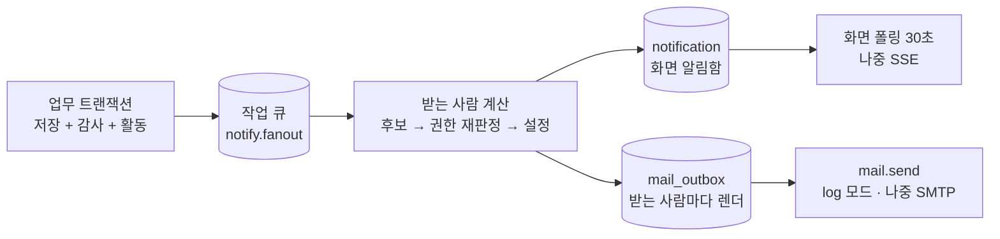
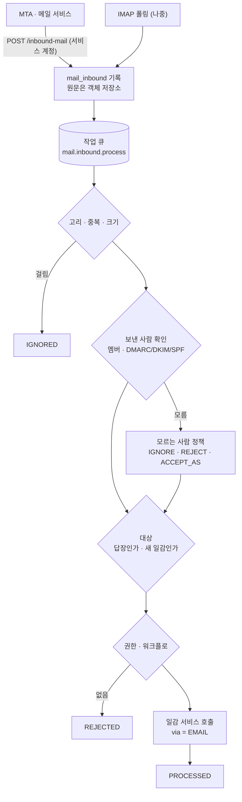

[홈](../README.md) › [설계](01-architecture.md) › 공동 작업

# 공동 작업 설계 — 위키 · 뉴스 · 문서 · 파일 · 포럼 · 알림 · 메일 · 활동 · 검색 · 내 페이지

프로젝트 안에서 일감 말고 함께 쓰는 것(위키 · 뉴스 · 문서 · 파일 · 포럼)과, 일어난 일을 사람에게 알리고(알림 · 메일) 되짚게 하는 것(활동 · 검색 · 내 페이지)을 정한다. Redmine 의 동작을 기준으로 하되 워크스페이스 · 권한 세 층 · Markdown · OpenSearch(nori) · 메일 `log` 모드 · api 안 작업 큐 · 화면 알림함 · MCP 동등성 · Agent 계정 결정을 따른다. 일감 · 이력 · 첨부 · 관찰자는 [일감 설계](05-issue-tracking.md), 프로젝트 · 모듈 · 프로젝트 역할은 [프로젝트 권한 설계](04-project-permissions.md), 작업 큐는 [연동 설계](09-integrations.md)에 있다.

요구사항: [FR-CNT](../requirements/08-content.md) · [FR-NTF](../requirements/09-notification.md) · [FR-ACT](../requirements/10-activity-search.md) · 결정 기록: [핵심 설계 결정](00-key-decisions.md)

**바로가기:** [원칙](#co-principles) · [권한 · 모듈](#co-permissions) · [위키](#co-wiki) · [뉴스](#co-news) · [문서](#co-document) · [파일](#co-file) · [포럼](#co-forum) · [관찰](#co-watch) · [이벤트](#co-events) · [알림](#co-notify) · [받는 사람](#co-recipients) · [알림 설정](#co-preference) · [화면 알림함](#co-inbox) · [메일 보내기](#co-mail-out) · [메일 헤더](#co-mail-thread) · [받은 메일](#co-mail-in) · [활동](#co-activity) · [검색](#co-search) · [내 페이지](#co-mypage) · [테이블](#co-tables) · [REST](#co-api) · [MCP](#co-mcp) · [시험](#co-tests) · [정해야 할 것](#co-decisions)

---

<a id="co-principles"></a>
## 1. 원칙

| 원칙 | 내용 |
|---|---|
| 판정은 api 한 곳 | 화면은 숨기기만 한다. 읽기 거부 404, 쓰기 거부 403. 모듈이 꺼진 프로젝트의 내용은 없는 것과 같다(404) |
| 받는 쪽 기준으로 다시 판정 | 알림 받는 사람 · 검색 결과 · 활동 목록 · 내 페이지 블록은 **받는 사람 · 보는 사람이 지금 그 대상을 읽을 수 있을 때만** 내준다. 쓴 사람의 권한으로 정하지 않는다 |
| 본문은 Markdown 하나 | 위키 · 뉴스 · 문서 설명 · 포럼 글 · 댓글 모두 GFM([ADR-010](00-key-decisions.md)). 링크 표기 `#123` · `[[쪽]]` · `version:"1.0"` · `commit:abc123` · `@사용자` 는 일감과 같다 |
| 이력은 쌓기만 | 위키는 저장마다 새 판을 남긴다. 판을 고치거나 지우지 않는다(비밀값 가리기만 예외, C) |
| 뒷일은 작업 큐 | 알림 펼치기 · 메일 보내기 · 검색 색인은 업무 트랜잭션에서 작업 큐에 넣고 스케줄러가 한다([ADR-013](00-key-decisions.md)). **활동은 같은 트랜잭션에서 쓴다**(바로 보여야 하므로, [§11](#co-activity)) |
| 행위자를 늘 남긴다 | 사람 · Agent 계정 · "사람 (MCP 로)" · "사람 (메일로)"를 판 · 글 · 활동 · 알림 · 메일에 그대로 보인다 |
| 메일은 `log` 모드부터 | 지금 코드의 `Mailer`(`moai-works.mail.mode=log`) 위에 아웃박스를 얹는다. SMTP 는 나중, 메일 받기는 C |
| 같은 서비스 | MCP 도구(`get_wiki_page` · `list_wiki_pages` · `create_wiki_page` · `update_wiki_page` · `get_activity`)는 REST 와 같은 서비스 · 같은 판정을 부른다 |
| 패키지 | api 의 `wiki` · `content`(뉴스 · 문서 · 파일 · 포럼 · 댓글 · 관찰) · `notify` · `activity` · `search` ([아키텍처](01-architecture.md)) |

---

<a id="co-permissions"></a>
## 2. 권한 · 모듈

판정은 [프로젝트 권한 설계](04-project-permissions.md)의 규칙 그대로다. 모듈 키는 [프로젝트 권한 설계](04-project-permissions.md)의 모듈 목록(`wiki` · `news` · `documents` · `files` · `forums`)과 같다. 코드 없이 독자면 되는 화면(뉴스 · 게시판 읽기)은 `@ProjectApi(module = …)` 로 모듈만 건다.

| 할 일 | 권한 코드 | 모듈 |
|---|---|---|
| 위키 쪽 · 판 · 차이 보기, 내보내기 | `wiki.read` | `wiki` |
| 쪽 만들기 · 고치기 · 되돌리기 · 첨부 올리기 | `wiki.edit` | `wiki` |
| 보호 · 보호된 쪽 고치기 · 이름 바꾸기 · 옮기기 · 지우기 · 시작 쪽 정하기 | `wiki.manage` | `wiki` |
| 뉴스 · 댓글 보기 | (프로젝트 독자) | `news` |
| 뉴스 쓰기 · 고치기 · 지우기, 남의 댓글 지우기 | `news.manage` | `news` |
| 뉴스 댓글 달기 · 내 댓글 고치기 · 지우기 | `forum.post` ([CO-Q1](#co-decisions)) | `news` |
| 문서 보기 · 첨부 내려받기 | `document.read` | `documents` |
| 문서 만들기 · 고치기 · 지우기 · 첨부 | `document.manage` | `documents` |
| 파일 목록 · 내려받기 | `file.read` | `files` |
| 파일 올리기 · 고치기 · 지우기 | `file.manage` | `files` |
| 게시판 · 글 읽기 | (프로젝트 독자) | `forums` |
| 글 쓰기 · 답글 · 내 글 고치기 · 지우기 | `forum.post` | `forums` |
| 게시판 만들기 · 순서 · 글 잠금 · 고정 · 옮기기 · 남의 글 고치기 · 지우기 | `forum.manage` | `forums` |
| 관찰하기(나 자신) | 그 대상을 읽을 수 있으면 누구나 | 대상의 모듈 |
| 알림 설정 · 알림함 · 내 페이지 | 워크스페이스 활성 멤버 자신 | — |
| 워크스페이스 메일 설정(보낼 종류 · 꼬리말) | `workspace.settings.manage` | — |
| 메일 받기 경로 설정(C) | `workspace.settings.manage` | — |
| 활동 · 검색 | 항목마다 위 읽기 규칙 | 항목의 모듈 |

- 프로젝트 역할 → 코드(초안, 정본은 04): 독자 = `wiki.read` `document.read` `file.read` · 보고자 = 독자 + `forum.post` · 개발자 = 보고자 + `wiki.edit` · 관리자 = 개발자 + `wiki.manage` `news.manage` `document.manage` `file.manage` `forum.manage`.
- Redmine 은 뉴스 · 게시판 읽기에 `view_news` · `view_messages` 를 따로 둔다. moai-works 는 코드를 만들지 않고 **프로젝트 독자면 읽는다**(모듈이 켜져 있을 때).
- 모듈이 꺼지면: 화면 · API · MCP 는 404, 알림을 만들지 않고, 활동 · 검색 · 내 페이지에서 빠진다. 데이터와 색인 문서는 지우지 않는다(질의 때 거른다 — [§12.4](#co-search-query)).
- **닫힌 프로젝트**(`CLOSED`)에서는 이 쪽의 모든 쓰기(위키 판 · 뉴스 · 댓글 · 문서 · 파일 · 글)가 409 `PROJECT_READ_ONLY` 다. 보기 · 나의 관찰 켜고 끄기는 된다(04 의 "개인 일").
- Agent 계정은 워크스페이스 권한이 없어 **프로젝트 역할을 받은 프로젝트에서만** 위 일을 한다(04 의 결정).

---

<a id="co-wiki"></a>
## 3. 위키

### 3.1 모양

```
프로젝트 backend
└─ 위키 (프로젝트마다 하나, 시작 쪽 "Wiki")
   ├─ Wiki                 ← 시작 쪽
   ├─ 설치 안내             ← 쪽 (판 1 … 판 N)
   │  ├─ 리눅스에 설치      ← 하위 쪽
   │  └─ 맥에 설치
   └─ 회의록
      └─ 2026-11-20 주간 회의
```

| 층 | 무엇 | 테이블 | Redmine |
|---|---|---|---|
| 위키 | 프로젝트마다 하나. `wiki` 모듈을 처음 켤 때 만든다. 시작 쪽 이름 | `wiki` | `wikis` |
| 쪽 | 제목 · 이름 열쇠 · 상위 쪽 · 보호 · 지금 판 번호 | `wiki_page` | `wiki_pages` |
| 판 | 저장마다 하나. 본문 전체 · 변경 요약 · 작성자 · 경로 | `wiki_page_revision` | `wiki_contents` + `wiki_content_versions` |
| 옛 이름 | 이름을 바꾼 뒤 옛 이름으로 오면 넘겨 줄 곳 | `wiki_redirect` | `wiki_redirects` |

Redmine 은 지금 판(`wiki_contents`)과 옛 판(`wiki_content_versions`)을 나눠 두지만, 여기서는 판 표 하나에 모두 두고 쪽이 지금 판 번호를 가리킨다.

<a id="co-wiki-names"></a>
### 3.2 쪽 이름 · 주소 · 링크

| 항목 | 규칙 |
|---|---|
| 제목 | 사람이 보는 이름. 255자. 쓸 수 없는 글자: `/` `\` `?` `#` `[` `]` `\|` `:` `<` `>` `"` (주소 · 링크 표기와 겹친다) |
| 이름 열쇠 | NFC 정규화 → 앞뒤 공백 제거 → 이어진 공백을 `_` 하나로 → 소문자. 위키 안에서 겹치지 않는다(대소문자 무시, Redmine 과 같다) |
| 주소 | `/projects/{project}/wiki/{제목의 공백을 _ 로}` (Redmine 과 같은 모양). 찾을 때는 이름 열쇠로 |
| 시작 쪽 | `wiki.start_page`(기본 `Wiki`, [CO-Q12](#co-decisions)). `/projects/{project}/wiki` 는 시작 쪽을 연다. 시작 쪽은 다른 쪽을 시작 쪽으로 정하기 전에는 지울 수 없다 |

링크 표기(본문 안):

```
[[설치 안내]]                 같은 위키의 쪽
[[설치 안내#준비]]            쪽 안의 제목으로
[[설치 안내|여기를 보라]]      보이는 글을 바꿔서
[[frontend:설치 안내]]        다른 프로젝트(식별자 frontend) 위키의 쪽
[[frontend:]]                 다른 프로젝트 위키의 시작 쪽
```

- 없는 쪽 링크는 빨간 링크로 보인다. `wiki.edit` 가 있으면 누르면 그 이름으로 새 쪽 만들기가 열린다.
- 다른 프로젝트 링크: 보는 사람이 그 프로젝트 위키를 읽을 수 없으면 **링크가 아닌 글자 그대로** 보인다(존재를 알리지 않는다).
- 옛 이름 링크는 [§3.5](#co-wiki-rename)의 넘기기를 따라간다.
- 링크 풀이는 서버가 한다: 쪽을 줄 때 본문(Markdown)과 함께 `references`(표기마다 `visible` · 제목 · 주소)를 준다. 안 보이는 대상과 없는 대상은 똑같이 `{"visible": false}` 다. 풀이 틀은 [일감 설계](05-issue-tracking.md)의 `TextReferenceResolver` 이고, 이 쪽은 `[[쪽]]` · `[[프로젝트:쪽]]` · `document#3` · `news#2` · `forum#1` 을 푸는 것을 더한다(`version:"1.0"` 은 [계획 · 시간 설계](06-planning-time.md)).
- 매크로(C): `{{toc}}`(목차) · `{{child_pages}}`(하위 쪽 목록) · `{{include(쪽)}}`(다른 쪽 넣기 — **보는 사람이 그 쪽을 읽을 수 있을 때만**) · 사이드바 쪽(`Sidebar` 라는 이름의 쪽을 옆에 보인다).

<a id="co-wiki-revision"></a>
### 3.3 판 · 차이 · 되돌리기

| 항목 | 규칙 |
|---|---|
| 판 만들기 | 저장마다 새 판(번호 1, 2, …). 본문 전체를 저장한다(압축은 PostgreSQL TOAST 에 맡긴다). 변경 요약 1024자(선택) |
| 본문이 같으면 | 판을 만들지 않는다(204). 변경 요약만 바꾸는 저장은 없다 |
| 동시 편집 | 저장 요청에 **보던 판 번호**(`base_revision`)를 넣는다. 지금 판과 다르면 409 와 함께 지금 본문을 돌려주고, 화면이 내 본문과의 차이를 보여 합치게 한다(Redmine 의 "다른 사용자가 고쳤다" 와 같다). MCP `update_wiki_page` 는 `base_revision` 이 필수다 |
| 절 고치기(S) | `#`~`###` 제목으로 나눈 절 하나만 고친다. 저장할 때 그 절의 내용 해시를 함께 보내고, 그 절이 그사이 바뀌었으면 409(다른 절만 바뀌었으면 합쳐서 저장 — Redmine 의 `section_hash` 와 같다) |
| 판 목록 | 판 번호 · 시각 · 작성자(사람 · Agent · "사람 (MCP 로)") · 변경 요약 · 크기 |
| 판 보기 | 옛 판의 본문(링크 풀이는 지금 기준) |
| 차이 | 두 판을 골라 줄 단위 차이 + 줄 안 낱말 강조. 서버가 계산해 덩어리(hunk) 목록으로 준다 |
| 주석 보기(C) | 줄마다 마지막으로 바꾼 판 · 작성자(Redmine "annotate") |
| 되돌리기 | 판 N 의 본문으로 **새 판**을 만든다. 변경 요약 "판 N 으로 되돌림". `wiki.edit`(보호된 쪽은 `wiki.manage`) |
| 판 지우기 | **하지 않는다**(Redmine 은 판 지우기가 있다 — 이력은 쌓기만이라는 원칙으로 뺐다). 비밀값이 들어간 판은 "가리기"(본문을 비우고 "가림" 표시, 행은 남김, `wiki.manage`, 감사) — C |
| 첨부 | 일감과 같은 첨부 표(대상 `WIKI_PAGE`). 올리기 `wiki.edit`, 지우기는 올린 사람 또는 `wiki.manage`. 본문에서 `` 은 그 쪽의 첨부로 풀린다 |

<a id="co-wiki-tree"></a>
### 3.4 계층 · 목록 · 지우기

- 상위 쪽은 같은 위키의 쪽이다(DB 가 막는다). 자기 자신 · 자기 하위 아래로 옮길 수 없다. 옮기기는 위키마다 한 번에 하나(`pg_advisory_xact_lock`, moai-wiki 와 같은 방식)로 순환을 막는다.
- 쪽 머리에 상위 쪽 길(빵 부스러기), 아래에 하위 쪽 목록.
- 색인 두 가지(Redmine 과 같다): **제목순**(트리) · **날짜순**(최근 고친 순, 날짜별 묶음).
- 지우기(`wiki.manage`): 하위 쪽이 있으면 고르게 한다(Redmine 과 같다).

| 선택 | 동작 |
|---|---|
| 하위를 위로 올리기(기본) | 하위 쪽을 지울 쪽의 상위 아래로 옮긴다 |
| 하위도 지우기 | 하위 전체를 함께 지운다 |
| 다른 쪽 아래로 | 고른 쪽 아래로 옮긴다 |

- 지우기는 쪽 · 판 · 첨부 · 이 쪽을 가리키는 옛 이름을 모두 지운다(되돌릴 수 없다 — Redmine 과 같다). 감사에 제목 · 판 수 · 마지막 판 본문 해시를 남긴다. 휴지통은 C([CO-Q11](#co-decisions)).

<a id="co-wiki-rename"></a>
### 3.5 이름 바꾸기 · 옛 이름 넘기기 · 다른 위키로 옮기기

| 항목 | 규칙 |
|---|---|
| 권한 | `wiki.manage` |
| 옛 이름 넘기기 | "옛 이름으로 오면 새 이름으로 넘기기"(기본 켬). 켜면 `wiki_redirect(위키, 옛 이름 열쇠 → 쪽 id)` 를 남긴다 |
| 쪽 id 로 가리킨다 | Redmine 은 옛 제목 → 새 제목을 저장해 이름이 여러 번 바뀌면 사슬을 줄여야 한다. 여기서는 **쪽 id** 를 가리키므로 사슬이 생기지 않는다 |
| 옛 이름을 다시 쓰면 | 그 이름으로 새 쪽을 만들면 그 이름의 넘기기를 지운다(실제 쪽이 이긴다) |
| 다른 쪽의 링크 | 고치지 않는다. 넘기기로 풀린다. 링크까지 고쳐 쓰는 기능은 C |
| 판 | 이름 바꾸기는 판을 만들지 않는다. 감사 · 이벤트 `wiki_page.renamed` 에 옛 이름 · 새 이름 |
| 다른 위키로 옮기기(S) | 대상 프로젝트에서도 `wiki.manage` 가 있어야 한다. 하위 쪽 · 판 · 첨부가 함께 간다. 옛 위키에 넘기기를 남길 수 있다(다른 위키의 쪽 id). 옛 프로젝트 독자가 새 프로젝트를 못 읽으면 넘기기 끝에서 404 다 |
| 이름 겹침 | 대상 위키에 같은 이름 열쇠가 있으면 409 |

<a id="co-wiki-protect"></a>
### 3.6 보호

- `protected = true` 인 쪽은 `wiki.manage` 를 가진 사람만 고치기 · 되돌리기 · 첨부 · 이름 바꾸기 · 지우기를 한다. 읽기는 그대로.
- 보호 켜고 끄기는 `wiki.manage`, 감사에 남긴다. 판은 만들지 않는다.
- MCP `update_wiki_page` 로 보호된 쪽을 고치려면 키 주체에게 `wiki.manage` 가 있어야 한다.

<a id="co-wiki-export"></a>
### 3.7 내보내기 (C)

| 무엇 | 형식 | 방법 |
|---|---|---|
| 쪽 하나 | Markdown(원문) · HTML · PDF | 원문은 바로. HTML 은 서버 렌더러. PDF 는 브라우저 인쇄 CSS 먼저 |
| 위키 전체 | ZIP(쪽마다 `.md` + 첨부 폴더 + 색인 `index.md`) · HTML | 작업 큐에서 만들고, 24시간 동안 쓸 수 있는 내려받기 링크를 알림으로 준다 |

- 권한 `wiki.read`. 내보낸 링크의 `[[…]]` 는 ZIP 안 상대 경로로 바꾼다. 다른 프로젝트 링크는 원래 주소로 둔다.
- 서버 렌더러는 화면(react-markdown)과 같은 GFM 범위 · 같은 허용 태그를 쓴다(메일 본문과 같은 렌더러, [§10.7](#co-mail-thread)).

---

<a id="co-news"></a>
## 4. 뉴스

| 항목 | 규칙 | Redmine |
|---|---|---|
| 필드 | 제목(60자) · 요약(255자) · 본문(Markdown) · 작성자 · 첨부 | `news` |
| 쓰기 | `news.manage`. Agent 계정도 권한이 있으면 쓸 수 있다(예: 릴리스 노트) — "Agent X" 로 보인다 | `manage_news` |
| 목록 | 프로젝트 뉴스(최근순, 페이지) · **워크스페이스 뉴스**(읽을 수 있고 `news` 모듈이 켜진 모든 프로젝트) · 프로젝트 개요에 최근 5개 | 전체 뉴스 `/news` |
| 댓글 | `comment` 표(대상 `NEWS`). 본문 Markdown. 달기 · 내 댓글 고치기 · 지우기 = `forum.post`, 남의 댓글 지우기 = `news.manage`. 댓글 고치기는 감사만 남긴다 | `comments` |
| 관찰 | 작성자는 자동으로 그 뉴스를 관찰한다. 댓글을 단 사람도 자동 관찰(끌 수 있다) | 뉴스 관찰자 |
| 알림 | 새 뉴스 → `news_added`, 새 댓글 → `news_comment_added` ([§10.2](#co-notify-kinds)) | 같다 |
| 이벤트 | `news.created` · `news.updated` · `news.deleted` · `news.comment.added` · `news.comment.deleted` | |

---

<a id="co-document"></a>
## 5. 문서

| 항목 | 규칙 | Redmine |
|---|---|---|
| 필드 | 분류(워크스페이스 열거형 "문서 분류", [워크플로 요구사항](../requirements/04-workflow.md)) · 제목(255자) · 설명(Markdown) · 첨부 여러 개 · 작성자 | `documents` |
| 권한 | 보기 `document.read`, 만들기 · 고치기 · 지우기 · 첨부 `document.manage` | `view_documents` · `add/edit/delete_documents` |
| 목록 | 묶기: 분류(기본) · 날짜 · 제목 · 작성자. 칸마다 제목 · 설명 첫 줄 · 마지막 갱신 | 같다 |
| 마지막 갱신 | max(문서 고친 시각, 마지막 첨부를 더한 시각) — `last_activity_at` 에 둔다 | `updated_on` 계산 |
| 지우기 | 첨부도 함께 지운다. 감사 | 같다 |
| 알림 | 새 문서 · 첨부 더함 → `document_added` | `document_added` · `attachments_added` |
| 이벤트 | `document.created` · `document.updated` · `document.attachment.added` · `document.deleted` | |

---

<a id="co-file"></a>
## 6. 파일 — `release_file`

설치본 · 배포 묶음처럼 **내려받으라고 내놓는 파일**이다. 버전에 묶거나 프로젝트에 바로 둔다(Redmine "파일" 모듈).

| 항목 | 규칙 | Redmine |
|---|---|---|
| 테이블 | `release_file` 은 버전 연결만 가진 얇은 그릇이고, 파일 자체는 [일감 설계](05-issue-tracking.md)의 `attachment` 한 행(`container_type = 'RELEASE_FILE'`)이다. 파일 이름 · 형식 · 크기 · **SHA-256** · 설명 · **내려받은 수**(`download_count`)는 첨부 표에 이미 있다. 그릇 하나에 첨부 하나(서비스가 지킨다) | 버전 · 프로젝트를 담는 첨부 |
| 올리기 | `file.manage`. 05 의 첨부 흐름(스트림으로 받아 MinIO `moai-works-attachments` 에 쓰면서 SHA-256 계산 · 형식 판별 · 금지 확장자)을 그대로 쓴다. 크기 상한만 따로 둔다(`issue_tracking_setting` 에 `release_file_max_bytes` 열, 기본 500MB — 일감 첨부 상한보다 크다) | `manage_files` |
| 버전 | 같은 프로젝트의 버전 또는 공유받은 버전(선택). 파일이 묶인 버전은 지울 수 없다([계획 설계 §3.3](06-planning-time.md#pt-version-delete)) | 같다 |
| 목록 | 버전별 묶음(버전 기한순, 버전 없음은 맨 위). 칸: 파일 이름 · 날짜 · 크기 · 내려받은 수 · SHA-256(복사 단추) · 설명 | 다이제스트는 4.0 부터 SHA-256 |
| 내려받기 | `GET …/files/{id}/download` → api 가 `file.read` 를 판정 → 첨부의 `download_count = download_count + 1`(한 문장 UPDATE) → MinIO 에서 흘려보낸다. 이어받기(Range)는 0 바이트부터일 때만 센다 | `downloads` |
| 고치기 | 설명 · 버전만. 파일 내용을 바꾸려면 새로 올린다(체크섬이 바뀌므로) | |
| 알림 | `file_added` | 같다 |
| 이벤트 | `release_file.created` · `release_file.updated` · `release_file.deleted` | |
| 바이러스 검사 | C (올린 뒤 검사 작업, 결과 전에는 "검사 중" — 첨부 상태 `QUARANTINED` 를 쓴다) | 없음 |

---

<a id="co-forum"></a>
## 7. 포럼

| 항목 | 규칙 | Redmine |
|---|---|---|
| 게시판 | 프로젝트마다 여러 개. 이름(60자) · 설명 · 순서 · 상위 게시판(한 단계) | `boards`(`parent_id`) — Redmine 표 이름 |
| 글 | 게시판의 주제 글. 제목 · 본문(Markdown) · 첨부 · 작성자 · 잠금 · 고정 · 답글 수 · 마지막 답글 | `messages`(`parent_id` 없음) |
| 답글 | 주제 글 아래 한 줄로(답글의 답글은 없다). 인용 단추는 `>` 인용을 넣어 준다 | `messages`(`parent_id` = 주제) |
| 정렬 | 고정 글 먼저, 그다음 마지막 활동(글 · 마지막 답글) 최근순 | `sticky` · `last_reply` |
| 잠금 | 잠긴 글에는 **아무도** 답글을 못 단다(403 "잠긴 글"). 풀기는 `forum.manage` | 같다 |
| 내 글 | `forum.post` 로 고치기. 지우기는 답글이면 언제나, 주제 글이면 답글이 없을 때만 | `edit_own_messages` · `delete_own_messages` |
| 관리 | `forum.manage`: 게시판 만들기 · 고치기 · 순서 · 지우기(글이 있으면 다른 게시판으로 옮기거나 함께 지우기) · 잠금 · 고정 · 글을 같은 프로젝트의 다른 게시판으로 옮기기 · 남의 글 고치기 · 지우기(주제 글을 지우면 답글도) | `manage_boards` 등 |
| 관찰 | 게시판 관찰 · 글 관찰. 주제 글 작성자와 답글 작성자는 그 글을 자동 관찰 | 같다 |
| 알림 | `message_posted` — 받는 사람은 [§10.3](#co-recipients) | 같다 |
| 이벤트 | `forum_message.created`(주제 · 답글) · `forum_message.updated` · `forum_message.deleted` | |

카운터(`topics_count` · `messages_count` · `replies_count` · `last_message_id` · `last_reply_id`)는 쓰는 트랜잭션에서 함께 고친다. 어긋나면 다시 세는 관리 작업이 있다.

---

<a id="co-watch"></a>
## 8. 관찰

| 대상 | 관찰하면 받는 것 | 자동 관찰 |
|---|---|---|
| 위키 전체 | 그 위키의 모든 쪽 만들기 · 고치기 | — |
| 위키 쪽 | 그 쪽 고치기 · 이름 바꾸기 | — |
| 뉴스 | 댓글 | 작성자 · 댓글 단 사람 |
| 게시판 | 새 글 · 답글 | — |
| 글(주제) | 답글 | 주제 작성자 · 답글 작성자 |

- 내용 쪽 관찰은 `content_watcher` 표에 둔다. 일감 관찰자는 [일감 설계](05-issue-tracking.md)의 `issue_watcher`(사람 · Agent)를 쓴다([CO-Q2](#co-decisions)).
- 관찰은 **자기 자신만** 켜고 끈다. 남을 관찰자로 넣는 일은 일감에만 있다(`issue.watcher.manage`).
- 관찰자가 나중에 읽기 권한을 잃으면 행은 두고 알림만 안 간다(보낼 때 다시 판정). 워크스페이스에서 나가면 그 워크스페이스의 관찰 행을 지운다.
- 내용 쪽 관찰자는 사람만 된다. Agent 계정은 알림을 받지 않으므로([§10.10](#co-agent-notify)) 관찰할 까닭이 없다.

---

<a id="co-events"></a>
## 9. 이벤트

이벤트 이름은 `대상.동작` 꼴이다. 봉투(이벤트 id · 워크스페이스 · 프로젝트 · 행위자 종류와 id · 경로(웹 · REST · MCP · 메일 · 커밋 · 시스템)와 MCP 키 id · 묶음 id · 시각 · 바뀐 필드)는 [일감 설계](05-issue-tracking.md)의 이벤트 목록과 맞춘다. 업무 트랜잭션이 이벤트를 내면 같은 트랜잭션에서 **활동 행을 쓰고**, 작업 큐에 **`notify.fanout`**(알림이 있는 종류만)과 **`search.index`**(색인 대상만)를 넣는다.

**이 쪽이 내는 이벤트**

| 이벤트 | 알림 | 활동 | 색인 |
|---|---|---|---|
| `wiki_page.created` · `wiki_page.updated`(새 판) | ○ | ○ 위키 편집 | ○ |
| `wiki_page.renamed` | ○(쪽 관찰자) | — | ○ |
| `wiki_page.deleted` | — | 그 쪽 활동 지움 | 지움 |
| `news.created` · `news.updated` · `news.deleted` | 만들기만 | 만들기만 | ○ |
| `news.comment.added` · `news.comment.deleted` | 더하기만 | — | 뉴스 문서 |
| `document.created` · `document.updated` · `document.attachment.added` · `document.deleted` | 만들기 · 첨부 | 만들기 · 첨부 | ○ |
| `release_file.created` · `release_file.updated` · `release_file.deleted` | 만들기 | 만들기 | ○ |
| `forum_message.created` · `forum_message.updated` · `forum_message.deleted` | 만들기 | 만들기 | ○ |

**받는 이벤트**(다른 쪽이 낸다 — 이름과 봉투는 [일감 설계](05-issue-tracking.md)의 도메인 이벤트 목록과 맞췄다. 이벤트는 본문을 싣지 않으므로 메일 · 색인을 만드는 쪽이 DB 에서 다시 읽는다)

| 이벤트 | 낸 곳 | 알림 | 활동 | 색인 |
|---|---|---|---|---|
| `issue.created` | [일감 설계](05-issue-tracking.md) | `issue_added` | ○ | 일감 |
| `issue.updated` | 05 | `issue_updated` · 하위 종류(`noteAdded` → 메모, `statusChanged` → 상태, `assigneeChanged` → 담당, `priorityChanged` → 우선순위). `cause = ROLLUP` 은 알림 없음. `bulkId` 가 있으면 묶음 | `noteAdded` 또는 `statusChanged` 일 때 | 일감 + 메모(+`visibilityChanged` · 작성자 · 담당 · `projectChanged` 면 그 일감 메모 전부) |
| `issue.deleted` | 05 | — | 그 일감 활동 지움 | 일감 · 메모 지움 |
| `issue.mentioned` | 05 | `mention`(멘션된 주체 중 볼 수 있는 사람) | — | — |
| `issue.note.edited` | 05 | — (Redmine 과 같이 메모 고치기는 알리지 않는다) | — | 그 메모 |
| `issue.relation.added` · `issue.relation.removed` | 05 | — (관계 변경은 저널 `RELATION` 줄로 `issue.updated` 에 함께 온다) | — | — |
| `issue.attachment.added` · `issue.attachment.removed` | 05 | — (저널에 남으면 `issue.updated` 로) | — | 일감 문서(첨부 이름) |
| `issue.watcher.added` · `issue.watcher.removed` | 05 | — | — | — |
| `config.changed` | 05 | — | — | 찾기에 쓰는 필드(상태의 닫힘 여부 등)가 바뀌면 해당 문서 다시 색인 |
| `time_entry.created` · `time_entry.deleted` | [계획 · 시간 설계](06-planning-time.md#pt-events) | — | 소요 시간(기본 숨김) | — |
| `version.created` · `version.updated` | 06 | — | 버전(C) | — |
| `project.created` · `project.updated` | [프로젝트 권한 설계](04-project-permissions.md) | — | — | 프로젝트 문서. 상위가 바뀌면 그 아래 문서의 `project_path` |
| `project.access.changed` · `project.module.changed` | 04 | — | — | **상위가 바뀐 경우만** `project_path` 다시 쓰기. 공개 범위 · 멤버 · 역할 · 모듈 · 상태는 질의 때 계산하므로 색인 일이 없다([§12.3](#co-search-index)) |
| `project.archived` · `project.deleted` | 04 | — | 지우면 그 프로젝트 활동 지움 | 지우면 그 프로젝트 문서 지움 |
| `project.member.removed`(이유: 직접 · 워크스페이스에서 나감 · Agent 지움) | 04 | 그 사람의 그 프로젝트 내용 관찰 정리. 워크스페이스에서 나갔으면 알림 설정 · 알림 · 내 페이지 행도 지움 | — | — |
| `repository.changeset.added` | [연동 설계](09-integrations.md)(이름은 09 의 이벤트 목록과 맞춘다) | — | 변경 묶음 | 변경 묶음 |

---

<a id="co-notify"></a>
## 10. 알림 · 메일

### 10.1 흐름



- `notify.fanout` 은 멱등이다: 같은 이벤트를 두 번 처리해도 `notification (event_id, recipient_id)` · `mail_outbox (event_id, recipient_id)` 고유 색인 때문에 두 번 생기지 않는다.
- 받는 사람 계산은 **처리하는 순간의 권한**으로 한다. 이벤트가 생긴 뒤 권한을 잃은 사람에게는 보내지 않는다.
- 묶음: 같은 행위자 · 같은 묶음 id(05 의 `bulkId` — 일괄 수정 · 공유 범위 변경 정리 · 가져오기)의 이벤트는 사람마다 **메일 한 통**("일감 50개가 바뀌었다" + 목록)으로 묶는다. 화면 알림은 이벤트마다 남기되 화면이 묶어 보인다.

<a id="co-notify-kinds"></a>
### 10.2 알림 종류

| 종류 키 | 이벤트 | Redmine 설정 이름 | 메일 기본 |
|---|---|---|---|
| `issue_added` | `issue.created` | `issue_added` | 켬 |
| `issue_updated` | `issue.updated` | `issue_updated` | 켬 |
| └ `issue_note_added` | `issue.updated` 의 `noteAdded` | `issue_note_added` | (위가 켜지면 함께) |
| └ `issue_status_updated` | `issue.updated` 의 상태 | `issue_status_updated` | |
| └ `issue_assigned_to_updated` | 담당 | `issue_assigned_to_updated` | |
| └ `issue_priority_updated` | 우선순위 | `issue_priority_updated` | |
| └ `issue_fixed_version_updated` | 대상 버전 | `issue_fixed_version_updated` | |
| `mention` | 본문 · 메모 · 위키 · 뉴스 · 글 · 댓글의 `@사용자` | (5.0 멘션) | 켬 |
| `wiki_content_added` | `wiki_page.created` | `wiki_content_added` | 끔 |
| `wiki_content_updated` | `wiki_page.updated` | `wiki_content_updated` | 끔 |
| `news_added` | `news.created` | `news_added` | 끔 |
| `news_comment_added` | `news.comment.added` | `news_comment_added` | 끔 |
| `document_added` | `document.created` · `document.attachment.added` | `document_added` | 끔 |
| `file_added` | `release_file.created` | `file_added` | 끔 |
| `message_posted` | `forum_message.created` | `message_posted` | 끔 |

- 워크스페이스 설정 `notify.mail_events`(`notification_setting` 한 행의 열, [§14.2](#co-ddl))가 **메일로 보낼 종류**를 정한다(Redmine "메일 알림" 설정과 같다, 기본은 일감 종류 + 멘션 — Redmine 기본 `issue_added` · `issue_updated` 에 멘션을 더했다). `issue_updated` 를 끄면 고른 하위 종류만 보낸다(Redmine 과 같다).
- **화면 알림은 종류 설정과 상관없이 늘 만든다**(값싸고, 화면에서 거를 수 있다). 사용자 설정([§10.4](#co-preference))은 두 채널 모두에 쓴다.

<a id="co-recipients"></a>
### 10.3 받는 사람 계산

**1단계 — 후보와 이유 모으기**

| 대상 | 후보(이유) |
|---|---|
| 일감 | 작성자(`author`) · 담당자(`assignee`) · 바로 전 담당자 — 담당이 바뀐 경우(`previous_assignee`) · 관찰자(`watcher`) · 멘션(`mentioned`) · 프로젝트 멤버 중 설정이 이 프로젝트의 "모든 일"인 사람(`member`) · 우선순위가 "높음" 이상이고 "높은 우선순위는 늘 받기"를 켠 프로젝트 멤버(`high_priority`) |
| 위키 쪽 | 위키 관찰자 · 쪽 관찰자(`watcher`) · 멘션 · 프로젝트 멤버(`member`) |
| 뉴스 | 프로젝트 멤버(`member`) · 멘션 / 댓글: 뉴스 관찰자 · 멘션 |
| 문서 · 파일 | 프로젝트 멤버(`member`) |
| 포럼 | 게시판 관찰자 · 글 관찰자(`watcher`) · 새 주제 글이면 프로젝트 멤버(`member`) · 멘션 |

"프로젝트 멤버"는 그 프로젝트(또는 이어받은 상위)의 **프로젝트 역할을 가진 사람**이다. 공개 범위 `WORKSPACE` 프로젝트를 읽기만 하는 워크스페이스 멤버는 멤버가 아니라서 "모든 일" 알림을 받지 않는다 — 관찰 · 담당 · 멘션으로만 받는다(Redmine 의 `project.notified_users` 와 같은 뜻).

**2~8단계**

```
for 후보 c in 후보들:
  2. c 가 Agent 계정이면 뺀다                                 (§10.10, 기록만 남김)
  3. c 의 계정 · 워크스페이스 멤버십이 ACTIVE 가 아니면 뺀다
  4. 권한 재판정 — c 로서 지금 이 대상을 읽을 수 있나:
       프로젝트 독자 ∧ 모듈 켜짐 ∧ 읽기 코드(issue.read · wiki.read · 독자 · document.read · file.read)
       ∧ 일감이면 04 §11 의 보이나(c, 일감) — 보기 범위 ALL · DEFAULT · OWN (관찰자라서 보이지는 않는다)
       ∧ 비공개 메모면 c 가 그 프로젝트에서 issue.note.private 를 가짐
       ∧ 일감 변경이면 c 가 볼 수 있는 바뀐 필드만 남긴다(필드 읽기 권한 · 숨긴 사용자 정의 필드 — 05)
         → 남은 필드도 메모도 없으면 c 에게는 보내지 않는다            (Redmine visible_details 와 같다)
  5. 설정 거르기 — §10.4 의 모드 × 이유 표
  6. 내가 한 변경 — 행위자 = c(사람 본인, 개인 MCP 키 포함) 이고 no_self_notified 켬 → 뺀다
       (Agent 계정이 한 변경은 그 책임자에게도 "내 변경"이 아니다 → 받는다)
  7. 중복 없애기 — 사람마다 하나, 이유는 가장 센 것:
       mentioned > assignee > author > watcher > previous_assignee > high_priority > member
  8. 채널 — 화면: 늘 / 메일: 종류가 notify.mail_events 에 있음 ∧ c.mail_enabled ∧ 확인된 메일 주소
```

- 멘션: 저장 꼴은 05 의 표준 멘션 표기(편집기가 `@` 로 골라 넣는다, [일감 설계](05-issue-tracking.md) §15.3)다. 그 대상을 읽을 수 있는 사람에게만 알린다. **일감에서 멘션하면 05 가 관찰자로 넣고 `issue.mentioned` 를 낸다** — 이 쪽은 그 이벤트로 `mention` 알림을 만든다. 위키 · 뉴스 · 글 · 댓글의 멘션은 이 쪽이 같은 방식으로 찾는다(관찰자로 넣지는 않는다). 못 보는 사람은 조용히 건너뛴다(존재를 알리지 않는다).
- `issue.mentioned` 는 같은 `journalId` 의 `issue.updated` 와 한 묶음으로 계산한다. 05 가 멘션된 사람을 같은 트랜잭션에서 관찰자로 넣으므로, 따로 계산하면 관찰자 · 멘션으로 두 번 받는다 — 펼치기 작업이 `journalId` 로 둘을 모아 사람마다 하나(이유 `mentioned`)만 만든다.
- 일감 판정 규칙(비공개 · 비공개 메모 · 필드 읽기)은 05 가 정본이고, 여기서는 같은 판정 서비스를 사람마다 부른다. 받는 사람이 많으면(프로젝트 멤버 수백) 권한 사본을 한 번에 읽어 메모리에서 판정한다.

<a id="co-preference"></a>
### 10.4 사용자 알림 설정

사람 × 워크스페이스마다 한 벌(행이 없으면 워크스페이스 기본값 `notify.default_mode`, 기본 `ONLY_MY_EVENTS` — Redmine 기본과 같다).

| 모드 | 화면 이름 | Redmine |
|---|---|---|
| `ALL` | 내 모든 프로젝트의 모든 일 | `all` |
| `SELECTED` | 고른 프로젝트의 모든 일, 나머지는 내 일만 | `selected` |
| `ONLY_MY_EVENTS` | 내가 관찰 · 담당 · 작성 · 멘션된 일만 | `only_my_events` |
| `ONLY_ASSIGNED` | 내가 담당인 일만 | `only_assigned` |
| `ONLY_OWNER` | 내가 작성한 일만 | `only_owner` |
| `NONE` | 받지 않음 | `none` |

모드 × 이유(○ 받음):

| 이유 \ 모드 | ALL | SELECTED 고른 곳 | SELECTED 나머지 | ONLY_MY_EVENTS | ONLY_ASSIGNED | ONLY_OWNER | NONE |
|---|---|---|---|---|---|---|---|
| `member` | ○ | ○ | | | | | |
| `author` | ○ | ○ | ○ | ○ | | ○ | |
| `assignee` · `previous_assignee` | ○ | ○ | ○ | ○ | ○ | | |
| `watcher` | ○ | ○ | ○ | ○ | ○ | ○ | |
| `mentioned` | ○ | ○ | ○ | ○ | ○ | ○ | |
| `high_priority`(옵션 켬) | ○ | ○ | ○ | ○ | ○ | ○ | |

- 관찰은 스스로 고른 것이라 `NONE` 이 아니면 늘 받는다(Redmine 의 `notified_watchers` 가 `none` 만 빼는 것과 같다). 멘션도 같다.
- `NONE` 은 멘션까지 모두 막는다(명시적 거부를 존중한다). 화면 알림함에도 쌓지 않는다.

| 옵션 | 기본 | Redmine |
|---|---|---|
| `no_self_notified` 내가 한 변경은 받지 않기 | 켬 | `no_self_notified` |
| `notify_high_priority` 높은 우선순위 일감은 늘 받기 | 끔 | `notify_about_high_priority_issues` |
| `mail_enabled` 메일 받기(끄면 화면 알림만) | 켬 | — |
| `auto_watch` 일감을 만들 때 · 고치거나 메모할 때 관찰자 되기 | 둘 다 켬 | `auto_watch_on` |
| `selected_project_ids` `SELECTED` 의 프로젝트 | 없음 | 멤버별 `mail_notification` |

<a id="co-inbox"></a>
### 10.5 화면 알림함

| 항목 | 규칙 |
|---|---|
| 행 | 이벤트 × 받는 사람마다 하나(`notification`). 받는 사람 언어로 만든 제목 · 요약(100자 — 바뀐 필드 요약이나 메모 첫 줄), 행위자 표시, 이유, 대상 주소 |
| 묶어 보이기 | 같은 대상의 읽지 않은 알림은 화면이 한 줄로 묶는다: "김가 외 2명이 기능 #123 을 고쳤다 · 3건". 읽지 않은 수는 **대상 수**로 센다 |
| 읽음 | 하나 읽음 · 모두 읽음 · 대상 쪽을 열면 그 대상의 읽지 않은 알림을 읽음으로(일감 쪽 열기 → 그 일감 알림 읽음) |
| 다시 판정 | 목록을 줄 때 프로젝트 독자 · 모듈을 다시 본다(값싼 판정). 대상이 지워졌거나 못 읽게 됐으면 "볼 수 없는 항목"으로 보이고 제목을 숨긴다 |
| 보관 | 90일 지나면 스케줄러가 지운다(읽음 여부와 상관없이) |
| 폴링(지금) | 화면이 30초마다 `GET …/me/notifications/unread-count`. `ETag` 를 주고 `If-None-Match` 가 같으면 304. 탭이 안 보이면 멈춘다(Page Visibility). TanStack Query `refetchInterval` |
| SSE(나중) | `GET …/me/notifications/stream`(BFF 가 그대로 흘려보낸다). api 인스턴스가 여럿이라 Redis 채널 `moai-works:notify:{user id}` 로 "새 알림" 신호를 나눈다. 끊기면 `Last-Event-ID` 로 다시 잇고, 그래도 안 되면 폴링으로 돌아간다 |
| 여러 워크스페이스 | 위쪽 바의 배지는 `GET /moai-works-api/v1/me/notifications/unread-counts`(내 모든 워크스페이스)로 |

<a id="co-mail-out"></a>
### 10.6 메일 보내기

| 항목 | 규칙 |
|---|---|
| 아웃박스 | `notify.fanout` 이 받는 사람마다 `mail_outbox` 행을 만든다. **이때 렌더한다**(받는 사람 언어 ko/en · 시간대 · 그 사람이 볼 수 있는 필드만). 보낼 때 다시 렌더하지 않는다 |
| 한 사람에 한 통 | BCC 로 모아 보내지 않는다. 사람마다 볼 수 있는 내용 · 언어가 다르다(Redmine 4 부터 사람마다 보내는 것과 같다) |
| 보내기 작업 | 스케줄러가 5초마다 `status = 'PENDING' AND next_attempt_at <= now()` 를 50개씩 `FOR UPDATE SKIP LOCKED` 로 집어 `SENDING` → 보내기 → `SENT` |
| 모드 | `moai-works.mail.mode=log`(지금): 지금 `Mailer` 가 받는 사람 · 제목 · 본문을 로그에 남기고 `SENT` 로 둔다. `smtp`(나중): spring.mail 로 보낸다. 비밀값(SMTP 비밀번호)은 `.env` 의 키 이름으로만 |
| 다시 하기 | 실패하면 1분 · 5분 · 30분 · 2시간 · 12시간 뒤. 다섯 번 실패하면 `FAILED`(관리 화면에 보인다) |
| 보내는 주소 | 플랫폼 하나 `moai-works.mail.from`. 보낸 이 이름 = "{워크스페이스 이름} · moai-works"([CO-Q5](#co-decisions)) |
| 크기 | 본문 200KB 를 넘으면 자르고 "전체 보기" 링크. 첨부 파일은 메일에 붙이지 않는다(링크만, 내려받기는 api 판정을 거친다) |
| 링크 | `moai-works.web.base-url` + 화면 경로 |
| 건너뜀 | 확인된 메일 주소가 없거나 계정이 정지 · 삭제면 `CANCELED` |
| 보관 | `SENT` 는 30일, `FAILED` · `CANCELED` 는 90일 뒤 지운다(본문에 업무 내용이 있다) |
| 다른 메일 | 가입 인증 코드 같은 계정 메일은 지금처럼 `Mailer` 를 바로 부른다. 나중에 아웃박스로 옮길 수 있게 `event_id` · `recipient_id` 를 비워 둘 수 있다 |

<a id="co-mail-thread"></a>
### 10.7 메일 내용 · 스레드 헤더

**제목**

| 대상 | 제목 |
|---|---|
| 일감(만들기 · 고치기 · 메모 모두) | `[{프로젝트 이름} - {트래커} #{번호}] ({상태}) {일감 제목}` — Redmine 과 같은 모양이라 메일 프로그램이 한 스레드로 묶는다 |
| 일감 묶음 | `[{프로젝트 이름}] 일감 {N}개가 바뀌었다` |
| 위키 | `[{프로젝트 이름}] 위키: {쪽 제목}` |
| 뉴스 · 댓글 | `[{프로젝트 이름}] 뉴스: {제목}` · `Re: [{프로젝트 이름}] 뉴스: {제목}` |
| 문서 · 파일 | `[{프로젝트 이름}] 새 문서: {제목}` · `[{프로젝트 이름}] 새 파일: {파일 이름}` |
| 포럼 | `[{프로젝트 이름} - {게시판}] {글 제목}` · 답글은 `Re: ` 를 붙인다 |

**헤더**

| 헤더 | 값 | 뜻 |
|---|---|---|
| `Message-ID` | 일감 만들기 `<moai-works.issue-{일감 id}@{메일 도메인}>` · 고치기 · 메모 `<moai-works.journal-{저널 id}@…>` · 위키 `<moai-works.wiki_page-{쪽 id}.{판}@…>` · 뉴스 `<moai-works.news-{id}@…>` · 댓글 `<moai-works.comment-{id}@…>` · 글 `<moai-works.forum_message-{id}@…>` | 대상마다 하나(받는 사람이 달라도 같다) |
| `In-Reply-To` · `References` | 일감의 뿌리 `<moai-works.issue-{일감 id}@…>`. 포럼 답글은 주제 글, 댓글은 뉴스 | 후속 메일이 모두 한 스레드로 |
| `List-Id` | `<{프로젝트 식별자}.{워크스페이스 주소}.{메일 도메인}>` | 메일 프로그램에서 프로젝트별 거르기(Redmine 은 사이트 하나의 List-Id) |
| `X-Moai-Works-Workspace` · `X-Moai-Works-Project` | 워크스페이스 주소 · 프로젝트 식별자 | 거르기 |
| `X-Moai-Works-Issue-Id` · `-Issue-Tracker` · `-Issue-Status` · `-Issue-Priority` | 번호 · 트래커 · 상태 · 우선순위 | Redmine `X-Redmine-Issue-*` 와 같은 자리 |
| `X-Moai-Works-Issue-Author` · `-Issue-Assignee` | 표시 이름(Agent 는 `Agent: 이름`) | 메일 주소는 넣지 않는다 |
| `X-Moai-Works-Reason` | `author` · `assignee` · `watcher` · `mentioned` · `member` · `high_priority` | 왜 받았나 |
| `X-Moai-Works-Actor` | `USER` · `AGENT` · `USER;via=MCP` · `USER;via=EMAIL` | 누가 했나 |
| `X-Moai-Works-Host` | 이 설치의 호스트 이름 | 받은 메일에서 고리 막기 |
| `Auto-Submitted` | `auto-generated` | RFC 3834 — 자동 응답 막기 |
| `X-Auto-Response-Suppress` | `All` | 부재중 자동 응답 막기 |
| `List-Unsubscribe` · `List-Unsubscribe-Post` | 알림 설정 쪽 주소 · one-click(RFC 8058) | C |
| `Reply-To` | 메일 받기가 켜진 프로젝트만 받는 주소(C) | 답장으로 메모 |

**본문** — `multipart/alternative`(텍스트 + HTML, 워크스페이스 설정 `notify.plain_text_only` 면 텍스트만):

1. 행위자 줄: "김가 님이 고쳤다" · "Agent 빌드봇이 고쳤다" · "김가 님이 MCP 로 고쳤다" · "김가 님이 메일로 메모했다".
2. 바뀐 필드 목록(받는 사람이 볼 수 있는 것만, "상태: 새로 → 진행").
3. 메모(Markdown → 서버 렌더러로 안전한 HTML, 텍스트 판에는 원문).
4. 일감 만들기 메일은 필드 표 + 설명.
5. 링크 · 받는 이유 · 알림 설정 링크 · 꼬리말(워크스페이스 설정 `notify.mail_footer`).

<a id="co-mail-in"></a>
### 10.8 받은 메일 (메일로 일감 · 답장으로 메모) — C



| 단계 | 내용 | 걸리면 |
|---|---|---|
| 0 입구 | `POST /moai-works-api/v1/inbound-mail`(원문 RFC 822, Keycloak 서비스 계정 토큰, `@ServiceApi`) — Redmine 의 `rdm-mailhandler` + 키 자리. 나중에 IMAP 폴링도 같은 처리기로 | 401 |
| 1 경로 | 받는 주소(`To` · `Cc` · `Delivered-To`) → `mail_inbound_route`(주소 → 워크스페이스 · 프로젝트 · 기본값 · 허용 키워드 · 정책). 경로가 없으면 버린다 | IGNORED |
| 2 고리 막기 | `X-Moai-Works-Host` 가 우리 것 · `Auto-Submitted` 가 `no` 가 아님 · `Precedence: bulk/junk/list` · 보낸 이 = 우리 보내는 주소 · `X-Auto-Response-Suppress` 에 `OOF` | IGNORED |
| 3 중복 | 같은 경로에서 같은 `Message-ID` 를 이미 처리 | IGNORED |
| 4 크기 · 형식 | 원문 25MB · 첨부 20개 · 금지 확장자(설정) | REJECTED |
| 5 보낸 사람 | `From` 주소 → 그 워크스페이스 활성 멤버의 **확인된** 메일 주소. 위조 막기: 믿는 MTA 가 붙인 `Authentication-Results` 의 DMARC(또는 DKIM · SPF)가 pass 여야 한다(경로 설정 `require_sender_auth`, 기본 켬) | 6 으로 |
| 6 모르는 사람 | `IGNORE`(기본, 기록만) · `REJECT`(안내 메일 한 통, 같은 주소 하루 1통) · `ACCEPT_AS`(경로에 정한 사람 또는 Agent 계정을 작성자로, 본문 맨 위에 "보낸 사람: {주소}"). Redmine 의 `create`(계정 만들기)는 두지 않는다 — 계정은 Keycloak 가입으로만 | |
| 7 대상 | (a) `In-Reply-To` · `References` 에 `moai-works.issue-{id}` · `moai-works.journal-{id}` → 그 일감에 메모 (b) 제목에 `[… #123]` → 일감 #123 에 메모 (c) `moai-works.forum_message-{id}` → 포럼 답글 (d) 그 밖 → 경로의 프로젝트에 새 일감 | |
| 8 권한 | 작성자(보낸 사람 또는 `ACCEPT_AS` 주체)가 `issue.create` · `issue.note` · `forum.post`. 대상 일감을 못 읽으면 없는 것과 같이 처리 | REJECTED |
| 9 본문 | HTML → Markdown. 인용 자르기: `-- ` 서명 · "On … wrote:" · "… 님이 작성:" · 설정한 구분 줄(`notify.inbound.body_delimiters`, Redmine `mail_handler_body_delimiters`). 이미지 · 첨부 → 첨부 | |
| 10 키워드 | [§10.9](#co-mail-keywords) | 무시한 키워드는 기록에 |
| 11 저장 | 일감 서비스의 만들기 · 메모 더하기를 **웹 · MCP 와 같은 판정으로** 부른다(경로 `EMAIL`, 행위자 = 작성자). `Cc` 에 든 멤버 주소는 관찰자로(그 사람이 읽을 수 있을 때, Redmine 과 같다) | |
| 12 기록 | `mail_inbound.status` = `PROCESSED`(대상) · `IGNORED` · `REJECTED` · `FAILED` + 이유. 원문은 30일 뒤 객체 저장소에서 지운다 | |

<a id="co-mail-keywords"></a>
### 10.9 키워드

본문의 **맨 앞 또는 맨 끝 줄 묶음**에 있는 `키: 값` 줄만 키워드로 읽는다(본문 중간의 "상태: 좋음" 같은 글을 오해하지 않게). 읽은 줄은 본문에서 뺀다.

| 키워드(영어 · 한국어) | 필드 | 새 일감 | 답장(메모) | 조건 |
|---|---|---|---|---|
| `Project:` · `프로젝트:` | 프로젝트 | 경로가 허용할 때 | — | 그 프로젝트에서 `issue.create` |
| `Tracker:` · `트래커:` | 트래커 | ○ | ○ | 답장은 `issue.edit` |
| `Status:` · `상태:` | 상태 | 첫 상태로 허용될 때 | ○ | **워크플로가 그 전이를 허용**할 때만 |
| `Priority:` · `우선순위:` | 우선순위 | ○ | ○ | 답장은 `issue.edit` |
| `Category:` · `카테고리:` | 카테고리 | ○ | ○ | |
| `Assigned to:` · `담당:` | 담당자(메일 주소 · 표시 이름) | ○ | ○ | `issue.assign` · 담당 가능한 멤버 |
| `Target version:` · `Fixed version:` · `대상 버전:` | 대상 버전 | ○ | ○ | 열린 공유 버전 |
| `Start date:` · `Due date:` · `시작일:` · `기한:` | 날짜(YYYY-MM-DD) | ○ | ○ | |
| `Estimated hours:` · `예상 시간:` | 예상 시간([시간 형식](06-planning-time.md#pt-time-input)) | ○ | ○ | |
| `Done ratio:` · `% Done:` · `진척률:` | 진척률 | ○ | ○ | |
| `Parent task:` · `상위 일감:` | 상위 일감 `#번호` | ○ | ○ | 그 일감을 읽을 수 있음 |
| `Private:` · `비공개:` | 비공개(yes/no) | ○ | — | |
| 사용자 정의 필드 이름 | 그 필드 | ○ | ○ | 필드 쓰기 권한 |

- 경로 설정 `allowed_keywords` 에 든 키워드만 받는다(Redmine `allow_override`). 나머지는 무시하고 기록한다.
- 모든 값은 웹 · MCP 와 같은 검사(권한 · 워크플로 · 필드 권한)를 거친다. 키워드가 검사에 걸리면 그 키워드만 버리고 나머지는 저장한다.

<a id="co-agent-notify"></a>
### 10.10 Agent 계정과 알림

| 경우 | 동작 |
|---|---|
| Agent 계정이 담당 · 관찰 · 멘션됨 | **메일 · 화면 알림을 만들지 않는다**([CO-Q3](#co-decisions)). Agent 는 MCP 로 묻는다(`search_issues` 의 담당 = 나). 알림 읽기 도구는 [MCP 요구사항](../requirements/12-mcp.md)과 정한다 |
| Agent 계정이 행위자 | 받는 사람에게 "Agent 빌드봇" 으로 보인다. 책임자(사람)에게 따로 사본을 보내지 않는다(책임자는 원하면 관찰한다) |
| 사람이 개인 MCP 키로 한 변경 | 행위자 = 그 사람. "김가 (MCP 로)". `no_self_notified` 는 그 사람 본인에게 적용된다 |
| Agent 의 대량 변경 | 묶음 id 가 있으면 묶음 메일. 묶음 id 없이 쏟아지면 Agent 계정마다 시간당 알림 상한(워크스페이스 설정 `notify.agent_hourly_cap`, 기본 200). 넘으면 그 시간의 나머지는 받는 사람마다 요약 메일 한 통 |

---

<a id="co-activity"></a>
## 11. 활동

### 11.1 방식 — 이벤트에서 만드는 투영 표

| 방식 | 좋은 점 | 나쁜 점 |
|---|---|---|
| 읽을 때 원본 표를 합친다(Redmine 의 활동 공급자) | 따로 저장이 없다 | 원본 9종(일감 · 메모 · 변경 묶음 · 뉴스 · 문서 · 파일 · 위키 판 · 글 · 시간)마다 질의 · 권한 거르기 · 페이지가 따로라 무겁다. 행위자(Agent) · 경로 정보의 모양이 제각각 |
| **이벤트에서 `activity` 표를 쓴다(선택)** | 질의 하나로 기간 · 종류 · 행위자 · 권한을 거른다. 사람별 · 전체 활동이 빠르다 | 원본과 어긋날 수 있다 → 원본에서 다시 만드는 작업을 둔다 |

- 활동 행은 이벤트를 낸 **같은 트랜잭션**에서 쓴다(지연 없음). 감사 · 저널처럼 추가 전용 기록이 아니라 **파생 표**다 — 대상이 옮겨지거나 지워지면 고치거나 지운다.
- 다시 만들기 `activity.rebuild(워크스페이스)`: 원본(저널 · 위키 판 · 뉴스 · 문서 · 파일 · 글 · 시간 기록 · 변경 묶음)에서 다시 쓴다.

### 11.2 종류

| 종류(`kind`) | 원본 이벤트 | 제목 모양 | 기본 보이기 | 보는 데 필요한 것 |
|---|---|---|---|---|
| `ISSUE` | `issue.created` · `issue.updated` 중 `noteAdded` 또는 `statusChanged` 인 것(Redmine 도 메모나 상태 변경이 있는 저널만 활동에 넣는다). `cause = ROLLUP` 은 넣지 않는다 | "기능 #123 (진행): 로그인 화면" | ○ | `issue.read` + 비공개 일감 · 비공개 메모 규칙 |
| `CHANGESET` | `repository.changeset.added` | "리비전 abc1234 (backend): 메시지 첫 줄" | ○ | `repository.read` |
| `NEWS` | `news.created` | "뉴스: 제목" | ○ | 독자 + `news` |
| `DOCUMENT` | `document.created` · `document.attachment.added` | "문서: 제목" | ○ | `document.read` |
| `FILE` | `release_file.created` | "파일: 이름 (버전)" | ○ | `file.read` |
| `WIKI_EDIT` | `wiki_page.created` · `wiki_page.updated` | "위키 편집: 쪽 (판 N)" | ○ | `wiki.read` |
| `MESSAGE` | `forum_message.created` | "게시판 이름: 글 제목" · "Re: 글 제목" | ○ | 독자 + `forums` |
| `TIME_ENTRY` | `time_entry.created` | "2.50 시간 (기능 #123: 로그인 화면)" | **숨김**(Redmine 기본과 같다) | `time.read` |
| `VERSION`(C) | `version.created` · 닫힘 | "버전 1.0 닫힘" | 숨김 | `issue.read` |

<a id="co-activity-filter"></a>
### 11.3 보이기 · 거르기

| 항목 | 규칙 |
|---|---|
| 범위 | 프로젝트(하위 포함 선택) · 사람(그 사람의 활동 중 내가 읽을 수 있는 것) · 워크스페이스 전체 |
| 기간 | 기본 30일(워크스페이스 설정 `activity.days_default`, Redmine `activity_days_default`). "이전" 으로 그 앞 기간. 날짜별 묶음 |
| 거르기 | 종류 체크 · 행위자 종류(사람 · Agent · 모두) · 경로(웹 · MCP · 메일 · 커밋) |
| 제목 | 이벤트 때의 제목을 저장한다. 일감은 지금 제목을 조인해 보인다(상태는 그때 상태) |
| 옮김 · 지움 | 일감이 다른 프로젝트로 옮겨지면 그 일감의 활동 `project_id` 를 같은 트랜잭션에서 고친다. 대상이 지워지면 활동 행도 지운다 |

```sql
SELECT a.*, i.subject
  FROM activity a
  LEFT JOIN issue i ON i.id = a.issue_id
 WHERE a.workspace_id = :ws
   AND a.occurred_at >= :from AND a.occurred_at < :to
   AND a.kind = ANY(:kinds)
   AND (   (a.kind = 'ISSUE'
            AND (   a.project_id = ANY(:issue_all)                                    -- 보기 범위 ALL
                 OR (a.project_id = ANY(:issue_default) AND NOT i.is_private)          -- DEFAULT
                 OR ((a.project_id = ANY(:issue_default) OR a.project_id = ANY(:issue_own))
                     AND ((i.author_type, i.author_id) = (:me_type, :me)
                          OR (i.assignee_type, i.assignee_id) = (:me_type, :me))))    -- 내 것
            AND (NOT a.note_private OR a.project_id = ANY(:private_note_read)))
        OR (a.kind = 'WIKI_EDIT'  AND a.project_id = ANY(:wiki_read))
        OR (a.kind = 'NEWS'       AND a.project_id = ANY(:news_read))
        OR (a.kind = 'DOCUMENT'   AND a.project_id = ANY(:document_read))
        OR (a.kind = 'FILE'       AND a.project_id = ANY(:file_read))
        OR (a.kind = 'MESSAGE'    AND a.project_id = ANY(:forums_read))
        OR (a.kind = 'TIME_ENTRY' AND a.project_id = ANY(:time_read))
        OR (a.kind = 'CHANGESET'  AND a.project_id = ANY(:repository_read)))
 ORDER BY a.occurred_at DESC, a.id DESC
 LIMIT :n;
```

- 프로젝트 목록은 api 가 판정 사본으로 계산한다(독자 ∧ 모듈 ∧ 코드). 일감은 [프로젝트 권한 설계](04-project-permissions.md)의 보기 범위로 셋으로 나눈다: `:issue_all`(`issue.private.read` 있음) · `:issue_default` · `:issue_own`(프로젝트 설정 `issue_visibility = OWN`). 비공개 여부는 **조인으로 지금 값**을 본다 — 나중에 비공개로 바꾼 일감도 바로 가려진다. 일감 열(`is_private` · `author_type/id` · `assignee_type/id` · `subject`)은 05 의 `issue` 표 그대로다.

<a id="co-actor"></a>
### 11.4 행위자 표시

| 행위자 | 표시 |
|---|---|
| 사람(웹 · REST) | 김가 |
| 사람(개인 MCP 키) | 김가 · "MCP 로" 표시(마우스를 올리면 엔드포인트 이름) |
| Agent 계정 | "Agent" 배지 + 빌드봇 |
| 사람(메일) | 김가 · "메일로" 표시 |
| 시스템 | 시스템(예: 예약 작업). 공유 범위 변경에 따른 정리처럼 사람이 일으킨 일은 그 사람이 행위자다 |

<a id="co-atom"></a>
### 11.5 Atom 피드 (C)

- `GET …/projects/{project}/activity.atom?key={피드 키}` · `GET …/activity.atom?key=…`(워크스페이스 전체). 피드 리더에는 세션 쿠키가 없으므로 사람마다 읽기 전용 **피드 키**(원문은 한 번만 보이고 SHA-256 만 저장, 언제든 다시 발급)를 쓴다. 개인 API 토큰과 함께 C([CO-Q8](#co-decisions)).
- 항목: 제목 · 링크 · 행위자 · 시각 · 요약(본문 200자). 거르기는 화면과 같다. 키 주인의 권한으로 거른다.

---

<a id="co-search"></a>
## 12. 검색

<a id="co-search-targets"></a>
### 12.1 무엇을 찾나

| `doc_type` | 제목 | 본문 | Redmine 종류 | 보는 데 필요한 것 |
|---|---|---|---|---|
| `issue` | `#번호 제목` | 설명 + 첨부 이름 · 설명 | issues | `issue.read` + 비공개 일감 규칙 |
| `issue_note` | 일감 제목 | 메모 | issues(저널 메모) | 위 + 비공개 메모 규칙 |
| `wiki_page` | 쪽 제목 | 지금 판 본문 + 첨부 이름 | wiki_pages | `wiki.read` |
| `news` | 제목 | 요약 + 본문 + 댓글 | news | 독자 + `news` |
| `document` | 제목 | 설명 + 첨부 이름 · 설명 | documents | `document.read` |
| `release_file` | 파일 이름 | 설명 | (첨부) | `file.read` |
| `forum_message` | 글 제목 | 본문 | messages | 독자 + `forums` |
| `project` | 이름 · 식별자 | 설명 | projects | 프로젝트 독자 |
| `changeset` | 리비전 | 커밋 메시지 | changesets | `repository.read`(문서 모양은 [연동 설계](09-integrations.md)와 맞춘다) |

첨부 **내용**(PDF · 오피스 본문) 검색은 C([CO-Q9](#co-decisions)).

<a id="co-search-mapping"></a>
### 12.2 색인 · 매핑 초안

- 색인 하나 `moai-works-content-v{n}` + 별칭 `moai-works-content`(읽기 · 쓰기 모두 별칭으로). 종류마다 색인을 나누지 않는다 — 종류를 넘는 검색 · 순위가 한 질의로 끝난다([CO-Q10](#co-decisions)).
- 문서 id `{doc_type}:{대상 uuid}`. 라우팅 키 `workspace_id`(질의가 늘 워크스페이스 하나라 샤드 하나만 본다).
- **프로젝트 이름은 넣지 않는다**(결과를 줄 때 api 가 DB 에서 채운다 — 이름을 바꿔도 다시 색인할 일이 없다). 권한 판정에 쓰는 것도 프로젝트 id 와 문서 자체의 비공개 필드뿐이다.

```json
{
  "settings": {
    "index": { "number_of_shards": 3, "number_of_replicas": 1, "refresh_interval": "1s" },
    "analysis": {
      "tokenizer": {
        "ko_tok": { "type": "nori_tokenizer", "decompound_mode": "mixed", "discard_punctuation": true }
      },
      "analyzer": {
        "ko_text": { "type": "custom", "tokenizer": "ko_tok",
                     "filter": ["nori_readingform", "lowercase", "nori_part_of_speech"] },
        "code":    { "type": "custom", "tokenizer": "standard", "filter": ["lowercase"] }
      },
      "normalizer": { "lower": { "type": "custom", "filter": ["lowercase"] } }
    }
  },
  "mappings": {
    "dynamic": "strict",
    "properties": {
      "doc_type":       { "type": "keyword" },
      "workspace_id":   { "type": "keyword" },
      "project_id":     { "type": "keyword" },
      "project_path":   { "type": "keyword" },
      "target_id":      { "type": "keyword" },
      "issue_number":   { "type": "long" },
      "title":          { "type": "text", "analyzer": "ko_text",
                          "fields": { "code": { "type": "text", "analyzer": "code" },
                                      "raw":  { "type": "keyword", "normalizer": "lower", "ignore_above": 512 } } },
      "body":           { "type": "text", "analyzer": "ko_text",
                          "fields": { "code": { "type": "text", "analyzer": "code" } } },
      "attachments":    { "type": "text", "analyzer": "ko_text" },
      "tracker_id":     { "type": "keyword" },
      "status_id":      { "type": "keyword" },
      "is_closed":      { "type": "boolean" },
      "version_id":     { "type": "keyword" },
      "is_private":     { "type": "boolean" },
      "author":         { "type": "keyword" },
      "assignee":       { "type": "keyword" },
      "note_private":   { "type": "boolean" },
      "actor_kind":     { "type": "keyword" },
      "url_path":       { "type": "keyword", "index": false },
      "created_at":     { "type": "date" },
      "updated_at":     { "type": "date" }
    }
  }
}
```

| 필드 | 뜻 |
|---|---|
| `project_path` | 그 프로젝트와 모든 상위 프로젝트 id. "하위 프로젝트 포함" 범위 거르기(`term project_path = P`) |
| `title.code` · `body.code` | 영문 · 숫자 · 코드 낱말(`NullPointerException`, `v1.2.3`)을 표준 분석기로 한 번 더 |
| `is_private` · `author` · `assignee` | 일감의 보기 범위 판정(ALL · DEFAULT · OWN). 주체는 05 의 표기대로 `USER:<id>` · `AGENT:<id>` 꼴(사람 · Agent 모두 담당 · 작성자가 될 수 있다). `issue_note` 문서도 **일감의 값**을 갖는다 |
| `note_private` | 비공개 메모 판정(`issue.note.private` 가 있는 프로젝트에서만 보인다) |
| `is_closed` | "열린 일감만" 거르기 |

동의어 사전(예: "배포" ↔ "deploy")은 C. 넣을 때는 검색 분석기에만 `synonym_graph` 를 붙인다.

<a id="co-search-index"></a>
### 12.3 색인 갱신

| 항목 | 규칙 |
|---|---|
| 넣기 | 이벤트 → 작업 큐 `search.index {doc_type, 대상 id}`. 같은 대상의 대기 작업은 하나로 합친다(중복 열쇠) |
| 처리 | DB 에서 **지금 상태를 다시 읽어** 문서를 만들어 넣거나(upsert), 없거나 지워졌으면 지운다. 이벤트 내용을 믿지 않으므로 순서가 뒤바뀌어도 결과가 같다 |
| 묶음 | 스케줄러가 한 번에 500개까지 `_bulk` |
| 실패 | OpenSearch 가 안 되면 작업을 미뤄 다시 한다(지수 백오프). 정본(DB)은 영향이 없다 |
| 지연 목표 | 쓰고 5초 안에 찾아진다 |
| 다시 만들기 | 새 번호 색인을 만들고 DB 전체를 훑어 채운 뒤 별칭을 바꾸고 옛 색인을 지운다(멈춤 없음). 워크스페이스 하나만 다시 채우기도 된다 |
| 맞추기 | 매일 워크스페이스 · 종류별 문서 수를 DB 와 비교해, 다르면 그 워크스페이스를 다시 채운다 |

| 일어난 일 | 다시 색인 |
|---|---|
| 일감 만들기 · 고치기 | 그 일감. **비공개 · 작성자 · 담당 · 프로젝트가 바뀌면 그 일감의 메모 문서 전부**도 |
| 메모 더하기 · 고치기 · 비공개 바꾸기 | 그 메모 |
| 일감 지우기 | 일감 + 메모 문서 지우기(`target_id` 로 delete_by_query) |
| 위키 쪽 새 판 · 이름 바꾸기 · 옮기기 | 그 쪽(옮기면 프로젝트도 바뀐다) |
| 뉴스 · 댓글 · 문서 · 파일 · 글 | 그 대상(댓글은 뉴스 문서) |
| 프로젝트 상위가 바뀜 | 그 프로젝트와 하위의 모든 문서 `project_path` (update_by_query 작업) |
| 프로젝트 지우기 | 그 프로젝트 문서 전부 지우기 |
| **모듈 켜고 끄기 · 공개 범위 · 멤버 · 역할 바뀜** | **다시 색인하지 않는다** — 질의 때 api 가 읽을 수 있는 프로젝트 목록을 계산한다 |

<a id="co-search-query"></a>
### 12.4 질의와 권한 필터

1. **입력 정리** — 앞뒤 공백 제거, 200자 상한, 따옴표 `"…"` 는 구절 검색.
2. **바로 가기** — [§12.5](#co-search-jump).
3. **권한 범위 계산(api, DB 사본)** — 종류마다 프로젝트 목록: 일감은 `issue.read` ∧ `issue_tracking` 인 프로젝트를 04 의 보기 범위로 나눈 `R_issue_all`(`issue.private.read`) · `R_issue_default` · `R_issue_own`(`issue_visibility = OWN`), 그리고 `R_private_note`(`issue.note.private`) · `R_wiki` · `R_news` · `R_document` · `R_file` · `R_forums` · `R_project` · `R_repository`. 검색 범위(이 프로젝트 · 하위 포함 · 내 프로젝트 · 전체)와 겹친다.
4. **질의** — 권한은 `filter` 로 넣는다(점수에 영향 없음, 캐시됨).

```json
{
  "query": { "bool": {
    "must": [ { "multi_match": { "query": "로그인 오류",
                "fields": ["title^3", "title.code^2", "body", "body.code", "attachments"],
                "operator": "and" } } ],
    "filter": [
      { "term": { "workspace_id": "W" } },
      { "bool": { "minimum_should_match": 1, "should": [
        { "bool": { "filter": [ { "terms": { "doc_type": ["issue", "issue_note"] } },
                                { "bool": { "minimum_should_match": 1, "should": [
                                  { "terms": { "project_id": ["R_issue_all…"] } },
                                  { "bool": { "filter": [ { "terms": { "project_id": ["R_issue_default…"] } },
                                                          { "term": { "is_private": false } } ] } },
                                  { "bool": { "filter": [ { "terms": { "project_id": ["R_issue_default…", "R_issue_own…"] } },
                                                          { "bool": { "minimum_should_match": 1, "should": [
                                                            { "term": { "author": "ME" } }, { "term": { "assignee": "ME" } } ] } } ] } } ] } },
                                { "bool": { "minimum_should_match": 1, "should": [
                                  { "term": { "doc_type": "issue" } }, { "term": { "note_private": false } },
                                  { "terms": { "project_id": ["R_private_note…"] } } ] } } ] } },
        { "bool": { "filter": [ { "term": { "doc_type": "wiki_page" } }, { "terms": { "project_id": ["R_wiki…"] } } ] } },
        { "bool": { "filter": [ { "term": { "doc_type": "news" } },      { "terms": { "project_id": ["R_news…"] } } ] } }
      ] } }
    ]
  } },
  "highlight": { "encoder": "html", "pre_tags": ["<mark>"], "post_tags": ["</mark>"],
                 "fields": { "body": { "fragment_size": 150, "number_of_fragments": 2 }, "title": {} } },
  "aggs": { "by_type": { "terms": { "field": "doc_type" } } },
  "from": 0, "size": 20
}
```

(문서 · 파일 · 글 · 프로젝트 · 변경 묶음도 `wiki_page` 와 같은 꼴로 `should` 에 더한다.)

| 선택 | 질의에서 |
|---|---|
| 제목만 | `fields` 를 `title^3` · `title.code` 로 |
| 낱말 하나라도 | `operator: or`(기본은 모든 낱말 `and` — Redmine 기본과 같다) |
| 열린 일감만 | `issue` · `issue_note` 에 `is_closed = false` |
| 종류 고르기 | `doc_type` 거르기. 결과 위에 종류별 수(`aggs`) |
| 범위 | `project_path` 거르기 |

5. **마지막 확인** — 돌려줄 결과(한 쪽 20개)의 대상을 DB 에서 한 번 더 읽어 지금도 읽을 수 있는지 본다. 색인이 늦은 사이(비공개로 바꾼 직후 등) 새는 것을 막는다. 빠진 만큼은 다음 결과로 채우지 않고 수만 줄인다.
6. **결과** — 점수순(같으면 최근 갱신순). 항목마다 종류 · 제목 · 강조 조각(HTML 이스케이프 후 `<mark>` 만) · 프로젝트 이름(DB) · 주소 · 시각. 페이지는 `from + size ≤ 1000`.
7. **OpenSearch 가 안 되면** 503 "검색을 잠시 쓸 수 없다". `#123` 바로 가기는 DB 라서 계속 된다.

- 주체가 Agent 계정(MCP)이어도 같은 계산이다 — `ME` 는 `AGENT:<id>`, 프로젝트 목록은 Agent 계정의 역할 ∩ 엔드포인트 대상 프로젝트. 사람은 `USER:<id>`.
- 프로젝트 수천 개도 `terms` 거르기로 충분하다(기본 상한 65,536).

<a id="co-search-jump"></a>
### 12.5 `#123` 바로 가기

| 질의 | 동작 |
|---|---|
| `#123` · `123` | 그 번호의 일감을 읽을 수 있으면 바로 그 일감으로(응답 `{"redirect": "/workspaces/{ws}/issues/123"}`, 화면이 옮겨 간다). 없거나 못 읽으면 보통 검색 — 둘을 구별해 알리지 않는다(Redmine 과 같다) |
| `[[쪽 이름]]`(C) | 이 프로젝트 위키의 그 쪽으로 |
| `commit:abc1234`(C) | 그 변경 묶음으로([연동 설계](09-integrations.md)) |

위쪽 바의 빠른 찾기 상자도 같은 API 를 부른다.

---

<a id="co-mypage"></a>
## 13. 내 페이지

워크스페이스 홈의 "내 페이지". 블록을 골라 세 칸에 놓는다(Redmine 과 같다).

| 블록 키 | 이름 | 내용 | 설정 | Redmine |
|---|---|---|---|---|
| `issues_assigned` | 내 담당 일감 | 열린 · 내가 담당 · 우선순위 높은 순 → 기한순 | 열 · 개수 | `issuesassignedtome` |
| `issues_reported` | 내가 보고한 일감 | 열린 · 내가 작성 | 열 · 개수 | `issuesreportedbyme` |
| `issues_watched` | 관찰 중인 일감 | 열린 · 내가 관찰 | 열 · 개수 | `issueswatched` |
| `issue_query` | 저장한 질의 | 고른 저장 질의 결과(여러 개 놓을 수 있다: `issue_query` · `issue_query-2` …) | 질의 · 열 · 개수 | `issuequery` |
| `news` | 최근 뉴스 | 읽을 수 있는 프로젝트 뉴스 | 개수 | `news` |
| `calendar` | 캘린더 | 이번 주와 다음 주, 내 일감([계획 설계 §7](06-planning-time.md#pt-calendar)) | — | `calendar` |
| `documents` | 최근 문서 | | 개수 | `documents` |
| `timelog` | 소요 시간 | 최근 N일 내 기록 + 날짜별 합계 + "기록" 단추 | 일수(기본 7) | `timelog` |
| `activity` | 최근 활동 | 읽을 수 있는 곳의 활동 | 종류 · 개수 | `activity` |
| `notifications` | 알림 | 읽지 않은 알림 5개 | — | (moai-works) |
| `versions_due` | 다가오는 버전 | 내가 멤버인 프로젝트의 기한이 가까운 버전 + 진척 | 기간(기본 14일) | (moai-works) |
| `agent_activity` | 내 Agent 활동 | 내가 책임자인 Agent 계정의 최근 활동 | 개수 | (moai-works) |

| 항목 | 규칙 |
|---|---|
| 칸 | `top`(전체 폭) · `left` · `right`. 390px 에서는 한 줄로 top → left → right 순 |
| 기본 배치 | left: `issues_assigned` · `notifications` / right: `issues_reported` · `versions_due` (Redmine 기본은 담당 · 보고 둘) |
| 꾸미기 | 블록 더하기(목록에서 고르기) · 끌어 옮기기 · 닫기 · 블록 설정. 바꾸면 바로 저장(`row_version`) |
| 범위 | 사람 × 워크스페이스마다 한 벌 |
| 데이터 | **블록 전용 API 를 두지 않는다.** 화면이 질의 · 활동 · 시간 · 알림 API 를 그 블록의 조건으로 부른다 — 권한 거르기는 그 API 의 것이 그대로 쓰인다 |
| 깨진 블록 | 저장 질의가 지워졌거나 볼 수 없게 되면 블록에 "이 질의를 볼 수 없다"와 설정 단추 |
| 블록 모듈 | 블록이 쓰는 모듈이 모든 프로젝트에서 꺼져 있으면 빈 상태로 보인다 |

---

<a id="co-tables"></a>
## 14. 테이블

### 14.1 목록

| 테이블 | 한 줄 | 정본 / 파생 |
|---|---|---|
| `wiki` | 프로젝트 위키 · 시작 쪽 | 정본 |
| `wiki_page` | 쪽 · 계층 · 보호 · 지금 판 번호 | 정본 |
| `wiki_page_revision` | 쪽의 판(본문 전체) | 정본. 고치지 않는다(가리기만 예외) |
| `wiki_redirect` | 옛 이름 → 쪽 | 정본 |
| `news` | 뉴스 | 정본 |
| `comment` | 댓글(지금은 뉴스만) | 정본 |
| `document` | 문서 | 정본 |
| `release_file` | 내려받기 파일 그릇 · 버전 연결(파일 · 체크섬 · 내려받은 수는 첨부 표) | 정본 |
| `forum` | 게시판 | 정본 |
| `forum_message` | 글 · 답글 | 정본 |
| `content_watcher` | 위키 · 쪽 · 뉴스 · 게시판 · 글 관찰 | 정본 |
| `notification` | 화면 알림 | 정본(90일 보관) |
| `notification_preference` | 사람 × 워크스페이스 알림 설정 | 정본 |
| `notification_setting` | 워크스페이스 알림 · 메일 · 활동 설정(`notify.*` · `activity.days_default`) | 정본 |
| `mail_outbox` | 보낼 메일(렌더한 본문) | 정본(30~90일 보관) |
| `mail_inbound` | 받은 메일 기록(C) | 정본. 원문은 객체 저장소 |
| `mail_inbound_route` | 받는 주소 → 프로젝트 · 정책(C) | 정본 |
| `activity` | 활동 | **파생**(이벤트 · 원본에서 다시 만든다) |
| `my_page_layout` | 내 페이지 배치 · 블록 설정 | 정본 |
| 검색 색인 `moai-works-content` | OpenSearch 문서 | **파생**(DB 에서 다시 만든다) |

첨부(`attachment`)와 일감 관찰자 · 저널은 [일감 설계](05-issue-tracking.md)에 있다.

<a id="co-ddl"></a>
### 14.2 SQL 초안

토대 스키마(V1)의 표기를 따른다. 프로젝트 참조는 [프로젝트 권한 설계](04-project-permissions.md)와 같이 `(workspace_id, project_id)` 복합 FK 다. 주체 열(`*_type` `USER` · `AGENT` · `SYSTEM` + `*_id`)과 경로 열(`via`)은 [일감 설계](05-issue-tracking.md)의 저널 표기와 맞춘다. 참조하는 `project` · `version` · `enumeration` · `attachment` 표 이름은 04 · 05 · 06 을 따른다.

```sql
-- ── 위키 ──────────────────────────────────────────────────────────────
CREATE TABLE wiki (
    id            uuid          PRIMARY KEY,
    workspace_id  uuid          NOT NULL REFERENCES workspace (id),
    project_id    uuid          NOT NULL UNIQUE,
    start_page    varchar(255)  NOT NULL DEFAULT 'Wiki',
    created_at    timestamptz   NOT NULL,
    updated_at    timestamptz   NOT NULL,
    row_version   integer       NOT NULL DEFAULT 0,
    FOREIGN KEY (workspace_id, project_id) REFERENCES project (workspace_id, id) ON DELETE CASCADE
);

CREATE TABLE wiki_page (
    id                   uuid          PRIMARY KEY,
    workspace_id         uuid          NOT NULL REFERENCES workspace (id),
    wiki_id              uuid          NOT NULL REFERENCES wiki (id) ON DELETE CASCADE,
    title                varchar(255)  NOT NULL,
    name_key             varchar(255)  NOT NULL,              -- 정규화한 이름 (§3.2)
    parent_id            uuid,
    protected            boolean       NOT NULL DEFAULT false,
    current_revision_no  integer       NOT NULL DEFAULT 0,
    created_by_type      varchar(10)   NOT NULL CHECK (created_by_type IN ('USER', 'AGENT', 'SYSTEM')),
    created_by_id        uuid,
    created_at           timestamptz   NOT NULL,
    updated_at           timestamptz   NOT NULL,
    row_version          integer       NOT NULL DEFAULT 0,
    CONSTRAINT wiki_page_title_chars CHECK (title !~ '[/\\?#\[\]|:<>"]'),
    UNIQUE (wiki_id, name_key),
    UNIQUE (wiki_id, id),
    -- 상위 쪽은 같은 위키 (다른 위키로 옮길 때 하위와 함께 바꾸므로 지연 검사)
    FOREIGN KEY (wiki_id, parent_id) REFERENCES wiki_page (wiki_id, id) DEFERRABLE INITIALLY DEFERRED
);
CREATE INDEX ix_wiki_page_parent ON wiki_page (wiki_id, parent_id);
CREATE INDEX ix_wiki_page_updated ON wiki_page (wiki_id, updated_at DESC);

CREATE TABLE wiki_page_revision (
    id            uuid          PRIMARY KEY,
    workspace_id  uuid          NOT NULL REFERENCES workspace (id),
    page_id       uuid          NOT NULL REFERENCES wiki_page (id) ON DELETE CASCADE,
    revision_no   integer       NOT NULL CHECK (revision_no >= 1),
    body          text          NOT NULL,                     -- Markdown 전체
    body_bytes    integer       NOT NULL,
    comment       varchar(1024),
    author_type   varchar(10)   NOT NULL CHECK (author_type IN ('USER', 'AGENT', 'SYSTEM')),
    author_id     uuid,
    via           varchar(10)   NOT NULL CHECK (via IN ('WEB', 'REST', 'MCP', 'EMAIL', 'SCM', 'IMPORT', 'SYSTEM')),
    mcp_endpoint_id uuid,
    mcp_key_id    uuid,
    redacted_at   timestamptz,                                -- 가림 (C). 그때 body 를 비운다
    redacted_by   uuid,
    created_at    timestamptz   NOT NULL,
    UNIQUE (page_id, revision_no)
);

CREATE TABLE wiki_redirect (
    id              uuid          PRIMARY KEY,
    workspace_id    uuid          NOT NULL REFERENCES workspace (id),
    wiki_id         uuid          NOT NULL REFERENCES wiki (id) ON DELETE CASCADE,       -- 옛 이름이 있던 위키
    old_name_key    varchar(255)  NOT NULL,
    old_title       varchar(255)  NOT NULL,
    target_page_id  uuid          NOT NULL REFERENCES wiki_page (id) ON DELETE CASCADE,  -- 다른 위키의 쪽일 수 있다
    created_at      timestamptz   NOT NULL,
    UNIQUE (wiki_id, old_name_key)
);

-- ── 뉴스 · 댓글 ─────────────────────────────────────────────────────────
CREATE TABLE news (
    id              uuid          PRIMARY KEY,
    workspace_id    uuid          NOT NULL REFERENCES workspace (id),
    project_id      uuid          NOT NULL,
    title           varchar(60)   NOT NULL,
    summary         varchar(255),
    body            text          NOT NULL DEFAULT '',
    author_type     varchar(10)   NOT NULL CHECK (author_type IN ('USER', 'AGENT', 'SYSTEM')),
    author_id       uuid,
    via             varchar(10)   NOT NULL,
    comments_count  integer       NOT NULL DEFAULT 0,
    created_at      timestamptz   NOT NULL,
    updated_at      timestamptz   NOT NULL,
    row_version     integer       NOT NULL DEFAULT 0,
    FOREIGN KEY (workspace_id, project_id) REFERENCES project (workspace_id, id) ON DELETE CASCADE
);
CREATE INDEX ix_news_project ON news (project_id, created_at DESC);
CREATE INDEX ix_news_ws ON news (workspace_id, created_at DESC);

CREATE TABLE comment (
    id            uuid          PRIMARY KEY,
    workspace_id  uuid          NOT NULL REFERENCES workspace (id),
    target_type   varchar(20)   NOT NULL CHECK (target_type IN ('NEWS')),
    target_id     uuid          NOT NULL,
    body          text          NOT NULL,
    author_type   varchar(10)   NOT NULL CHECK (author_type IN ('USER', 'AGENT', 'SYSTEM')),
    author_id     uuid,
    via           varchar(10)   NOT NULL,
    created_at    timestamptz   NOT NULL,
    updated_at    timestamptz   NOT NULL,
    row_version   integer       NOT NULL DEFAULT 0
);
CREATE INDEX ix_comment_target ON comment (target_type, target_id, created_at);

-- ── 문서 ──────────────────────────────────────────────────────────────
CREATE TABLE document (
    id                uuid          PRIMARY KEY,
    workspace_id      uuid          NOT NULL REFERENCES workspace (id),
    project_id        uuid          NOT NULL,
    category_id       uuid          NOT NULL REFERENCES enumeration (id),   -- 문서 분류 열거형
    title             varchar(255)  NOT NULL,
    description       text          NOT NULL DEFAULT '',
    author_type       varchar(10)   NOT NULL CHECK (author_type IN ('USER', 'AGENT', 'SYSTEM')),
    author_id         uuid,
    via               varchar(10)   NOT NULL,
    last_activity_at  timestamptz   NOT NULL,                            -- max(고친 시각, 마지막 첨부)
    created_at        timestamptz   NOT NULL,
    updated_at        timestamptz   NOT NULL,
    row_version       integer       NOT NULL DEFAULT 0,
    FOREIGN KEY (workspace_id, project_id) REFERENCES project (workspace_id, id) ON DELETE CASCADE
);
CREATE INDEX ix_document_project ON document (project_id, category_id, last_activity_at DESC);

-- ── 내려받기 파일 ──────────────────────────────────────────────────────
-- 파일 자체(이름 · 크기 · sha256 · 설명 · download_count)는 attachment (container_type = 'RELEASE_FILE', container_id = release_file.id)
CREATE TABLE release_file (
    id               uuid          PRIMARY KEY,
    workspace_id     uuid          NOT NULL REFERENCES workspace (id),
    project_id       uuid          NOT NULL,
    version_id       uuid,                                                        -- 같은 프로젝트 또는 공유받은 버전 (선택)
    uploaded_by_type varchar(10)   NOT NULL CHECK (uploaded_by_type IN ('USER', 'AGENT', 'SYSTEM')),
    uploaded_by_id   uuid,
    via              varchar(10)   NOT NULL,
    created_at       timestamptz   NOT NULL,
    updated_at       timestamptz   NOT NULL,
    row_version      integer       NOT NULL DEFAULT 0,
    FOREIGN KEY (workspace_id, project_id) REFERENCES project (workspace_id, id) ON DELETE CASCADE,
    FOREIGN KEY (workspace_id, version_id) REFERENCES version (workspace_id, id) ON DELETE RESTRICT  -- 파일이 묶인 버전은 못 지운다
);
CREATE INDEX ix_release_file_project ON release_file (project_id, version_id, created_at DESC);

-- ── 포럼 ──────────────────────────────────────────────────────────────
CREATE TABLE forum (
    id               uuid          PRIMARY KEY,
    workspace_id     uuid          NOT NULL REFERENCES workspace (id),
    project_id       uuid          NOT NULL,
    parent_id        uuid          REFERENCES forum (id),                -- 한 단계만 (서비스가 막는다)
    name             varchar(60)   NOT NULL,
    description      varchar(255),
    position         integer       NOT NULL,
    topics_count     integer       NOT NULL DEFAULT 0,
    messages_count   integer       NOT NULL DEFAULT 0,
    last_message_id  uuid,
    created_at       timestamptz   NOT NULL,
    updated_at       timestamptz   NOT NULL,
    row_version      integer       NOT NULL DEFAULT 0,
    FOREIGN KEY (workspace_id, project_id) REFERENCES project (workspace_id, id) ON DELETE CASCADE
);
CREATE INDEX ix_forum_project ON forum (project_id, position);

CREATE TABLE forum_message (
    id                uuid          PRIMARY KEY,
    workspace_id      uuid          NOT NULL REFERENCES workspace (id),
    forum_id          uuid          NOT NULL REFERENCES forum (id) ON DELETE CASCADE,
    topic_id          uuid          REFERENCES forum_message (id) ON DELETE CASCADE,  -- NULL = 주제 글, 아니면 그 글의 답글
    subject           varchar(255)  NOT NULL,
    body              text          NOT NULL,
    author_type       varchar(10)   NOT NULL CHECK (author_type IN ('USER', 'AGENT', 'SYSTEM')),
    author_id         uuid,
    via               varchar(10)   NOT NULL,
    locked            boolean       NOT NULL DEFAULT false,
    sticky            boolean       NOT NULL DEFAULT false,
    replies_count     integer       NOT NULL DEFAULT 0,
    last_reply_id     uuid,
    last_activity_at  timestamptz   NOT NULL,
    created_at        timestamptz   NOT NULL,
    updated_at        timestamptz   NOT NULL,
    row_version       integer       NOT NULL DEFAULT 0,
    CHECK (topic_id IS NULL OR (NOT locked AND NOT sticky))                  -- 잠금 · 고정은 주제 글만
);
CREATE INDEX ix_forum_topics ON forum_message (forum_id, sticky DESC, last_activity_at DESC) WHERE topic_id IS NULL;
CREATE INDEX ix_forum_replies ON forum_message (topic_id, created_at) WHERE topic_id IS NOT NULL;

-- ── 관찰 (내용 쪽) ─────────────────────────────────────────────────────
CREATE TABLE content_watcher (
    workspace_id  uuid          NOT NULL REFERENCES workspace (id) ON DELETE CASCADE,
    target_type   varchar(20)   NOT NULL CHECK (target_type IN ('WIKI', 'WIKI_PAGE', 'NEWS', 'FORUM', 'FORUM_TOPIC')),
    target_id     uuid          NOT NULL,
    user_id       uuid          NOT NULL REFERENCES user_profile (id),
    created_at    timestamptz   NOT NULL,
    PRIMARY KEY (target_type, target_id, user_id)
);
CREATE INDEX ix_content_watcher_user ON content_watcher (workspace_id, user_id);

-- ── 화면 알림 ──────────────────────────────────────────────────────────
CREATE TABLE notification (
    id             uuid          PRIMARY KEY,
    workspace_id   uuid          NOT NULL REFERENCES workspace (id) ON DELETE CASCADE,
    recipient_id   uuid          NOT NULL REFERENCES user_profile (id),
    event_id       uuid          NOT NULL,
    kind           varchar(40)   NOT NULL,                  -- issue_added · mention · …
    reason         varchar(20)   NOT NULL,                  -- author · assignee · watcher · …
    project_id     uuid,
    target_type    varchar(20)   NOT NULL,
    target_id      uuid          NOT NULL,
    title          varchar(300)  NOT NULL,                  -- 받는 사람 언어로 만든 제목
    summary        varchar(500),
    actor_type     varchar(10)   NOT NULL CHECK (actor_type IN ('USER', 'AGENT', 'SYSTEM')),
    actor_id       uuid,
    actor_name     varchar(255),
    via            varchar(10)   NOT NULL,
    url_path       varchar(500)  NOT NULL,
    created_at     timestamptz   NOT NULL,
    read_at        timestamptz
);
CREATE UNIQUE INDEX ux_notification_event ON notification (event_id, recipient_id);
CREATE INDEX ix_notification_inbox ON notification (recipient_id, workspace_id, created_at DESC);
CREATE INDEX ix_notification_unread ON notification (recipient_id, workspace_id, target_type, target_id) WHERE read_at IS NULL;

CREATE TABLE notification_preference (
    user_id               uuid          NOT NULL REFERENCES user_profile (id),
    workspace_id          uuid          NOT NULL REFERENCES workspace (id) ON DELETE CASCADE,
    mode                  varchar(20)   NOT NULL DEFAULT 'ONLY_MY_EVENTS'
                              CHECK (mode IN ('ALL', 'SELECTED', 'ONLY_MY_EVENTS', 'ONLY_ASSIGNED', 'ONLY_OWNER', 'NONE')),
    selected_project_ids  uuid[]        NOT NULL DEFAULT '{}',
    no_self_notified      boolean       NOT NULL DEFAULT true,
    notify_high_priority  boolean       NOT NULL DEFAULT false,
    mail_enabled          boolean       NOT NULL DEFAULT true,
    auto_watch            text[]        NOT NULL DEFAULT '{ISSUE_CREATED,ISSUE_CONTRIBUTED}',
    updated_at            timestamptz   NOT NULL,
    row_version           integer       NOT NULL DEFAULT 0,
    PRIMARY KEY (user_id, workspace_id)
);

-- ── 워크스페이스 알림 · 활동 설정 (워크스페이스마다 한 행, 없으면 기본값) ─────────
CREATE TABLE notification_setting (
    workspace_id             uuid          PRIMARY KEY REFERENCES workspace (id) ON DELETE CASCADE,
    mail_events              text[]        NOT NULL DEFAULT '{issue_added,issue_updated,mention}',  -- notify.mail_events
    mail_footer              varchar(2000),                                                         -- notify.mail_footer
    plain_text_only          boolean       NOT NULL DEFAULT false,                                  -- notify.plain_text_only
    default_mode             varchar(20)   NOT NULL DEFAULT 'ONLY_MY_EVENTS',                       -- notify.default_mode
    agent_hourly_cap         integer       NOT NULL DEFAULT 200 CHECK (agent_hourly_cap > 0),       -- notify.agent_hourly_cap
    inbound_body_delimiters  text[]        NOT NULL DEFAULT '{}',                                   -- notify.inbound.body_delimiters (C)
    activity_days_default    integer       NOT NULL DEFAULT 30 CHECK (activity_days_default BETWEEN 1 AND 365),
    updated_by               uuid          REFERENCES user_profile (id),
    updated_at               timestamptz   NOT NULL,
    row_version              integer       NOT NULL DEFAULT 0
);

-- 내려받기 파일 크기 상한 (05 의 issue_tracking_setting 에 더하는 열)
ALTER TABLE issue_tracking_setting
    ADD COLUMN release_file_max_bytes bigint NOT NULL DEFAULT 524288000 CHECK (release_file_max_bytes > 0);

-- ── 메일 보내기 ────────────────────────────────────────────────────────
CREATE TABLE mail_outbox (
    id               uuid          PRIMARY KEY,
    workspace_id     uuid          REFERENCES workspace (id) ON DELETE CASCADE,
    kind             varchar(40)   NOT NULL,                -- 알림 종류 · 묶음 · 계정 메일
    event_id         uuid,
    recipient_id     uuid          REFERENCES user_profile (id),
    to_address       varchar(320)  NOT NULL,
    subject          varchar(998)  NOT NULL,
    body_text        text          NOT NULL,
    body_html        text,
    message_id       varchar(255)  NOT NULL,
    headers          jsonb         NOT NULL DEFAULT '{}',   -- In-Reply-To · References · List-Id · X-Moai-Works-*
    status           varchar(10)   NOT NULL CHECK (status IN ('PENDING', 'SENDING', 'SENT', 'FAILED', 'CANCELED')),
    attempts         integer       NOT NULL DEFAULT 0,
    next_attempt_at  timestamptz   NOT NULL,
    last_error       varchar(1000),
    created_at       timestamptz   NOT NULL,
    sent_at          timestamptz
);
CREATE UNIQUE INDEX ux_mail_outbox_event ON mail_outbox (event_id, recipient_id) WHERE event_id IS NOT NULL;
CREATE INDEX ix_mail_outbox_due ON mail_outbox (next_attempt_at) WHERE status = 'PENDING';

-- ── 메일 받기 (C) ──────────────────────────────────────────────────────
CREATE TABLE mail_inbound_route (
    id                   uuid          PRIMARY KEY,
    workspace_id         uuid          NOT NULL REFERENCES workspace (id) ON DELETE CASCADE,
    address              varchar(320)  NOT NULL,             -- 소문자
    project_id           uuid          NOT NULL,
    defaults             jsonb         NOT NULL DEFAULT '{}', -- 트래커 · 우선순위 · 카테고리 …
    allowed_keywords     text[]        NOT NULL DEFAULT '{}',
    unknown_sender       varchar(20)   NOT NULL DEFAULT 'IGNORE' CHECK (unknown_sender IN ('IGNORE', 'REJECT', 'ACCEPT_AS')),
    accept_as_type       varchar(10)   CHECK (accept_as_type IN ('USER', 'AGENT')),
    accept_as_id         uuid,
    require_sender_auth  boolean       NOT NULL DEFAULT true,
    enabled              boolean       NOT NULL DEFAULT true,
    created_at           timestamptz   NOT NULL,
    updated_at           timestamptz   NOT NULL,
    row_version          integer       NOT NULL DEFAULT 0,
    CHECK (unknown_sender <> 'ACCEPT_AS' OR accept_as_id IS NOT NULL),
    FOREIGN KEY (workspace_id, project_id) REFERENCES project (workspace_id, id) ON DELETE CASCADE
);
CREATE UNIQUE INDEX ux_mail_inbound_route_address ON mail_inbound_route (address);

CREATE TABLE mail_inbound (
    id                  uuid          PRIMARY KEY,
    workspace_id        uuid          REFERENCES workspace (id) ON DELETE CASCADE,
    route_id            uuid          REFERENCES mail_inbound_route (id) ON DELETE SET NULL,
    message_id          varchar(998),
    from_address        varchar(320),
    subject             varchar(998),
    raw_object_key      varchar(500)  NOT NULL,             -- 객체 저장소의 원문(.eml), 30일 뒤 지움
    raw_bytes           integer       NOT NULL,
    sender_auth         varchar(10)   CHECK (sender_auth IN ('PASS', 'FAIL', 'NONE')),
    sender_type         varchar(10)   CHECK (sender_type IN ('USER', 'AGENT')),
    sender_id           uuid,
    status              varchar(20)   NOT NULL CHECK (status IN ('RECEIVED', 'PROCESSED', 'IGNORED', 'REJECTED', 'FAILED')),
    reason              varchar(50),                        -- LOOP · DUPLICATE · UNKNOWN_SENDER · NO_PERMISSION · TOO_LARGE …
    result_target_type  varchar(20),
    result_target_id    uuid,
    received_at         timestamptz   NOT NULL,
    processed_at        timestamptz
);
CREATE UNIQUE INDEX ux_mail_inbound_msgid ON mail_inbound (route_id, message_id) WHERE message_id IS NOT NULL;
CREATE INDEX ix_mail_inbound_ws ON mail_inbound (workspace_id, received_at DESC);

-- ── 활동 (파생 — 다시 만들 수 있다) ──────────────────────────────────────
CREATE TABLE activity (
    id            uuid          PRIMARY KEY,
    workspace_id  uuid          NOT NULL REFERENCES workspace (id) ON DELETE CASCADE,
    project_id    uuid          NOT NULL,
    kind          varchar(20)   NOT NULL CHECK (kind IN ('ISSUE', 'CHANGESET', 'NEWS', 'DOCUMENT', 'FILE',
                                                         'WIKI_EDIT', 'MESSAGE', 'TIME_ENTRY', 'VERSION')),
    event_type    varchar(60)   NOT NULL,                   -- issue.updated · wiki_page.updated …
    event_id      uuid          NOT NULL UNIQUE,
    target_type   varchar(20)   NOT NULL,
    target_id     uuid          NOT NULL,
    issue_id      uuid,                                     -- 일감 관련이면 (비공개 판정 조인)
    note_private  boolean       NOT NULL DEFAULT false,
    title         varchar(300)  NOT NULL,
    summary       varchar(500),
    actor_type    varchar(10)   NOT NULL CHECK (actor_type IN ('USER', 'AGENT', 'SYSTEM')),
    actor_id      uuid,
    via           varchar(10)   NOT NULL,
    mcp_endpoint_id uuid,
    mcp_key_id    uuid,
    occurred_at   timestamptz   NOT NULL
);
CREATE INDEX ix_activity_project ON activity (project_id, occurred_at DESC);
CREATE INDEX ix_activity_ws ON activity (workspace_id, occurred_at DESC);
CREATE INDEX ix_activity_actor ON activity (workspace_id, actor_type, actor_id, occurred_at DESC);
CREATE INDEX ix_activity_target ON activity (target_type, target_id);

-- ── 내 페이지 ──────────────────────────────────────────────────────────
CREATE TABLE my_page_layout (
    user_id       uuid          NOT NULL REFERENCES user_profile (id),
    workspace_id  uuid          NOT NULL REFERENCES workspace (id) ON DELETE CASCADE,
    layout        jsonb         NOT NULL,     -- {"top":[], "left":["issues_assigned","notifications"], "right":["issues_reported","versions_due"]}
    settings      jsonb         NOT NULL DEFAULT '{}',   -- {"timelog":{"days":7}, "issue_query-2":{"query_id":"…","columns":[…]}}
    updated_at    timestamptz   NOT NULL,
    row_version   integer       NOT NULL DEFAULT 0,
    PRIMARY KEY (user_id, workspace_id)
);
```

- 위키 판 · 뉴스 · 문서 · 파일 · 포럼의 모든 쓰기는 감사(`audit_log`)에 행위자 · 경로 · 대상을 남긴다.
- `notification` · `mail_outbox` · `mail_inbound` 의 오래된 행은 스케줄러가 보관 기간대로 지운다.

---

<a id="co-api"></a>
## 15. REST API

경로 앞부분 `/moai-works-api/v1/workspaces/{workspace}` 는 줄였다. 규약은 [연동 설계](09-integrations.md).

| 메서드 · 경로 | 하는 일 | 권한 |
|---|---|---|
| `GET /projects/{project}/wiki` · `GET /projects/{project}/wiki/index?by=title\|date` | 시작 쪽 · 색인 | `wiki.read` |
| `GET /projects/{project}/wiki/{title}?revision=` | 쪽(본문 · `references` · 상위 · 하위 · 첨부). 옛 이름이면 `redirect` | `wiki.read` |
| `PUT /projects/{project}/wiki/{title}` | 만들기 · 고치기(`base_revision` · `comment` · 절 고치기면 `section` · `section_hash`) | `wiki.edit`(보호면 `wiki.manage`) |
| `GET …/wiki/{title}/revisions` · `GET …/wiki/{title}/diff?from=&to=` | 판 목록 · 차이 | `wiki.read` |
| `POST …/wiki/{title}/revert?revision=` | 되돌리기 | `wiki.edit` |
| `POST …/wiki/{title}/rename` · `PUT …/wiki/{title}/protection` · `DELETE …/wiki/{title}?children=` | 이름 바꾸기 · 옮기기 · 보호 · 지우기 | `wiki.manage` |
| `GET …/wiki/{title}/export?format=md` · `POST /projects/{project}/wiki/exports` | 내보내기(C) | `wiki.read` |
| `GET/POST /projects/{project}/news` · `GET/PATCH/DELETE /news/{id}` | 뉴스 | 독자 / `news.manage` |
| `POST /news/{id}/comments` · `PATCH/DELETE /comments/{id}` | 댓글 | `forum.post` / `news.manage` |
| `GET /news` | 워크스페이스 뉴스 | 프로젝트마다 거름 |
| `GET/POST /projects/{project}/documents` · `GET/PATCH/DELETE /documents/{id}` | 문서 | `document.read` / `document.manage` |
| `GET/POST /projects/{project}/files` · `PATCH/DELETE /files/{id}` · `GET /files/{id}/download` | 파일 | `file.read` / `file.manage` |
| `GET/POST /projects/{project}/forums` · `GET/POST /forums/{id}/topics` · `GET/POST /topics/{id}/replies` · `PATCH/DELETE /forum-messages/{id}` | 포럼 | 독자 / `forum.post` / `forum.manage` |
| `PUT/DELETE /watches/{targetType}/{targetId}` | 나의 관찰 켜고 끄기 | 대상 읽기 |
| `GET /me/notifications` · `GET /me/notifications/unread-count` · `POST /me/notifications/{id}/read` · `POST /me/notifications/read-all` | 화면 알림함 | `@WorkspaceApi(WORKSPACE_READ)` + 본인 |
| `GET/PUT /me/notification-preference` | 알림 설정 | 본인 |
| `GET/PUT /me/page-layout` | 내 페이지 배치 | 본인 |
| `GET /activity?project=&subprojects=&user=&kinds=&actorKind=&from=&to=` | 활동 | 항목마다 거름 |
| `GET /search?q=&scope=&project=&subprojects=&types=&titlesOnly=&anyWord=&openIssuesOnly=&offset=` | 검색 | 항목마다 거름 |
| `GET/PUT /settings/notification` | 워크스페이스 메일 설정 | `workspace.settings.manage` |
| `GET /moai-works-api/v1/me/notifications/unread-counts` | 내 모든 워크스페이스의 읽지 않은 수 | `@UserApi` |
| `POST /moai-works-api/v1/inbound-mail` | 받은 메일(C) | `@ServiceApi` |

---

<a id="co-mcp"></a>
## 16. MCP

도구 카탈로그 · 공통 안전장치는 [MCP · Agent 설계](07-mcp-agents.md)가 정본이다. 이 영역 도구의 뜻:

| 도구 | 입력(요지) | 출력(요지) | REST 짝 |
|---|---|---|---|
| `list_wiki_pages` | `project` · `parent`(선택) · `cursor` · `limit` | 쪽 제목 · 상위 · 지금 판 · 고친 시각 · 고친 이(트리 순) | `GET …/wiki/index` |
| `get_wiki_page` | `project` · `title` · `revision`(선택) | 본문(**사용자 데이터로 표시**) · 판 번호 · 작성자 · 상위 · 하위 제목 · 첨부 목록 · 옛 이름이면 넘긴 곳 | `GET …/wiki/{title}` |
| `create_wiki_page` | `project` · `title` · `body` · `parent` · `comment` · `idempotency_key`(필수) | 만든 쪽(판 1). 이미 있으면 `ALREADY_EXISTS` | `PUT …/wiki/{title}`(없을 때) |
| `update_wiki_page` | `project` · `title` · `body` · **`base_revision`(필수, `get_wiki_page` 의 `revision`)** · `comment` · `idempotency_key`(선택) | 새 판 번호. 판이 어긋나면 `CONCURRENT_UPDATE` + 지금 판 번호 | `PUT …/wiki/{title}` |
| `get_activity` | `project`(선택) · `subprojects` · `user` · `kinds` · `actor_kind` · `before` · `limit` | 활동 목록(시각 · 종류 · 제목 · 행위자 · 경로 · 주소) | `GET /activity` |

- 리소스 `moai-works://{ws}/projects/{식별자}/wiki/{페이지}`(읽기) = `get_wiki_page` 와 같은 내용.
- MCP 로 만든 판에는 경로 `MCP` 와 키 id 가 남고, 판 목록에 "김가 (MCP 로)" · "Agent X" 로 보인다.
- MCP 로 하지 않는 것: 위키 이름 바꾸기 · 옮기기 · 보호 · 지우기, 뉴스 · 문서 · 파일 · 포럼 쓰기, 알림 설정. (사람만 웹에서. 뉴스 쓰기 도구는 수요가 있으면 C)
- 통합 검색 도구 `search` 를 둘지는 [CO-Q4](#co-decisions). 일감 찾기는 `search_issues`(질의 필터)로 한다.

---

<a id="co-tests"></a>
## 17. 시험

| 시험 | 확인할 것 |
|---|---|
| 위키 이름 | 대소문자 · 공백 차이는 같은 쪽. 금지 글자 422. 다른 프로젝트 링크는 못 읽으면 글자로 |
| 위키 판 | 저장마다 판 하나, 같은 본문은 판 없음. `base_revision` 어긋나면 409. 절 고치기 — 다른 절만 바뀌었으면 합쳐 저장 |
| 되돌리기 · 이름 바꾸기 | 되돌리기는 새 판. 이름을 두 번 바꿔도 첫 이름으로 오면 지금 쪽. 옛 이름으로 새 쪽을 만들면 넘기기가 사라진다 |
| 보호 · 지우기 | 보호된 쪽을 `wiki.edit` 만으로 고치면 403. 하위가 있는 쪽 지우기의 세 선택 |
| 파일 | SHA-256 이 올린 내용과 같다. 내려받을 때마다 수가 1 오른다. 파일이 묶인 버전 지우기 막힘 |
| 포럼 | 잠긴 글에 답글 403. 고정 글이 먼저. 답글 있는 내 주제 글 지우기 막힘 |
| 받는 사람 | 비공개 일감 — 권한 없는 관찰자에게 안 감. 비공개 메모 — 권한 있는 사람에게만. 숨긴 필드만 바뀐 변경은 그 사람에게 안 감. 읽기만 하는 워크스페이스 멤버는 `member` 이유로 안 받음 |
| 설정 | 모드 × 이유 표의 모든 칸. `no_self_notified` 는 개인 MCP 키 변경에도 적용, Agent 계정 변경에는 적용 안 됨 |
| 멱등 | `notify.fanout` 두 번 → 알림 · 메일 한 벌 |
| 묶음 | 일괄 수정 50건 → 사람마다 메일 1통 |
| 메일 | `log` 모드에서 `SENT`. 헤더(`Message-ID` · `In-Reply-To` · `List-Id` · `Auto-Submitted`) 모양. 실패 다시 하기 간격 |
| 받은 메일(C) | 고리 · 중복 · 모르는 사람 세 정책 · 위조 발신(DMARC fail) 거절 · 워크플로가 막는 `Status:` 무시 |
| 활동 | 종류 거르기 · 비공개로 바꾼 일감이 바로 가려짐 · 일감을 옮기면 활동도 따라감 · 다시 만들기 결과가 같다 |
| 검색 | 권한 필터 — 못 읽는 프로젝트 · 꺼진 모듈 · 비공개 일감 · 비공개 메모가 결과에 없다. 마지막 확인으로 색인 지연 중 새지 않는다. `#123` 바로 가기 |
| 색인 | 이벤트 순서를 뒤섞어도 결과가 같다. 다시 만들기 동안 검색이 된다 |
| 내 페이지 | 배치 저장 · 390px 한 줄 · 지운 저장 질의 블록 |
| 권한 | 독자 아님 404 · 코드 없음 403 · 모듈 꺼짐 404 — 화면 · REST · MCP 셋 다 |

---

<a id="co-decisions"></a>
## 18. 정해야 할 것

| ID | 결정 | 제안 | 막는 것 |
|---|---|---|---|
| CO-Q1 | 뉴스 댓글 권한 코드 | `forum.post` 로 갈음(가벼운 의견 쓰기). 따로 `news.comment` 를 두려면 카탈로그에 더한다 | FR-CNT-010 |
| CO-Q2 | 관찰 표를 일감과 하나로 합칠까 | 따로 둔다 — [일감 설계](05-issue-tracking.md)가 일감 전용 `issue_watcher`(사람 · Agent, 외래 키 `CASCADE`)를 두었다. 내용 쪽은 대상이 여러 종류라 `content_watcher`(사람만). 알림 계산은 두 표를 같은 "관찰자" 이유로 읽는다 | 관찰 |
| CO-Q3 | Agent 계정에 알림을 만들까 | 만들지 않는다(메일 · 화면 모두). Agent 는 MCP 로 묻는다 | 받는 사람 계산 |
| CO-Q4 | MCP 에 알림 읽기 · 통합 검색 도구를 둘까 | `list_notifications` 는 두지 않고, `search`(읽기, S)는 [MCP 요구사항](../requirements/12-mcp.md)과 정한다 | MCP 도구 |
| CO-Q5 | 보내는 주소를 워크스페이스마다 둘까 | 플랫폼 하나 + 보낸 이 이름에 워크스페이스 이름. 자기 도메인 주소는 SPF · DKIM 설정이 필요해 나중 | 메일 |
| CO-Q6 | 메일 받기 입구 | HTTP 입구(MTA · 메일 서비스가 원문을 보냄) 먼저, IMAP 폴링은 나중 | FR-NTF-009 |
| CO-Q7 | 모르는 보낸 사람 기본 정책 | `IGNORE`(기록만) | FR-NTF-011 |
| CO-Q8 | Atom 피드 인증 | 사람별 읽기 전용 피드 키(해시 저장). 개인 API 토큰과 함께 C | FR-ACT-004 |
| CO-Q9 | 첨부 내용 검색 | C. 넣을 때는 작업 큐에서 글자를 뽑아 `attachments` 필드에 | FR-ACT-013 |
| CO-Q10 | 검색 색인 하나 대 종류별 | 하나(`moai-works-content`). 종류를 넘는 순위 · 개수가 한 질의 | 검색 |
| CO-Q11 | 위키 쪽 지우기에 휴지통을 둘까 | 첫 출시는 바로 지움(Redmine 과 같다) + 감사. 휴지통은 C | 위키 |
| CO-Q12 | 위키 시작 쪽 기본 이름 | `Wiki`(Redmine 에서 옮겨 올 때 그대로). 화면에는 "시작 쪽"으로 보인다 | 위키 |
| CO-Q13 | 메일 묶어 보내기(하루 요약) | C. 사용자 설정에 "바로 · 하루 한 번" 을 더하는 방식 | FR-NTF-007 |

---

**관련 문서:** [위키 · 뉴스 · 문서 · 파일 · 포럼 요구사항](../requirements/08-content.md) · [알림 · 메일 요구사항](../requirements/09-notification.md) · [활동 · 검색 · 내 페이지 요구사항](../requirements/10-activity-search.md) · [일감 설계](05-issue-tracking.md) · [계획 · 시간 설계](06-planning-time.md) · [프로젝트 권한 설계](04-project-permissions.md) · [MCP · Agent 설계](07-mcp-agents.md) · [연동 설계](09-integrations.md) · [데이터 모델](02-data-model.md)

[← 이전: MCP · AI Agent 설계](07-mcp-agents.md) | [다음: 연동 설계 — REST API 규약 · 웹훅 · Git 연동 · 가져오기 · Redmine 이관 →](09-integrations.md)
