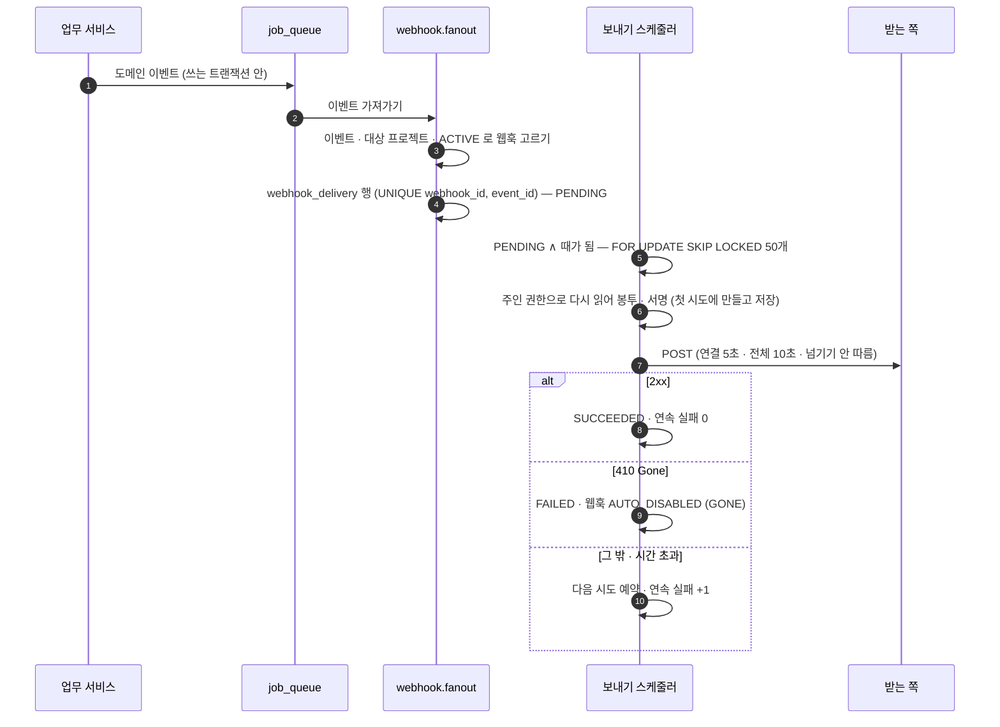
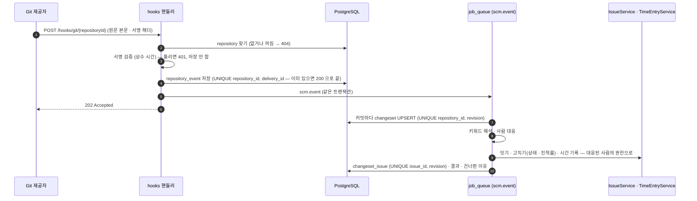
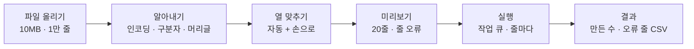
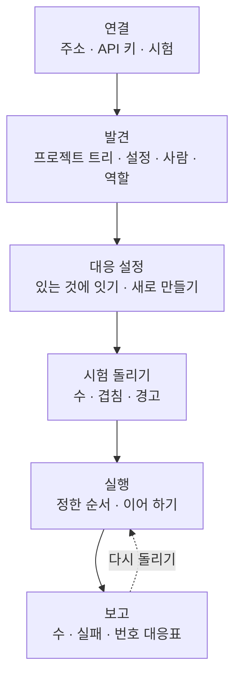

[홈](../README.md) › [설계](01-architecture.md) › 연동

# 연동 설계 — REST API 규약 · 웹훅 · Git 연동 · 가져오기 · Redmine 이관

moai-works 가 바깥 시스템과 이어지는 길을 정한다: 화면과 같은 **REST API** 의 규약, 바깥 자동화의 인증, 일이 일어나면 바깥으로 알리는 **웹훅**, Git 제공자의 웹훅을 받아 커밋을 일감에 잇는 **Git 연동**, **CSV 가져오기**, **Redmine 이관**, 데이터 내보내기. AI Agent 의 입구(MCP)는 [MCP · AI Agent 설계](07-mcp-agents.md)에 있다.

> 요구사항: [FR-INT](../requirements/11-integration.md) · 도메인 이벤트 이름의 정본: [일감 설계](05-issue-tracking.md) · 작업 큐(아웃박스): [아키텍처](01-architecture.md)

**바로가기:** [구성](#in-arch) · [REST 규약](#in-rest) · [페이지](#in-paging) · [오류](#in-errors) · [잠금](#in-lock) · [OpenAPI](#in-openapi) · [자동화 인증](#in-auth) · [웹훅](#in-webhook) · [이벤트](#in-webhook-events) · [서명](#in-webhook-sign) · [재시도](#in-webhook-retry) · [Git](#in-git) · [받기](#in-git-receive) · [키워드](#in-git-keywords) · [사람 대응](#in-git-users) · [PR](#in-git-pr) · [CSV](#in-csv) · [Redmine](#in-redmine) · [대응 규칙](#in-redmine-map) · [순서](#in-redmine-order) · [다시 돌리기](#in-redmine-rerun) · [본문 · 첨부](#in-redmine-content) · [한계](#in-redmine-limits) · [내보내기](#in-export) · [비밀값](#in-secrets) · [DDL](#in-ddl) · [정해야 할 것](#in-open)

---

<a id="in-arch"></a>
## 1. 구성

```
                       ┌──────────────────────────── moai-works-api ─────────────────────────────┐
 바깥 자동화 ──REST───▶ │ restChain (JWT) → AccessInterceptor → 컨트롤러 ──┐                          │
 (Keycloak 서비스 계정)  │                                                   ▼                          │
                       │                                   업무 서비스 (Issue · Time · Wiki …)        │
 Git 제공자 ──웹훅──▶   │ POST /hooks/git/{repositoryId} (@PublicApi + 서명)  │  쓰는 트랜잭션 안에서       │
 (GitHub·GitLab·Gitea) │   → repository_event 저장 → 202                    ▼  도메인 이벤트             │
                       │                                   job_queue (아웃박스) ──┬─ scm.event          │
 CSV 파일 ─올리기──▶    │ imports API → MinIO(imports/) ─────────────────────────┼─ import.csv         │
 Redmine ◀─REST 끌어오기─│ imports API (주소 · API 키) ────────────────────────────┼─ import.redmine     │
                       │                                                       ├─ webhook.fanout     │
 받는 쪽 ◀──웹훅 POST── │ 웹훅 보내기 스케줄러 ◀── webhook_delivery ◀──────────────┘                     │
 (채팅 봇 · CI)         └───────────────────────────────────────────────────────────────────────────┘
```

| 구성 요소 | 책임 |
|---|---|
| REST 컨트롤러 | 화면 · 바깥 자동화가 같이 쓰는 API. 규약은 [§2](#in-rest) |
| 자동화 인증 | Keycloak 서비스 계정 토큰을 Agent 계정으로 잇는다([§3](#in-auth)) |
| 웹훅 | 도메인 이벤트를 구독한 주소로 서명해 보낸다([§4](#in-webhook)) |
| Git 받기 | 제공자 웹훅을 받아 서명을 확인하고 저장한 뒤, 작업 큐에서 커밋 · 키워드를 처리한다([§5](#in-git)) |
| 가져오기 | CSV([§6](#in-csv)) · Redmine([§7](#in-redmine)) — 작업 큐에서 줄 · 대상마다 짧은 트랜잭션 |
| 작업 큐 | api 안의 DB 작업 큐(`job_queue`)와 스케줄러. 워커 모듈은 없다([아키텍처](01-architecture.md)) |

모든 연동의 쓰기는 **같은 업무 서비스**를 부르고, 행위자와 경로(`via` — `REST` · `SCM` · `IMPORT`)를 이력 · 감사에 남긴다([일감 설계](05-issue-tracking.md)의 주체 · 경로 표기).

---

<a id="in-rest"></a>
## 2. REST API 규약

화면이 쓰는 `/moai-works-api/v1/**` 가 곧 공개 API 다. 브라우저는 BFF 의 `/api/v1/**` 를 거쳐 1:1 로 오고(토큰은 BFF 에만), 바깥 자동화는 Bearer 토큰으로 api 를 바로 부른다. MCP 도구는 REST 를 부르지 않고 **같은 서비스**를 부른다.

### 2.1 경로 · 이름

| 규칙 | 내용 |
|---|---|
| 앞부분 | `/moai-works-api/v1` |
| 워크스페이스 | `/workspaces/{workspace}` — `workspace-` + 12자 주소 |
| 프로젝트 | `/workspaces/{workspace}/projects/{project}/…` — `project` 는 식별자(소문자 · 숫자 · 하이픈, 바꾸지 않음) |
| 일감 | `/workspaces/{workspace}/issues/{number}` — 번호로 바로(프로젝트를 옮겨도 그대로). 숫자 경로 변수는 `{number:\d+}` |
| 조각 이름 | 소문자 kebab-case 복수형(`time-entries` · `mcp-endpoints` · `issue-metadata`). 동작은 하위 조각(`…/suspend` · `…/ping` · `…/redeliver`) |
| 접근 어노테이션 | 핸들러마다 하나: `@PublicApi` · `@AuthenticatedApi` · `@UserApi` · `@ServiceApi` · `@PlatformApi` · `@WorkspaceApi(권한)` · `@ProjectApi(권한)` · `@IssueApi(권한)`. 없으면 기동 실패(지금 코드 · [프로젝트 권한 설계](04-project-permissions.md)) |

### 2.2 판(버전)

| 바꿈 | 다루는 법 |
|---|---|
| 필드 · 경로 · 열거 값 더하기 | 같은 `v1`. 클라이언트는 모르는 필드 · 값을 무시해야 한다 |
| 필드 지우기 · 이름 바꾸기 · 뜻 바꾸기 · 필수로 바꾸기 | **깨지는 변경** — `/v2` 를 새로 내고 `/v1` 을 6개월 함께 둔다. 응답 헤더 `Deprecation` · `Sunset` 으로 알린다 |
| 찾는 법 | 빌드가 OpenAPI 를 지난 릴리스와 비교해 깨지는 변경을 잡는다([§2.8](#in-openapi)) |

### 2.3 요청 · 응답 꼴

| 항목 | 규칙 |
|---|---|
| 형식 | `application/json; charset=utf-8`. 필드 이름 camelCase(지금 코드 — Java record + Jackson). MCP 도구는 snake_case 로 바꿔 낸다([MCP 설계 §14](07-mcp-agents.md#mc-result)) |
| 시각 · 날짜 | 시각은 ISO 8601 UTC(`2026-11-21T03:04:05Z`), 날짜는 `YYYY-MM-DD`, 시간 양은 시간 단위 소수(`1.5`) |
| 고치기 | `PATCH` 는 병합 꼴: 보내지 않은 필드는 그대로, `null` 은 비움 |
| id | uuid 문자열. 일감은 번호(`number`)도 함께 |
| 사람 · Agent | 주체는 `{ "type": "USER" \| "AGENT", "id", "name" }` |
| 글 | Markdown 원문 + 글 속 링크 풀이 `references`([일감 설계](05-issue-tracking.md)의 텍스트 링크) |
| 크기 | 요청 본문 1MB(첨부 올리기는 따로 — 멀티파트, 상한은 첨부 설정) |

<a id="in-paging"></a>
### 2.4 페이지 · 정렬 · 거르기

[일감 설계](05-issue-tracking.md)의 결정(화면은 쪽 번호, REST · MCP 는 커서)을 API 전체에 쓴다. 목록 API 는 두 꼴을 모두 받는다.

| 꼴 | 요청 | 응답 | 쓰임 |
|---|---|---|---|
| 쪽 번호 | `?page=1&size=25` (`size` 25 · 50 · 100) | `{ "items": [...], "page": 1, "size": 25, "total": 312, "totalCapped": false }` | 화면 목록. `total` 은 10,000 까지 세고 넘으면 `totalCapped: true`. 10,000 행 뒤로는 쪽 번호로 가지 않는다 |
| 커서 | `?limit=50&cursor=…` (`limit` 최대 100) | `{ "items": [...], "nextCursor": "…" \| null }` | 자동화 · 큰 목록 · 흐름(활동 · 감사 · 전달 기록). 키셋이라 빠짐 · 겹침이 없다 |

| 항목 | 규칙 |
|---|---|
| 상한 | `size` · `limit` 이 상한을 넘으면 400 `INVALID_REQUEST`(조용히 줄이지 않는다 — 자동화가 알게) |
| 정렬 | `?sort=updatedAt:desc,priority:asc` — 자원마다 허용 목록, 최대 3개. 끝에 늘 고유 열쇠(일감은 번호)를 붙인다 |
| 거르기 | 흔한 것은 쿼리 매개변수(`?status=open&assignee=me`). 일감의 복잡한 질의는 `POST /workspaces/{ws}/issues/search` 에 질의 JSON(질의 엔진과 같은 꼴, MCP `search_issues` 와 같은 꼴) |
| 커서 | 불투명 문자열(마지막 정렬 값 + 고유 열쇠 + 질의 해시, 서명). 다른 질의 · 다른 사람에게 쓰면 400 |

<a id="in-errors"></a>
### 2.5 오류

지금 코드(`common/ApiExceptionHandler`)처럼 **RFC 9457 problem+json** 이고 **모든 오류에 `code`** 가 있다.

```json
{
  "type": "about:blank",
  "title": "Conflict",
  "status": 409,
  "detail": "다른 요청이 먼저 바꿨습니다. 다시 시도하십시오.",
  "code": "CONCURRENT_UPDATE",
  "currentLockVersion": 9,
  "traceId": "4bf9…"
}
```

| 규칙 | 내용 |
|---|---|
| `code` | 대문자 스네이크, 화면 · 자동화 · MCP 가 분기에 쓰는 고정 문자열. 한 번 낸 `code` 는 바꾸지 않는다. MCP 도구 오류의 `code` 와 같다 |
| `detail` | 사람이 읽는 한국어 문장(요청 `Accept-Language: en` 이면 영어) |
| 입력 오류 | 400 `INVALID_REQUEST` + `errors: [{ "field", "code", "message" }]` — 모든 필드 오류를 한 번에(지금 코드는 `field` · `message` 만 — `code` 를 더한다) |
| 읽기 거부 | 404 — 없음과 같은 모양(`…_NOT_FOUND`). 존재를 숨긴다 |
| 쓰기 거부 | 403 `PERMISSION_REQUIRED`(지금 `AccessInterceptor`) 또는 업무 규칙 code |
| 업무 규칙 | 409(상태 충돌 · 이미 있음) · 422(검증 · 워크플로) + 업무 code |
| 서버 오류 | 500 `INTERNAL` + `traceId`. 스택 · SQL 을 싣지 않는다 |
| 인증 | 401 `UNAUTHORIZED`(지금 `SecurityConfiguration`) + `WWW-Authenticate: Bearer` |

| 공통 code | HTTP | 뜻 |
|---|---|---|
| `INVALID_REQUEST` | 400 | 입력 형식 · 값 오류 |
| `UNAUTHORIZED` | 401 | 토큰 없음 · 만료 |
| `PERMISSION_REQUIRED` | 403 | 권한 코드 없음 |
| `USER_ONLY` · `SERVICE_ONLY` · `PLATFORM_ROLE_REQUIRED` | 403 | 주체 종류 · 플랫폼 역할(지금 코드) |
| `WORKSPACE_NOT_FOUND` · `PROJECT_NOT_FOUND` · `ISSUE_NOT_FOUND` … | 404 | 없음 또는 볼 수 없음 |
| `CONCURRENT_UPDATE` | 409 | 낙관적 잠금 충돌(지금 코드) |
| `IDEMPOTENCY_KEY_REUSED` | 409 | 같은 멱등 키 · 다른 요청([§2.7](#in-rest)) |
| `PAYLOAD_TOO_LARGE` · `FILE_TOO_LARGE` | 413 | 크기 초과 |
| `RATE_LIMITED` | 429 | 속도 제한, `Retry-After` |
| `IDENTITY_PROVIDER_ERROR` | 502 | Keycloak 실패(지금 코드) |
| `INTERNAL` | 500 | 그 밖 |

> **이름 맞추기 (2026-11-21 맞춤).** `code` 는 지금 코드와 [DEVELOPE.md](../../DEVELOPE.md) 규칙대로 대문자 스네이크다. 처음 쓴 설계에 있던 kebab 이름은 모두 바꿨다(잠금 충돌은 지금 코드의 `CONCURRENT_UPDATE`, 그 밖은 `RELATION_EXISTS` · `CIRCULAR_DEPENDENCY` · `NOT_FOUND` 처럼).

<a id="in-lock"></a>
### 2.6 낙관적 잠금

| 대상 | 요청 필드 | 다르면 |
|---|---|---|
| 일감 | `lockVersion`(= `issue.row_version`) | 409 `CONCURRENT_UPDATE` + `currentLockVersion` + 그 사이 저널(보는 사람에게 보이는 것) |
| 위키 쪽 | `baseRevision` | 409 `CONCURRENT_UPDATE` + 지금 판 |
| 그 밖(프로젝트 · 버전 · 엔드포인트 · 웹훅 …) | `rowVersion` | 409 `CONCURRENT_UPDATE` |

- 응답에는 늘 새 `lockVersion` · `rowVersion` 이 있다. `ETag` / `If-Match` 는 쓰지 않는다(본문 필드 하나로 화면 · 자동화 · MCP 가 같게).
- 덧붙이기(메모 · 관계 · 시간 기록 · 관찰자)는 잠금 필드가 없다. 메모만 쓰기는 일감의 `lockVersion` 을 올리지 않는다([일감 설계](05-issue-tracking.md)).

### 2.7 멱등 키

| 항목 | 규칙 |
|---|---|
| 헤더 | `Idempotency-Key: <8~100자>` — 만드는 `POST`(일감 · 메모 · 관계 · 시간 기록 · 위키 쪽 · 가져오기 작업)에 선택으로 |
| 동작 | 같은 주체 · 같은 키 · 같은 요청이면 24시간 첫 응답(상태 코드 · 본문)을 다시 준다(`Idempotent-Replay: true` 헤더). 다른 요청이면 409 `IDEMPOTENCY_KEY_REUSED` |
| 저장 | MCP 와 같은 `idempotency_record` 표 · 같은 한 트랜잭션 방식([MCP 설계 §16](07-mcp-agents.md#mc-idem)), `via = REST` |
| 우선순위 | 자동화(S)와 함께 만든다. 화면은 쓰지 않는다(화면은 단추를 막는다) |

<a id="in-openapi"></a>
### 2.8 OpenAPI 문서

| 항목 | 설계 |
|---|---|
| 만들기 | 코드에서 만든다(springdoc-openapi — Spring Boot 4 와 맞는 최신 GA 를 레지스트리에서 확인해 고른다). 손으로 쓰지 않는다 |
| 접근 규칙 | `OperationCustomizer` 가 핸들러의 접근 어노테이션을 읽어 작업마다 `x-moai-works-access: { "rule": "ProjectApi", "permission": "issue.edit" }` 와 설명 첫 줄 "필요한 권한: `issue.edit`"을 넣는다 |
| 오류 | 모든 작업에 공통 problem 응답(400 · 401 · 403 · 404 · 409 · 422 · 429)을 붙이고, 업무 code 는 문서용 어노테이션 `@ApiErrors({"RELATION_EXISTS", …})` 로 적는다 |
| 내보내기 | 빌드의 시험 단계가 문맥을 띄워 `openapi.json` 을 산출물로 쓴다. 운영 api 는 springdoc 의 실행 중 문서 주소를 끈다(`springdoc.api-docs.enabled=false`) — 접근 어노테이션 없는 핸들러를 열지 않기 위해서다(개발 프로필에서만 켜고, 접근 계약 검사는 springdoc 핸들러를 뺀다) |
| 보기 | 웹 화면 "API 문서" 쪽(로그인 필요)이 산출물 `openapi.json` 을 그린다. 운영자가 끌 수 있다 |
| 깨지는 변경 | 빌드가 지난 릴리스의 `openapi.json` 과 비교한다(필드 · 경로 지우기 · 필수로 바꾸기 → 실패). 깨지는 변경이면 `/v2` 를 낸다([§2.2](#in-rest)) |
| 예시 | 일감 만들기 · 고치기(잠금) · 질의 · 웹훅 서명 검증 예시를 문서에 싣는다 |

### 2.9 속도 제한

| 단위 | 기본 | 넘으면 |
|---|---|---|
| 사람 토큰(화면) | 사람마다 분당 1,200 | 429 `RATE_LIMITED` + `Retry-After` |
| 서비스 계정(자동화) | 클라이언트마다 분당 600 | 같음 |
| 쓰기 | 주체마다 분당 120 | 같음 |
| Git 받기 | 저장소마다 분당 120 | 429(제공자가 다시 보낸다) |

Redis 토큰 버킷(`moai-works:rest:rl:{주체}`), Redis 가 멈추면 인스턴스 메모리 버킷. 숫자의 정본은 [비기능 요구사항](../requirements/13-non-functional.md)이다.

---

<a id="in-auth"></a>
## 3. 바깥 자동화 인증

### 3.1 길 셋

| 길 | 누구로 판정 | 쓰임 | 우선 |
|---|---|---|---|
| 사람 로그인(BFF 세션 → JWT) | 그 사람 | 웹 화면 | 있음 |
| **Keycloak 서비스 계정**(client_credentials JWT) | 이어진 **Agent 계정** | CI · 사내 시스템의 REST | S |
| MCP 키 | 사람(개인 키) · Agent 계정(서비스 키) | 바깥 AI Agent([MCP 설계](07-mcp-agents.md)) | M |
| 개인 API 토큰 | 그 사람 | 사람의 스크립트 | C |

### 3.2 Keycloak 서비스 계정 → Agent 계정

지금 코드: 서비스 계정 토큰(`preferred_username` 이 `service-account-` 로 시작)은 `@ServiceApi(clients = …)` 로 지정한 플랫폼 클라이언트만 받고, `@WorkspaceApi` 에서는 `USER_ONLY` 403 이다. [프로젝트 권한 설계](04-project-permissions.md)도 "REST 어노테이션은 사람만 지나간다"로 적었다. 자동화(S)를 만들 때 아래처럼 넓힌다.

| 단계 | 하는 일 |
|---|---|
| 1. 클라이언트 만들기 | 시스템 관리자가 Keycloak 렐름 `moai-works` 에 confidential 클라이언트(client_credentials, audience `moai-works-api` 매퍼)를 만든다. 비밀은 Keycloak 에만 |
| 2. 잇기 | 시스템 관리자가 그 클라이언트 id 를 워크스페이스의 Agent 계정에 잇는다(`agent_account.keycloak_client_id`, UNIQUE — 클라이언트 하나 = Agent 하나). 워크스페이스 관리자는 잇기를 요청만 한다 |
| 3. 판정 | `AccessInterceptor` 가 서비스 계정 토큰의 `azp` 로 `agent_account` 를 찾는다. 있으면 주체 = 그 Agent(`via = REST`), 없으면 지금처럼 `USER_ONLY` 403 |
| 4. 워크스페이스 | 경로의 `{workspace}` 가 그 Agent 의 워크스페이스가 아니면 404 |
| 5. 권한 | [프로젝트 권한 설계](04-project-permissions.md)의 같은 함수(Agent 규칙 — 워크스페이스 권한 ∅, 역할을 받은 프로젝트만 독자). 그래서 `@ProjectApi` · `@IssueApi` 경로는 쓰고, `@WorkspaceApi(…)` 경로는 403 이다(문지기 경로 `GET /issues` 를 열지는 [§11](#in-open)) |
| 6. 끄기 | Agent 정지 · 지우기 · 잇기 풀기 → 다음 요청부터 403. Keycloak 클라이언트를 끄면 토큰이 안 나온다 |
| 7. 기록 | 이력 · 감사에 행위자 Agent · `via = REST` · 클라이언트 id |

- MCP 키는 오래 사는 불투명 키(최대 365일), 서비스 계정은 짧게 사는 JWT(Keycloak 기본 5분)다. CI 처럼 비밀을 안전하게 둘 수 있으면 서비스 계정을 권한다.

### 3.3 개인 API 토큰 (C)

| 항목 | 설계 |
|---|---|
| 꼴 | `mwk_pat_` + 32바이트 난수. SHA-256 만 저장(MCP 키와 같은 코덱) |
| 묶음 | 워크스페이스 하나 · 범위(`read` · `write`) · 만료(최대 365일) |
| 판정 | 그 사람과 같다. `read` 범위면 쓰기는 403 |
| 무효 | 멤버가 나가면 바로. 폐기는 다음 요청부터 401 |
| 인증 자리 | restChain 앞에 토큰 필터(접두사로 JWT 와 가린다) |

---

<a id="in-webhook"></a>
## 4. 웹훅

### 4.1 모델

| 항목 | 설계 |
|---|---|
| 단위 | **워크스페이스**의 웹훅. 대상 프로젝트는 전체(`ALL`) 또는 고른 것(하위 포함 여부) |
| 관리 | `webhook.manage`(기본: 소유자 · 관리자) |
| 설정 | 이름 · 주소(https) · 고를 이벤트 · 대상 프로젝트 · 글 포함 여부(설명 · 메모 글을 실을지, 기본 켬) · 상태(`ACTIVE` · `DISABLED` · `AUTO_DISABLED`) |
| 주인 | 만든 사람(`owner_user_id`). **웹훅은 주인의 읽기 권한으로 거른다** — 주인이 볼 수 없는 일감 · 비공개 메모 · 꺼진 모듈의 이벤트는 보내지 않는다. 주인이 나가거나 `webhook.manage` 를 잃으면 자동으로 끈다(`AUTO_DISABLED`, `OWNER_INACTIVE`) |
| 비밀 | 만들 때 서버가 32바이트 난수를 정해 한 번 보이고 암호화해 둔다([§9](#in-secrets)). 서명에 써야 하므로 해시만 둘 수 없다 |

| API | 접근 어노테이션 |
|---|---|
| `GET · POST /workspaces/{ws}/webhooks` · `PATCH · DELETE …/{id}` | `@WorkspaceApi(WEBHOOK_MANAGE)` |
| `POST …/{id}/ping` · `POST …/{id}/rotate-secret` | `@WorkspaceApi(WEBHOOK_MANAGE)` |
| `GET …/{id}/deliveries?cursor=` · `GET …/{id}/deliveries/{deliveryId}` · `POST …/{id}/deliveries/{deliveryId}/redeliver` | `@WorkspaceApi(WEBHOOK_MANAGE)` |

<a id="in-webhook-events"></a>
### 4.2 이벤트

이벤트 이름 · 언제 나는지는 각 설계의 도메인 이벤트 목록이 정본이다([일감 설계](05-issue-tracking.md) · [계획 · 시간 설계](06-planning-time.md) · [협업 설계](08-collaboration.md)). 웹훅으로 고를 수 있는 것:

| 묶음 | 이벤트 | 정본 |
|---|---|---|
| 일감 | `issue.created` · `issue.updated` · `issue.note.edited` · `issue.deleted` · `issue.relation.added` · `issue.relation.removed` · `issue.watcher.added` · `issue.watcher.removed` · `issue.attachment.added` · `issue.attachment.removed` | 일감 설계 |
| 프로젝트 | `project.created` · `project.updated` · `project.closed` · `project.reopened` · `project.archived` · `project.unarchived` · `project.deleted` · `project.module.changed` · `project.member.added` · `project.member.changed` · `project.member.removed` | 일감 설계(프로젝트 권한 설계와 맞춤) |
| 버전 · 시간 | `version.created` · `version.updated` · `version.deleted` · `time_entry.created` · `time_entry.updated` · `time_entry.deleted` | 계획 · 시간 설계 |
| 위키 · 내용 | `wiki_page.created` · `wiki_page.updated` · `wiki_page.renamed` · `wiki_page.deleted` · `news.created` · `news.updated` · `news.deleted` · `news.comment.added` · `document.created` · `document.updated` · `document.deleted` · `release_file.created` · `forum_message.created` · `forum_message.updated` | 협업 설계 |
| 저장소 (이 쪽이 낸다) | `repository.changeset.added`(커밋을 저장함 — 이어진 일감 번호 포함) · `repository.pull_request.updated`(PR · MR 열기 · 고치기 · 병합 · 닫기) | [§5](#in-git) — [협업 설계](08-collaboration.md)의 활동 · 검색이 같은 이름으로 받는다 |
| 웹훅 | `ping`(시험 보내기) | 이 쪽 |

- 보내지 않는 것: `issue.mentioned`(알림 전용) · `config.changed` · `project.access.changed`(내부 캐시용).
- 고르기 화면은 묶음 단위 체크와 `issue.*` 같은 별표를 받는다(저장할 때 이름 목록으로 편다 — 나중에 생긴 이벤트는 저절로 켜지지 않는다).
- `issue.updated` 의 `flags`(`statusChanged` · `closed` · `noteAdded` …)로 받는 쪽이 거른다(웹훅 쪽 거르기는 C).

<a id="in-webhook-sign"></a>
### 4.3 봉투 · 서명

도메인 이벤트는 본문 글을 싣지 않는다(id 와 바뀐 값만 — [일감 설계](05-issue-tracking.md)). 웹훅은 보낼 때 **주인의 권한으로 자원을 다시 읽어** 봉투를 만든다. 필드 이름은 REST 와 같은 camelCase 다.

```json
{
  "id": "0b9c…",                         // 도메인 이벤트 id — 받는 쪽은 이것으로 겹침을 거른다
  "type": "issue.updated",
  "version": 1,
  "occurredAt": "2026-11-21T03:00:00Z",
  "deliveryId": "5e1d…",
  "attempt": 1,
  "workspace": { "slug": "workspace-ab12cd34ef56", "name": "ACME 개발팀" },
  "project":   { "identifier": "web-shop", "name": "웹 쇼핑몰" },
  "actor":     { "type": "AGENT", "id": "…", "name": "빌드봇" },
  "via":       { "channel": "MCP", "endpoint": "build-bot" },
  "data": {
    "issue":   { "number": 123, "subject": "…", "status": { "id": "…", "name": "해결", "isClosed": false },
                 "assignee": { "type": "USER", "id": "…", "name": "김개발" }, "lockVersion": 8,
                 "webUrl": "https://…/issues/123", "…": "REST 일감 표현(주인이 보는 대로)" },
    "changes": [ { "field": "status", "old": { "id": "…", "name": "진행" }, "new": { "id": "…", "name": "해결" } } ],
    "flags":   { "statusChanged": true, "noteAdded": true },
    "journal": { "id": "…", "notes": "재현되지 않음 …", "privateNotes": false }
  }
}
```

- 비공개 메모는 늘 뺀다(`journal.notes` 를 비우고 `noteAdded` 만 남긴다). 글 포함이 꺼져 있으면 `description` · `notes` 를 싣지 않는다.
- 주인이 그 자원을 볼 수 없으면 보내지 않고 전달을 `SKIPPED`(`NOT_VISIBLE`)로 남긴다.
- 본문은 64KB 를 넘지 않게 긴 글을 자르고 `truncated: true` 를 붙인다.

**헤더**

| 헤더 | 값 |
|---|---|
| `Content-Type` | `application/json` |
| `User-Agent` | `moai-works-webhook/1` |
| `X-Moai-Works-Event` | `issue.updated` |
| `X-Moai-Works-Delivery` | 전달 id |
| `X-Moai-Works-Signature` | `t=<유닉스 초>,v1=<hex(HMAC-SHA256(비밀, t + "." + 본문 바이트))>` — 비밀을 바꾸는 24시간 동안은 `v1=` 를 둘(새 비밀 · 옛 비밀) 싣는다 |

**받는 쪽 검증(문서에 싣는 예시)**

```python
import hashlib, hmac, time

def verify(secret: bytes, signature_header: str, body: bytes, tolerance: int = 300) -> bool:
    """X-Moai-Works-Signature 검증. 본문은 받은 바이트 그대로 쓴다(JSON 을 다시 만들지 않는다)."""
    items = [p.split("=", 1) for p in signature_header.split(",")]
    t = next(v for k, v in items if k == "t")
    if abs(time.time() - int(t)) > tolerance:          # 오래된 요청(다시 보내기 공격) 거절
        return False
    expected = hmac.new(secret, t.encode() + b"." + body, hashlib.sha256).hexdigest()
    return any(k == "v1" and hmac.compare_digest(v, expected) for k, v in items)
```

<a id="in-webhook-retry"></a>
### 4.4 전달 · 재시도 · 자동 끄기



| 항목 | 설계 |
|---|---|
| 재시도 | 처음 포함 7번: 바로 → 1분 → 5분 → 30분 → 2시간 → 6시간 → 12시간(±20% 흔들기). 마지막도 실패면 `FAILED` |
| 같은 내용 | 봉투는 첫 시도에 만들어 저장하고, 재시도 · 다시 보내기는 같은 봉투(같은 이벤트 id)를 보낸다. `attempt` · `deliveryId` 헤더만 바뀐다 |
| 동시성 | 웹훅마다 동시에 4개까지. 순서는 보장하지 않는다 — 봉투의 `occurredAt` · `lockVersion` 으로 받는 쪽이 낡은 것을 버린다 |
| 기록 | 시도마다 `webhook_delivery_attempt`: 시각 · 응답 상태 · 응답 앞부분 2KB · 걸린 시간 · 오류. 14일 뒤 지운다(봉투 포함) |
| 다시 보내기 | 화면 단추 → 그 전달을 `PENDING` 으로 되돌려 바로 보낸다(같은 이벤트 id) |
| 자동 끄기 | 연속 실패 시도 50번, 또는 첫 실패 뒤 3일 동안 성공이 없으면 `AUTO_DISABLED`(`FAILING`) + 주인 · 관리자에게 화면 알림 · 메일. 다시 켜면 쌓인 `PENDING` 은 `CANCELED` 로 접고 새 이벤트부터 보낸다 |
| 시험 | `ping` 은 줄을 서지 않고 바로 한 번 보내 결과를 화면에 보인다 |

### 4.5 SSRF 막기

| 검사 | 때 |
|---|---|
| `https` 만(개발 프로필에서만 플랫폼 설정 `webhook.allow_http`) | 저장 · 보낼 때 |
| 이름을 풀어 나온 모든 주소가 막힌 대역이 아님: `127.0.0.0/8` · `::1` · `10.0.0.0/8` · `172.16.0.0/12` · `192.168.0.0/16` · `fc00::/7` · `169.254.0.0/16` · `fe80::/10` · `100.64.0.0/10` · `0.0.0.0/8` · 멀티캐스트 · 클라우드 메타데이터 주소 | 저장 · **보낼 때마다**(DNS 리바인딩) |
| 풀어 둔 주소로 바로 연결(Host · SNI 는 이름), 넘기기(3xx)를 따르지 않음 | 보낼 때 |
| 사내 받는 쪽이 필요하면 시스템 관리자의 허용 목록(`webhook.allowed_private_hosts`)만 | 저장 · 보낼 때 |

---

<a id="in-git"></a>
## 5. Git 저장소 연동

코드를 복제하지 않는다. 제공자(GitHub · GitLab · Gitea)의 웹훅으로 **커밋 · PR 정보만** 받아 일감에 잇고, 키워드로 상태 · 진척률 · 시간을 반영한다(Redmine 의 저장소 연동과 같은 뜻). 저장소 브라우저는 C([§5.6](#in-git-browser)).

### 5.1 저장소 연결

| 항목 | 설계 |
|---|---|
| 단위 | 프로젝트에 저장소 여러 개. 저장소 모듈(`repository`)이 켜져 있어야 한다 |
| 관리 | `repository.manage`(프로젝트 관리자) — `@ProjectApi(REPOSITORY_MANAGE)` |
| 설정 | 식별자(프로젝트 안 고유, `commit:식별자:abc123` 표기에 씀) · 종류(`GITHUB` · `GITLAB` · `GITEA`) · 웹 주소(커밋 · PR 링크를 만든다) · 기본 브랜치 · 고치기 브랜치(비면 기본 브랜치) · 작성자 이메일 믿기(기본 켬) · 다른 프로젝트 일감 잇기(기본 끔) · 시간 기록(기본 켬) · 기본 작업 분류 · PR 병합 때 고치기 적용(기본 끔) · 브랜치 이름에서 번호 찾기(기본 끔) |
| 받는 주소 | `https://<api 주소>/moai-works-api/v1/hooks/git/{repositoryId}` — 저장소 id(uuid)가 주소에 들어간다. 앞단 프록시는 이 `hooks/**` 만 바깥에 연다 |
| 비밀 | 저장소를 더할 때 서버가 32바이트 난수를 만들어 **한 번** 보이고 암호화해 둔다([§9](#in-secrets)). "비밀 다시 만들기"는 새 비밀을 한 번 보이고 옛 비밀을 24시간 함께 받는다 |
| 안내 | 종류별 설정 방법: GitHub(Settings › Webhooks · Content type `application/json` · Secret · 이벤트 Push · Pull requests) · GitLab(Settings › Webhooks · Secret token · Push events · Merge request events) · Gitea(Settings › Webhooks · Gitea · Secret · Push · Pull Request) |

| API | 접근 어노테이션 |
|---|---|
| `GET /workspaces/{ws}/projects/{project}/repositories` · `GET …/{repo}/changesets?cursor=` | `@ProjectApi(REPOSITORY_READ)` |
| `POST …/repositories` · `PATCH · DELETE …/{repo}` · `POST …/{repo}/rotate-secret` · `GET …/{repo}/events` | `@ProjectApi(REPOSITORY_MANAGE)` |
| `GET /workspaces/{ws}/issues/{number}/changesets` | `@IssueApi(REPOSITORY_READ)` — `get_issue(include=changesets)` 도 같은 서비스 |
| `GET · PUT /workspaces/{ws}/scm-settings` (키워드 · 고치기 규칙) | 읽기 `@WorkspaceApi(WORKSPACE_READ)` · 쓰기 `@WorkspaceApi(CONFIG_MANAGE)` |
| `GET · POST · DELETE /me/scm-identities` · `POST /me/scm-identities/{id}/verify` | `@UserApi` |
| `POST /moai-works-api/v1/hooks/git/{repositoryId}` | `@PublicApi` + 서명 검증(핸들러 안). restChain 에서 `hooks/**` 를 인증 없이 통과시킨다(지금 가입 경로처럼) |

<a id="in-git-receive"></a>
### 5.2 받기 · 서명 검증 · 저장



| 제공자 | 서명 | 이벤트 헤더 | 전달 id |
|---|---|---|---|
| GitHub | `X-Hub-Signature-256: sha256=<hex(HMAC-SHA256(비밀, 원문 본문))>` | `X-GitHub-Event`: `push` · `pull_request` · `ping` | `X-GitHub-Delivery` |
| Gitea | `X-Gitea-Signature: <hex(HMAC-SHA256(비밀, 원문 본문))>` (`X-Hub-Signature-256` 이 오면 그것도 받는다) | `X-Gitea-Event`: `push` · `pull_request` | `X-Gitea-Delivery` |
| GitLab | `X-Gitlab-Token: <비밀 원문>` — 상수 시간 비교(GitLab 판이 HMAC 서명 헤더를 주면 그것을 먼저 쓴다 — 실측) | `X-Gitlab-Event`: `Push Hook` · `Merge Request Hook` | `X-Gitlab-Event-UUID`(없으면 본문 해시) |

| 규칙 | 내용 |
|---|---|
| 원문 | 서명은 **받은 바이트 그대로** 로 계산한다. 핸들러는 `byte[]` 로 받고, 검증 뒤에 JSON 으로 푼다 |
| 크기 · 속도 | 본문 5MB, 저장소마다 분당 120(넘으면 429 — 제공자가 다시 보낸다) |
| 무시 | 태그 푸시 · 브랜치 지우기(`after` 가 0) · 모르는 이벤트는 저장만 하고 `IGNORED` |
| 커밋 상한 | 제공자는 한 이벤트에 싣는 커밋 수에 상한이 있다(GitLab 은 20개 + `total_commits_count`). 넘친 커밋은 저장소 API 토큰(C, [§5.6](#in-git-browser))이 있을 때만 가져오고, 없으면 결과에 "커밋 n개를 받지 못함"을 남긴다 |
| 보관 | `repository_event` 의 본문은 30일 뒤 지운다(처리 결과는 남긴다) |
| 실패 | 처리 중 오류는 이벤트 `FAILED` + 오류. 작업 큐가 3번까지 다시 하고, 저장소 화면의 "받은 이벤트"에서 다시 처리할 수 있다 |

<a id="in-git-keywords"></a>
### 5.3 키워드 해석 · 일감 반영

**설정** (워크스페이스 — `scm_setting` · `scm_fix_rule`)

| 설정 | 기본 | 뜻 |
|---|---|---|
| 참조 키워드 | `refs` · `references` · `IssueID` · `see` | 뒤의 `#번호` 를 잇기만 |
| 아무 번호나 참조 | 끔 | 켜면 키워드 없는 `#123` 도 참조(Redmine 의 `*`) |
| 고치기 키워드 · 규칙 | `fixes` · `closes` · `resolves` → 상태 "해결", 진척률 100 | 키워드마다, 트래커마다(비면 모든 트래커) 바꿀 상태 · 진척률 |
| 시간 기록 | 켬 | `@시간` 을 시간 기록으로 |

**해석**

1. 커밋 메시지에서 `키워드[:] #번호` 덩어리를 찾는다. 번호는 `,` · `&` · `and` · 공백으로 여럿 이어진다(`fixes #12, #13 & #14`). 키워드는 대소문자를 가리지 않고 낱말 경계에서만 맞춘다.
2. 번호 바로 뒤의 `@시간` 은 그 일감의 시간이다: `@2h` · `@2h30m` · `@30m` · `@1.5h` · `@1:30` · `@2`(시간). 0 보다 크고 24시간 이하만.
3. 한 커밋에서 같은 일감이 참조 · 고치기로 둘 다 나오면 고치기로 본다.

**반영** (커밋 · 일감 쌍마다, 작업 큐 안의 짧은 트랜잭션)

```
cs   = changeset UPSERT (repository_id, revision)        # 같은 sha 가 다른 브랜치로 와도 한 행
user = 사람 대응(cs.author_email)                          # §5.4 — 없으면 null
for (number, action, minutes) in parse(cs.message):
    issue = 워크스페이스의 그 번호 일감
    if 없음 or (저장소 프로젝트 트리 밖 and not 다른 프로젝트 잇기): 건너뜀 (OUT_OF_SCOPE)
    if not INSERT changeset_issue (issue, revision) ON CONFLICT DO NOTHING: 다음   # 두 번 반영 막기
    if action == FIX and cs.branch ∈ 고치기 브랜치:
        if user is null or not 작성자 이메일 믿기: skip(USER_NOT_MAPPED)
        else IssueService.update(ctx{주체 = user, via = SCM, cause = SCM, cause_ref = sha},
                                 { status, done_ratio, notes: "커밋 abc1234 로 고침 — <첫 줄>" })
             # 같은 권한 · 워크플로 · 필드 규칙 — 거절되면 skip(PERMISSION | TRANSITION | FIELD_RULE …)
    if minutes and 시간 기록 켬:
        if user is null: skip(USER_NOT_MAPPED)
        else TimeEntryService.log(ctx{주체 = user, via = SCM}, issue, minutes,
                                  spent_on = 커밋 날짜, activity = 저장소 기본, comment = 첫 줄)   # time.log 판정
    결과(적용한 상태 · 진척률 · 시간 기록 id · 건너뛴 이유)를 changeset_issue 에 쓴다
도메인 이벤트 repository.changeset.added (이어진 일감 번호 포함)
```

| 규칙 | 내용 |
|---|---|
| 잇기 | 이력(저널)을 남기지 않고 일감의 "연결된 커밋"에 보인다(Redmine 과 같다). 저장소를 볼 권한(`repository.read`)이 있는 사람에게만 보인다 |
| 고치기 | **사람이 웹에서 바꿀 때와 같은 규칙**: 대응된 사람의 권한 · 워크플로가 허용할 때만. 이력의 행위자는 그 사람, 경로 `SCM`, 메모에 커밋 링크 |
| 두 번 막기 | `repository_event`(전달 id) · `changeset`(저장소, sha) · `changeset_issue`(일감, sha — 미러 저장소로 같은 커밋이 와도 한 번)의 고유 열쇠 셋 |
| 브랜치 | 고치기 · 시간은 고치기 브랜치로 들어온 커밋만(기능 브랜치에서 미리 닫히지 않게). 잇기는 모든 브랜치 |
| 강제 푸시 | 브랜치에서 사라진 커밋도 기록은 남긴다(Redmine 과 같다) |
| 글 속 링크 | `commit:abc123` · `commit:식별자:abc123` 은 [일감 설계](05-issue-tracking.md)의 텍스트 링크 풀이에 이 쪽의 풀이를 꽂는다(변경 묶음 링크) |

<a id="in-git-users"></a>
### 5.4 사람 대응

| 순서 | 맞추는 것 |
|---|---|
| 1 | 커밋 작성자 이메일(소문자) = 워크스페이스 **활성 멤버**의 계정 이메일(Keycloak 이 확인한 이메일) |
| 2 | = 멤버가 내 설정에서 더하고 **메일 코드로 확인한** 커밋 이메일(`scm_identity`, 인증 코드는 지금 `email_verification` 방식) |
| 3 | 맞는 사람이 없으면 "대응 없음" — 잇기만 한다. 커밋 작성자 이름 · 이메일은 변경 묶음에 남는다 |

- GitHub 의 `…@users.noreply.github.com` 같은 받을 수 없는 주소는 확인할 수 없으므로 **표시용 대응**으로만 둔다(커밋 작성자로 이름은 보이지만 상태 · 시간 반영에는 쓰지 않는다).
- PR 작성자의 제공자 계정 이름(`login`)도 멤버가 더할 수 있다(표시용).
- **위험**: Git 커밋의 작성자 이메일은 누구나 적을 수 있다. 저장소에 푸시할 수 있는 사람은 다른 멤버의 이메일로 커밋해 그 사람 이름으로 일감을 고칠 수 있다(Redmine 도 같다). 피해는 그 사람의 권한 안이고, 이력에 커밋 sha 가 남는다. 저장소 설정 "작성자 이메일 믿기"를 끄면 잇기만 한다([§11](#in-open)).

<a id="in-git-pr"></a>
### 5.5 PR · MR

| 항목 | 설계 |
|---|---|
| 받는 것 | GitHub · Gitea `pull_request`(`opened` · `edited` · `synchronize` · `reopened` · `closed`, `merged` 여부), GitLab `Merge Request Hook`(`object_attributes.action`: `open` · `update` · `reopen` · `close` · `merge`) |
| 저장 | `pull_request`(저장소 · 번호(GitLab 은 `iid`) · 제목 · 상태 `OPEN` · `MERGED` · `CLOSED` · 작성자 · 원본 / 대상 브랜치 · 주소 · 병합 시각) — (저장소, 번호)로 UPSERT |
| 잇기 | 제목 · 본문의 `#번호`(참조 · 고치기 키워드 모두), 그리고 설정을 켜면 원본 브랜치 이름의 번호(`feature/123-login` → #123) → `pull_request_issue` |
| 병합 | 기본은 아무것도 바꾸지 않는다(병합 커밋의 푸시가 고치기를 적용한다). 설정 "PR 병합 때 고치기 적용"을 켜면 PR 본문의 고치기 키워드를 병합한 사람(대응될 때)으로 적용 |
| 보이기 | 일감 화면의 "연결된 PR"(번호 · 제목 · 상태 · 주소). PR 제목은 사용자 데이터로 다룬다(MCP 표지) |
| 이벤트 | `repository.pull_request.updated` |

<a id="in-git-browser"></a>
### 5.6 저장소 브라우저 (C)

저장소를 복제하지 않고 **제공자 API** 를 부른다: 저장소에 읽기 전용 API 토큰(암호화 보관)을 넣으면 파일 트리 · 파일 보기 · 커밋 이력 · 커밋 차이 · 브랜치 · 태그를 보인다. 응답은 Redis 에 5분 캐시, 권한은 `repository.read`, 토큰 원문은 화면 · 로그에 다시 보이지 않는다. 같은 토큰으로 넘친 커밋 가져오기([§5.2](#in-git-receive))도 한다.

---

<a id="in-csv"></a>
## 6. CSV 가져오기



| 단계 | 설계 |
|---|---|
| 권한 | `@ProjectApi(ISSUE_IMPORT)` + 서비스가 `issue.create` 와 필드별 권한(담당 `issue.assign` 등 — 웹 만들기와 같다)을 본다 |
| 올리기 | `POST /workspaces/{ws}/projects/{project}/imports/issues`(멀티파트). 파일은 객체 저장소 `imports/{workspaceId}/{jobId}.csv`(첨부 버킷의 다른 앞부분), 7일 뒤 지운다. 프로젝트마다 도는 가져오기는 하나 |
| 알아내기 | 인코딩: BOM → UTF-8, 아니면 엄격한 UTF-8 풀기, 실패하면 CP949(MS949). 구분자: 앞 5줄에서 `,` · `;` · 탭 중 고르게 갈리는 것. 따옴표 `"`. 날짜 꼴 후보(`YYYY-MM-DD` · `YYYY/MM/DD` · `DD.MM.YYYY` · `MM/DD/YYYY`) |
| 열 맞추기 | 일감 필드: 제목(필수) · 트래커 · 상태 · 우선순위 · 설명 · 카테고리 · 담당 · 대상 버전 · 상위(`#번호` 또는 파일 안 "줄 id" 열) · 시작 · 기한 · 예상 시간 · 진척률 · 비공개 · 관찰자(`;` 구분) · 사용자 정의 필드. 머리글 이름(한국어 · 영어 · Redmine CSV 내보내기 머리글)으로 자동으로 맞추고 사람이 고친다 |
| 값 풀기 | 트래커 · 상태 · 우선순위 · 카테고리 · 버전은 이름(대소문자 무시). 담당 · 관찰자는 이메일 → 계정 이름 → 표시 이름(겹치면 오류). 선택: 없는 카테고리 · 버전 만들기(`project.manage` · `version.manage` 가 있을 때) |
| 미리보기 | `GET …/imports/{id}/preview` — 처음 20줄을 바뀐 값과 줄 오류로. 검사는 일감 서비스의 "검사만" 길(웹 만들기와 같은 검사: 필수 필드 · 새 일감 허용 상태 · 담당 가능 · 사용자 정의 필드) |
| 실행 | `POST …/imports/{id}/run` → 작업 큐 `import.csv`. 줄마다 트랜잭션 하나. 상위가 파일 안에 있으면 상위 줄을 먼저(순환이면 그 줄들 오류). 만든 줄은 `import_mapping`(CSV, 작업 id, 줄 번호 → 일감)에 같은 트랜잭션으로 남겨 **이어 돌려도 겹치지 않는다** |
| 행위자 | 작성자 = 가져온 사람, `created_via = IMPORT`, 저널 원인 `IMPORT`. 알림은 기본으로 보내지 않는다(선택) |
| 결과 | `GET …/imports/{id}` — 단계 · 진행 · 만든 수 · 실패 수. `GET …/imports/{id}/errors.csv` — 원래 줄 + `error` 열(오류 줄만 고쳐 다시 올리게) |
| 상한 | 10MB · 1만 줄 · 200열. 줄 하나 64KB |
| 감사 | `issue.import.start` · `issue.import.finish`(수 · 파일 이름). 만든 일감마다 `issue.created` 이벤트(활동 · 색인), 알림은 설정대로 |

---

<a id="in-redmine"></a>
## 7. Redmine 이관

Redmine REST API(JSON, 헤더 `X-Redmine-API-Key`)에서 **끌어온다**. Redmine DB 에 붙지 않는다.

### 7.1 흐름



| 항목 | 설계 |
|---|---|
| 권한 | `@WorkspaceApi(CONFIG_MANAGE)` + 서비스가 `project.create` 도 본다(소유자 · 관리자) |
| API | `POST /workspaces/{ws}/imports/redmine`(주소 · 키 → 연결 시험 · 발견) · `GET …/{id}/discovery` · `PUT …/{id}/mapping` · `POST …/{id}/dry-run` · `POST …/{id}/run` · `POST …/{id}/pause` · `…/resume` · `…/cancel` · `GET …/{id}` · `GET …/{id}/report` · `GET …/{id}/number-map.csv` |
| 연결 시험 | `GET /users/current.json`(관리자 여부) · `GET /projects.json?limit=1`. 관리자 키가 아니면 "사람 이메일 · 비공개 일감 · 비공개 메모 · 사용자 정의 필드 정의를 못 가져온다" 경고 |
| API 키 | 암호화해 작업 동안만 둔다([§9](#in-secrets)). 끝 · 취소 · 7일 동안 손대지 않음 → 지운다. 화면 · 로그 · 감사에 원문이 없다 |
| 읽는 곳 | `/projects.json?include=trackers,issue_categories,enabled_modules` · `/trackers.json` · `/issue_statuses.json` · `/enumerations/issue_priorities.json` · `/enumerations/time_entry_activities.json` · `/custom_fields.json`(관리자) · `/users.json`(관리자) · `/roles.json` · `/roles/{id}.json` · `/projects/{id}/memberships.json` · `/projects/{id}/versions.json` · `/issues.json?project_id=…&subproject_id=!*&status_id=*&sort=id` · `/issues/{id}.json?include=journals,attachments,relations,watchers,children` · `/time_entries.json?project_id=…` · `/projects/{id}/wiki/index.json` · `/projects/{id}/wiki/{title}.json?include=attachments` · `/projects/{id}/wiki/{title}/{version}.json` · `/projects/{id}/news.json` · `/attachments/{id}.json` + `content_url` |
| 끌어오기 | 쪽은 `offset` + `limit=100`. 동시에 2요청, 429 · 503 은 `Retry-After` 를 지켜 물러난다. 요청 시간 한도 30초 |

<a id="in-redmine-map"></a>
### 7.2 대응 규칙

| Redmine | moai-works | 규칙 |
|---|---|---|
| 프로젝트 `identifier` · `name` · `description` · `parent` | 프로젝트 | 식별자는 같게(이미 있으면 사람이 새 식별자를 정한다). 설명은 Markdown 으로 바꾼다 |
| `is_public` | `visibility` | 공개 → `WORKSPACE`, 비공개 → `RESTRICTED` |
| `status` 1 · 5 · 9 | 프로젝트 상태 | 활성 · 닫힘 · 보관 |
| `enabled_modules` | 모듈 | `issue_tracking` · `time_tracking` · `wiki` · `news` · `documents` · `files` · `boards`(→ 포럼) · `repository` · `calendar` · `gantt` 같은 이름으로 |
| `inherit_members` | `inherit_members` | 같게 |
| 트래커 | 트래커 | 같은 이름에 잇거나 새로 만든다(기본 상태도 대응) |
| 상태 `is_closed` | 상태 | 같은 이름에 잇거나 새로(닫힘 여부 그대로) |
| 우선순위 · 작업 분류 | 열거형 | 같은 이름에 잇거나 새로(기본값 · 순서) |
| 사용자 정의 필드 `field_format` | 형식 | `string`→문자 · `text`→긴 글 · `int`→정수 · `float`→실수 · `date`→날짜 · `bool`→예/아니요 · `list`→목록 · `enumeration`→키-값 목록 · `user`→사용자 · `version`→버전 · `link`→링크 · `attachment`→**옮기지 않음**(보고). 대상(`customized_type`) 일감 · 프로젝트 · 버전 · 시간 기록 · 사용자 |
| 사용자 | 멤버 | 같은 이메일(소문자)의 워크스페이스 멤버에 자동으로 잇는다. 없으면 **대응 없음** — 이력 · 작성자에는 "이름 (Redmine 에서 가져옴 · 계정 없음)"으로 남기고(주체 `SYSTEM` + 이름 사본), 열린 일감의 담당은 비우고 메모로 알린다. 초대 보내기는 C |
| 그룹 | — | moai-works 에 그룹이 없다. 그룹 담당은 비우고 메모로 "Redmine 그룹 X 담당이었음" |
| 역할 | 프로젝트 역할 | Manager → `project-manager` · Developer → `project-developer` · Reporter → `project-reporter` · 그 밖 → `project-viewer`(고칠 수 있음). 대응된 사람만 멤버로 — 사람은 Keycloak 그룹을 먼저 쓴다([프로젝트 권한 설계](04-project-permissions.md)의 이중 쓰기) |
| 버전 `status` · `sharing` | 버전 | 열림 · 잠김 · 닫힘 / `none` · `descendants` · `hierarchy` · `tree` · `system`(→ 워크스페이스) — 값 이름은 [계획 · 시간 설계](06-planning-time.md) |
| 카테고리 `assigned_to` | 카테고리 기본 담당 | 대응된 사람이면 |
| 일감 | 일감 | 모든 필드 · 사용자 정의 필드 · 상위 · 비공개 · `created_on` · `updated_on` · `closed_on` · 작성자 · 담당. `created_via = IMPORT` |
| 저널 `details` | 저널 상세 | `attr`(필드 키와 id 대응) → `ATTR` · `cf` → `CF` · `attachment` → `ATTACHMENT` · `relation` → `RELATION`. 메모 · 비공개 메모 · 원래 시각 · 원래 사람 |
| 관계 `relation_type` · `delay` | 관계 | 9가지 이름 그대로(반대 이름은 저장 방향으로) |
| 관찰자 | 관찰자 | 대응된 사람만 |
| 시간 기록 | 시간 기록 | 날짜 · 시간 · 작업 분류 · 메모 · 사람 · 일감 / 프로젝트 · 만든 때. 사람이 대응 없음이면 **옮기지 않고 보고**(시간은 사람의 것) |
| 위키 쪽 · 판 | 위키 쪽 · 판 | 쪽마다 모든 판(판의 작성자 · 메모 · 시각)을 차례로. 상위 쪽 |
| 뉴스 | 뉴스 | 제목 · 요약 · 본문 · 작성자 · 시각(댓글은 REST 에 없어 옮기지 않음) |
| 첨부 | 첨부 | [§7.5](#in-redmine-content) |

<a id="in-redmine-order"></a>
### 7.3 순서

참조가 끊기지 않게 아래 순서로 옮긴다. 단계마다 위치(마지막으로 다룬 Redmine id)를 `import_job.progress` 에 남겨 **멈춘 자리에서 이어 한다.**

| 단계 | 옮기는 것 | 비고 |
|---|---|---|
| 1 | 설정: 트래커 · 상태 · 우선순위 · 작업 분류 · 사용자 정의 필드 | 대응 설정의 "새로 만들기"만. 워크플로는 REST 에 없으므로 대응한 역할마다 "모든 전이 허용" 표를 만들고 손보라고 알린다 |
| 2 | 사람 대응 | 이메일로 자동 + 대응 설정 |
| 3 | 프로젝트(상위부터) · 모듈 · 멤버 · 역할 | 멤버는 Keycloak 이중 쓰기(사람) |
| 4 | 카테고리 · 버전 | 공유 버전은 공유 범위를 마지막에(대상 프로젝트가 다 생긴 뒤) |
| 5 | 일감 1차 — Redmine id 차례로, 상위 · 관계 없이 | 번호 정하기([§7.4](#in-redmine-rerun)) |
| 6 | 일감 2차 — 상위 일감 | |
| 7 | 저널 · 관찰자 | 저널은 id 차례로 |
| 8 | 관계 | 순환 · 겹침 검사에 걸리면 건너뛰고 보고 |
| 9 | 시간 기록 | |
| 10 | 위키 쪽 · 판 · 뉴스 | |
| 11 | 첨부 | 내려받아 올리고 일감 · 저널 · 위키에 잇는다 |
| 12 | 글 바꾸기 | 새 번호 모드면 본문 · 메모 · 위키의 `#123` · 위키 링크 · `attachment:` 참조를 바꾼다 |
| 13 | 마무리 | 상위 롤업 다시 계산 · 검색 색인(작업 큐) · 보고서 |

- **가져오기 쓰기 길**: 일감 서비스의 가져오기 전용 길(`IssueImportWriter`)을 쓴다. 이미 일어난 일이므로 **워크플로 전이 판정 · 알림 · 웹훅을 하지 않고**, 데이터 모순 검사(참조 · 번호 · 사용자 정의 필드 형식)만 한다. 원래 시각을 그대로 쓴다(`updated_at` 포함). 이 길은 가져오기 작업만 부를 수 있다(REST · MCP 에 없음).
- 대상마다 짧은 트랜잭션 하나에 "만든 행 + `import_mapping` 행"을 함께 쓴다 → 어디서 멈춰도 다시 돌리면 이어진다.

<a id="in-redmine-rerun"></a>
### 7.4 번호 · 다시 돌리기

**번호**

| 모드 | 조건 | 동작 |
|---|---|---|
| 번호 유지 | 워크스페이스에 일감이 하나도 없고, 다른 가져오기가 돌지 않음 · 사용자가 고름 | 일감 번호 = Redmine id. 끝나면 워크스페이스 번호 카운터를 max(id) + 1 로 둔다([일감 설계](05-issue-tracking.md)의 번호 카운터). Redmine id 는 전역이라 여러 프로젝트를 한 번에 옮겨도 겹치지 않는다 |
| 새 번호 | 그 밖 | Redmine id 차례로 새 번호. 대응표(Redmine id → 새 번호)를 만들고 글 속 `#123` 을 바꾼다 |

- 번호 유지 모드로 옮긴 뒤 다시 돌릴 때, 그 사이 moai-works 에서 만든 일감이 Redmine id 의 번호를 이미 썼으면 그 일감만 새 번호를 받고 대응표와 보고에 남는다.

**다시 돌리기** — 같은 Redmine(정규화한 주소)에서 다시 가져오면 `import_mapping` 으로 이미 옮긴 것을 안다.

| 경우 | 동작 |
|---|---|
| 처음 보는 대상 | 만든다 |
| 옮긴 대상 · Redmine `updated_on` 그대로 | 건너뛴다 |
| 옮긴 대상 · Redmine 에서 바뀜 · moai-works 에서 안 바뀜(`row_version` = 옮길 때 값) | Redmine 값으로 고친다 |
| 옮긴 대상 · moai-works 에서 바뀜 | **덮어쓰지 않고** 보고(`LOCAL_CHANGED`) |
| 저널 · 판 · 첨부 | 처음 보는 id 만 덧붙인다 |
| Redmine 에서 사라진 대상 | 지우지 않고 보고(`MISSING_IN_SOURCE`) |

**보고**: 종류별 만든 · 고친 · 건너뛴 · 실패 수, 실패 목록(대상 · id · 이유), 바꾸지 못한 서식 줄 수, 대응 없는 사람 목록, 번호 대응표 CSV(`redmine_id,number,project`).

<a id="in-redmine-content"></a>
### 7.5 첨부 · 본문 바꾸기

| 항목 | 설계 |
|---|---|
| 첨부 | `content_url` 을 API 키로 받아 객체 저장소에 흘려 올린다(메모리에 다 올리지 않는다). 파일 이름 · 형식 · 설명 · 올린 사람 · 시각을 지키고 SHA-256 을 새로 계산한다. 크기 상한은 첨부 설정과 같다([일감 설계](05-issue-tracking.md) — 넘으면 건너뛰고 보고) |
| 서식 | Redmine 의 본문 서식(`textile` · `markdown` · `common_mark`)은 REST 로 알 수 없으므로 사람이 고른다(기본 `textile`) |
| Textile → GFM | api 안의 작은 변환기(블록 파서 + 줄 규칙): `h1.`~`h6.` → `#` · `*굵게*` → `**굵게**` · `_기울임_` → `*기울임*` · `@코드@` → `` `코드` `` · `<pre>` · `<code class="x">` → 코드 묶음 · `"글":주소` → Markdown 링크(대괄호 글 + 괄호 주소) · `!그림.png!` → `` · `\|표\|` → GFM 표(첫 줄을 머리로) · `*` / `#` 목록 → `-` / `1.` · `bq.` → `>` · `{{toc}}` → 지움 · `{{collapse(제목)…}}` → `<details>` |
| 그대로 두는 것 | `#123` · `[[위키]]` · `commit:` · `r123` 같은 링크 표기(새 번호 모드면 12단계에서 바꾼다). 바꾸지 못한 줄은 그대로 두고 수를 센다 |
| Markdown 서식 | `markdown`(Redcarpet) · `common_mark` 는 거의 그대로 쓴다(Redmine 만의 링크 표기만 본다) |

<a id="in-redmine-limits"></a>
### 7.6 한계

| 옮기지 못하는 것 | 이유 | 대신 |
|---|---|---|
| 비밀번호 · 로그인 | 계정은 Keycloak | 사람은 가입 · 초대로 들어오고, 같은 이메일이면 이력이 이어진다 |
| 워크플로 · 필드 권한 | REST 에 없다 | "모든 전이 허용" 표로 시작해 손본다 |
| 역할의 세부 권한 | moai-works 프로젝트 역할은 4종 고정 | 가까운 역할로 접는다(사용자 정의 프로젝트 역할은 C) |
| 그룹 | moai-works 에 없다 | 담당은 비우고 메모 |
| 포럼 · 문서 | REST 에 없다 | 옮기지 않는다(보고) |
| 저장소 · 변경 묶음 | 저장소는 다시 잇는다 | Git 연동을 새로 걸면 그 뒤 커밋부터 잇는다(옛 커밋 잇기는 C) |
| 저장한 질의 | REST 는 목록만 | 다시 만든다 |
| 뉴스 댓글 · 첨부 형식 사용자 정의 필드 | REST 에 없다 · 형식이 없다 | 보고 |
| 비공개 일감 · 비공개 메모 · 사람 이메일 | 관리자 키가 아니면 안 보인다 | 연결 시험에서 경고 |
| 메일 · 알림 설정 · 내 페이지 | 사람마다 다시 정한다 | — |

---

<a id="in-export"></a>
## 8. 워크스페이스 데이터 내보내기 (C)

| 항목 | 설계 |
|---|---|
| 누가 | 소유자만(소유자 전용 코드를 새로 둔다 — 이름은 `workspace.export` 제안, [§11](#in-open)) |
| 흐름 | `POST /workspaces/{ws}/exports` → 작업 큐 `export.workspace` → 끝나면 화면 알림 · 메일 → `GET /workspaces/{ws}/exports/{id}/download`(api 를 거쳐 판정, 24시간 뒤 무효 · 파일 지움) |
| 꼴 | zip: `manifest.json`(형식 판 · 표마다 행 수 · 만든 때) · `tables/<표>.jsonl`(워크스페이스의 업무 표, 한 줄 한 행) · `attachments/<id>/<파일 이름>` · `README.md`(형식 설명) |
| 빼는 것 | 비밀값(웹훅 · 저장소 비밀 · MCP 키 해시 · 멱등 기록) · 다른 워크스페이스와 섞인 것 |
| 감사 | `workspace.export.request` · `workspace.export.download` |
| 일감 목록 내보내기 | CSV / PDF / Atom 은 [질의 요구사항](../requirements/05-query.md)의 내보내기(질의 엔진)다 — 이것과 다르다 |

---

<a id="in-secrets"></a>
## 9. 비밀값 · 작업 큐

| 비밀 | 왜 원문이 필요한가 | 보관 |
|---|---|---|
| 웹훅 서명 비밀 | 보낼 때마다 HMAC 을 만든다 | 암호화 |
| 저장소 웹훅 비밀 | 받을 때 HMAC 을 확인한다(GitLab 은 원문 비교) | 암호화 |
| 저장소 API 토큰(C) | 제공자 API 를 부른다 | 암호화 |
| Redmine API 키 | 작업 동안 Redmine 을 부른다 | 암호화 · 작업이 끝나면 지움 |
| MCP 키 · 개인 API 토큰 | 원문이 필요 없다(받은 값의 해시로 찾는다) | SHA-256 만 |

| 항목 | 설계 |
|---|---|
| 방식 | AES-256-GCM. 저장 값 = 키 판 1바이트 + nonce 12바이트 + 암호문 + 태그 |
| 키 | env `MOAI_WORKS_DATA_ENCRYPTION_KEY`(32바이트, base64) — `.env` 에만, 문서 · 로그에 값 없음. 키를 바꿀 때는 옛 키를 `MOAI_WORKS_DATA_ENCRYPTION_KEY_PREVIOUS` 에 두고 다시 암호화 작업이 끝나면 뺀다 |
| 보이기 | 만들 때 한 번만. 다시 보이지 않고 "다시 만들기"만 있다 |
| 로그 | 요청 · 응답 로그에서 서명 헤더 · `X-Gitlab-Token` · `X-Redmine-API-Key` 를 가린다 |

**작업 큐 종류** (큐 · 스케줄러의 정본은 [아키텍처](01-architecture.md))

| 종류 | 하는 일 | 다시 하기 |
|---|---|---|
| `webhook.fanout` | 이벤트 → 웹훅 전달 행 | 3번 |
| (스케줄러) 웹훅 보내기 | `webhook_delivery` 의 때가 된 행을 보낸다 | §4.4 의 일정 |
| `scm.event` | 받은 Git 이벤트 처리 | 3번, 그 뒤 `FAILED`(화면에서 다시) |
| `import.csv` · `import.redmine` | 가져오기 단계 실행(단계 · 위치로 이어 하기) | 멈추면 이어서 |
| `export.workspace` | 내보내기 zip 만들기 | 3번 |
| (스케줄러) 정리 | 웹훅 전달 14일 · Git 이벤트 본문 30일 · 가져오기 파일 7일 · 끝난 Redmine 키 | — |

---

<a id="in-ddl"></a>
## 10. DDL 초안

정본은 Flyway 마이그레이션이다. 표기는 토대 스키마와 같다(uuid id · `timestamptz` · 상태 값 대문자 · `row_version` · 업무 표에 `workspace_id` · 주체 열 `*_type` + `*_id`).

```sql
-- ── 웹훅 ─────────────────────────────────────────────────────────────
CREATE TABLE webhook (
    id                     uuid          PRIMARY KEY,
    workspace_id           uuid          NOT NULL REFERENCES workspace (id) ON DELETE CASCADE,
    name                   varchar(100)  NOT NULL,
    url                    varchar(2000) NOT NULL,                 -- https
    events                 text[]        NOT NULL,                 -- 이벤트 이름 (§4.2). 모르는 이름은 맞는 것이 없을 뿐
    project_scope          varchar(20)   NOT NULL CHECK (project_scope IN ('ALL', 'SELECTED')),
    include_text           boolean       NOT NULL DEFAULT true,    -- 설명 · 메모 글을 실을지
    owner_user_id          uuid          NOT NULL REFERENCES user_profile (id),   -- 읽기 판정의 주체
    secret_ciphertext      bytea         NOT NULL,                 -- 서명 비밀 (암호화, §9)
    previous_secret_ciphertext bytea,                              -- 바꾸는 24시간 동안
    secret_rotated_at      timestamptz,
    status                 varchar(20)   NOT NULL CHECK (status IN ('ACTIVE', 'DISABLED', 'AUTO_DISABLED')),
    disabled_reason        varchar(30)   CHECK (disabled_reason IN ('MANUAL', 'FAILING', 'GONE', 'OWNER_INACTIVE')),
    consecutive_failures   integer       NOT NULL DEFAULT 0,
    first_failure_at       timestamptz,                            -- 이어진 실패의 시작 (3일 규칙)
    last_success_at        timestamptz,
    created_by             uuid          NOT NULL REFERENCES user_profile (id),
    created_at             timestamptz   NOT NULL,
    updated_at             timestamptz   NOT NULL,
    row_version            integer       NOT NULL DEFAULT 0
);
CREATE INDEX ix_webhook_ws ON webhook (workspace_id) WHERE status = 'ACTIVE';

CREATE TABLE webhook_project (
    webhook_id           uuid     NOT NULL REFERENCES webhook (id) ON DELETE CASCADE,
    project_id           uuid     NOT NULL REFERENCES project (id) ON DELETE CASCADE,
    workspace_id         uuid     NOT NULL REFERENCES workspace (id) ON DELETE CASCADE,
    include_subprojects  boolean  NOT NULL DEFAULT true,
    PRIMARY KEY (webhook_id, project_id)
);

CREATE TABLE webhook_delivery (
    id                uuid          PRIMARY KEY,
    workspace_id      uuid          NOT NULL REFERENCES workspace (id) ON DELETE CASCADE,
    webhook_id        uuid          NOT NULL REFERENCES webhook (id) ON DELETE CASCADE,
    event_id          uuid          NOT NULL,                      -- 도메인 이벤트 id
    event_type        varchar(64)   NOT NULL,
    payload           jsonb,                                       -- 첫 시도에 만들어 저장 (재시도는 같은 봉투)
    status            varchar(20)   NOT NULL CHECK (status IN ('PENDING', 'SENDING', 'SUCCEEDED', 'FAILED', 'SKIPPED', 'CANCELED')),
    skip_reason       varchar(30),                                 -- NOT_VISIBLE 등
    attempts          integer       NOT NULL DEFAULT 0,
    next_attempt_at   timestamptz,
    last_status_code  integer,
    created_at        timestamptz   NOT NULL,
    completed_at      timestamptz,
    UNIQUE (webhook_id, event_id)                                  -- 같은 이벤트는 웹훅마다 한 번
);
CREATE INDEX ix_webhook_delivery_due ON webhook_delivery (next_attempt_at) WHERE status = 'PENDING';
CREATE INDEX ix_webhook_delivery_hook ON webhook_delivery (webhook_id, created_at DESC);

CREATE TABLE webhook_delivery_attempt (
    delivery_id       uuid          NOT NULL REFERENCES webhook_delivery (id) ON DELETE CASCADE,
    attempt_no        integer       NOT NULL,
    attempted_at      timestamptz   NOT NULL,
    status_code       integer,                                     -- 응답 없으면 NULL
    response_excerpt  varchar(2000),
    error             varchar(500),                                -- 시간 초과 · 연결 실패 · 막힌 주소 …
    duration_ms       integer       NOT NULL,
    PRIMARY KEY (delivery_id, attempt_no)
);

-- ── Git 저장소 ───────────────────────────────────────────────────────
CREATE TABLE repository (
    id                         uuid          PRIMARY KEY,           -- 받는 주소에 들어간다
    workspace_id               uuid          NOT NULL REFERENCES workspace (id) ON DELETE CASCADE,
    project_id                 uuid          NOT NULL REFERENCES project (id) ON DELETE CASCADE,
    identifier                 varchar(63)   NOT NULL,              -- 프로젝트 안 고유 (commit:식별자:abc)
    provider                   varchar(20)   NOT NULL CHECK (provider IN ('GITHUB', 'GITLAB', 'GITEA')),
    web_url                    varchar(2000),
    default_branch             varchar(255)  NOT NULL DEFAULT 'main',
    fix_branches               text[]        NOT NULL DEFAULT '{}', -- 비면 기본 브랜치
    trust_commit_email         boolean       NOT NULL DEFAULT true,
    allow_cross_project_refs   boolean       NOT NULL DEFAULT false,
    time_logging_enabled       boolean       NOT NULL DEFAULT true,
    default_time_activity_id   uuid,                                -- 작업 분류 (enumeration)
    apply_fix_on_merge         boolean       NOT NULL DEFAULT false,
    branch_issue_pattern       boolean       NOT NULL DEFAULT false,
    webhook_secret_ciphertext  bytea         NOT NULL,
    previous_secret_ciphertext bytea,
    secret_rotated_at          timestamptz,
    api_token_ciphertext       bytea,                               -- 저장소 브라우저 (C)
    status                     varchar(20)   NOT NULL CHECK (status IN ('ACTIVE', 'DISABLED')),
    last_event_at              timestamptz,
    created_by                 uuid          NOT NULL REFERENCES user_profile (id),
    created_at                 timestamptz   NOT NULL,
    updated_at                 timestamptz   NOT NULL,
    row_version                integer       NOT NULL DEFAULT 0,
    CONSTRAINT repository_identifier_format CHECK (identifier ~ '^[a-z0-9][a-z0-9_-]{0,62}$'),
    UNIQUE (project_id, identifier)
);

-- 받은 웹훅 (인박스). 본문은 30일 뒤 비운다
CREATE TABLE repository_event (
    id             uuid          PRIMARY KEY,
    workspace_id   uuid          NOT NULL REFERENCES workspace (id) ON DELETE CASCADE,
    repository_id  uuid          NOT NULL REFERENCES repository (id) ON DELETE CASCADE,
    delivery_id    varchar(100)  NOT NULL,                          -- 제공자의 전달 id (없으면 본문 해시)
    event_type     varchar(50)   NOT NULL,                          -- push · pull_request · ping …
    payload        jsonb,
    status         varchar(20)   NOT NULL CHECK (status IN ('RECEIVED', 'PROCESSED', 'IGNORED', 'FAILED')),
    error          varchar(1000),
    summary        jsonb,                                           -- 커밋 수 · 이은 일감 수 · 건너뛴 이유별 수
    received_at    timestamptz   NOT NULL,
    processed_at   timestamptz,
    UNIQUE (repository_id, delivery_id)
);

CREATE TABLE changeset (
    id                  uuid          PRIMARY KEY,
    workspace_id        uuid          NOT NULL REFERENCES workspace (id) ON DELETE CASCADE,
    repository_id       uuid          NOT NULL REFERENCES repository (id) ON DELETE CASCADE,
    revision            varchar(64)   NOT NULL,                     -- 커밋 sha
    committed_at        timestamptz   NOT NULL,
    author_name         varchar(255),
    author_email        varchar(320),
    user_id             uuid          REFERENCES user_profile (id), -- 대응된 멤버 (없으면 NULL)
    message             text          NOT NULL,                     -- 사용자 데이터
    branch              varchar(255),                               -- 처음 본 브랜치
    web_url             varchar(2000),
    created_at          timestamptz   NOT NULL,
    UNIQUE (repository_id, revision)
);
CREATE INDEX ix_changeset_ws_revision ON changeset (workspace_id, revision);   -- commit:abc123 풀이

CREATE TABLE changeset_issue (
    changeset_id         uuid          NOT NULL REFERENCES changeset (id) ON DELETE CASCADE,
    issue_id             uuid          NOT NULL,                    -- 일감을 지우면 서비스가 함께 지운다
    workspace_id         uuid          NOT NULL REFERENCES workspace (id) ON DELETE CASCADE,
    revision             varchar(64)   NOT NULL,                    -- 미러 저장소로 같은 커밋이 와도 한 번
    action               varchar(10)   NOT NULL CHECK (action IN ('REF', 'FIX')),
    applied_status_id    uuid,
    applied_done_ratio   integer,
    journal_id           uuid,                                      -- 고치기로 생긴 저널
    time_entry_id        uuid,                                      -- @시간 으로 생긴 시간 기록
    skip_reason          varchar(30),                               -- USER_NOT_MAPPED · PERMISSION · TRANSITION · FIELD_RULE · BRANCH · OUT_OF_SCOPE …
    created_at           timestamptz   NOT NULL,
    PRIMARY KEY (changeset_id, issue_id),
    UNIQUE (issue_id, revision)
);

CREATE TABLE pull_request (
    id                uuid          PRIMARY KEY,
    workspace_id      uuid          NOT NULL REFERENCES workspace (id) ON DELETE CASCADE,
    repository_id     uuid          NOT NULL REFERENCES repository (id) ON DELETE CASCADE,
    number            integer       NOT NULL,                       -- GitLab 은 iid
    title             varchar(1000) NOT NULL,                       -- 사용자 데이터
    state             varchar(10)   NOT NULL CHECK (state IN ('OPEN', 'MERGED', 'CLOSED')),
    author_login      varchar(255),
    source_branch     varchar(255),
    target_branch     varchar(255),
    web_url           varchar(2000),
    merged_at         timestamptz,
    updated_at        timestamptz   NOT NULL,
    UNIQUE (repository_id, number)
);

CREATE TABLE pull_request_issue (
    pull_request_id  uuid  NOT NULL REFERENCES pull_request (id) ON DELETE CASCADE,
    issue_id         uuid  NOT NULL,
    workspace_id     uuid  NOT NULL REFERENCES workspace (id) ON DELETE CASCADE,
    PRIMARY KEY (pull_request_id, issue_id)
);

-- 키워드 설정 (워크스페이스마다 한 행) · 고치기 규칙
CREATE TABLE scm_setting (
    workspace_id          uuid      PRIMARY KEY REFERENCES workspace (id) ON DELETE CASCADE,
    ref_keywords          text[]    NOT NULL DEFAULT '{refs,references,IssueID,see}',
    any_issue_ref         boolean   NOT NULL DEFAULT false,         -- Redmine 의 *
    fix_keywords          text[]    NOT NULL DEFAULT '{fixes,closes,resolves}',
    updated_at            timestamptz NOT NULL,
    row_version           integer   NOT NULL DEFAULT 0
);
CREATE TABLE scm_fix_rule (
    id            uuid          PRIMARY KEY,
    workspace_id  uuid          NOT NULL REFERENCES workspace (id) ON DELETE CASCADE,
    keyword       varchar(50)   NOT NULL,
    tracker_id    uuid,                                             -- NULL = 모든 트래커
    status_id     uuid          NOT NULL,                           -- 바꿀 상태 (issue_status)
    done_ratio    integer       CHECK (done_ratio BETWEEN 0 AND 100),
    UNIQUE NULLS NOT DISTINCT (workspace_id, keyword, tracker_id)
);

-- 사람 대응: 멤버가 더한 커밋 이메일 · 제공자 계정 이름 (사람 단위)
CREATE TABLE scm_identity (
    id            uuid          PRIMARY KEY,
    user_id       uuid          NOT NULL REFERENCES user_profile (id) ON DELETE CASCADE,
    kind          varchar(20)   NOT NULL CHECK (kind IN ('EMAIL', 'LOGIN')),
    provider      varchar(20)   CHECK (provider IN ('GITHUB', 'GITLAB', 'GITEA')),   -- LOGIN 만
    value         varchar(320)  NOT NULL,                           -- 소문자
    verified_at   timestamptz,                                      -- EMAIL 은 메일 코드로 확인. 확인 전에는 반영에 안 씀
    created_at    timestamptz   NOT NULL
);
CREATE UNIQUE INDEX ux_scm_identity_verified ON scm_identity (kind, provider, value) WHERE verified_at IS NOT NULL;

-- ── 가져오기 ─────────────────────────────────────────────────────────
CREATE TABLE import_job (
    id                       uuid          PRIMARY KEY,
    workspace_id             uuid          NOT NULL REFERENCES workspace (id) ON DELETE CASCADE,
    kind                     varchar(20)   NOT NULL CHECK (kind IN ('CSV_ISSUES', 'REDMINE')),
    project_id               uuid          REFERENCES project (id) ON DELETE CASCADE,   -- CSV 대상 프로젝트
    status                   varchar(20)   NOT NULL CHECK (status IN
                                 ('DRAFT', 'READY', 'RUNNING', 'PAUSED', 'SUCCEEDED', 'PARTIAL', 'FAILED', 'CANCELED')),
    source                   jsonb         NOT NULL,   -- CSV: 객체 키 · 파일 이름 · 인코딩 · 구분자 · 날짜 꼴 / Redmine: 정규화 주소 · 서식 · 관리자 키 여부
    source_secret_ciphertext bytea,                    -- Redmine API 키 (끝나면 NULL)
    mapping                  jsonb         NOT NULL DEFAULT '{}',   -- 열 맞추기 · 대응 설정
    options                  jsonb         NOT NULL DEFAULT '{}',   -- 알림 · 번호 유지 · 없는 값 만들기 …
    stage                    varchar(30),
    progress                 jsonb         NOT NULL DEFAULT '{}',   -- 단계별 마지막 위치 (이어 하기)
    totals                   jsonb         NOT NULL DEFAULT '{}',   -- 종류별 만든 · 고친 · 건너뛴 · 실패 수
    report_object_key        varchar(500),                          -- 오류 줄 CSV · 번호 대응표
    created_by               uuid          NOT NULL REFERENCES user_profile (id),
    created_at               timestamptz   NOT NULL,
    started_at               timestamptz,
    finished_at              timestamptz,
    row_version              integer       NOT NULL DEFAULT 0
);
CREATE UNIQUE INDEX ux_import_job_running ON import_job (workspace_id, kind, coalesce(project_id, '00000000-0000-0000-0000-000000000000'::uuid))
    WHERE status IN ('RUNNING', 'PAUSED');

-- 옮긴 것의 대응 — 다시 돌려도 겹치지 않게 (같은 트랜잭션에서 대상 행과 함께 쓴다)
CREATE TABLE import_mapping (
    workspace_id         uuid          NOT NULL REFERENCES workspace (id) ON DELETE CASCADE,
    source_system        varchar(20)   NOT NULL CHECK (source_system IN ('REDMINE', 'CSV')),
    source_key           varchar(500)  NOT NULL,     -- Redmine 정규화 주소 · CSV 작업 id
    source_type          varchar(30)   NOT NULL,     -- project · tracker · status · priority · activity · custom_field · user
                                                     -- · version · category · issue · journal · relation · time_entry
                                                     -- · wiki_page · wiki_version · news · attachment · row(CSV)
    source_id            varchar(100)  NOT NULL,
    target_type          varchar(30)   NOT NULL,
    target_id            uuid,                       -- 대응 없는 사람은 NULL
    target_number        integer,                    -- 일감 번호
    source_updated_at    timestamptz,                -- Redmine updated_on
    target_row_version   integer,                    -- 옮길 때의 row_version (그 뒤 고쳤는지 본다)
    last_job_id          uuid          NOT NULL,
    created_at           timestamptz   NOT NULL,
    updated_at           timestamptz   NOT NULL,
    PRIMARY KEY (workspace_id, source_system, source_key, source_type, source_id)
);
CREATE INDEX ix_import_mapping_target ON import_mapping (target_type, target_id);

CREATE TABLE import_row_error (
    job_id        uuid          NOT NULL REFERENCES import_job (id) ON DELETE CASCADE,
    seq           integer       NOT NULL,
    source_type   varchar(30)   NOT NULL,            -- row(CSV) · issue · journal …
    source_id     varchar(100),                      -- 줄 번호 · Redmine id
    code          varchar(64)   NOT NULL,            -- 업무 오류 code (REST 와 같은 이름) · LOCAL_CHANGED · MISSING_IN_SOURCE …
    message       varchar(1000) NOT NULL,
    raw           jsonb,                             -- CSV 원래 줄 (오류 줄 CSV 를 만든다)
    PRIMARY KEY (job_id, seq)
);

-- ── 내보내기 (C) ─────────────────────────────────────────────────────
CREATE TABLE workspace_export (
    id             uuid          PRIMARY KEY,
    workspace_id   uuid          NOT NULL REFERENCES workspace (id) ON DELETE CASCADE,
    status         varchar(20)   NOT NULL CHECK (status IN ('QUEUED', 'RUNNING', 'READY', 'FAILED', 'EXPIRED')),
    object_key     varchar(500),
    size_bytes     bigint,
    requested_by   uuid          NOT NULL REFERENCES user_profile (id),
    requested_at   timestamptz   NOT NULL,
    ready_at       timestamptz,
    expires_at     timestamptz
);
```

- `agent_account.keycloak_client_id`(서비스 계정 잇기) · `idempotency_record`(REST `Idempotency-Key`)는 [MCP 설계 §27](07-mcp-agents.md#mc-ddl)에 있다.
- 일감의 `created_via = SCM` · `IMPORT`, 저널의 `via` · `cause` · `cause_ref`(커밋 sha)는 [일감 설계](05-issue-tracking.md)의 표에 있다.

---

<a id="in-open"></a>
## 11. 정해야 할 것

| # | 질문 | 이 문서의 기본 | 다른 길 |
|---|---|---|---|
| 1 | 오류 `code` 이름 꼴 | **맞춤(11-21)**: 대문자 스네이크(지금 코드). 일감 · 프로젝트 설계의 이름도 바꿨다 | — |
| 2 | 서비스 계정 ↔ Agent 계정 잇기를 누가 하나 | 시스템 관리자(Keycloak 클라이언트를 만드는 사람) | 워크스페이스 관리자가 직접(클라이언트 소유를 증명하는 절차 필요) |
| 3 | 자동화(Agent)가 `@WorkspaceApi(WORKSPACE_READ)` 를 문지기로 쓰는 경로(`GET /issues` · `/queries` …)를 지나갈까 | 지나가지 못한다 — Agent 의 워크스페이스 권한은 ∅ 그대로([프로젝트 권한 설계](04-project-permissions.md) · [MCP 설계 §9](07-mcp-agents.md#mc-authz)). 자동화는 프로젝트 경로(`/projects/{p}/…`)와 일감 번호 경로(`@IssueApi`)를 쓴다 | 그 문지기를 "활성 주체인가"로 바꿔 Agent 도 지나가게(프로젝트 독자 판정은 질의 엔진이 그대로 한다) — 프로젝트 권한 설계의 "REST 는 사람만"과 함께 정한다 |
| 4 | 웹훅의 단위 | 워크스페이스(`webhook.manage`) | 프로젝트 관리자가 만드는 프로젝트 웹훅 |
| 5 | 웹훅에 글(설명 · 메모)을 기본으로 실을까 | 싣는다(끌 수 있음) | 기본으로 빼기(바깥으로 나가는 글 최소화) |
| 6 | Git 작성자 이메일을 믿을까 | 믿는다(Redmine 과 같음, 저장소마다 끌 수 있음) | 기본 끔 — 잇기만, 상태 · 시간은 사람이 |
| 7 | GitLab 처럼 커밋 목록이 잘린 푸시 | 받지 못한 수를 보고 | 저장소 API 토큰을 S 로 당겨 가져오기 |
| 8 | Redmine 이관의 권한 코드 | `config.manage` + `project.create` | 새 코드 `workspace.import` |
| 9 | 대응 없는 Redmine 사람의 표시 | 주체 `SYSTEM` + 이름 사본 | 주체 종류 `IMPORTED` 를 더한다([일감 설계](05-issue-tracking.md)와 함께) |
| 10 | Textile 변환 범위 | 흔한 표기만(§7.5), 나머지는 그대로 · 수 보고 | 바깥 변환 도구 |
| 11 | 내보내기 권한 코드 | 새 소유자 전용 코드 `workspace.export` | 소유자 역할 검사만 |
| 12 | 비밀값 암호화 키 관리 | env 키 하나 + 바꾸기 절차 | 바깥 KMS · Vault |
| 13 | REST `Idempotency-Key` 우선순위 | 자동화(S)와 함께 | C |
| 14 | OpenAPI 문서를 로그인 없이 공개할까 | 로그인한 사람만 | 공개(API 를 알리는 데 좋음) |

정한 것은 [정해야 할 것(WBS)](../wbs/08-decisions.md)과 [핵심 설계 결정](00-key-decisions.md)에 옮긴다.

---

## 관련 요구사항

[FR-INT-001](../requirements/11-integration.md#fr-int-001) · [FR-INT-002](../requirements/11-integration.md#fr-int-002) · [FR-INT-003](../requirements/11-integration.md#fr-int-003) · [FR-INT-004](../requirements/11-integration.md#fr-int-004) · [FR-INT-005](../requirements/11-integration.md#fr-int-005) · [FR-INT-006](../requirements/11-integration.md#fr-int-006) · [FR-INT-007](../requirements/11-integration.md#fr-int-007) · [FR-INT-008](../requirements/11-integration.md#fr-int-008) · [FR-INT-009](../requirements/11-integration.md#fr-int-009) · [FR-INT-010](../requirements/11-integration.md#fr-int-010) · [FR-INT-011](../requirements/11-integration.md#fr-int-011) · [FR-INT-012](../requirements/11-integration.md#fr-int-012) · [FR-INT-013](../requirements/11-integration.md#fr-int-013) · [FR-INT-014](../requirements/11-integration.md#fr-int-014) · [FR-INT-015](../requirements/11-integration.md#fr-int-015) · [FR-INT-016](../requirements/11-integration.md#fr-int-016) · [FR-INT-017](../requirements/11-integration.md#fr-int-017) · [FR-INT-018](../requirements/11-integration.md#fr-int-018) · [FR-INT-019](../requirements/11-integration.md#fr-int-019) · [FR-MCP-025](../requirements/12-mcp.md#fr-mcp-025)

---

**관련 문서:** [아키텍처](01-architecture.md) · [일감 설계](05-issue-tracking.md) · [계획 · 시간 설계](06-planning-time.md) · [MCP · AI Agent 설계](07-mcp-agents.md) · [협업 설계](08-collaboration.md) · [연동 요구사항](../requirements/11-integration.md) · [6단계 연동 작업](../wbs/07-stage-6-integration.md)

[← 이전: 공동 작업 설계 — 위키 · 뉴스 · 문서 · 파일 · 포럼 · 알림 · 메일 · 활동 · 검색 · 내 페이지](08-collaboration.md) | [다음: 모듈 한눈에 →](../modules/00-overview.md)
