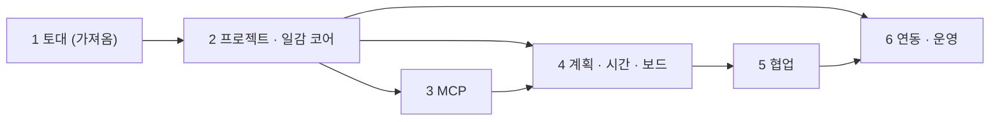

[홈](../README.md) › [계획](01-roadmap.md) › 로드맵

# 로드맵

무엇을 어떤 순서로 만드는지 단계로 나눈다. 작업 단위 · 상태는 [WBS](../wbs/00-overview.md)가 정본이다. 이 쪽은 단계마다 **왜 그 순서인지 · 무엇이 되면 끝인지**를 적는다.

**바로가기:** [원칙](#rm-principles) · [단계](#rm-stages) · [첫 출시 범위](#rm-mvp) · [미루는 것](#rm-later)

---

## 1. 원칙

- **토대는 이미 있다.** moai-wiki 에서 가져온 계정 · 워크스페이스 · 권한 · 로그인이 돈다. 남은 것은 moai-works 렐름에서 실제 흐름을 한 번 확인하는 일이다.
- **사람이 쓰는 코어 먼저, MCP 는 바로 그다음.** MCP 도구는 서비스를 부르는 얇은 층이라 코어(프로젝트 · 일감 · 워크플로 · 질의)가 있어야 의미가 있다. 대신 코어가 서면 **곧바로** MCP 를 붙인다 — 이 제품의 이유이기 때문이다([ADR-003](../design/00-key-decisions.md#adr-003)).
- 각 단계는 "데모할 수 있는 상태"로 끝난다. 단계마다 [요구사항 진행](../requirements/14-progress.md)을 고친다.
- 우선순위 M(첫 출시) → S(곧) → C(나중). 같은 단계 안에서도 M 부터.

## 2. 단계

| 단계 | 목표 | 주요 요구사항 | 끝나는 조건 | WBS |
|---|---|---|---|---|
| 1 토대 | 로그인 · 워크스페이스 · 역할 · 멤버십 · 감사 · MCP 키 | [FR-WSP](../requirements/01-workspace.md) | moai-works 렐름을 만들고, 시드 계정으로 가입 → 워크스페이스 → 초대 → 역할을 화면에서 확인 | [1단계](../wbs/02-stage-1-foundation.md) |
| 2 프로젝트 · 일감 코어 | 사람이 프로젝트를 만들고 일감을 추적한다 | [FR-PRJ](../requirements/02-project.md) · [FR-ISS](../requirements/03-issue.md) · [FR-WFL](../requirements/04-workflow.md) · [FR-QRY](../requirements/05-query.md) 의 M | 프로젝트 · 멤버 · 프로젝트 역할 · 일감 CRUD · 이력/메모 · 기본 워크플로 · 필터 목록 · 첨부가 화면과 REST 로 되고, 권한 회귀 테스트가 돈다 | [2단계](../wbs/03-stage-2-project-issue.md) |
| 3 MCP | 바깥 AI Agent 가 일감을 다룬다 | [FR-MCP](../requirements/12-mcp.md) 의 M | 워크스페이스 엔드포인트 · 키 · Agent 계정 · 핵심 도구가 되고, Claude Code 로 UC-05 · UC-06 을 시연한다. 웹과 MCP 의 동등성 테스트가 돈다 | [3단계](../wbs/04-stage-3-mcp.md) |
| 4 계획 · 시간 · 보드 | 릴리스를 계획하고 시간을 기록한다 | [FR-PLN](../requirements/06-planning.md) · [FR-TIM](../requirements/07-time.md) · FR-QRY(보드 · 저장한 질의) · FR-ISS(하위 · 관계) · FR-WFL(사용자 정의 필드 · 필드 권한) · FR-MCP(시간 · 버전 도구) | 로드맵 · 간트 · 캘린더 · 시간 기록 · 보고서 · 보드 | [4단계](../wbs/05-stage-4-planning-time.md) |
| 5 협업 | 팀이 소식을 받고 찾고 기록한다 | [FR-CNT](../requirements/08-content.md) · [FR-NTF](../requirements/09-notification.md) · [FR-ACT](../requirements/10-activity-search.md) · FR-MCP(위키 도구 · 리소스) | 위키 · 알림(화면 · 메일) · 활동 · 검색 · 내 페이지 | [5단계](../wbs/06-stage-5-collaboration.md) |
| 6 연동 · 운영 | 다른 도구와 잇고 옮겨 온다 | [FR-INT](../requirements/11-integration.md) · [NFR](../requirements/13-non-functional.md) | Git 웹훅 · 웹훅 · REST 문서 · CSV · Redmine 이관 · 운영 준비(관측 · 백업 · 규모 시험) | [6단계](../wbs/07-stage-6-integration.md) |

## 3. 첫 출시 범위 (MVP)

첫 출시는 **1 ~ 3단계 + 4단계의 M** 이다: 워크스페이스 · 프로젝트 · 일감(이력 · 메모 · 첨부) · 트래커/상태/우선순위 · 기본 워크플로 · 필터 목록 · 버전 · 시간 기록 · **MCP 로 Agent 연결**. 이것으로 "사람과 Agent 가 같은 프로젝트를 관리한다"를 보여 줄 수 있다.

## 4. 미루는 것

| 항목 | 왜 미루나 |
|---|---|
| 사용자 정의 프로젝트 역할 | 고정 4종으로 대부분 된다([ADR-005](../design/00-key-decisions.md#adr-005)) |
| MCP OAuth 2.1 · 프롬프트 | 클라이언트 지원이 넓어지면([ADR-008](../design/00-key-decisions.md#adr-008)) |
| 메일로 일감 만들기 · 저장소 브라우저 · PDF/PNG 내보내기 | 핵심 흐름 다음 |
| 개인 API 토큰 · 데이터 내보내기 | 서비스 계정 · MCP 로 대신 |

---

**관련 문서:** [WBS 한눈에](../wbs/00-overview.md) · [요구사항 진행 현황](../requirements/14-progress.md) · [테스트 전략](02-test-strategy.md) · [정해야 할 것](../wbs/08-decisions.md)

[← 이전: moai-works-web-frontend](../modules/03-web-frontend.md) | [다음: 테스트 전략 →](02-test-strategy.md)
