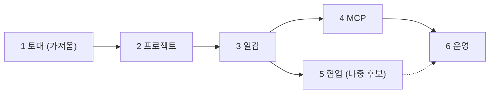

[홈](../README.md) › [계획](01-roadmap.md) › 로드맵

# 로드맵

무엇을 어떤 순서로 만드는지 단계로 나눈다. 작업 단위 · 상태는 [WBS](../wbs/00-overview.md)가 정본이다. 이 쪽은 단계마다 **왜 그 순서인지 · 무엇이 되면 끝인지**를 적는다.

**바로가기:** [원칙](#rm-principles) · [단계](#rm-stages) · [왜 이 순서인가](#rm-why) · [첫 출시 범위](#rm-mvp) · [미루는 것](#rm-later)

---

## 1. 원칙

- **moai-wiki 와 같게 만든다 (2026-11-22 사람 확인).** 모듈 구조 · 인증 · 워크스페이스 · 역할과 권한 · MCP 체계 · 흐름 · 웹 구조가 같고, 위키 대신 프로젝트, 페이지 대신 일감이다([ADR-002](../design/00-key-decisions.md#adr-002)). 그래서 각 단계는 moai-wiki 에 이미 있는 같은 기능의 코드 · 화면을 본떠 만든다 — 새로 고안하는 것은 일감 모델(유형 · 관리자와 담당자 · 다섯 날짜 · 상위 · 하위 · 연결)뿐이다([ADR-018](../design/00-key-decisions.md#adr-018)).
- **토대는 이미 있다.** moai-wiki 에서 가져온 계정 · 워크스페이스 · 권한 · 로그인이 돈다. 남은 것은 moai-works 렐름에서 나머지 화면 흐름을 확인하는 일이다.
- **사람이 쓰는 코어 먼저, MCP 는 바로 그다음.** MCP 도구는 서비스를 부르는 얇은 층이라 프로젝트 · 일감 서비스가 있어야 의미가 있다. 대신 서비스가 서면 **곧바로** MCP 를 붙인다 — 이 제품의 이유이기 때문이다([ADR-003](../design/00-key-decisions.md#adr-003)).
- 각 단계는 "데모할 수 있는 상태"로 끝난다. 단계마다 [요구사항 진행](../requirements/06-progress.md)을 고친다.
- 우선순위 M(첫 출시) → S(곧) → C(나중). 같은 단계 안에서도 M 부터. 첫 출시 범위 밖의 기능은 요구사항으로 쓰지 않고 [나중 후보](../01-overview.md#32-나중-후보)로 목록만 둔다.

## 2. 단계

| 단계 | 목표 | 주요 요구사항 | 끝나는 조건 | WBS |
|---|---|---|---|---|
| 1 토대 | 로그인 · 워크스페이스 · 역할 · 멤버십 · 감사 · MCP 키 | [FR-WSP](../requirements/01-workspace.md) | moai-works 렐름에서 시드 계정으로 가입 → 워크스페이스 → 초대 · 가입 신청 → 역할을 화면에서 확인 | [1단계](../wbs/02-stage-1-foundation.md) |
| 2 프로젝트 | 위키 자리 — 프로젝트가 권한 경계가 된다 | [FR-PRJ](../requirements/02-project.md) · FR-WSP(권한 코드 25개 · 기본 역할 넷) | 프로젝트 만들기 · 설정 · 보관 · 복원 · 삭제 · 공개 범위 · 프로젝트 역할 · 기본 프로젝트가 화면과 REST 로 되고, 경계(404) · 권한(403) · 상승 방지 테스트가 돈다 | [2단계](../wbs/03-stage-2-project.md) |
| 3 일감 | 페이지 자리 — 사람이 일감을 추적한다 | [FR-ISS](../requirements/03-issue.md) | 일감 유형 · 상태 · 관리자 · 담당자 · 날짜 · 상위 · 하위 · 연결 · 이력 · 댓글 · 목록이 화면과 REST 로 되고, 동시 수정(409) · 이력 테스트가 돈다 | [3단계](../wbs/04-stage-3-issue.md) |
| 4 MCP | 바깥 AI Agent 가 같은 판정으로 일감을 다룬다 | [FR-MCP](../requirements/04-mcp.md) | MCP 키가 워크스페이스에 묶이고, 워크스페이스 엔드포인트 · 읽기 · 쓰기 도구가 되고, Claude Code 로 UC-05 · UC-06 을 시연한다. 동등성 · 범위 · 재판정 테스트가 돈다 | [4단계](../wbs/05-stage-4-mcp.md) |
| 5 협업 | 나중 후보에서 고른 것 | 고른 뒤에 쓴다 | 고른 후보(제안: 첨부 · 알림 · 활동 · 검색)가 같은 판정으로 돈다 | [5단계](../wbs/06-stage-5-collaboration.md) |
| 6 운영 | 규모를 재고 운영하고 옮겨 온다 | [NFR](../requirements/05-non-functional.md) · FR-WSP(운영 보안) | 규모 시험 보고서 · 운영 배치 · 관측 · 운영 보안 · Redmine 이관 | [6단계](../wbs/07-stage-6-operations.md) |

## 3. 왜 이 순서인가

- **프로젝트가 먼저다.** 프로젝트는 moai-wiki 의 위키처럼 권한 경계다. 독자 판정(`ProjectAccessService`) · 프로젝트 역할 · `@ProjectApi` 가 서야 일감 API 도, MCP 도구의 범위도 그 위에 얹힌다. moai-wiki 가 위키를 먼저 만들고 페이지를 얹은 순서와 같다.
- **권한 코드 · 큐레이터가 프로젝트보다 먼저다.** 프로젝트 · 일감 코드 9개와 기본 역할 넷이 카탈로그 · Keycloak 에 있어야 `@ProjectApi(권한)` 을 붙일 수 있다(2단계 첫 작업).
- **일감은 프로젝트 다음이다.** 일감 번호는 프로젝트 안 순번이고([ADR-019](../design/00-key-decisions.md#adr-019)), 관리자 · 담당자는 그 프로젝트의 독자여야 하며, 상위 · 연결은 같은 프로젝트 안이다 — 모두 프로젝트를 전제한다.
- **MCP 는 일감 바로 다음이다.** 도구는 일감 서비스를 부르는 얇은 층이라 서비스가 있어야 하고, 서비스가 서면 곧바로 붙여 웹과 같은 결과인지(동등성) 확인한다. 다만 MCP 키를 워크스페이스에 묶는 일([4.1](../wbs/05-stage-4-mcp.md#w-4-1))은 프로젝트를 기다리지 않아 앞당겨도 된다.
- **협업은 고른 뒤에 한다.** 첨부 · 알림 · 검색 등은 첫 출시 범위 밖의 나중 후보라, 무엇을 먼저 할지([D-05](../wbs/08-decisions.md#d-05)) 정하고 요구사항을 쓴 뒤 시작한다.
- **운영은 끝에, 일부는 사이사이에.** 규모 시험은 목록 질의 · MCP 읽기 도구가 있어야 잴 수 있다. 운영 보안 · 배포 준비는 단계 사이에 끼워 넣어도 된다.

## 4. 첫 출시 범위 (MVP)

첫 출시는 **1 ~ 4단계**다: 워크스페이스(moai-wiki 와 같은 토대) · 프로젝트(공개 범위 · 프로젝트 역할 · 보관 · 삭제 · 기본 프로젝트) · 일감(유형 · 상태 · 관리자 · 담당자 · 다섯 날짜 · 상위 · 하위 · 연결 · 이력 · 댓글 · 목록 · 필터 · 정렬) · **MCP 로 바깥 AI Agent 연결**(개인 · 서비스 키, 워크스페이스 엔드포인트, 읽기 · 쓰기 도구). 이것으로 "사람과 AI Agent 가 같은 권한 규칙으로 같은 프로젝트의 일감을 관리한다"를 보여 줄 수 있다.

## 5. 미루는 것

[나중 후보](../01-overview.md#32-나중-후보) 전부가 첫 출시 밖이다. 그 가운데 판단이 필요한 것만 이유를 적는다.

| 항목 | 왜 미루나 |
|---|---|
| 사용자 정의 워크플로 · 상태 · 필드, 프로젝트별 일감 유형 | 고정 상태 넷 · 공통 유형 넷으로 시작한다. 날짜 자동 채움이 고정 상태에 묶여 있다([ADR-020](../design/00-key-decisions.md#adr-020) · [D-03](../wbs/08-decisions.md#d-03)) |
| 사용자 정의 프로젝트 역할 | moai-wiki 의 위키 역할처럼 고정 넷으로 대부분 된다([ADR-005](../design/00-key-decisions.md#adr-005)) |
| 다른 프로젝트와의 연결 일감 | 두 프로젝트의 권한이 다를 때의 표시 · MCP 범위를 정해야 한다([D-02](../wbs/08-decisions.md#d-02)) |
| 버전 · 로드맵 · 간트 · 캘린더 · 시간 기록 | Redmine 의 계획 기능. 일감의 다섯 날짜로 먼저 쓰고, 필요하면 5단계에서 고른다 |
| 첨부 · 관찰자 · 알림과 메일 · 활동 · 전문 검색 | 5단계의 제안 후보([D-05](../wbs/08-decisions.md#d-05)) |
| 프로젝트 위키 · 뉴스 · 포럼 · 하위 프로젝트 · 모듈 켜고 끄기 · 저장한 질의 · 칸반 보드 · 내보내기 | moai-wiki 에 없는 Redmine 기능 |
| Git 연동 · 웹훅 · REST API 키 | 바깥 자동화는 먼저 MCP 로 한다 |
| Redmine 이관 | 일감 모델이 굳은 뒤 6단계에서([6.4](../wbs/07-stage-6-operations.md#w-6-4)) |
| MCP OAuth 2.1 · 리소스 · 프롬프트 | 클라이언트 지원이 넓어지면([ADR-008](../design/00-key-decisions.md#adr-008)) |

---

**관련 문서:** [WBS 한눈에](../wbs/00-overview.md) · [요구사항 진행 현황](../requirements/06-progress.md) · [테스트 전략](02-test-strategy.md) · [정해야 할 것](../wbs/08-decisions.md)

[← 이전: moai-works-web-frontend](../modules/03-web-frontend.md) | [다음: 테스트 전략 →](02-test-strategy.md)
