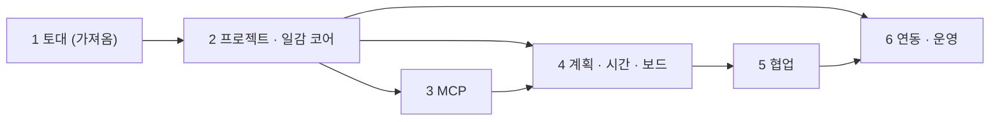

[홈](../README.md) › WBS › WBS 한눈에

# WBS 한눈에

지금까지 만든 기능과 앞으로 할 일을 작업 단위로 나눈 영역이다. [로드맵](../plan/01-roadmap.md)은 단계마다 왜 그 순서인지를 다루고, 이 영역은 **지금 코드에서 실제로 만들어 갈 순서와 상태**를 다룬다.

**바로가기:** [지금 위치](#1-지금-위치) · [단계](#2-단계) · [작업 하나의 순서](#3-작업-하나의-순서) · [표기](#4-표기) · [고칠 때](#5-고칠-때)

---

## 1. 지금 위치

2026-11-21 기준이다.

- **피봇했다.** 그룹웨어 명세를 지우고 Redmine 같은 프로젝트 관리 시스템으로 다시 정리했다. AI Agent 는 내장하지 않고 MCP 로 연다([ADR-001](../design/00-key-decisions.md#adr-001) · [ADR-003](../design/00-key-decisions.md#adr-003)).
- **토대는 돈다.** moai-wiki 에서 계정 · 가입 · 워크스페이스 · 역할 · 멤버십 · 초대 · 감사 · MCP 키 · BFF 로그인 · 화면 뼈대를 가져와 이름을 바꾸고 위키 부분을 걷어 냈다. api 자동 테스트 66건 · 화면 60건이 통과한다. 모듈별 목록은 [구현한 기능](01-implemented.md).
- **남은 1단계 일:** 같이 쓰는 Keycloak 에 렐름 `moai-works` 를 만들고, 시드를 돌리고, 서비스를 띄워 로그인 → 워크스페이스 → 초대 → 역할을 화면에서 확인한다([1.3](02-stage-1-foundation.md#w-1-3)).
- **다음은 2단계** — 프로젝트 · 일감 코어([2단계](03-stage-2-project-issue.md)). 시작 전에 정할 것이 [정해야 할 것](08-decisions.md)에 있다.

## 2. 단계

| 단계 | 목표 | 상태 | 문서 |
|---|---|---|---|
| 1 | 토대 — 계정 · 워크스페이스 · 권한 · 로그인 (moai-wiki 에서 가져옴) | **진행** (코드 · 자동 테스트 끝, 실제 흐름 확인 남음) | [1단계](02-stage-1-foundation.md) |
| 2 | 프로젝트 · 일감 코어 — 사람이 프로젝트를 만들고 일감을 추적한다 | 할 일 (**다음**) | [2단계](03-stage-2-project-issue.md) |
| 3 | MCP — 바깥 AI Agent 가 일감을 다룬다 | 할 일 | [3단계](04-stage-3-mcp.md) |
| 4 | 계획 · 시간 · 보드 | 할 일 | [4단계](05-stage-4-planning-time.md) |
| 5 | 협업 — 위키 · 알림 · 활동 · 검색 | 할 일 | [5단계](06-stage-5-collaboration.md) |
| 6 | 연동 · 운영 — Git · 웹훅 · Redmine 이관 · 규모 시험 | 할 일 | [6단계](07-stage-6-integration.md) |

3단계(MCP)는 2단계의 서비스가 서자마자 시작한다. 4단계의 MCP 도구(시간 · 버전)는 그 기능과 같은 작업에서 더한다.

## 3. 작업 하나의 순서

1. [요구사항 진행 현황](../requirements/14-progress.md)에서 그 작업의 요구사항을 확인한다.
2. 설계 쪽(DDL · 판정 · API)을 읽고, 달라질 곳이 있으면 설계부터 고친다.
3. api: Flyway 새 파일 → 엔티티 · 서비스 · 컨트롤러(접근 어노테이션) → **같은 작업에서 테스트**(경계 · 권한 · 이력 · 감사).
4. MCP 로도 여는 기능이면 도구를 같은 서비스 위에 얹고 동등성 테스트를 더한다.
5. 화면: 경로 표(`routes.tsx`) · 리소스(ko · en) · 화면 → ego-browser 로 데스크톱 · 390px · 다크 · 영어.
6. 검사 → 문서(요구사항 진행 줄 · 수용 기준 체크 · 이 영역의 상태 · [구현한 기능](01-implemented.md) · HANDOFF 작업 기록) → 커밋 → 사람에게 처리 결과와 남은 요구사항을 알린다.

## 4. 표기

| 칸 | 뜻 |
|---|---|
| ID | `단계.묶음[.작업]`. 앵커 `w-2-1` 처럼 |
| 모듈 | api · web-backend · web-frontend · infra · docs |
| 규모 | S(반나절 ~ 하루) · M(2 ~ 4일) · L(1주 이상) |
| 상태 | 할 일 · 진행 · 완료 · 보류 |
| 요구사항 | 그 작업이 다루는 요구사항 ID. [진행 현황](../requirements/14-progress.md)의 "작업" 칸이 이것을 모은다 |

## 5. 고칠 때

- 작업을 끝내면 그 단계 문서의 `상태` 칸과 "내용 · 완료 기준"에 날짜와 한 일을 적는다.
- 새 작업이 생기면 같은 단계 표에 줄을 더한다(번호는 다시 쓰지 않는다).
- 결정이 필요하면 [정해야 할 것](08-decisions.md)에 더하고, 막는 작업을 적는다.

---

**관련 문서:** [로드맵](../plan/01-roadmap.md) · [구현한 기능](01-implemented.md) · [정해야 할 것](08-decisions.md) · [요구사항 진행 현황](../requirements/14-progress.md) · [HANDOFF.md](../../HANDOFF.md)

[← 이전: 테스트 전략](../plan/02-test-strategy.md) | [다음: 구현한 기능 →](01-implemented.md)
