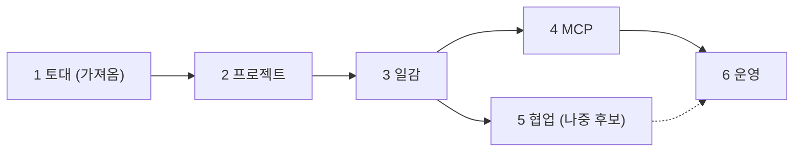

[홈](../README.md) › WBS › WBS 한눈에

# WBS 한눈에

지금까지 만든 기능과 앞으로 할 일을 작업 단위로 나눈 영역이다. [로드맵](../plan/01-roadmap.md)은 단계마다 왜 그 순서인지를 다루고, 이 영역은 **지금 코드에서 실제로 만들어 갈 순서와 상태**를 다룬다.

> **이 프로젝트의 범위 (2026-11-22 사람 확인):** moai-works 는 형제 저장소 moai-wiki 와 같다 — 모듈 구조 · 인증 · 워크스페이스 · 역할과 권한 · MCP 체계 · 흐름 · 웹 구조가 같고, **위키 대신 프로젝트, 페이지 대신 일감**이다. 다른 것은 일감 모델(유형 · 관리자와 담당자 · 다섯 날짜 · 상위 · 하위 일감 · 연결 일감)뿐이다([ADR-002](../design/00-key-decisions.md#adr-002) · [ADR-018](../design/00-key-decisions.md#adr-018)). Redmine 의 나머지 기능은 [나중 후보](../01-overview.md#32-나중-후보)로 목록만 둔다.

**바로가기:** [지금 위치](#1-지금-위치) · [단계](#2-단계) · [작업 하나의 순서](#3-작업-하나의-순서) · [표기](#4-표기) · [고칠 때](#5-고칠-때)

---

## 1. 지금 위치

2026-11-22 기준이다.

- **토대는 돈다.** moai-wiki 에서 계정 · 가입 · 워크스페이스 · 역할 · 멤버십 · 초대 · 감사 · MCP 키 · BFF 로그인 · 화면 뼈대를 가져와 이름을 바꾸고 위키 부분을 걷어 냈다.  모듈별 목록은 [구현한 기능](01-implemented.md).
- **1단계 실제 흐름:** 2026-11-22 같이 쓰는 Keycloak 에 렐름 `moai-works` 를 만들고 시드를 돌려 서비스를 띄웠다. 로그인 흐름은 확인했다. 남은 것은 가입 · 초대 · 가입 신청 · 역할 · 시스템 관리 화면 확인이다([1.3](02-stage-1-foundation.md#w-1-3)).
- **다시 정리했다 (2026-11-22).** 전날 쓴 명세는 Redmine 을 그대로 옮긴 큰 범위(트래커 · 워크플로 · 버전 · 시간 기록 · 위키 · 알림 · "Agent 계정" 등 여섯 단계)였다. 사람이 "moai-wiki 와 다를 게 없다 — 위키냐 프로젝트냐 차이만 있다"고 정해, moai-wiki 의 위키 → 프로젝트, 페이지 → 일감으로 옮기고 일감 모델만 더하는 범위로 요구사항 · 설계 · WBS 를 다시 썼다. 기본 역할은 moai-wiki 와 같은 넷(큐레이터를 되살림, [ADR-017](../design/00-key-decisions.md#adr-017)), 권한 코드는 25개, "Agent 계정"은 없앴다(서비스 키는 워크스페이스 이름으로 일한다).
- **2 · 3단계 (2026-11-22):** api 의 프로젝트 · 프로젝트 역할 · 일감을 만들었다(자동 테스트 99건). 화면도 만들어 ego-browser 로 확인했다(화면 자동 테스트 98건). 남은 것은 몇 가지 브라우저 흐름(프로젝트 만들기 · 보관 · 지우기, 두 창 충돌)과 요구사항 진행 줄의 남은 시험이다([2단계](03-stage-2-project.md) · [3단계](04-stage-3-issue.md)).
- **다음은 4단계** — MCP([4단계](05-stage-4-mcp.md)): 키를 워크스페이스에 묶고, 워크스페이스 엔드포인트와 읽기 · 쓰기 도구를 만들어 Claude Code 로 시연한다.

## 2. 단계

| 단계 | 목표 | 작업 수 | 상태 | 문서 |
|---|---|---|---|---|
| 1 | 토대 — 계정 · 워크스페이스 · 권한 · 로그인 (moai-wiki 에서 가져옴) | 8 | **진행** (코드 · 자동 테스트 · 로그인 흐름 확인 · 시스템 관리자 분리 끝, 워크스페이스 사용 중지 · 나머지 화면 확인 남음) | [1단계](02-stage-1-foundation.md) |
| 2 | 프로젝트 — 위키 자리. 만들기 · 설정 · 보관 · 삭제 · 공개 범위 · 프로젝트 역할 | 4 | **진행** (2.1 · 2.2 완료, 2.3 · 2.4 남은 확인) | [2단계](03-stage-2-project.md) |
| 3 | 일감 — 페이지 자리. 유형 · 상태 · 관리자 · 담당자 · 날짜 · 상위 · 하위 · 연결 · 이력 · 댓글 · 목록 | 5 | **진행** (3.1 ~ 3.4 완료, 3.5 남은 확인) | [3단계](04-stage-3-issue.md) |
| 4 | MCP — 바깥 AI Agent 가 같은 판정으로 일감을 다룬다 (moai-wiki MCP 체계, web-backend 가 중계, 읽기까지 모든 접근 기록) | 8 | 할 일 (**다음**) | [4단계](05-stage-4-mcp.md) |
| 5 | 협업 — 나중 후보에서 고른 것(첨부 · 알림 · 활동 · 검색) | 4 | 할 일 (고르기 전) | [5단계](06-stage-5-collaboration.md) |
| 6 | 운영 — 규모 시험 · 운영 준비 · 운영 보안 · Redmine 이관 | 4 | 할 일 | [6단계](07-stage-6-operations.md) |

- 2 → 3 → 4 는 moai-wiki 가 위키 → 페이지 → MCP 로 간 순서와 같다. 프로젝트가 권한 경계라 일감 · MCP 판정이 모두 그 위에 선다.
- 4단계의 [4.1](05-stage-4-mcp.md#w-4-1)(MCP 키를 워크스페이스에 묶기)은 프로젝트 · 일감을 기다리지 않으므로 2 · 3단계와 함께 해도 된다.
- 5단계는 나중 후보 가운데 무엇을 먼저 할지([D-05](08-decisions.md#d-05)) 정한 뒤 요구사항을 쓰고 시작한다. 6단계의 운영 보안 · 운영 준비는 단계 사이사이에 끼워 넣어도 된다.

## 3. 작업 하나의 순서

1. [요구사항 진행 현황](../requirements/06-progress.md)에서 그 작업의 요구사항을 확인한다.
2. 설계 쪽(DDL · 판정 · API)을 읽고, **같은 기능의 moai-wiki 코드를 먼저 본다**(위키 → 프로젝트, 페이지 → 일감 — 패키지 · 클래스 · 화면 이름까지 맞춘다). 달라질 곳이 있으면 설계부터 고친다.
3. api: Flyway 새 파일 → 엔티티 · 서비스 · 컨트롤러(접근 어노테이션) → **같은 작업에서 테스트**(경계 404 · 권한 403 · 허용 200 · 이력 · 감사).
4. MCP 로도 여는 기능이면 도구를 같은 서비스 위에 얹고 동등성 테스트를 더한다.
5. 화면: 경로 표(`routes.tsx`) · 리소스(ko · en) · 화면 → ego-browser 로 데스크톱 · 390px · 다크 · 영어.
6. 검사 → 문서(요구사항 진행 줄 · 수용 기준 체크 · 이 영역의 상태 · [구현한 기능](01-implemented.md) · HANDOFF 작업 기록) → 커밋 → 사람에게 처리 결과와 남은 요구사항을 알린다.

크기가 L 인 작업은 한 번에 끝내지 않는다. 동작하는 조각 단위로 나눠 위 순서를 여러 번 돈다.

## 4. 표기

| 칸 | 뜻 |
|---|---|
| ID | `단계.작업`. 앵커 `w-2-1` 처럼. 한 번 붙인 ID 는 바꾸지 않는다 |
| 모듈 | api · web-backend · web-frontend · infra · docs |
| 선행 | 먼저 끝나야 하는 작업 ID 나 결정(`D-xx`) |
| 규모 | S(반나절 ~ 하루) · M(2 ~ 4일) · L(1주 이상, 여러 번에 나눔) |
| 상태 | 할 일 · 진행 · 완료 · 보류 · 취소 |
| 요구사항 | 그 작업이 다루는 요구사항 ID. [진행 현황](../requirements/06-progress.md)의 "작업" 칸이 이것을 모은다. 나중 후보 작업은 요구사항이 아직 없어 비워 둔다 |

## 5. 고칠 때

- 작업을 끝내면 그 단계 문서의 `상태` 칸과 "내용 · 완료 기준"에 날짜와 한 일을 적는다. 같은 작업에서 [구현한 기능](01-implemented.md)과 그 작업이 다룬 요구사항의 진행도 고친다.
- 새 작업이 생기면 같은 단계 표에 줄을 더하고 이 쪽 §2 의 작업 수를 고친다(번호는 다시 쓰지 않고, 빼는 작업은 지우지 않고 `취소`로 둔다).
- 결정이 필요하면 [정해야 할 것](08-decisions.md)에 더하고, 막는 작업을 적는다.

---

**관련 문서:** [로드맵](../plan/01-roadmap.md) · [구현한 기능](01-implemented.md) · [정해야 할 것](08-decisions.md) · [요구사항 진행 현황](../requirements/06-progress.md) · [모듈 한눈에](../modules/00-overview.md) · [HANDOFF.md](../../HANDOFF.md)

[← 이전: 테스트 전략](../plan/02-test-strategy.md) | [다음: 구현한 기능 →](01-implemented.md)
